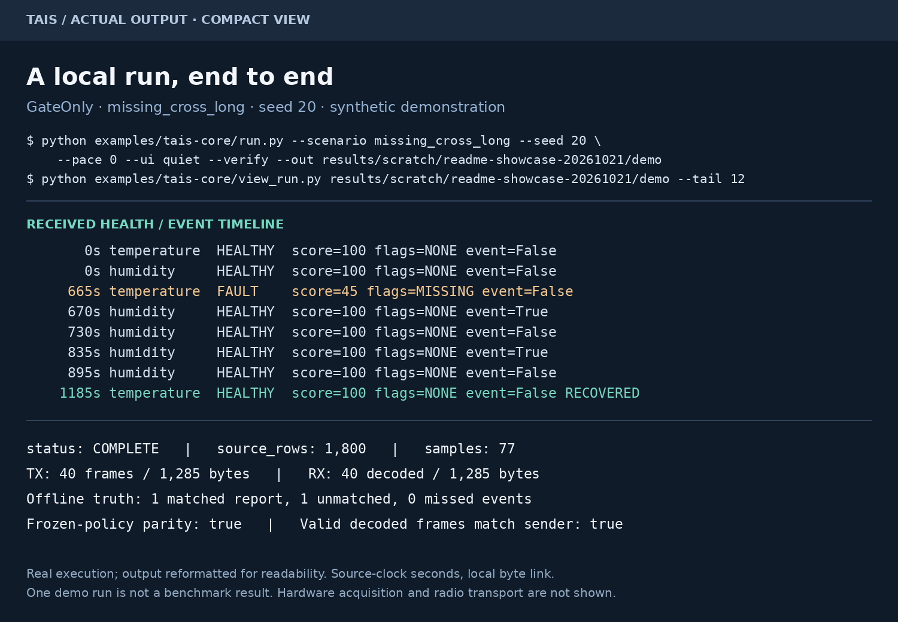
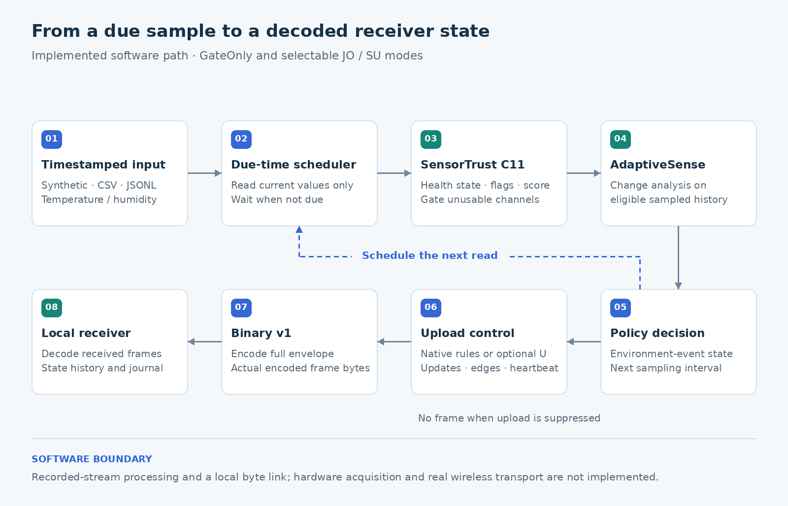
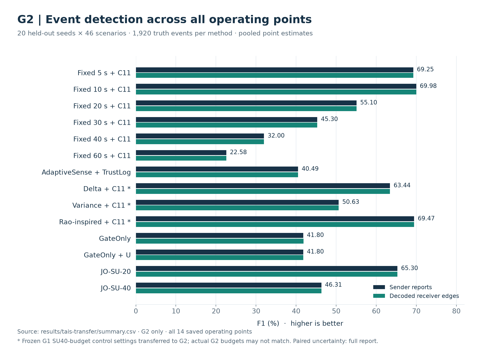
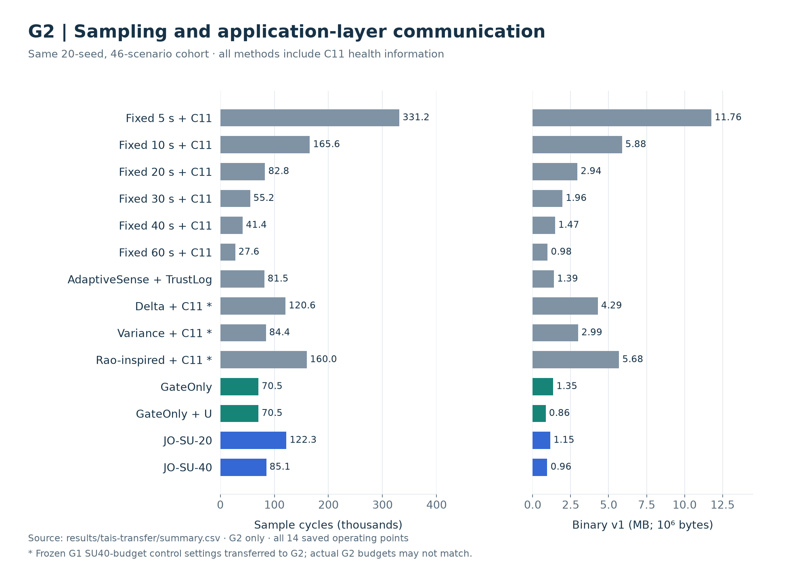
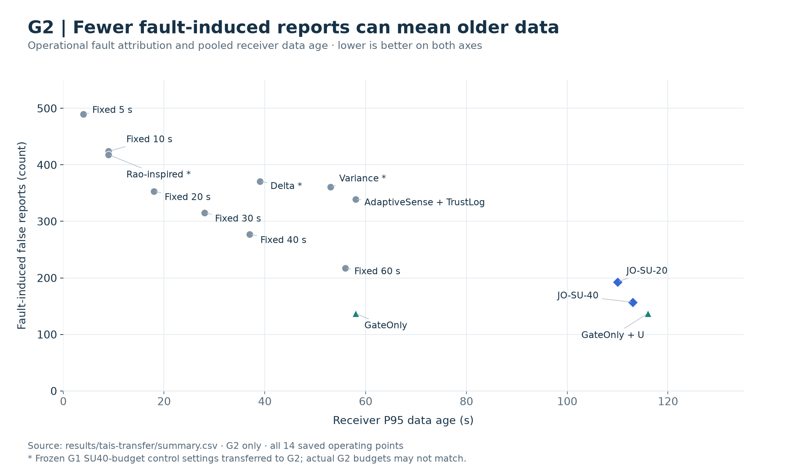

# TAIS — Trust-Aware Importance Scheduler

TAIS is an open research prototype for monitoring changing environments with unreliable sensors. It combines health checks, event detection, adaptive sampling and selective transmission to study detection quality, sampling effort and communication cost together.

**The question:** when a reading changes, should the system report an environmental event, investigate a possible sensor fault, or wait for the next sample?

Causal stream processing · Sensor health and event state · Independent byte receiver · Reproducible experiments

[Quick start](#quick-start) · [Architecture](#system-architecture) · [Results](#experimental-results) · [Paper](papers/tais/README.md) · [Documentation](docs/README.md)

## See it run



**Real output, reformatted for readability.** GateOnly runs the synthetic `missing_cross_long` scenario, seed 20: temperature data go missing while humidity changes. It finishes with 77 samples, 40 transmitted/decoded frames and 1,285 application bytes. Offline scoring finds one matched and one unmatched report. This is a demonstration, not a benchmark average; [run it below](#quick-start).

## System architecture



Only due samples enter analysis. **SensorTrust C11** supplies health states and flags; **AdaptiveSense** analyzes eligible sampled history. Policy decisions set event state and the next sample time; upload control selects envelopes for Binary v1 encoding. The independent receiver reconstructs state from decoded frames.

The implemented transport is a local byte link. Hardware acquisition and real wireless transport are outside this prototype. [Core interface](examples/tais-core/README.md) · [Architecture and source map](docs/REPOSITORY_GUIDE.md#source-map).

## Core capabilities

- **Sensor health:** actual C11 diagnosis through a Python bridge, with states, flags and heuristic scores.
- **Environmental events:** per-channel change analysis with separate fault and environmental-event state.
- **Sampling and uploads:** GateOnly or JO/SU policies; optional U suppresses ordinary updates while retaining sampled event/health edges and heartbeats.
- **Bytes and receiver state:** Stateless Binary v1, independent decoding, timestamped journals and controlled local link failures.
- **Metrics:** samples, uploads, bytes, sender reports, receiver events, fault-induced reports, detection delay and data age.

## Experimental results

All three figures use **G2 only: 20 held-out seeds × 46 synthetic scenarios**, including all 14 saved operating points with health information. No campaign was rerun. Controls marked `*` transfer frozen G1 development settings without retuning; G2 sampling budgets may differ. Rao-inspired is an engineering adaptation, not a full literature reproduction.

### Event detection



Fixed-20+C11 achieves **55.10% sender F1**, compared with **46.31% for JO-SU-40**. JO-SU-20 reaches 65.30% with more sampling. Labels are sender point estimates; green bars independently evaluate receiver edges. [Full results and seed-paired uncertainty](docs/TAIS_CROSS_GENERATOR_REPORT.md).

### Sampling and communication



At nearby totals of **85,055 versus 82,800 samples**, JO-SU-40 sends **959,129 bytes**, compared with **2,940,838 for Fixed-20+C11**. Upload rules, including shareable U, explain part of the benefit; it is not all due to sampling. [Plot data](results/tais-transfer/summary.csv) · [Evidence](docs/TAIS_PAPER_EVIDENCE.md).

### Fault-induced reports and data freshness



JO-SU-40 produces **157 operational fault-induced false reports versus 353 for Fixed-20+C11**, but receiver P95 data age increases from **18 s to 113 s**. GateOnly+U illustrates the upload tradeoff directly: unchanged sampling and sender detection, fewer bytes, older ordinary data.

JO-SU-40's near-budget F1 difference interval against Variance includes zero in G2. G1/G2 also differ in event-truth definitions: totals cannot be pooled or differences attributed solely to distribution shift. [Paper](papers/tais/README.md) · [中文概要](docs/TAIS_PAPER_SUMMARY_ZH.md).

## Quick start

Use **Python 3.14** and a C11 compiler (`cc`, Clang or GCC). The bridge compiles on first use. Run from the checkout root; no hardware or external dataset is required.

**1. Install and check the Core components**

```sh
git clone --recurse-submodules https://github.com/Sver0411/TAIS.git
cd TAIS
python3.14 -m venv .venv
source .venv/bin/activate
python -m pip install -r requirements-lock.txt
python -m pip install -e . --no-build-isolation
python -m pytest tests/test_core_stream.py tests/test_wire_codec.py -q
```

**2. Run the demonstration and inspect its received history**

```sh
python examples/tais-core/run.py --scenario missing_cross_long --seed 20 \
  --pace 0 --ui quiet --verify --out results/scratch/quickstart-01
python examples/tais-core/view_run.py results/scratch/quickstart-01 --tail 12
```

Choose a **new output directory** for each run. Expect `status: COMPLETE`, frozen-policy parity and TX/RX counters. The directory contains `manifest.json` for provenance, `summary.json` for results and `journal.jsonl` for the actual sampled and received history. For a live terminal display, replace `--pace 0 --ui quiet` with `--pace .01 --ui live`.

[Installation details, CSV/JSONL input and troubleshooting](docs/QUICKSTART.md) · [Standalone receiver and link examples](examples/tais-core/README.md).

## Running modes

GateOnly remains the default. SU numbers are **idle interval caps**, not fixed sampling periods.

| Mode | Main tradeoff | Select with |
| --- | --- | --- |
| GateOnly | Health-gated baseline; short or fault-masked events can be missed | `--policy gateonly` |
| GateOnly + U | Same sampling and sender detection, fewer uploads, older ordinary receiver data | `--policy gateonly-u` |
| JO-SU-20 | Higher detection in the reported tests, with more samples and potentially more fault-induced reports | `--policy tais-su --su-mode high` |
| JO-SU-30 | Lower sampling than SU20, but lost detections and failed the balanced-replacement gate | `--policy tais-su --su-mode balanced` |
| JO-SU-40 | Lower-sampling operating point; no general near-budget quality advantage | [Python API / frozen benchmark](docs/QUICKSTART.md#mode-selection) |

`balanced` names the historical SU30 candidate, not a passed qualification. Fixed-period, Delta, Variance and Rao-inspired schedules are research benchmark controls, not Core CLI modes. [Mode details](docs/QUICKSTART.md#mode-selection) · [SU-1 results](docs/TAIS_SU_RESULTS.md).

## Research limitations

- The main evaluations use synthetic data. The separate offline study with real greenhouse background and controlled interventions **failed its predefined held-out coverage gate**.
- Natural-fault diagnosis accuracy, agricultural field-event performance, real wireless delivery and measured energy consumption remain unvalidated.
- Trust scores are heuristic. Events entirely between samples, or erased by a same-channel fault, may be unrecoverable.
- Fewer application bytes do not imply an equal percentage reduction in radio energy or longer measured battery life.

[Failure boundaries, negative results and research history](docs/README.md#history-and-negative-results).

## Documentation

- **Use the system:** [Quick start](docs/QUICKSTART.md) · [Core input and receiver contract](examples/tais-core/README.md).
- **Understand the implementation:** [Repository and source map](docs/REPOSITORY_GUIDE.md) · [Core architecture](docs/TAIS_CORE_PROTOTYPE.md).
- **Inspect or reproduce evidence:** [Research document index](docs/README.md) · [Results](results/README.md) · [Experiment and verification commands](scripts/README.md).
- **Read the paper:** [PDF, LaTeX and build guide](papers/tais/README.md) · [中文概要](docs/TAIS_PAPER_SUMMARY_ZH.md) · [Submission checklist](docs/TAIS_SUBMISSION_CHECKLIST.md).
- **Contribute and reuse:** [Contributing](CONTRIBUTING.md) · [MIT license](LICENSE) · [Third-party notices](THIRD_PARTY_NOTICES.md).

AdaptiveSense and SensorTrust remain pinned upstream dependencies in [vendor/](vendor). Adaptive sampling, health heuristics, deadbands and binary encoding are established techniques; TAIS contributes a reproducible integration and evaluation of their system-level tradeoffs.
