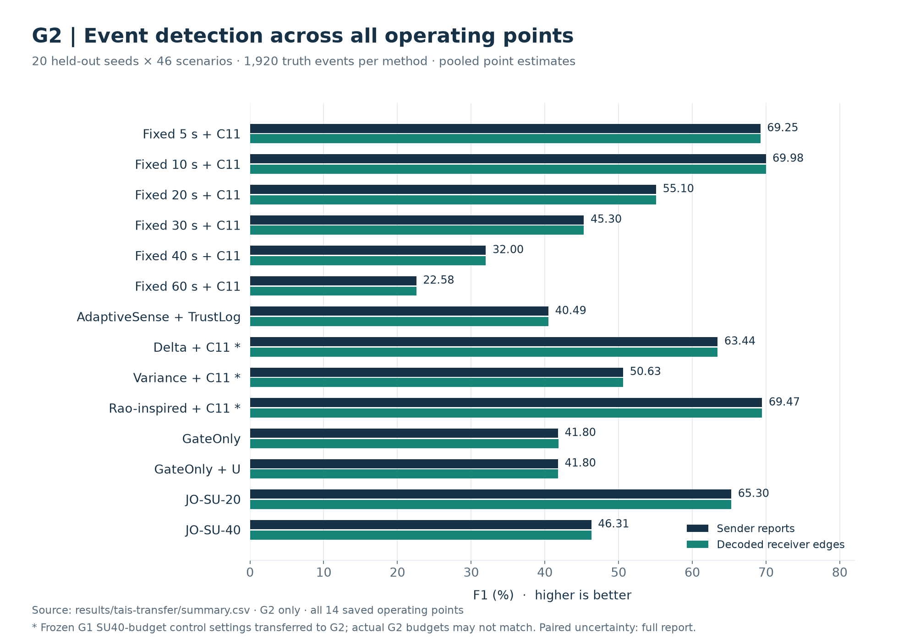
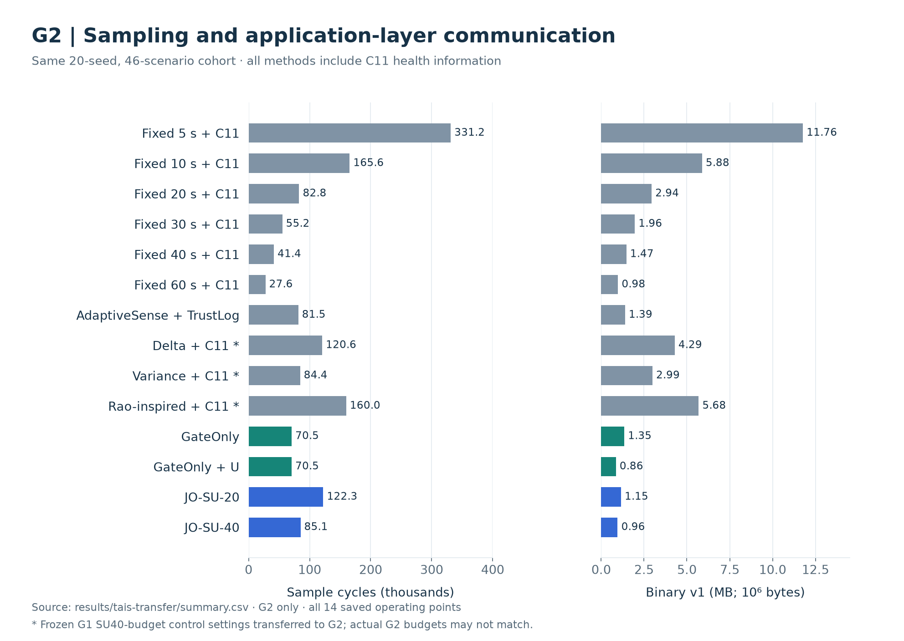
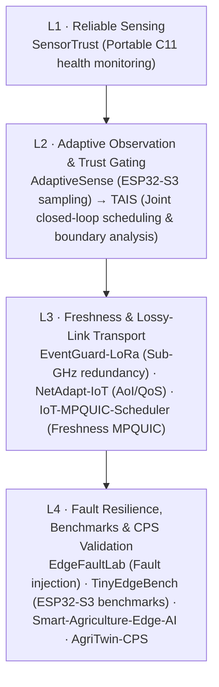

# TAIS — Trust-Aware Importance Scheduler

TAIS is an open research prototype for monitoring changing environments with unreliable sensors. It combines health checks, event detection, adaptive sampling and selective transmission to study detection quality, sampling effort and communication cost together.

**The question:** when a reading changes, should the system report an environmental event, investigate a possible sensor fault, or wait for the next sample?

Causal stream processing · Sensor health and event state · Independent byte receiver · Reproducible experiments

[Quick start](#quick-start) · [中文简介](README.zh-CN.md) · [Architecture](#system-architecture) · [Results](#experimental-results) · [Paper](papers/tais/README.md) · [Documentation](docs/README.md)

## See it run


**Real output, reformatted for readability.** GateOnly runs the synthetic `missing_cross_long` scenario, seed 20: temperature data go missing while humidity changes. It finishes with 77 samples, 40 transmitted/decoded frames and 1,285 application bytes. Offline scoring finds one matched and one unmatched report. This is a demonstration, not a benchmark average; [run it below](#quick-start).

## System architecture


Only due samples enter analysis. **SensorTrust C11** supplies health states and flags; **AdaptiveSense** analyzes eligible sampled history. Policy decisions set event state and the next sample time; upload control selects envelopes for Binary v1 encoding. The independent receiver reconstructs state from decoded frames.

The implemented transport is a local byte link. Hardware acquisition and real wireless transport are outside this prototype. [Core interface](examples/tais-core/README.md) · [Architecture and source map](docs/REPOSITORY_GUIDE.md#source-map).

## Core capabilities

- **Sensor health:** actual C11 diagnosis through a Python bridge, with states, flags and heuristic scores.
- **Environmental events:** per-channel change analysis with separate fault and environmental-event state.
- **Sampling and uploads:** GateOnly or JO/SU policies; optional U suppresses ordinary updates while retaining sampled event/health edges and heartbeats.
- **Bytes and receiver state:** Stateless Binary v1, independent decoding, timestamped journals and controlled local link failures.
- **Metrics:** samples, uploads, bytes, sender reports, receiver events, fault-induced reports, detection delay and data age.

## Experimental results

All four figures use **G2 only: 20 held-out seeds × 46 synthetic scenarios**, including all 14 saved operating points with health information. No campaign was rerun. Controls marked `*` transfer frozen G1 development settings without retuning; G2 sampling budgets may differ. Rao-inspired is an engineering adaptation, not a full literature reproduction.

### Event detection



Fixed-20+C11 achieves **55.10% sender F1**, compared with **46.31% for JO-SU-40**. JO-SU-20 reaches 65.30% with more sampling. Labels are sender point estimates; green bars independently evaluate receiver edges. [Full results and seed-paired uncertainty](docs/TAIS_CROSS_GENERATOR_REPORT.md).

### Sampling and communication



At nearby totals of **85,055 versus 82,800 samples**, JO-SU-40 sends **959,129 bytes**, compared with **2,940,838 for Fixed-20+C11**. Upload rules, including shareable U, explain part of the benefit; it is not all due to sampling. [Plot data](results/tais-transfer/summary.csv) · [Evidence](docs/TAIS_PAPER_EVIDENCE.md).

### Detection vs. Communication Trade-off


**Upper left means higher detection F1 and lower communication cost.** GateOnly+U retains GateOnly's sender F1 with fewer bytes; JO-SU-20 gains detection at additional cost, while some independent controls achieve higher F1 with more communication. These are pooled sender-report point estimates, not a claim of overall superiority. Communication is application-layer Binary v1 volume (1 MB = 10⁶ bytes), not actual energy consumption. Starred controls retain their frozen G1 budget settings; actual G2 sampling budgets may not match.

### Fault-induced reports and data freshness


JO-SU-40 produces **157 operational fault-induced false reports versus 353 for Fixed-20+C11**, but receiver P95 data age increases from **18 s to 113 s**. GateOnly+U illustrates the upload tradeoff directly: unchanged sampling and sender detection, fewer bytes, older ordinary data.

JO-SU-40's near-budget F1 difference interval against Variance includes zero in G2. G1/G2 also differ in event-truth definitions: totals cannot be pooled or differences attributed solely to distribution shift. [Paper](papers/tais/README.md) · [中文概要](docs/TAIS_PAPER_SUMMARY_ZH.md).

## Module ablation and unified evaluation (MA-1)

The next-stage study adds the complete SensorTrust × AdaptiveSense sampling ×
selective-transmission factorial, alongside eight frozen controls. It reuses
the actual C11 engine, original policy/scorer, G2 generator and Binary v1
receiver. A7 is GateOnly+U; JO-SU-20/40 remain separately named controls.
Historical G1/G2 results above retain their original scoring definitions.

[Frozen protocol](docs/MODULE_ABLATION_PROTOCOL.md) ·
[Results and reproduction](results/module-ablation/README.md) ·
[Chinese analysis](docs/MODULE_ABLATION_RESULTS_ZH.md).

With the installed environment, one command runs a fresh complete replica using
the saved freeze (choose a new, unique output-directory name):

```sh
python scripts/benchmark_ablation.py replicate --out results/scratch/ma1-replica-01 --workers 4
```

One command regenerates all summary tables and six PNG/vector-PDF figures from
the saved per-run/per-event observations; no policy replay or raw archive needed:

```sh
python scripts/analyze_ablation.py
# For the fresh replica instead:
python scripts/analyze_ablation.py --root results/scratch/ma1-replica-01
python scripts/verify_ablation.py
```

The primary scoring window ends at the earlier of event-end+5 s or onset+120 s.
Misses remain FNs and count as120 s in a separately named restricted-delay loss.
Frame age and age of the latest finite received value are distinct. Fixed-grid
and U comparisons have exact shared sample times; adaptive comparisons report
actual resources. Bootstrap intervals cluster whole paired seeds, and the
78 prespecified tests use Holm correction. These are synthetic system-level
tradeoffs; no natural-fault, wireless-energy or field-performance validation.

## Phase 5: 3D Joint Adaptive Closed-Loop & Boundary Analysis

Building on MA-1 and Phase 4 (`src/tais/adaptive/`), the additive `src/tais/closed_loop/` package introduces `TAIS-JALC` — a lean 4+1 state machine (`QUIET_ECO`, `PROBE`, `TRACK`, `SAFE_FALLBACK`, `DIAG_VERIFY`) with five control hyperparameters, strict Binary v1 reuse, AoI-sampling hard reservation, and closed-loop loss/bandwidth link telemetry.

Across 20 held-out validation seeds (`1100–1119`) covering event dynamics (10–600 s × 0.5–2.5× amplitude), degraded links (0–30% loss, Gilbert-Elliott bursts, 600–1200 B/min caps) and high-noise/fault slices:

- **Degraded links & freshness:** under 30% packet loss and burst fading, `JALC-Full` improves receiver F1 by **+10.6 to +11.6 pp** over `A5` (`p_holm < 0.05`) while reducing run-P95 finite-value AoI from **140–175 s** to **42–45 s** (0% violation under lossless transport).
- **Hardware-trace-driven validation (`1200–1219`):** replaying 24 audited ESP32-S3 + E220-400T22D Sub-GHz LoRa hardware logs (3,359 RF attempts from [EventGuard-LoRa](https://github.com/Sver0411/EventGuard-LoRa)), `JALC-Full` improves receiver F1 by **+7.74 pp** over `A5` and **+9.46 pp** over `Fixed-20` (`p_holm <= 0.0175`), lowers P95 finite AoI from **225.9 s** to **46.4 s**, and uses less physical E220 airtime than `Fixed-20` (`41.6 s` vs `43.8 s/seed`).
- **Zero-allocation C11 port & ESP32-S3 footprint:** [tais_jalc.c](src/tais/closed_loop/c11/tais_jalc.c) passes 27 full-trajectory bit-exact parity tests against Python (`-std=c11 -Wall -Wextra -Werror`), requires **1,072 B** static RAM (**3,328 B** total with 2× `SensorTrust`), and cross-compiles to **7,643 B** `.text` on Xtensa ESP32-S3 (`-Os`, `0 B .data/.bss`).
- **Documented failure boundaries:** ultra-short pulses ($\le 10\text{ s}$), 600 s smooth slow ramps under the unchanged 60 s EMA detector, and 7× high-noise events remain explicit degradation regimes.

[Phase 5 boundary report (ZH)](docs/PHASE5_BOUNDARY_RESULTS_ZH.md) · [Phase 5.5 E220 hardware-trace & C11 report (ZH)](docs/PHASE5_5_HW_TRACE_AND_C11_ZH.md) · [Closed-loop source](src/tais/closed_loop/) · [Boundary config](configs/phase5_boundary.json)

## Phase 6: 54-Mote Real-World External Validity & Spatial Drift Identifiability

The additive `src/tais/real_data/` package evaluates TAIS on the public MIT CSAIL Intel Berkeley Research Lab 54-mote dataset (2.31M raw lines audited; 1.82M valid T+RH rows; strictly causal replay with zero future interpolation) across a pre-declared chronological split (3-day calibration prefix `2004-02-28..03-01`, 1-day isolation gap, 12-day contiguous held-out block `2004-03-03..03-14` passing the $\ge 50\%$ coverage gate at **76.4%** mean 54-mote coverage, including the real March 10–11 outage):

- **Exp A — Real sensing background × real E220 hardware loss traces (5,400 runs):** under `e220_random_30`, `JALC-Full` reduces real wall-clock P95 finite AoI from **2,225 s (37.1 min)** (`A5`) to **1,313 s (21.9 min)** (`−912 s`, `p_holm = 0.0258`), cuts AoI violation by **−44.2 pp**, beats `Fixed-20` on P95 AoI (`−94.6 s`, `p_holm = 0.0273`) at lower byte cost, and lifts Recall by **+15.6 pp** (`79.4%` vs `63.8%`). Honestly, uncalibrated fixed `noise_floor = 0.15 °C` triggers additional background alarms during real morning HVAC warming, keeping overall F1 close to `A5` (`55.3%` vs `55.8%`).
- **Exp B — Causal spatial $k$-NN reference vs. SingleChannel & equal-cost NullSpatial (3,600 runs, $k=4$, mean spacing `5.09 m`):** using matched causal differential spatial residuals, `SpatialKNN` cuts drift-induced false environmental alarms by **−75.0%** (`1.58 → 0.40/run`, `p_holm = 0.0270`), identifies **88.3%** of single-mote drifts (**96.5%** on normal-coverage days), preserves `common_env_event` recall with **0.00 pp** loss (**85.8%** vs `NullSpatial` **40.4%**, `+45.4 pp`, `p_holm = 0.0270`), cuts clean-day spurious drift alerts by **−63.8%** vs `NullSpatial` (`p_holm = 0.0258`), and lifts `drift_plus_local_fast` event recall by **+65.0 pp** over `SingleChannel` (`88.3%` vs `23.3%`, `p_holm = 0.0270`).
- **Honest unidentifiable boundary (H3):** single-mote `local_slow_event` recall drops by **−55.0 pp** (`85.8% → 30.8%`), confirming that a slow single-node local event is fundamentally indistinguishable from single-sensor drift under single-modality spatial comparison alone.

[Phase 6 real-data & spatial report (ZH)](docs/PHASE6_REAL_DATA_SPATIAL_ZH.md) · [Real-data & spatial source](src/tais/real_data/) · [Phase 6 benchmark script](scripts/run_phase6_intel_berkeley.py)

## Research Stack & Related Repositories

TAIS sits at the adaptive-observation layer of a four-tier reproducible AIoT systems research stack:



| Layer | Repository | Focus |
| :--- | :--- | :--- |
| L1 | [SensorTrust](https://github.com/Sver0411/SensorTrust) | Zero-allocation C11 sensor health diagnosis (`RANGE`, `STUCK`, `SPIKE`, `DRIFT`, `MISSING`) |
| L2 | [AdaptiveSense](https://github.com/Sver0411/AdaptiveSense) | Change-aware adaptive sampling primitives and ESP32-S3 firmware |
| L2 | [TAIS](https://github.com/Sver0411/TAIS) | Trust-aware importance scheduling, ablation studies, and closed-loop boundary analysis |
| L3 | [EventGuard-LoRa](https://github.com/Sver0411/EventGuard-LoRa) | Event-aware redundancy evaluated on ESP32-S3 + E220 Sub-GHz LoRa links |
| L3 | [NetAdapt-IoT](https://github.com/Sver0411/NetAdapt-IoT) | Multi-flow IoT resource scheduling balancing AoI, deadlines, and fairness |
| L3 | [IoT-MPQUIC-Scheduler](https://github.com/Sver0411/IoT-MPQUIC-Scheduler) | Deadline- and freshness-aware multipath QUIC scheduling for IoT traffic |
| L4 | [EdgeFaultLab](https://github.com/Sver0411/EdgeFaultLab) | Deterministic fault injection and resilience testing for edge/IoT systems |
| L4 | [TinyEdgeBench](https://github.com/Sver0411/TinyEdgeBench) | Lightweight micro-benchmarks for TinyML / edge kernels on ESP32-class hardware |
| L4 | [Smart-Agriculture-Edge-AI](https://github.com/Sver0411/Smart-Agriculture-Edge-AI) | Multi-node edge AI smart-agriculture system with LoRa failover and safe actuation |
| L4 | [AgriTwin-CPS](https://github.com/Sver0411/AgriTwin-CPS) | Greenhouse digital twin and cyber-physical closed-loop fault-resilience simulator |

## Quick start

Use **Python 3.10+** and a C11 compiler (`cc`, Clang or GCC). The bridge compiles on first use. Run from the checkout root; no hardware or external dataset is required.

**1. Install and check the Core components**

```sh
git clone --recurse-submodules https://github.com/Sver0411/TAIS.git
cd TAIS
python3 -m venv .venv
source .venv/bin/activate
python -m pip install -r requirements-lock.txt
python -m pip install -e . --no-build-isolation
python -m pytest tests/test_core_stream.py tests/test_wire_codec.py -q
```

**2. Run the demonstration and inspect its received history**

```sh
python examples/tais-core/run.py --scenario missing_cross_long --seed 20 \
  --pace 0 --ui quiet --verify --out results/scratch/quickstart-01
python examples/tais-core/view_run.py results/scratch/quickstart-01 --tail 12
```

Choose a **new output directory** for each run. Expect `status: COMPLETE`, frozen-policy parity and TX/RX counters. The directory contains `manifest.json` for provenance, `summary.json` for results and `journal.jsonl` for the actual sampled and received history. For a live terminal display, replace `--pace 0 --ui quiet` with `--pace .01 --ui live`.

[Installation details, CSV/JSONL input and troubleshooting](docs/QUICKSTART.md) · [Standalone receiver and link examples](examples/tais-core/README.md).

## Running modes

GateOnly remains the default. SU numbers are **idle interval caps**, not fixed sampling periods.

| Mode | Main tradeoff | Select with |
| --- | --- | --- |
| GateOnly | Health-gated baseline; short or fault-masked events can be missed | `--policy gateonly` |
| GateOnly + U | Same sampling and sender detection, fewer uploads, older ordinary receiver data | `--policy gateonly-u` |
| JO-SU-20 | Higher detection in the reported tests, with more samples and potentially more fault-induced reports | `--policy tais-su --su-mode high` |
| JO-SU-30 | Lower sampling than SU20, but lost detections and failed the balanced-replacement gate | `--policy tais-su --su-mode balanced` |
| JO-SU-40 | Lower-sampling operating point; no general near-budget quality advantage | [Python API / frozen benchmark](docs/QUICKSTART.md#mode-selection) |

`balanced` names the historical SU30 candidate, not a passed qualification. Fixed-period, Delta, Variance and Rao-inspired schedules are research benchmark controls, not Core CLI modes. [Mode details](docs/QUICKSTART.md#mode-selection) · [SU-1 results](docs/TAIS_SU_RESULTS.md).

## Research limitations

- The main evaluations use synthetic data. The earlier real-greenhouse background study **failed its predefined held-out coverage gate**; Phase 6 passes the 50% coverage gate on the 54-mote Intel Berkeley indoor dataset with controlled interventions, while agricultural field-event validation remains open.
- Natural-fault diagnosis accuracy, agricultural field-event performance, live multi-node wireless deployment and measured battery energy consumption remain unvalidated.
- Trust scores are heuristic. Events entirely between samples, or erased by a same-channel fault, may be unrecoverable.
- Fewer application bytes do not imply an equal percentage reduction in radio energy or longer measured battery life.

[Failure boundaries, negative results and research history](docs/README.md#history-and-negative-results).

## Documentation

- **Use the system:** [Quick start](docs/QUICKSTART.md) · [Core input and receiver contract](examples/tais-core/README.md).
- **Understand the implementation:** [Repository and source map](docs/REPOSITORY_GUIDE.md) · [Core architecture](docs/TAIS_CORE_PROTOTYPE.md).
- **Inspect or reproduce evidence:** [Research document index](docs/README.md) · [Results](results/README.md) · [Experiment and verification commands](scripts/README.md).
- **Read the paper:** [PDF, LaTeX and build guide](papers/tais/README.md) · [中文概要](docs/TAIS_PAPER_SUMMARY_ZH.md) · [Submission checklist](docs/TAIS_SUBMISSION_CHECKLIST.md).
- **Contribute and reuse:** [Contributing](CONTRIBUTING.md) · [MIT license](LICENSE) · [Third-party notices](THIRD_PARTY_NOTICES.md).

AdaptiveSense and SensorTrust remain pinned upstream dependencies in [vendor/](vendor). Adaptive sampling, health heuristics, deadbands and binary encoding are established techniques; TAIS contributes a reproducible integration and evaluation of their system-level tradeoffs.
