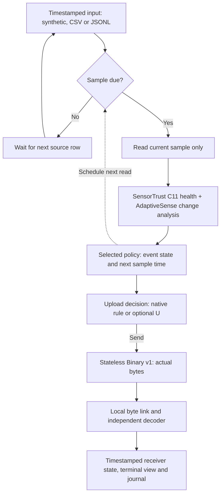

# TAIS — Trust-Aware Importance Scheduler

TAIS studies event detection, sampling and communication under sensor faults in single-node IoT monitoring. It integrates **SensorTrust C11** health diagnosis, **AdaptiveSense** change analysis, selectable sampling and upload control as separate functions.

This is a tested local software prototype and reproducible systems study. Its primarily synthetic evidence includes conditional tradeoffs and documented failures; field reliability and energy savings remain unvalidated.

**Start here:** [Quick start](#quick-start) · [Choose a mode](#running-modes) · [Documentation](docs/README.md) · [Paper and 中文概要](docs/README.md#paper-and-review)

## What is implemented

- Real C11 health state, flags and heuristic scores via ctypes.
- GateOnly, JO/SU combinations; fixed-period, Delta, Variance and **Rao-inspired** research controls.
- CSV/JSONL/synthetic input → Stateless Binary v1 → independent local receiver and history.
- Separate local/sender/receiver metrics, actual sample/upload/byte counts, data age and seed-paired uncertainty.

## Data flow



Values are read only when due; sparse input cannot supply missing samples. Hardware acquisition and a real wireless transport are not implemented. [Architecture and source map](docs/REPOSITORY_GUIDE.md#source-map).

## Quick start

Use **Python 3.14** and a C11 compiler (`cc`, Clang or GCC); the bridge compiles on first use. Run from the checkout root. No hardware or data download is needed. This branch includes the latest paper revision; `main` is an earlier snapshot.

```sh
git clone --branch docs/repository-readme-and-structure --recurse-submodules https://github.com/Sver0411/TAIS.git
cd TAIS
python3.14 -m venv .venv
source .venv/bin/activate
python -m pip install -r requirements-lock.txt
python -m pip install -e . --no-build-isolation
python -m pytest tests/test_core_stream.py tests/test_wire_codec.py -q
python examples/tais-core/run.py --scenario missing_cross_long --seed 20 \
  --pace 0 --ui quiet --verify --out results/scratch/quickstart-01
python examples/tais-core/view_run.py results/scratch/quickstart-01 --tail 12
```

Use a **new** output directory each time. Expect `status: COMPLETE`, frozen-policy parity, TX/RX counts and three files: `manifest.json`, `summary.json`, `journal.jsonl`. Seed 20 is demonstration data. [Live display, input formats, troubleshooting and evidence checks](docs/QUICKSTART.md).

## Running modes

GateOnly remains default. SU numbers are **idle interval caps**, not fixed periods. U suppresses ordinary updates while sending sampled event/health edges and heartbeats.

| Mode | Behavior / useful property | Cost or limitation | Existing entry |
| --- | --- | --- | --- |
| GateOnly | Health-gated baseline | Can miss short or fault-masked events | Default, or `--policy gateonly` |
| GateOnly + U | Same sampling and local detection, fewer uploads | Older ordinary receiver data; receiver edges can differ | `--policy gateonly-u` |
| JO-SU-20 | JO-S sampling plus U; higher-detection option in the reported tests | More samples and potentially more fault-induced reports | `--policy tais-su --su-mode high` |
| JO-SU-30 | Lower acquisition count than SU20 in SU-1 | Lost detections; failed the balanced-replacement gate | `--policy tais-su --su-mode balanced` |
| JO-SU-40 | Retained lower-sampling operating point | Recall loss versus SU20; no general near-budget quality advantage | Python API / frozen benchmark only |

[Mode commands / SU40 API](docs/QUICKSTART.md#mode-selection) · [SU-1 results](docs/TAIS_SU_RESULTS.md). `balanced` means the frozen **SU30** candidate, not a passed qualification. Independent baselines are benchmark controls, not Core CLI modes.

## What the experiments show

The [paper](papers/tais/README.md) compares independent baselines and conditional tradeoffs. This adverse comparison comes from **G2 only** (20 seeds, 46 scenarios):

| G2 sender/system metric | JO-SU-40 | Fixed-20+C11 |
| --- | ---: | ---: |
| F1 | 46.31% | 55.10% |
| Sample cycles | 85,055 | 82,800 |
| Binary v1 application bytes | 959,129 | 2,940,838 |
| Operational fault-induced false reports | 157 | 353 |
| Receiver P95 data age | 113 s | 18 s |

Fixed20 has higher point F1 at nearby sample totals; SU40 sends fewer bytes with fewer attributed false reports and older data. Shared U explains part of the communication benefit. G1's near-budget F1 advantage over Variance was not retained in G2, whose difference interval includes zero.

G1/G2 differ in signals, faults, timing **and event-truth definitions**; their totals cannot be pooled or differences attributed solely to distribution shift. [Full evidence](docs/TAIS_PAPER_EVIDENCE.md) · [中文概要](docs/TAIS_PAPER_SUMMARY_ZH.md) · [Results](results/README.md).

## Scope and maturity

| Status | What it means |
| --- | --- |
| Implemented and tested | C11 integration, causal due-time processing, local bytes/receiver, codecs and deterministic software checks |
| Condition-specific evidence | Synthetic quality/cost tradeoffs; independent controls and negative findings, not universal superiority |
| Separate exploration | Real greenhouse background with controlled offline interventions; coverage failed its held-out gate |
| Unvalidated | Natural-fault diagnosis, agricultural field event performance, hardware timing/RAM, real wireless delivery, current draw and battery life |

Trust scores are heuristic, not calibrated probabilities. Events entirely between samples or erased by faults may be unrecoverable. Application-byte reductions are not proportional energy savings. [Failure boundaries and research history](docs/README.md#history-and-negative-results).

## Find your next step

- **Run or integrate:** [Quick start](docs/QUICKSTART.md), [Core input contract](examples/tais-core/README.md), [source and directory map](docs/REPOSITORY_GUIDE.md).
- **Inspect or reproduce evidence:** [document navigation](docs/README.md), [script navigation](scripts/README.md), [result navigation](results/README.md).
- **Read the paper:** [LaTeX/PDF and build instructions](papers/tais/README.md), [中文概要](docs/TAIS_PAPER_SUMMARY_ZH.md), [submission checklist](docs/TAIS_SUBMISSION_CHECKLIST.md).
- **Contribute:** [contribution rules](CONTRIBUTING.md), [MIT license](LICENSE), [third-party notices](THIRD_PARTY_NOTICES.md).

Pinned upstreams: AdaptiveSense `f7ec30f…`, SensorTrust `2ce98dd…`; source/licenses remain in [vendor/](vendor). Adaptive sampling, health heuristics, deadbands and binary encoding are established techniques.
