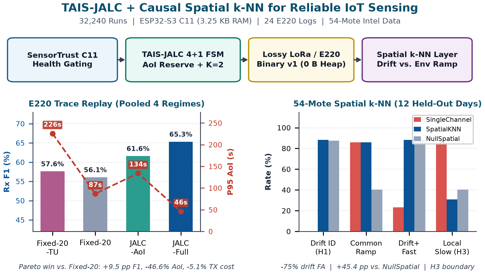
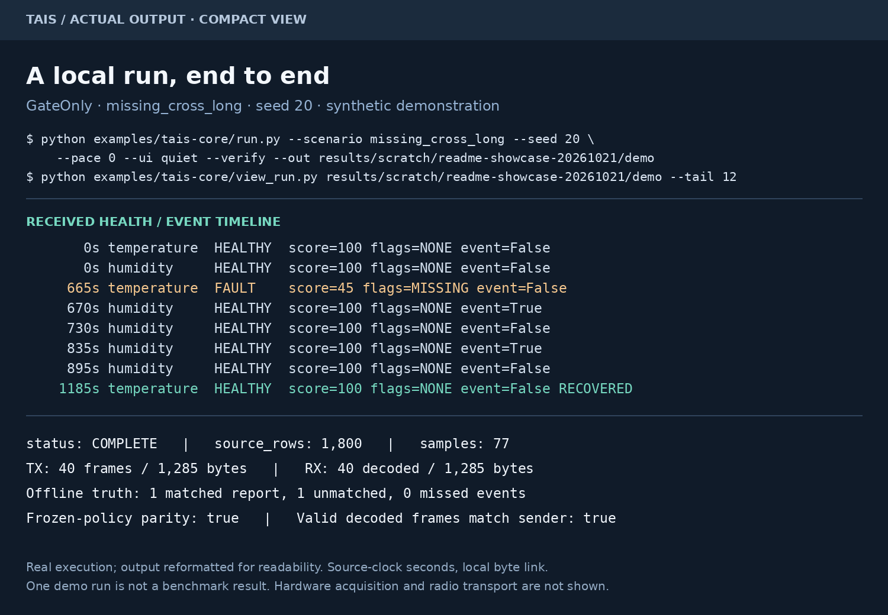
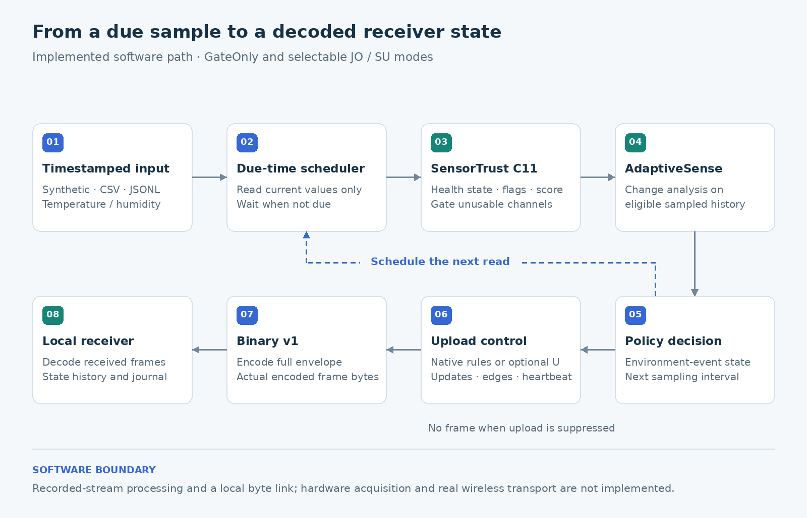
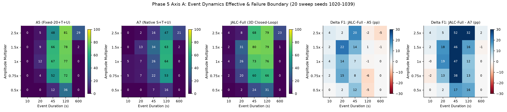
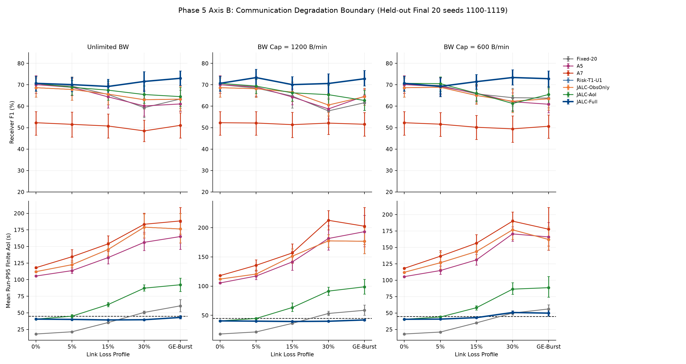
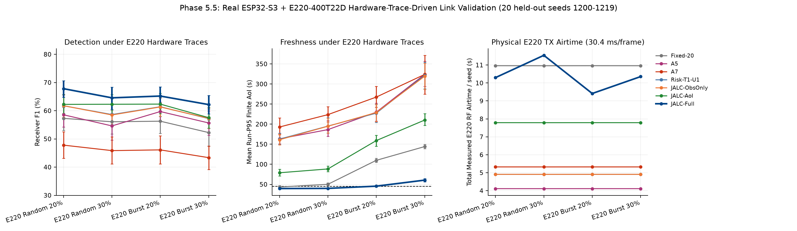
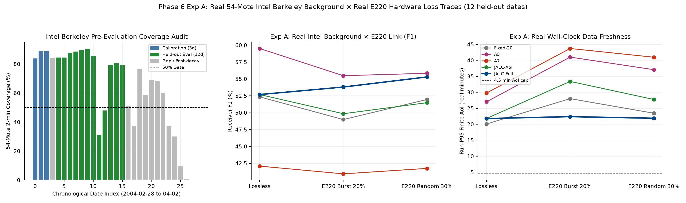
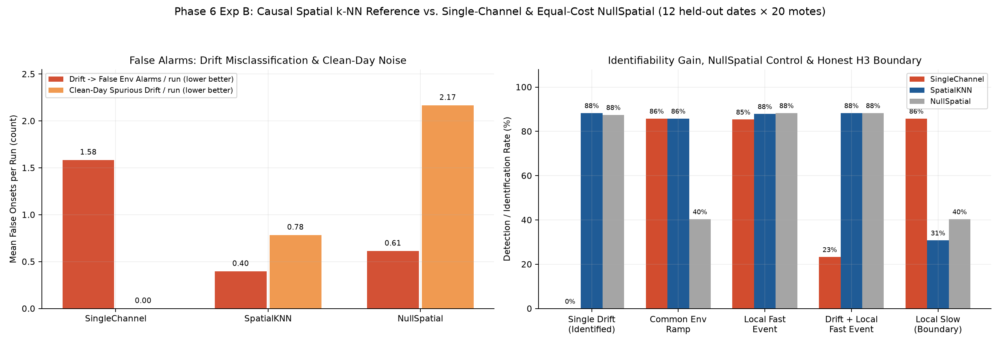
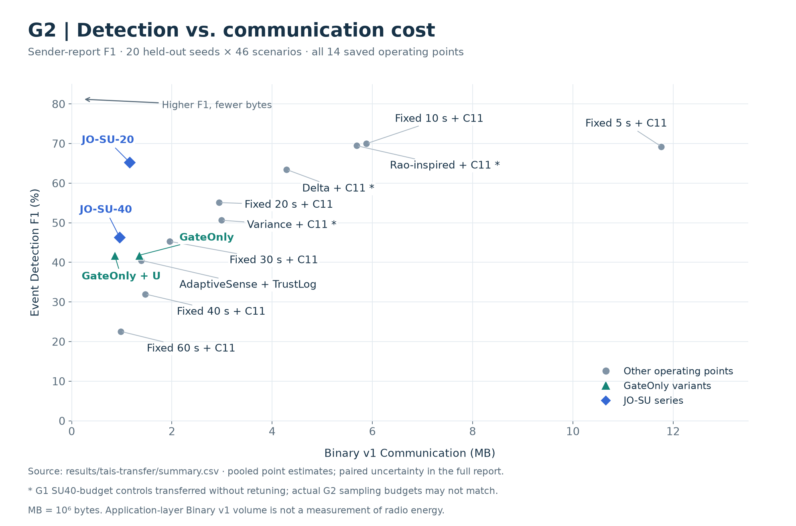
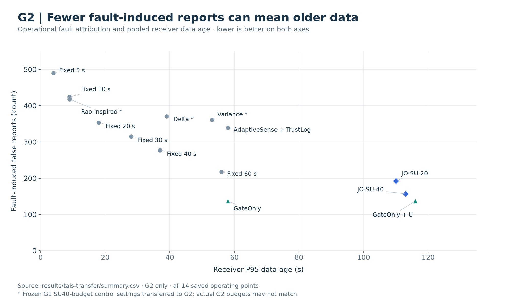

# TAIS — Trust-Aware Importance Scheduler

**English** | [简体中文](README.zh-CN.md)

**Closed-loop trust-aware sensing, adaptive scheduling, and spatial drift identifiability for unreliable IoT sensor networks.**

TAIS is an open, reproducible AIoT research framework for monitoring dynamic physical environments with fault-prone sensors over constrained, lossy wireless links. It integrates zero-allocation C11 sensor health diagnosis (**SensorTrust**), change-aware adaptive sampling (**AdaptiveSense**), selective binary transmission (**Binary v1**), closed-loop freshness/loss scheduling (**`TAIS-JALC`**), and causal spatial $k$-NN drift disambiguation to study detection quality, sampling effort, communication cost, and data freshness (Age of Information, AoI) under one verifiable architecture.

[Overview](#overview) · [Architecture](#system-architecture) · [Key Results](#experimental-results) · [Embedded C11](#2-hardware-trace-validation--embedded-c11-kernel) · [Quick Start](#quick-start) · [IEEE Paper (PDF)](papers/tais-closed-loop/manuscript.pdf)

---

## Overview

When a sensor reading suddenly shifts, an edge node faces a three-way decision: report a genuine environmental event, diagnose a faulty or drifting sensor, or conserve sampling and radio budget. TAIS addresses this end-to-end across synthetic stress regimes, real Sub-GHz LoRa hardware loss logs, and real 54-mote wireless sensor network deployments:

- **Closed-loop freshness & loss control (`TAIS-JALC`):** A lean 4+1 state machine (`QUIET_ECO`, `PROBE`, `TRACK`, `SAFE_FALLBACK`, `DIAG_VERIFY`) with five control hyperparameters, hard AoI-sampling reservation, and closed-loop link-loss telemetry—lifting receiver F1 by **+10.6 to +11.6 pp** under 30% and Gilbert-Elliott burst loss while keeping Run-P95 finite AoI flat at **42–51 s** (vs. 140–190 s for open-loop baselines).
- **Real ESP32-S3 + E220 hardware traces & pure C11 port:** Evaluated over **24 audited ESP32-S3 + E220-400T22D Sub-GHz LoRa logs** (3,359 physical RF attempts), improving receiver F1 by **+7.74–9.46 pp** (`p_holm <= 0.0175`) and cutting P95 AoI from **225.9 s to 46.4 s** at lower RF airtime than fixed-period sampling; the zero-allocation C11 kernel fits in **1,072 B RAM** and **7,643 B ESP32-S3 flash** with **27/27** bit-exact trajectory parity.
- **54-mote real-world external validity & causal spatial drift identifiability:** Evaluated on the public **MIT Intel Berkeley 54-mote** dataset (1.82M valid T+RH rows, 12 held-out days at 76.4% mean coverage), reducing real wall-clock P95 AoI by **−912 s** under real E220 loss traces, while causal spatial $k$-NN cuts single-sensor drift false alarms by **−75.0%** and beats an equal-cost `NullSpatial` negative control by **+45.4 pp** on common environmental events.
- **Transparent tradeoffs & failure boundaries:** Documents exact operating regions alongside honest boundaries (ultra-short pulses $\le 10\text{ s}$, 600 s slow ramps under a 60 s EMA detector, uncalibrated HVAC warming shifts, and single-node local slow events).



## See It Run



*Demonstration on `missing_cross_long` (seed 20): temperature readings drop out while humidity shifts. `GateOnly` finishes with 77 samples, 40 decoded Binary v1 frames, and 1,285 application bytes. [Run it yourself below](#quick-start).*

## System Architecture



Only due samples enter analysis strictly causally (zero lookahead):

1. **Sensor health (`SensorTrust` C11):** Zero-allocation C11 diagnosis through a Python/C bridge emitting health states, flags (`RANGE`, `STUCK`, `SPIKE`, `DRIFT`, `MISSING`), and heuristic trust scores.
2. **Environmental change & spatial disambiguation:** Per-channel change analysis (`AdaptiveSense`) with separate fault and environmental-event states, optionally paired with causal spatial $k$-NN differential residuals against the $k=4$ nearest physical neighbors (`src/tais/real_data/`).
3. **Adaptive sampling & selective upload (`TAIS-JALC` / `GateOnly` / `JO-SU`):** Jointly controls next sample intervals, event/health edge reporting, heartbeat AoI protection, and selective suppression (`U`) of ordinary updates.
4. **Stateless wire codec & independent receiver:** Binary v1 encoding with an independent local receiver, timestamped journals, and controlled or hardware-trace wireless link impairment.

[Core interface](examples/tais-core/README.md) · [Architecture & source map](docs/REPOSITORY_GUIDE.md#source-map) · [Closed-loop source](src/tais/closed_loop/)

---

## Experimental Results

### 1. Event Dynamics & Wireless Link Degradation Boundaries

Across 20 sweep seeds (`1020–1039`) and 20 independent held-out seeds (`1100–1119`, 21,000 runs total), `TAIS-JALC` (`JALC-Full`) maps both its high-gain regime and explicit failure boundaries:



- **Event dynamics:** `JALC-Full` lifts receiver F1 by **+8.6 to +24.5 pp** on short-to-medium events (`20–45 s`), while transparently documenting failure boundaries on ultra-short pulses ($\le 10\text{ s}$), 600 s smooth ramps under the fixed 60 s EMA detector, and 7× high-noise regimes.



- **Lossy & bandwidth-capped links:** Under 30% packet loss and Gilbert-Elliott burst fading (even under tight `600 B/min` caps), `JALC-Full` improves receiver F1 by **+10.6 to +11.6 pp** over `A5` (`p_holm < 0.05`) while holding Run-P95 finite-value AoI flat at **42–51 s** (vs. **140–190 s** for open-loop baselines, with 0% AoI violation under lossless transport).

[Boundary analysis report (ZH)](docs/PHASE5_BOUNDARY_RESULTS_ZH.md)

### 2. Hardware-Trace Validation & Embedded C11 Kernel



Replaying **24 audited ESP32-S3 + E220-400T22D Sub-GHz LoRa hardware logs** (3,359 RF attempts from [EventGuard-LoRa](https://github.com/Sver0411/EventGuard-LoRa), held-out seeds `1200–1219`), `JALC-Full` improves receiver F1 by **+7.74 pp** over `A5` and **+9.46 pp** over `Fixed-20` (`p_holm <= 0.0175`), cuts P95 finite AoI from **225.9 s** to **46.4 s**, and consumes **less physical E220 RF airtime** than `Fixed-20` (`41.6 s` vs. `43.8 s/seed`).

| Embedded C11 Kernel (`src/tais/closed_loop/c11/tais_jalc.c`) | Measured Value |
| :--- | :--- |
| Static controller state RAM (`sizeof(tais_jalc_t)`) | **1,072 B** (`0 B` heap / `malloc`) |
| Combined RAM with 2× `SensorTrust` channels | **3,328 B** (`3.25 KB` — `< 0.7%` of ESP32-S3 512 KB SRAM) |
| ESP32-S3 Xtensa LX7 (`-Os`) Flash footprint | **7,643 B `.text`**, `0 B .data`, `0 B .bss` |
| Host joint step latency (`SensorTrust` + `JALC` + `Binary v1`) | **1.44 µs / step** (bit-exact parity across **27/27** trajectories) |

[Hardware-trace & C11 report (ZH)](docs/PHASE5_5_HW_TRACE_AND_C11_ZH.md) · [C11 implementation](src/tais/closed_loop/c11/)

### 3. Real 54-Mote External Validity & Spatial Drift Identifiability

Evaluated on the public **MIT CSAIL Intel Berkeley Research Lab 54-mote** dataset (2.31M raw lines audited; 1.82M valid T+RH rows; strictly causal replay with zero future interpolation; 3-day calibration prefix, 1-day isolation gap, and 12-day contiguous held-out block passing the $\ge 50\%$ coverage gate at **76.4%** mean coverage, including the real March 10–11 outage):



- **Real 54-mote sensing × real E220 hardware loss (5,400 runs):** Under `e220_random_30`, `JALC-Full` cuts real wall-clock P95 finite AoI from **2,225 s (37.1 min)** (`A5`) to **1,313 s (21.9 min)** (`−912 s`, `p_holm = 0.0258`), reduces AoI violation by **−44.2 pp**, outperforms `Fixed-20` on P95 AoI (`−94.6 s`, `p_holm = 0.0273`) at lower byte cost, and lifts Recall by **+15.6 pp** (`79.4%` vs. `63.8%`). Uncalibrated fixed `noise_floor = 0.15 °C` triggers additional background alarms during real morning HVAC warming (`+5–9 °C`), keeping overall F1 close to `A5` (`55.3%` vs. `55.8%`).



- **Causal spatial $k$-NN drift identifiability vs. equal-cost `NullSpatial` control (3,600 runs):** Matching causal differential residuals against the $k=4$ nearest physical motes (mean spacing `5.09 m`) cleanly separates single-sensor drift from shared environmental ramps:

| Scenario (240 held-out runs each) | Metric | `SingleChannel` | `SpatialKNN` | `NullSpatial` | Date-Cluster Paired Effect (`p_holm`) |
| :--- | :--- | :---: | :---: | :---: | :--- |
| **`single_drift`** | False env alarms / run ↓ | `1.58` | **`0.40`** | `0.61` | **−75.0%** vs. `SingleChannel` (`p = 0.0270` ✓) |
| **`single_drift`** | Drift correctly identified ↑ | `0.0%` | **`88.3%`** (`96.5%` normal) | `87.5%` | **+88.3 pp** vs. `SingleChannel` (`p = 0.0270` ✓) |
| **Clean unperturbed days** | Spurious drift / run ↓ | `0.00` | **`0.78`** | `2.17` | **−63.8%** vs. `NullSpatial` (`p = 0.0258` ✓) |
| **`common_env_event`** | Common event recall ↑ | `85.8%` | **`85.8%`** | `40.4%` | **0.0 pp** loss; **+45.4 pp** vs. `NullSpatial` (`p = 0.0270` ✓) |
| **`drift_plus_local_fast`** | Event recall during drift ↑ | `23.3%` | **`88.3%`** | `88.3%` | **+65.0 pp** vs. `SingleChannel` (`p = 0.0270` ✓) |
| **`local_slow_event`** (Boundary) | Single-node slow recall | `85.8%` | **`30.8%`** | `40.4%` | **−55.0 pp** honest unidentifiable boundary (`p = 0.0270`) |

[Real-data & spatial report (ZH)](docs/PHASE6_REAL_DATA_SPATIAL_ZH.md) · [Real-data & spatial source](src/tais/real_data/) · [Benchmark script](scripts/run_phase6_intel_berkeley.py)

### 4. Detection–Communication Tradeoffs & Factorial Module Ablations

Across 20 held-out seeds × 46 synthetic scenarios (14 saved operating points with health information), TAIS also characterizes the baseline detection–communication–freshness frontier and full SensorTrust × AdaptiveSense × Selective-Upload (`T × S × U`) factorial ablations (17,280 runs, 78 Holm-corrected tests, plus 31,680 robust/risk-sampling evaluations documenting negative `NO_GO_DEFAULT` gates):





- At comparable sampling totals (**85,055 vs. 82,800 samples**), `JO-SU-40` sends **959,129 bytes** vs. **2,940,838 bytes** for `Fixed-20+C11` and lowers fault-induced false reports (**157 vs. 353**), trading off higher receiver P95 ordinary-data age (**113 s vs. 18 s**). `GateOnly+U` retains `GateOnly`'s sender F1 at lower byte volume.

[Cross-generator report](docs/TAIS_CROSS_GENERATOR_REPORT.md) · [Module ablation analysis (ZH)](docs/MODULE_ABLATION_RESULTS_ZH.md) · [Robust-sampling boundary report (ZH)](docs/PHASE4_RESULTS_ZH.md) · [Plot data](results/tais-transfer/summary.csv) · [IEEE Paper (PDF)](papers/tais-closed-loop/manuscript.pdf)

---

## Quick Start

Requires **Python 3.10+** and a C11 compiler (`cc`, Clang or GCC). The C11 bridge compiles automatically on first use; no hardware or external dataset is required for the core demonstration.

**1. Install and run core unit tests**

```sh
git clone --recurse-submodules https://github.com/Sver0411/TAIS.git
cd TAIS
python3 -m venv .venv
source .venv/bin/activate
python -m pip install -r requirements-lock.txt
python -m pip install -e . --no-build-isolation
python -m pytest tests/test_core_stream.py tests/test_wire_codec.py tests/test_closed_loop.py tests/test_closed_loop_c11_parity.py -q
```

**2. Run the local demonstration and inspect received history**

```sh
python examples/tais-core/run.py --scenario missing_cross_long --seed 20 \
  --pace 0 --ui quiet --verify --out results/scratch/quickstart-01
python examples/tais-core/view_run.py results/scratch/quickstart-01 --tail 12
```

For a live terminal display, replace `--pace 0 --ui quiet` with `--pace .01 --ui live`. Choose a fresh output directory for each run.

**3. Reproduce factorial ablations or regenerate figures**

```sh
python scripts/benchmark_ablation.py replicate --out results/scratch/ablation-01 --workers 4
python scripts/analyze_ablation.py
python scripts/verify_ablation.py
```

[Installation details & troubleshooting](docs/QUICKSTART.md) · [Standalone receiver examples](examples/tais-core/README.md) · [All experiment scripts](scripts/README.md)

## Running Modes

`GateOnly` is the default CLI policy; `SU` numbers specify **idle interval caps**, not fixed sampling periods.

| Mode | Main Tradeoff | Select With |
| :--- | :--- | :--- |
| `GateOnly` | Health-gated baseline; short or fault-masked events can be missed | `--policy gateonly` |
| `GateOnly + U` | Same sampling and sender detection, fewer uploads, older ordinary data | `--policy gateonly-u` |
| `JO-SU-20` | Higher detection at higher sampling effort and potential fault-induced reports | `--policy tais-su --su-mode high` |
| `JO-SU-30` | Lower sampling than SU20, with lower detection (did not pass balanced gate) | `--policy tais-su --su-mode balanced` |
| `JO-SU-40` | Lower-sampling operating point; no general near-budget quality advantage | [Python API / benchmark](docs/QUICKSTART.md#mode-selection) |

## Scope & Limitations

- Synthetic evaluations are complemented by 24 real E220 hardware loss logs and the 54-mote Intel Berkeley indoor dataset (with controlled interventions), while live multi-node agricultural field-event deployment and measured battery energy remain open.
- Trust scores are heuristic; events occurring strictly between samples or fully masked by a same-channel fault may be unrecoverable.
- Lower application-layer byte counts do not directly equal proportional radio energy reduction or longer battery life.

[Failure boundaries & negative results](docs/README.md#history-and-negative-results)

## Documentation & Related Projects

- **Use & extend:** [Quick start](docs/QUICKSTART.md) · [Core prototype contract](docs/TAIS_CORE_PROTOTYPE.md) · [Repository & source map](docs/REPOSITORY_GUIDE.md)
- **Paper & reports:** [IEEEtran Manuscript (PDF)](papers/tais-closed-loop/manuscript.pdf) · [Paper & LaTeX guide](papers/tais-closed-loop/README.md) · [Document index](docs/README.md) · [Results index](results/README.md)
- **Part of a 4-layer AIoT systems stack:**
  - **L1 · Reliable Sensing:** [SensorTrust](https://github.com/Sver0411/SensorTrust)
  - **L2 · Adaptive Observation:** [AdaptiveSense](https://github.com/Sver0411/AdaptiveSense) · [TAIS](https://github.com/Sver0411/TAIS)
  - **L3 · Freshness & Lossy Links:** [EventGuard-LoRa](https://github.com/Sver0411/EventGuard-LoRa) · [NetAdapt-IoT](https://github.com/Sver0411/NetAdapt-IoT) · [IoT-MPQUIC-Scheduler](https://github.com/Sver0411/IoT-MPQUIC-Scheduler)
  - **L4 · Resilience & CPS Validation:** [EdgeFaultLab](https://github.com/Sver0411/EdgeFaultLab) · [TinyEdgeBench](https://github.com/Sver0411/TinyEdgeBench) · [Smart-Agriculture-Edge-AI](https://github.com/Sver0411/Smart-Agriculture-Edge-AI) · [AgriTwin-CPS](https://github.com/Sver0411/AgriTwin-CPS)

## License

Project code and documentation are released under the [MIT License](LICENSE). Pinned upstream dependencies (`AdaptiveSense`, `SensorTrust`) remain in [vendor/](vendor) with attribution in [THIRD_PARTY_NOTICES.md](THIRD_PARTY_NOTICES.md).
