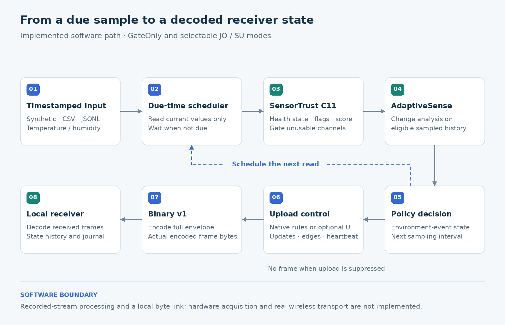
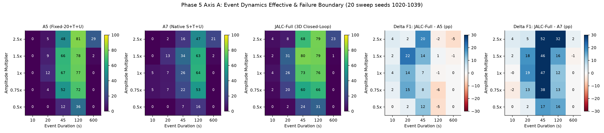
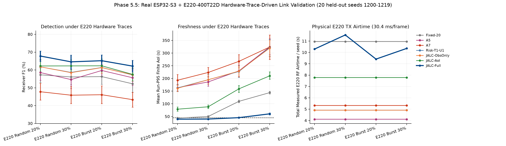
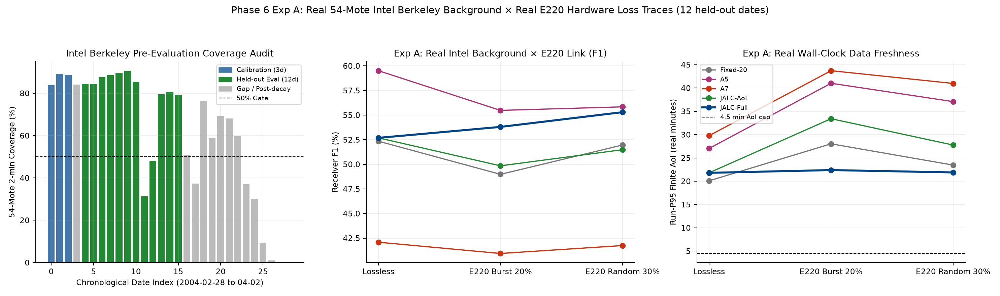
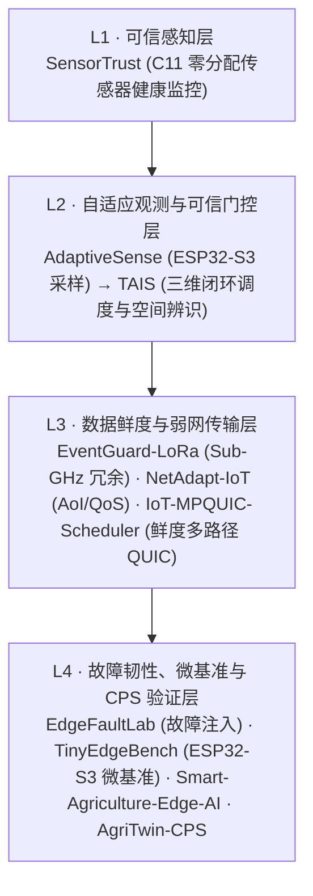

# TAIS — 信任感知重要性调度器（Trust-Aware Importance Scheduler）

[English README](README.md) · [快速开始](docs/QUICKSTART.md) · [论文与证据](papers/tais/README.md) · [Phase 5 边界报告](docs/PHASE5_BOUNDARY_RESULTS_ZH.md) · [Phase 5.5 硬件与 C11 报告](docs/PHASE5_5_HW_TRACE_AND_C11_ZH.md) · [Phase 6 真实 54 节点与空间辨识报告](docs/PHASE6_REAL_DATA_SPATIAL_ZH.md)

TAIS 是一个面向不可靠传感器与动态环境监测的开源可复现 AIoT 研究原型，将底层传感器健康诊断（SensorTrust C11）、变化感知自适应采样（AdaptiveSense）、选择性传输、弱网数据鲜度（AoI）闭环控制以及多节点因果空间参考整合在同一评测框架下，系统研究检测质量、采样开销、通信字节与数据新鲜度之间的可复现边界。

## 研究演进总览

| 阶段 | 评测规模与数据源 | 核心可复现结论 | 详细报告 |
| :--- | :--- | :--- | :--- |
| **G1/G2 & Core** | 20 种子 × 46 合成场景 | 因果 C11 健康门控 + Binary v1 独立收发权衡基准 | [论文摘要](docs/TAIS_PAPER_SUMMARY_ZH.md) |
| **MA-1 模块消融** | 20 种子（`900–919`），17,280 次 | 完整 T × S × U 三因素消融，剥离采样与上传各自贡献 | [MA-1 报告](docs/MODULE_ABLATION_RESULTS_ZH.md) |
| **Phase 4** | 20 种子（`920–939`），31,680 次 | 有界稳健/风险采样；严格保留 `NO_GO_DEFAULT` 负向结论 | [Phase 4 报告](docs/PHASE4_RESULTS_ZH.md) |
| **Phase 5** | 20+20 种子（`1020–1039` / `1100–1119`），21,000 次 | 三维闭环 `TAIS-JALC`：30%/突发丢包下 **+10.6–11.6 pp** F1，P95 AoI 压至 **42–45 s** | [Phase 5 报告](docs/PHASE5_BOUNDARY_RESULTS_ZH.md) |
| **Phase 5.5** | 24 组实测 E220 硬件日志（`1200–1219`）+ 纯 C11 移植 | 真实丢包轨迹 **+7.74–9.46 pp** F1；ESP32-S3 占 **1,072 B RAM / 7,643 B `.text`** | [Phase 5.5 报告](docs/PHASE5_5_HW_TRACE_AND_C11_ZH.md) |
| **Phase 6** | MIT Intel Berkeley 54 节点（12 留出日），9,000 次 | 真实背景×E220 压低 AoI **−912 s**；空间 $k$-NN 降误报 **−75.0%**、胜负对照 **+45.4 pp** | [Phase 6 报告](docs/PHASE6_REAL_DATA_SPATIAL_ZH.md) |

---

## 系统架构与核心演示



---

## Phase 5：三维自适应闭环有效区间与失效边界

在 [`src/tais/closed_loop/`](src/tais/closed_loop/) 实现零 CUSUM、100% 复用 Binary v1 的 4+1 状态闭环控制器 `TAIS-JALC`（5 个主控超参数）：

### 事件动态相图（有效区间 vs. 明确失效边界）



在 20–45 s 中短突发事件下较 `A5` 提升 Rx F1 **+8.6 至 +24.5 pp**；同时明确标注极短脉冲（$\le 10\text{ s}$）、600 s 平滑缓变脉冲与 7× 强噪声为显式退化区间。

### 弱网丢包、突发衰落与带宽上限边界


在 30% 丢包与 Gilbert-Elliott 突发丢包下较 `A5` 取得 **+10.6 至 +11.6 pp** 的 Holm 校正显著提升（$p < 0.05$），并将 Run-P95 有限有效值 AoI 从 **140–190 s** 稳定压制在 **42–51 s**。

---

## Phase 5.5：真实 ESP32-S3 + E220 硬件丢包验证与纯 C11 嵌入式落地



在 24 组实测 ESP32-S3 + E220-400T22D 硬件丢包轨迹（来自 [EventGuard-LoRa](https://github.com/Sver0411/EventGuard-LoRa)，新种子 `1200–1219`）上，`JALC-Full` 较 `A5` 提升 **+7.74 pp**、较 `Fixed-20` 提升 **+9.46 pp**（$p_{\text{Holm}} \le 0.0175$），P95 有限 AoI 从 **225.9 s** 压至 **46.4 s**，且物理 E220 射频总发射时长低于 `Fixed-20`（`41.6 s` vs `43.8 s/seed`）。

| 纯 C11 零分配实现（[`src/tais/closed_loop/c11/tais_jalc.c`](src/tais/closed_loop/c11/tais_jalc.c)） | 实测指标 |
| :--- | :--- |
| 控制器静态 RAM（`sizeof(tais_jalc_t)`） | **1,072 B**（零堆分配 / 零 `malloc`） |
| 联合双通道 `SensorTrust` 总静态 RAM | **3,328 B**（**3.25 KB**，不足 ESP32-S3 SRAM 的 0.7%） |
| ESP32-S3 Xtensa LX7（`-Os`）交叉编译体积 | **7,643 B `.text`**，`0 B .data`，`0 B .bss` |
| 单步联合耗时与一致性验证 | **1.44 µs/次**（27 条完整轨迹 **100% 逐帧一致**） |

---

## Phase 6：真实 54 节点传感网外部效度与因果空间参考漂移辨识

在 MIT CSAIL Intel Berkeley 54 节点真实温湿度数据集（231 万原始行审计、12 天连续留出块平均覆盖率 **76.4%** 通过 50% 门控、零未来插值、保留 3 月 10–11 日真实断网故障日）上开展两项验证：

### 实验 A：真实昼夜温湿度背景 × 真实 E220 硬件丢包（5,400 次运行）



在 `e220_random_30` 链路下，`JALC-Full` 将真实 P95 有限 AoI 从 `A5` 的 **2,225 s（37.1 分钟）**压至 **1,313 s（21.9 分钟，−912 s，$p_{\text{Holm}}=0.0258$）**、AoI 违约率下降 **−44.2 pp**、Recall 提升 **+15.6 pp**，并在更少字节下优于 `Fixed-20`；同时坦诚记录固定噪声底座面对真实暖通晨间升温（`+5–9 °C`）带来的背景误报域偏移。

### 实验 B：因果空间 $k$-NN 参考 vs. 单通道与等成本负对照 `NullSpatial`（3,600 次运行）


| 场景（各 240 次留出运行） | 指标 | `SingleChannel` | `SpatialKNN` | `NullSpatial` | 日期整簇配对效应（$p_{\text{Holm}}$） |
| :--- | :--- | :---: | :---: | :---: | :--- |
| **`single_drift`**（H1） | 漂移所致环境误报/次 ↓ | `1.58` | **`0.40`** | `0.61` | 较 `SingleChannel` **−75.0%**（$p=0.0270$ ✓） |
| **`single_drift`**（H1） | 漂移正确检出率 ↑ | `0.0%` | **`88.3%`**（正常日 **96.5%**） | `87.5%` | 较 `SingleChannel` **+88.3 pp**（$p=0.0270$ ✓） |
| **干净无干预日** | 全日虚假漂移触发/次 ↓ | `0.00` | **`0.78`** | `2.17` | 较 `NullSpatial` **−63.8%**（$p=0.0258$ ✓） |
| **`common_env_event`**（H1+负对照） | 共同环境事件召回率 ↑ | `85.8%` | **`85.8%`** | `40.4%` | 零损失；较 `NullSpatial` **+45.4 pp**（$p=0.0270$ ✓） |
| **`drift_plus_local_fast`**（H2） | 漂移期叠加快事件召回 ↑ | `23.3%` | **`88.3%`** | `88.3%` | 较 `SingleChannel` **+65.0 pp**（$p=0.0270$ ✓） |
| **`local_slow_event`**（**H3 诚实边界**） | 单节点局部缓变召回 | `85.8%` | **`30.8%`** | `40.4%` | **−55.0 pp** 诚实物理不可辨识边界（$p=0.0270$） |

---

## 四层 AIoT 研究栈与关联仓库



| 层级 | 仓库 | 核心定位 |
| :--- | :--- | :--- |
| L1 | [SensorTrust](https://github.com/Sver0411/SensorTrust) | 纯 C11 嵌入式传感器健康诊断引擎 |
| L2 | [AdaptiveSense](https://github.com/Sver0411/AdaptiveSense) | ESP32-S3 变化感知自适应采样原语 |
| L2 | [TAIS](https://github.com/Sver0411/TAIS) | 信任感知闭环调度、模块消融、真实传感网验证与空间漂移辨识总枢纽 |
| L3 | [EventGuard-LoRa](https://github.com/Sver0411/EventGuard-LoRa) | ESP32-S3 + E220 Sub-GHz LoRa 事件感知冗余实证 |
| L3 | [NetAdapt-IoT](https://github.com/Sver0411/NetAdapt-IoT) | 面向 AoI、截止时间与公平性的多流 IoT 资源调度 |
| L3 | [IoT-MPQUIC-Scheduler](https://github.com/Sver0411/IoT-MPQUIC-Scheduler) | 截止时间与数据鲜度感知的多路径 QUIC 调度 |
| L4 | [EdgeFaultLab](https://github.com/Sver0411/EdgeFaultLab) | 分布式边缘/IoT 确定性故障注入与韧性测试 |
| L4 | [TinyEdgeBench](https://github.com/Sver0411/TinyEdgeBench) | ESP32 级硬件轻量 TinyML/边缘计算微基准 |
| L4 | [Smart-Agriculture-Edge-AI](https://github.com/Sver0411/Smart-Agriculture-Edge-AI) | 多节点智慧农业边缘 AI 与容错执行控制闭环 |
| L4 | [AgriTwin-CPS](https://github.com/Sver0411/AgriTwin-CPS) | 温室数字孪生与 CPS 闭环状态估计仿真平台 |

## 快速复现

```sh
python3 -m venv .venv && source .venv/bin/activate
python -m pip install -r requirements-lock.txt
python -m pip install -e . --no-build-isolation
python -m pytest tests/test_core_stream.py tests/test_wire_codec.py tests/test_closed_loop.py tests/test_closed_loop_c11_parity.py tests/test_phase6_real_data.py -q
```
