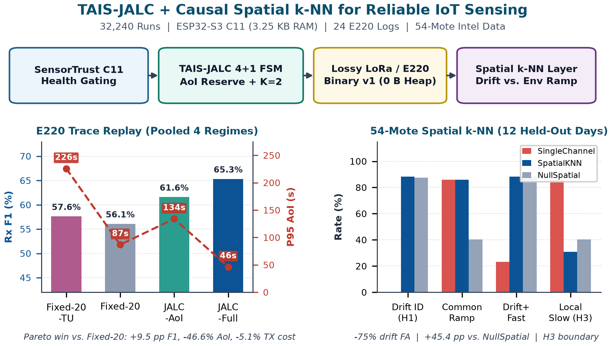
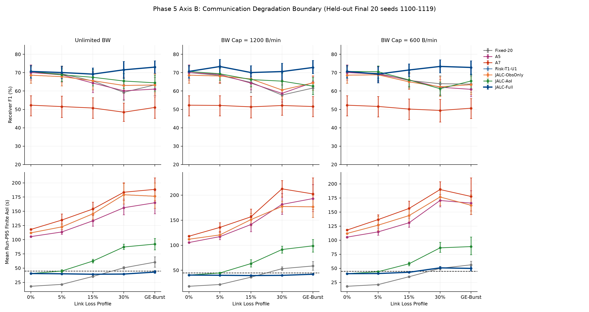
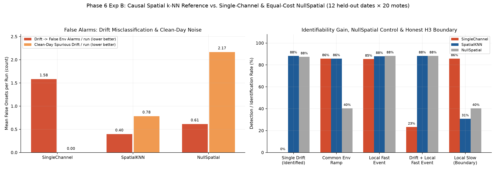

# TAIS — 信任感知重要性调度器（Trust-Aware Importance Scheduler）

[English](README.md) | **简体中文**

**面向不可靠传感器与弱网 IoT 监测的闭环信任感知调度、自适应采样与因果空间漂移辨识框架。**

TAIS 将零分配 C11 传感器健康诊断（**SensorTrust**）、变化感知自适应采样（**AdaptiveSense**）、选择性二进制传输（**Binary v1**）、弱网数据鲜度与丢包闭环控制（**`TAIS-JALC`**）以及多节点因果空间 $k$-NN 漂移辨识整合在同一可复现评测体系中，系统研究检测质量、采样开销、通信字节与数据新鲜度（AoI）之间的权衡与失效边界。

[核心亮点](#核心亮点) · [系统架构](#系统架构) · [实验结果](#实验结果) · [C11 与硬件验证](#2-真实-esp32-s3--e220-硬件丢包验证与纯-c11-内核) · [快速开始](#快速开始) · [IEEE 论文 (PDF)](papers/tais-closed-loop/manuscript.pdf)

---

## 核心亮点

当传感器读数发生突变时，边缘节点需要同时判断：这是真实环境事件、传感器故障/漂移，还是可以继续休眠省电？TAIS 给出了从单节点算法到真实多节点传感网与嵌入式 C11 落地的完整实证：

- **三维闭环调度器 `TAIS-JALC`**：4+1 状态轻量闭环控制器（5 个主控超参数、严格复用 Binary v1、AoI 硬保底预留与丢包/带宽反馈），在 30% 丢包与 Gilbert-Elliott 突发衰落下较开环基线提升接收端 F1 **+10.6 至 +11.6 pp**（$p_{\text{Holm}} < 0.05$），并将 Run-P95 有限有效值 AoI 从 **140–190 s** 压制在 **42–51 s**。
- **真实 ESP32-S3 + E220 硬件日志与纯 C11 零分配内核**：在 **24 组实测 Sub-GHz LoRa 丢包日志**（3,359 次物理射频尝试）上较 `A5` / `Fixed-20` 提升 F1 **+7.74–9.46 pp**，P95 AoI 从 **225.9 s** 压至 **46.4 s** 且物理射频占空比更低；纯 C11 实现仅占 **1,072 B 静态 RAM** 与 **7,643 B ESP32-S3 Flash**，27 条轨迹 100% 逐帧一致。
- **54 节点真实传感网外部效度与空间漂移辨识**：在 **MIT Intel Berkeley 54 节点**真实温湿度数据（182 万有效行、12 天连续留出块平均覆盖率 76.4%）上，弱网下将真实 P95 AoI 降低 **−912 s**；因果空间 $k$-NN 将单传感器漂移误报压低 **−75.0%**，并在共同环境事件上以 **+45.4 pp** 显著战胜等成本负对照 `NullSpatial`。
- **诚实边界披露**：完整记录有效区间与明确退化边界（$\le 10\text{ s}$ 极短脉冲、600 s 平滑缓变、强噪声、未校准暖通晨间升温及单节点局部缓变事件）。



## 系统架构


所有决策严格保持因果性（零未来信息泄露）：到期样本依次经过 `SensorTrust` C11 健康门控、`AdaptiveSense` 变化分析（可选叠加 $k=4$ 因果空间参考残差）、`TAIS-JALC` / `GateOnly` / `JO-SU` 采样与上传决策，最终经无状态 Binary v1 编解码与独立接收端重构状态。

---

## 实验结果

### 1. 事件动态区间与弱网退化边界

在 20 组扫参种子与 20 组独立留出种子（共 21,000 次运行）上，`TAIS-JALC` 完整刻画了有效增益区间与失效边界：


- 在 **20–45 s 中短突发事件**上较 `A5` 提升接收端 F1 **+8.6 至 +24.5 pp**；同时明确标注 $\le 10\text{ s}$ 极短脉冲、600 s 平滑缓变与 7× 强噪声为显式退化区间。



- 在 **30% 丢包与 Gilbert-Elliott 突发丢包**（含 `600 B/min` 严苛带宽上限）下较 `A5` 提升 **+10.6 至 +11.6 pp**（$p_{\text{Holm}} < 0.05$），P95 有限 AoI 稳定保持在 **42–51 s**。

### 2. 真实 ESP32-S3 + E220 硬件丢包验证与纯 C11 内核


在 24 组实测 ESP32-S3 + E220-400T22D 硬件丢包轨迹（来自 [EventGuard-LoRa](https://github.com/Sver0411/EventGuard-LoRa)）上，`JALC-Full` 较 `A5` 提升 **+7.74 pp**、较 `Fixed-20` 提升 **+9.46 pp**（$p_{\text{Holm}} \le 0.0175$），P95 有限 AoI 从 **225.9 s** 压至 **46.4 s**，且物理 E220 射频发射时长低于 `Fixed-20`（`41.6 s` vs. `43.8 s/seed`）。

| 纯 C11 零分配实现（[`src/tais/closed_loop/c11/tais_jalc.c`](src/tais/closed_loop/c11/tais_jalc.c)） | 实测指标 |
| :--- | :--- |
| 控制器静态 RAM（`sizeof(tais_jalc_t)`） | **1,072 B**（零堆分配 / 零 `malloc`） |
| 联合双通道 `SensorTrust` 总静态 RAM | **3,328 B**（**3.25 KB**，不足 ESP32-S3 SRAM 的 0.7%） |
| ESP32-S3 Xtensa LX7（`-Os`）交叉编译体积 | **7,643 B `.text`**，`0 B .data`，`0 B .bss` |
| 单步联合耗时与一致性验证 | **1.44 µs/次**（27 条完整轨迹 **100% 逐帧一致**） |

### 3. 真实 54 节点传感网外部效度与因果空间漂移辨识

在 MIT CSAIL Intel Berkeley 54 节点真实温湿度数据集（231 万原始行审计、12 天连续留出块平均覆盖率 **76.4%**、零未来插值、保留真实断网日）上开展两项外部效度验证：


- **真实传感背景 × 实测 E220 硬件丢包（5,400 次运行）**：在 `e220_random_30` 下，`JALC-Full` 将真实 P95 有限 AoI 从 `A5` 的 **2,225 s（37.1 分钟）** 压至 **1,313 s（21.9 分钟，−912 s，$p_{\text{Holm}}=0.0258$）**、AoI 违约率下降 **−44.2 pp**、Recall 提升 **+15.6 pp**；同时如实记录未校准固定噪声底座面对真实暖通晨间升温（`+5–9 °C`）时的背景误报偏移。



- **因果空间 $k$-NN 漂移辨识 vs. 单通道与等成本负对照 `NullSpatial`（3,600 次运行）**：

| 场景（各 240 次留出运行） | 指标 | `SingleChannel` | `SpatialKNN` | `NullSpatial` | 日期整簇配对效应（$p_{\text{Holm}}$） |
| :--- | :--- | :---: | :---: | :---: | :--- |
| **`single_drift`** | 漂移所致环境误报/次 ↓ | `1.58` | **`0.40`** | `0.61` | 较 `SingleChannel` **−75.0%**（$p=0.0270$ ✓） |
| **`single_drift`** | 漂移正确检出率 ↑ | `0.0%` | **`88.3%`**（正常日 **96.5%**） | `87.5%` | 较 `SingleChannel` **+88.3 pp**（$p=0.0270$ ✓） |
| **干净无干预日** | 全日虚假漂移触发/次 ↓ | `0.00` | **`0.78`** | `2.17` | 较 `NullSpatial` **−63.8%**（$p=0.0258$ ✓） |
| **`common_env_event`** | 共同环境事件召回率 ↑ | `85.8%` | **`85.8%`** | `40.4%` | 零损失；较 `NullSpatial` **+45.4 pp**（$p=0.0270$ ✓） |
| **`drift_plus_local_fast`** | 漂移期叠加快事件召回 ↑ | `23.3%` | **`88.3%`** | `88.3%` | 较 `SingleChannel` **+65.0 pp**（$p=0.0270$ ✓） |
| **`local_slow_event`**（诚实边界） | 单节点局部缓变召回 | `85.8%` | **`30.8%`** | `40.4%` | **−55.0 pp** 物理不可辨识边界（$p=0.0270$） |

### 4. 基础检测–通信权衡与模块消融

仓库同时完整归档了 14 个基准工作点的检测–通信–新鲜度权衡曲线、完整三因素模块消融（17,280 次运行、78 项 Holm 校正检验）以及有界风险采样的负向门控记录，便于按需核查：[论文摘要](docs/TAIS_PAPER_SUMMARY_ZH.md) · [模块消融报告](docs/MODULE_ABLATION_RESULTS_ZH.md) · [稳健采样分析](docs/PHASE4_RESULTS_ZH.md) · [三维闭环边界报告](docs/PHASE5_BOUNDARY_RESULTS_ZH.md) · [硬件与 C11 报告](docs/PHASE5_5_HW_TRACE_AND_C11_ZH.md) · [真实 54 节点与空间辨识报告](docs/PHASE6_REAL_DATA_SPATIAL_ZH.md)。

---

## 快速开始

```sh
git clone --recurse-submodules https://github.com/Sver0411/TAIS.git
cd TAIS
python3 -m venv .venv && source .venv/bin/activate
python -m pip install -r requirements-lock.txt
python -m pip install -e . --no-build-isolation
python -m pytest tests/test_core_stream.py tests/test_wire_codec.py tests/test_closed_loop.py tests/test_closed_loop_c11_parity.py tests/test_phase6_real_data.py -q
```

运行本地端到端演示：

```sh
python examples/tais-core/run.py --scenario missing_cross_long --seed 20 \
  --pace 0 --ui quiet --verify --out results/scratch/quickstart-01
python examples/tais-core/view_run.py results/scratch/quickstart-01 --tail 12
```

详细配置见 [快速开始文档](docs/QUICKSTART.md)、[IEEE 论文 (PDF)](papers/tais-closed-loop/manuscript.pdf) 与 [论文构建说明](papers/tais-closed-loop/README.md)。

## 相关研究栈与许可证

TAIS 位于四层可复现 AIoT 研究栈的 **L2 · 自适应观测与可信门控层**：

- **L1 · 可信感知：** [SensorTrust](https://github.com/Sver0411/SensorTrust)
- **L2 · 自适应观测：** [AdaptiveSense](https://github.com/Sver0411/AdaptiveSense) · [TAIS](https://github.com/Sver0411/TAIS)
- **L3 · 数据鲜度与弱网传输：** [EventGuard-LoRa](https://github.com/Sver0411/EventGuard-LoRa) · [NetAdapt-IoT](https://github.com/Sver0411/NetAdapt-IoT) · [IoT-MPQUIC-Scheduler](https://github.com/Sver0411/IoT-MPQUIC-Scheduler)
- **L4 · 故障韧性与 CPS 验证：** [EdgeFaultLab](https://github.com/Sver0411/EdgeFaultLab) · [TinyEdgeBench](https://github.com/Sver0411/TinyEdgeBench) · [Smart-Agriculture-Edge-AI](https://github.com/Sver0411/Smart-Agriculture-Edge-AI) · [AgriTwin-CPS](https://github.com/Sver0411/AgriTwin-CPS)

项目代码与文档采用 [MIT 许可证](LICENSE)。
