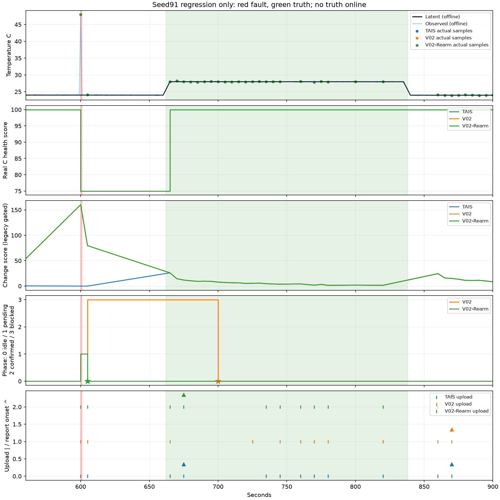
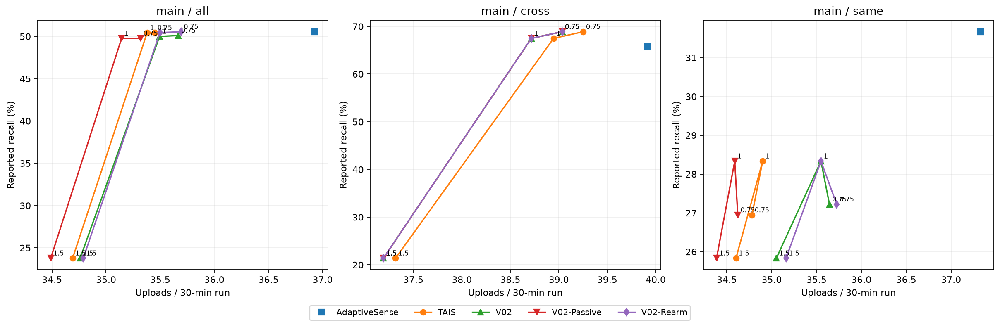
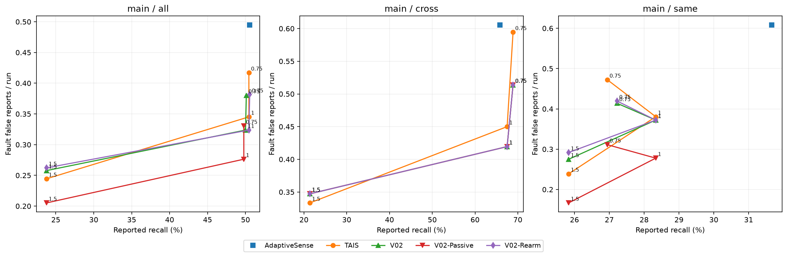
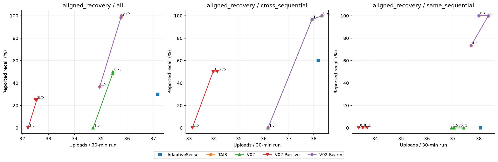
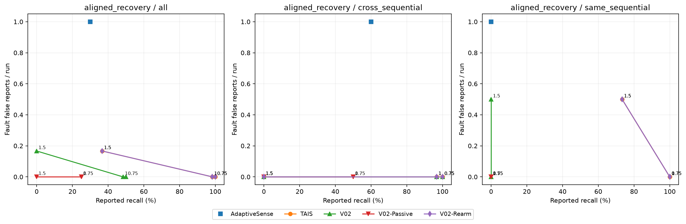

# BLOCKED reference-return repair: independent report

[Committed design](BLOCKED_REARM_FIX.md). The repair synchronizes one unconfirmed reference-return cancellation with the existing scorer reset. It suppresses that sample itself, never clears on health change alone, and retains all numerical parameters and hard FAULT exclusion. Original v0.1/v0.2 modules and experimental artifacts remain unchanged. Seed91 is regression evidence only.

## Verified small gate

Original regression forced with --runxfail actually failed. After repair its unchanged TP==1 assertion passes normally: report675, samples78 unchanged, uploads39→40. Initial new suite66 passed/2 failed; those two all-points detection assertions remain strict expected failures at1.5 because original TAIS also cannot satisfy the unchanged debounce. Their assertions/logs are retained; no scoring threshold was changed. Full test and baseline-replay logs are under results/blocked-rearm/diagnosis.

## development: 6630 scored runs

Seeds[100, 101, 102, 103, 104, 105, 106, 107, 108, 109]; actual source`4958b6ef0869302620b40c052f428353c79870ef`. [Manifest](../results/blocked-rearm/development/manifest.json), [all raw metrics](../results/blocked-rearm/development/metrics.csv), [all event rows](../results/blocked-rearm/development/events.csv), [every changed event](../results/blocked-rearm/development/changed_events.csv).

### main

| method | multiplier | tp | n_events | recall | fault_induced_false | false_reports | latency_mean_s | samples | uploads | payload_bytes |
| --- | --- | --- | --- | --- | --- | --- | --- | --- | --- | --- |
| AdaptiveSense | 1 | 149 | 300 | 0.496667 | 218 | 317 | 24.8054 | 33555 | 16590 | 2.66502e+06 |
| TAIS | 0.75 | 154 | 300 | 0.513333 | 182 | 289 | 25.3117 | 26144 | 15931 | 4.27686e+06 |
| TAIS | 1 | 151 | 300 | 0.503333 | 152 | 262 | 25.7682 | 25296 | 15878 | 4.26352e+06 |
| TAIS | 1.5 | 76 | 300 | 0.253333 | 105 | 172 | 19.6711 | 23806 | 15523 | 4.1696e+06 |
| V02 | 0.75 | 154 | 300 | 0.513333 | 163 | 272 | 25.3117 | 27652 | 16016 | 4.29961e+06 |
| V02 | 1 | 151 | 300 | 0.503333 | 141 | 249 | 25.7682 | 26609 | 15913 | 4.27281e+06 |
| V02 | 1.5 | 76 | 300 | 0.253333 | 111 | 178 | 19.6711 | 24140 | 15583 | 4.1857e+06 |
| V02-Passive | 0.75 | 154 | 300 | 0.513333 | 143 | 251 | 25.6688 | 26571 | 15902 | 4.269e+06 |
| V02-Passive | 1 | 151 | 300 | 0.503333 | 124 | 232 | 26.1325 | 25598 | 15798 | 4.24185e+06 |
| V02-Passive | 1.5 | 76 | 300 | 0.253333 | 90 | 157 | 21.1184 | 23660 | 15475 | 4.15666e+06 |
| V02-Rearm | 0.75 | 154 | 300 | 0.513333 | 164 | 273 | 25.3117 | 27714 | 16030 | 4.30337e+06 |
| V02-Rearm | 1 | 151 | 300 | 0.503333 | 141 | 249 | 25.7682 | 26609 | 15913 | 4.27281e+06 |
| V02-Rearm | 1.5 | 76 | 300 | 0.253333 | 118 | 185 | 19.6711 | 24236 | 15616 | 4.1946e+06 |

### aligned_recovery

| method | multiplier | tp | n_events | recall | fault_induced_false | false_reports | latency_mean_s | samples | uploads | payload_bytes |
| --- | --- | --- | --- | --- | --- | --- | --- | --- | --- | --- |
| AdaptiveSense | 1 | 12 | 40 | 0.3 | 60 | 80 | 23.6667 | 4694 | 2250 | 364492 |
| TAIS | 0.75 | 40 | 40 | 1 | 0 | 20 | 12.5 | 3587 | 2158 | 582776 |
| TAIS | 1 | 34 | 40 | 0.85 | 0 | 26 | 12.5882 | 3425 | 2145 | 579264 |
| TAIS | 1.5 | 18 | 40 | 0.45 | 10 | 20 | 13 | 3200 | 2099 | 566846 |
| V02 | 0.75 | 20 | 40 | 0.5 | 0 | 20 | 12 | 3587 | 2137 | 577158 |
| V02 | 1 | 14 | 40 | 0.35 | 0 | 26 | 12 | 3425 | 2124 | 573642 |
| V02 | 1.5 | 0 | 40 | 0 | 10 | 20 | N/A | 3200 | 2083 | 562551 |
| V02-Passive | 0.75 | 10 | 40 | 0.25 | 0 | 20 | 67 | 2910 | 1952 | 527241 |
| V02-Passive | 1 | 10 | 40 | 0.25 | 0 | 20 | 67 | 2848 | 1954 | 527811 |
| V02-Passive | 1.5 | 0 | 40 | 0 | 0 | 20 | N/A | 2691 | 1935 | 522686 |
| V02-Rearm | 0.75 | 40 | 40 | 1 | 0 | 20 | 12.5 | 3587 | 2158 | 582776 |
| V02-Rearm | 1 | 34 | 40 | 0.85 | 0 | 26 | 12.5882 | 3425 | 2145 | 579264 |
| V02-Rearm | 1.5 | 18 | 40 | 0.45 | 10 | 20 | 13 | 3200 | 2099 | 566846 |

## validation: 6630 scored runs

Seeds[110, 111, 112, 113, 114, 115, 116, 117, 118, 119]; actual source`4958b6ef0869302620b40c052f428353c79870ef`. [Manifest](../results/blocked-rearm/validation/manifest.json), [all raw metrics](../results/blocked-rearm/validation/metrics.csv), [all event rows](../results/blocked-rearm/validation/events.csv), [every changed event](../results/blocked-rearm/validation/changed_events.csv).

### main

| method | multiplier | tp | n_events | recall | fault_induced_false | false_reports | latency_mean_s | samples | uploads | payload_bytes |
| --- | --- | --- | --- | --- | --- | --- | --- | --- | --- | --- |
| AdaptiveSense | 1 | 158 | 300 | 0.526667 | 244 | 349 | 22.057 | 34285 | 16725 | 2.68685e+06 |
| TAIS | 0.75 | 173 | 300 | 0.576667 | 196 | 307 | 22.1792 | 26722 | 16057 | 4.31111e+06 |
| TAIS | 1 | 165 | 300 | 0.55 | 156 | 274 | 22.4424 | 25729 | 15986 | 4.29271e+06 |
| TAIS | 1.5 | 72 | 300 | 0.24 | 113 | 170 | 19.5833 | 24076 | 15671 | 4.20923e+06 |
| V02 | 0.75 | 170 | 300 | 0.566667 | 183 | 294 | 23.2882 | 28278 | 16131 | 4.33085e+06 |
| V02 | 1 | 161 | 300 | 0.536667 | 151 | 266 | 22.677 | 27194 | 16038 | 4.30656e+06 |
| V02 | 1.5 | 68 | 300 | 0.226667 | 113 | 170 | 19.9706 | 24369 | 15664 | 4.20725e+06 |
| V02-Passive | 0.75 | 167 | 300 | 0.556667 | 157 | 268 | 23.8383 | 27034 | 15960 | 4.2849e+06 |
| V02-Passive | 1 | 159 | 300 | 0.53 | 129 | 244 | 24.5409 | 25963 | 15874 | 4.26246e+06 |
| V02-Passive | 1.5 | 68 | 300 | 0.226667 | 94 | 153 | 24.0147 | 23828 | 15566 | 4.18089e+06 |
| V02-Rearm | 0.75 | 174 | 300 | 0.58 | 184 | 295 | 23.0517 | 28344 | 16150 | 4.33596e+06 |
| V02-Rearm | 1 | 165 | 300 | 0.55 | 151 | 266 | 22.4424 | 27194 | 16041 | 4.30736e+06 |
| V02-Rearm | 1.5 | 72 | 300 | 0.24 | 113 | 170 | 19.5833 | 24369 | 15668 | 4.20832e+06 |

### aligned_recovery

| method | multiplier | tp | n_events | recall | fault_induced_false | false_reports | latency_mean_s | samples | uploads | payload_bytes |
| --- | --- | --- | --- | --- | --- | --- | --- | --- | --- | --- |
| AdaptiveSense | 1 | 12 | 40 | 0.3 | 60 | 80 | 28.6667 | 4654 | 2227 | 360811 |
| TAIS | 0.75 | 40 | 40 | 1 | 0 | 20 | 12.5 | 3578 | 2151 | 580952 |
| TAIS | 1 | 40 | 40 | 1 | 0 | 23 | 12.5 | 3449 | 2140 | 578013 |
| TAIS | 1.5 | 14 | 40 | 0.35 | 10 | 20 | 13 | 3197 | 2097 | 566429 |
| V02 | 0.75 | 20 | 40 | 0.5 | 0 | 20 | 12 | 3578 | 2133 | 576128 |
| V02 | 1 | 20 | 40 | 0.5 | 0 | 23 | 12 | 3449 | 2123 | 573455 |
| V02 | 1.5 | 0 | 40 | 0 | 10 | 20 | N/A | 3197 | 2083 | 562661 |
| V02-Passive | 0.75 | 10 | 40 | 0.25 | 0 | 20 | 67 | 2886 | 1941 | 524279 |
| V02-Passive | 1 | 9 | 40 | 0.225 | 0 | 20 | 67 | 2812 | 1952 | 527275 |
| V02-Passive | 1.5 | 0 | 40 | 0 | 0 | 20 | N/A | 2699 | 1937 | 523213 |
| V02-Rearm | 0.75 | 40 | 40 | 1 | 0 | 20 | 12.5 | 3578 | 2151 | 580952 |
| V02-Rearm | 1 | 40 | 40 | 1 | 0 | 23 | 12.5 | 3449 | 2140 | 578013 |
| V02-Rearm | 1.5 | 14 | 40 | 0.35 | 10 | 20 | 13 | 3197 | 2097 | 566429 |

## test: 19890 scored runs

Seeds[120, 121, 122, 123, 124, 125, 126, 127, 128, 129, 130, 131, 132, 133, 134, 135, 136, 137, 138, 139, 140, 141, 142, 143, 144, 145, 146, 147, 148, 149]; actual source`8a735930883cd1a2dc6e6a0f0860bc3d2f91440e`. [Manifest](../results/blocked-rearm/test/manifest.json), [all raw metrics](../results/blocked-rearm/test/metrics.csv), [all event rows](../results/blocked-rearm/test/events.csv), [every changed event](../results/blocked-rearm/test/changed_events.csv).

### main

| method | multiplier | tp | n_events | recall | fault_induced_false | false_reports | latency_mean_s | samples | uploads | payload_bytes |
| --- | --- | --- | --- | --- | --- | --- | --- | --- | --- | --- |
| AdaptiveSense | 1 | 455 | 900 | 0.505556 | 668 | 998 | 24.4044 | 101228 | 49851 | 8.00472e+06 |
| TAIS | 0.75 | 454 | 900 | 0.504444 | 563 | 918 | 23.8436 | 78986 | 47857 | 1.28456e+07 |
| TAIS | 1 | 454 | 900 | 0.504444 | 466 | 829 | 25.0154 | 76306 | 47762 | 1.28216e+07 |
| TAIS | 1.5 | 214 | 900 | 0.237778 | 330 | 493 | 20.2056 | 71926 | 46833 | 1.25762e+07 |
| V02 | 0.75 | 451 | 900 | 0.501111 | 513 | 867 | 24.2705 | 83631 | 48152 | 1.29245e+07 |
| V02 | 1 | 450 | 900 | 0.5 | 437 | 794 | 25.1222 | 80588 | 47917 | 1.28629e+07 |
| V02 | 1.5 | 214 | 900 | 0.237778 | 348 | 511 | 20.2056 | 72656 | 46927 | 1.26013e+07 |
| V02-Passive | 0.75 | 448 | 900 | 0.497778 | 446 | 800 | 24.4844 | 80096 | 47680 | 1.27976e+07 |
| V02-Passive | 1 | 448 | 900 | 0.497778 | 373 | 727 | 26.1629 | 77071 | 47444 | 1.27357e+07 |
| V02-Passive | 1.5 | 214 | 900 | 0.237778 | 277 | 442 | 23.8037 | 71260 | 46560 | 1.25025e+07 |
| V02-Rearm | 0.75 | 455 | 900 | 0.505556 | 515 | 869 | 24.1714 | 83752 | 48185 | 1.29334e+07 |
| V02-Rearm | 1 | 454 | 900 | 0.504444 | 437 | 794 | 25.0154 | 80588 | 47921 | 1.2864e+07 |
| V02-Rearm | 1.5 | 214 | 900 | 0.237778 | 354 | 517 | 20.2056 | 72784 | 46966 | 1.26118e+07 |

### aligned_recovery

| method | multiplier | tp | n_events | recall | fault_induced_false | false_reports | latency_mean_s | samples | uploads | payload_bytes |
| --- | --- | --- | --- | --- | --- | --- | --- | --- | --- | --- |
| AdaptiveSense | 1 | 36 | 120 | 0.3 | 180 | 240 | 28.1111 | 14050 | 6691 | 1.08361e+06 |
| TAIS | 0.75 | 120 | 120 | 1 | 0 | 61 | 12.5 | 10762 | 6440 | 1.73899e+06 |
| TAIS | 1 | 118 | 120 | 0.983333 | 0 | 76 | 12.5085 | 10331 | 6438 | 1.73848e+06 |
| TAIS | 1.5 | 44 | 120 | 0.366667 | 30 | 60 | 13 | 9588 | 6292 | 1.69916e+06 |
| V02 | 0.75 | 60 | 120 | 0.5 | 0 | 61 | 12 | 10762 | 6383 | 1.72374e+06 |
| V02 | 1 | 58 | 120 | 0.483333 | 0 | 76 | 12 | 10331 | 6381 | 1.72322e+06 |
| V02 | 1.5 | 0 | 120 | 0 | 30 | 60 | N/A | 9588 | 6247 | 1.68706e+06 |
| V02-Passive | 0.75 | 30 | 120 | 0.25 | 0 | 60 | 67 | 8701 | 5850 | 1.57978e+06 |
| V02-Passive | 1 | 30 | 120 | 0.25 | 0 | 60 | 67 | 8514 | 5860 | 1.58247e+06 |
| V02-Passive | 1.5 | 0 | 120 | 0 | 0 | 57 | N/A | 8080 | 5800 | 1.56628e+06 |
| V02-Rearm | 0.75 | 120 | 120 | 1 | 0 | 61 | 12.5 | 10762 | 6440 | 1.73899e+06 |
| V02-Rearm | 1 | 118 | 120 | 0.983333 | 0 | 76 | 12.5085 | 10331 | 6438 | 1.73848e+06 |
| V02-Rearm | 1.5 | 44 | 120 | 0.366667 | 30 | 60 | 13 | 9588 | 6292 | 1.69916e+06 |

## Independent paired comparisons, repair minus unfixed V02

All three declared points are retained. Counts are mean differences per paired seed batch in the indicated suite/group; recall fractions x100 give percentage points.2000 whole-seed bootstrap draws, RNG731, descriptive95% percentile CIs without multiplicity adjustment. Delays condition on detected events; misses are reported separately. Main random-jitter distribution and aligned exposure challenge are never pooled.

### main

| group | multiplier | metric | mean_difference | ci_low | ci_high | seeds |
| --- | --- | --- | --- | --- | --- | --- |
| all | 0.75 | recall | 0.00444444 | 0 | 0.0111111 | 30 |
| all | 0.75 | samples | 4.03333 | 0 | 10.0675 | 30 |
| all | 0.75 | uploads | 1.1 | 0.0666667 | 2.56667 | 30 |
| all | 0.75 | payload_bytes | 295.633 | 17.7333 | 681.2 | 30 |
| all | 0.75 | fault_induced_false | 0.0666667 | 0 | 0.166667 | 30 |
| all | 0.75 | false_reports | 0.0666667 | 0 | 0.166667 | 30 |
| all | 0.75 | latency_mean_s | -0.146405 | -0.366013 | 0 | 30 |
| all | 1 | recall | 0.00444444 | 0 | 0.0111111 | 30 |
| all | 1 | samples | 0 | 0 | 0 | 30 |
| all | 1 | uploads | 0.133333 | 0 | 0.333333 | 30 |
| all | 1 | payload_bytes | 35.6 | 0 | 89.0667 | 30 |
| all | 1 | fault_induced_false | 0 | 0 | 0 | 30 |
| all | 1 | false_reports | 0 | 0 | 0 | 30 |
| all | 1 | latency_mean_s | -0.159477 | -0.401307 | 0 | 30 |
| all | 1.5 | recall | 0 | 0 | 0 | 30 |
| all | 1.5 | samples | 4.26667 | 0 | 10.0333 | 30 |
| all | 1.5 | uploads | 1.3 | 0 | 3.13417 | 30 |
| all | 1.5 | payload_bytes | 349.967 | 0 | 817.023 | 30 |
| all | 1.5 | fault_induced_false | 0.2 | 0 | 0.466667 | 30 |
| all | 1.5 | false_reports | 0.2 | 0 | 0.466667 | 30 |
| all | 1.5 | latency_mean_s | 0 | 0 | 0 | 30 |
| relationship:clean | 0.75 | recall | 0 | 0 | 0 | 30 |
| relationship:clean | 0.75 | samples | 0 | 0 | 0 | 30 |
| relationship:clean | 0.75 | uploads | 0 | 0 | 0 | 30 |
| relationship:clean | 0.75 | payload_bytes | 0 | 0 | 0 | 30 |
| relationship:clean | 0.75 | fault_induced_false | 0 | 0 | 0 | 30 |
| relationship:clean | 0.75 | false_reports | 0 | 0 | 0 | 30 |
| relationship:clean | 0.75 | latency_mean_s | 0 | 0 | 0 | 30 |
| relationship:clean | 1 | recall | 0 | 0 | 0 | 30 |
| relationship:clean | 1 | samples | 0 | 0 | 0 | 30 |
| relationship:clean | 1 | uploads | 0 | 0 | 0 | 30 |
| relationship:clean | 1 | payload_bytes | 0 | 0 | 0 | 30 |
| relationship:clean | 1 | fault_induced_false | 0 | 0 | 0 | 30 |
| relationship:clean | 1 | false_reports | 0 | 0 | 0 | 30 |
| relationship:clean | 1 | latency_mean_s | 0 | 0 | 0 | 30 |
| relationship:clean | 1.5 | recall | 0 | 0 | 0 | 30 |
| relationship:clean | 1.5 | samples | 0 | 0 | 0 | 30 |
| relationship:clean | 1.5 | uploads | 0 | 0 | 0 | 30 |
| relationship:clean | 1.5 | payload_bytes | 0 | 0 | 0 | 30 |
| relationship:clean | 1.5 | fault_induced_false | 0 | 0 | 0 | 30 |
| relationship:clean | 1.5 | false_reports | 0 | 0 | 0 | 30 |
| relationship:clean | 1.5 | latency_mean_s | 0 | 0 | 0 | 19 |
| relationship:cross | 0.75 | recall | 0 | 0 | 0 | 30 |
| relationship:cross | 0.75 | samples | 0 | 0 | 0 | 30 |
| relationship:cross | 0.75 | uploads | 0 | 0 | 0 | 30 |
| relationship:cross | 0.75 | payload_bytes | 0 | 0 | 0 | 30 |
| relationship:cross | 0.75 | fault_induced_false | 0 | 0 | 0 | 30 |
| relationship:cross | 0.75 | false_reports | 0 | 0 | 0 | 30 |
| relationship:cross | 0.75 | latency_mean_s | 0 | 0 | 0 | 30 |
| relationship:cross | 1 | recall | 0 | 0 | 0 | 30 |
| relationship:cross | 1 | samples | 0 | 0 | 0 | 30 |
| relationship:cross | 1 | uploads | 0 | 0 | 0 | 30 |
| relationship:cross | 1 | payload_bytes | 0 | 0 | 0 | 30 |
| relationship:cross | 1 | fault_induced_false | 0 | 0 | 0 | 30 |
| relationship:cross | 1 | false_reports | 0 | 0 | 0 | 30 |
| relationship:cross | 1 | latency_mean_s | 0 | 0 | 0 | 30 |
| relationship:cross | 1.5 | recall | 0 | 0 | 0 | 30 |
| relationship:cross | 1.5 | samples | 0 | 0 | 0 | 30 |
| relationship:cross | 1.5 | uploads | 0 | 0 | 0 | 30 |
| relationship:cross | 1.5 | payload_bytes | 0 | 0 | 0 | 30 |
| relationship:cross | 1.5 | fault_induced_false | 0 | 0 | 0 | 30 |
| relationship:cross | 1.5 | false_reports | 0 | 0 | 0 | 30 |
| relationship:cross | 1.5 | latency_mean_s | 0 | 0 | 0 | 30 |
| relationship:cross_sequential | 0.75 | recall | 0 | 0 | 0 | 30 |
| relationship:cross_sequential | 0.75 | samples | 0 | 0 | 0 | 30 |
| relationship:cross_sequential | 0.75 | uploads | 0 | 0 | 0 | 30 |
| relationship:cross_sequential | 0.75 | payload_bytes | 0 | 0 | 0 | 30 |
| relationship:cross_sequential | 0.75 | fault_induced_false | 0 | 0 | 0 | 30 |
| relationship:cross_sequential | 0.75 | false_reports | 0 | 0 | 0 | 30 |
| relationship:cross_sequential | 0.75 | latency_mean_s | 0 | 0 | 0 | 30 |
| relationship:cross_sequential | 1 | recall | 0 | 0 | 0 | 30 |
| relationship:cross_sequential | 1 | samples | 0 | 0 | 0 | 30 |
| relationship:cross_sequential | 1 | uploads | 0 | 0 | 0 | 30 |
| relationship:cross_sequential | 1 | payload_bytes | 0 | 0 | 0 | 30 |
| relationship:cross_sequential | 1 | fault_induced_false | 0 | 0 | 0 | 30 |
| relationship:cross_sequential | 1 | false_reports | 0 | 0 | 0 | 30 |
| relationship:cross_sequential | 1 | latency_mean_s | 0 | 0 | 0 | 30 |
| relationship:cross_sequential | 1.5 | recall | 0 | 0 | 0 | 30 |
| relationship:cross_sequential | 1.5 | samples | 0 | 0 | 0 | 30 |
| relationship:cross_sequential | 1.5 | uploads | 0 | 0 | 0 | 30 |
| relationship:cross_sequential | 1.5 | payload_bytes | 0 | 0 | 0 | 30 |
| relationship:cross_sequential | 1.5 | fault_induced_false | 0 | 0 | 0 | 30 |
| relationship:cross_sequential | 1.5 | false_reports | 0 | 0 | 0 | 30 |
| relationship:cross_sequential | 1.5 | latency_mean_s | 0 | 0 | 0 | 1 |
| relationship:same | 0.75 | recall | 0 | 0 | 0 | 30 |
| relationship:same | 0.75 | samples | 4.03333 | 0 | 10.1 | 30 |
| relationship:same | 0.75 | uploads | 0.966667 | 0 | 2.4 | 30 |
| relationship:same | 0.75 | payload_bytes | 260.033 | 0 | 654.567 | 30 |
| relationship:same | 0.75 | fault_induced_false | 0.0666667 | 0 | 0.166667 | 30 |
| relationship:same | 0.75 | false_reports | 0.0666667 | 0 | 0.166667 | 30 |
| relationship:same | 0.75 | latency_mean_s | 0 | 0 | 0 | 30 |
| relationship:same | 1 | recall | 0 | 0 | 0 | 30 |
| relationship:same | 1 | samples | 0 | 0 | 0 | 30 |
| relationship:same | 1 | uploads | 0 | 0 | 0 | 30 |
| relationship:same | 1 | payload_bytes | 0 | 0 | 0 | 30 |
| relationship:same | 1 | fault_induced_false | 0 | 0 | 0 | 30 |
| relationship:same | 1 | false_reports | 0 | 0 | 0 | 30 |
| relationship:same | 1 | latency_mean_s | 0 | 0 | 0 | 30 |
| relationship:same | 1.5 | recall | 0 | 0 | 0 | 30 |
| relationship:same | 1.5 | samples | 4.26667 | 0 | 10.0333 | 30 |
| relationship:same | 1.5 | uploads | 1.3 | 0 | 3.06667 | 30 |
| relationship:same | 1.5 | payload_bytes | 349.967 | 0 | 825.957 | 30 |
| relationship:same | 1.5 | fault_induced_false | 0.2 | 0 | 0.433333 | 30 |
| relationship:same | 1.5 | false_reports | 0.2 | 0 | 0.466667 | 30 |
| relationship:same | 1.5 | latency_mean_s | 0 | 0 | 0 | 30 |
| relationship:same_sequential | 0.75 | recall | 0.0666667 | 0 | 0.166667 | 30 |
| relationship:same_sequential | 0.75 | samples | 0 | 0 | 0 | 30 |
| relationship:same_sequential | 0.75 | uploads | 0.133333 | 0 | 0.333333 | 30 |
| relationship:same_sequential | 0.75 | payload_bytes | 35.6 | 0 | 88.9333 | 30 |
| relationship:same_sequential | 0.75 | fault_induced_false | 0 | 0 | 0 | 30 |
| relationship:same_sequential | 0.75 | false_reports | 0 | 0 | 0 | 30 |
| relationship:same_sequential | 0.75 | latency_mean_s | 0 | 0 | 0 | 28 |
| relationship:same_sequential | 1 | recall | 0.0666667 | 0 | 0.166667 | 30 |
| relationship:same_sequential | 1 | samples | 0 | 0 | 0 | 30 |
| relationship:same_sequential | 1 | uploads | 0.133333 | 0 | 0.333333 | 30 |
| relationship:same_sequential | 1 | payload_bytes | 35.6 | 0 | 89.0667 | 30 |
| relationship:same_sequential | 1 | fault_induced_false | 0 | 0 | 0 | 30 |
| relationship:same_sequential | 1 | false_reports | 0 | 0 | 0 | 30 |
| relationship:same_sequential | 1 | latency_mean_s | 0 | 0 | 0 | 28 |
| relationship:same_sequential | 1.5 | recall | 0 | 0 | 0 | 30 |
| relationship:same_sequential | 1.5 | samples | 0 | 0 | 0 | 30 |
| relationship:same_sequential | 1.5 | uploads | 0 | 0 | 0 | 30 |
| relationship:same_sequential | 1.5 | payload_bytes | 0 | 0 | 0 | 30 |
| relationship:same_sequential | 1.5 | fault_induced_false | 0 | 0 | 0 | 30 |
| relationship:same_sequential | 1.5 | false_reports | 0 | 0 | 0 | 30 |
| relationship:same_sequential | 1.5 | latency_mean_s | 0 | 0 | 0 | 17 |

| relationship | method | multiplier | tp | n_events | recall | fault_induced_false | false_reports | latency_mean_s | samples | uploads | payload_bytes |
| --- | --- | --- | --- | --- | --- | --- | --- | --- | --- | --- | --- |
| clean | TAIS | 1 | 35 | 60 | 0.583333 | 0 | 37 | 36.2286 | 4654 | 3029 | 817966 |
| clean | V02 | 1 | 35 | 60 | 0.583333 | 0 | 37 | 36.2286 | 4654 | 3029 | 817966 |
| clean | V02-Rearm | 1 | 35 | 60 | 0.583333 | 0 | 37 | 36.2286 | 4654 | 3029 | 817966 |
| cross | TAIS | 1 | 243 | 360 | 0.675 | 162 | 382 | 26.7243 | 25827 | 14021 | 3.75046e+06 |
| cross | V02 | 1 | 243 | 360 | 0.675 | 151 | 371 | 26.7243 | 27059 | 13938 | 3.72786e+06 |
| cross | V02-Rearm | 1 | 243 | 360 | 0.675 | 151 | 371 | 26.7243 | 27059 | 13938 | 3.72786e+06 |
| cross_sequential | TAIS | 1 | 37 | 60 | 0.616667 | 0 | 39 | 31.5405 | 3490 | 2115 | 571088 |
| cross_sequential | V02 | 1 | 37 | 60 | 0.616667 | 0 | 39 | 31.5405 | 3490 | 2115 | 571088 |
| cross_sequential | V02-Rearm | 1 | 37 | 60 | 0.616667 | 0 | 39 | 31.5405 | 3490 | 2115 | 571088 |
| none | TAIS | 1 | 0 | 0 | N/A | 167 | 174 | N/A | 19411 | 13883 | 3.72917e+06 |
| none | V02 | 1 | 0 | 0 | N/A | 152 | 152 | N/A | 21446 | 13891 | 3.73121e+06 |
| none | V02-Rearm | 1 | 0 | 0 | N/A | 152 | 152 | N/A | 21446 | 13891 | 3.73121e+06 |
| same | TAIS | 1 | 102 | 360 | 0.283333 | 137 | 160 | 12.1961 | 19170 | 12564 | 3.37241e+06 |
| same | V02 | 1 | 102 | 360 | 0.283333 | 134 | 158 | 12.1961 | 20185 | 12798 | 3.43534e+06 |
| same | V02-Rearm | 1 | 102 | 360 | 0.283333 | 134 | 158 | 12.1961 | 20185 | 12798 | 3.43534e+06 |
| same_sequential | TAIS | 1 | 37 | 60 | 0.616667 | 0 | 37 | 32 | 3754 | 2150 | 580555 |
| same_sequential | V02 | 1 | 33 | 60 | 0.55 | 0 | 37 | 34.303 | 3754 | 2146 | 579487 |
| same_sequential | V02-Rearm | 1 | 37 | 60 | 0.616667 | 0 | 37 | 32 | 3754 | 2150 | 580555 |

### aligned_recovery

| group | multiplier | metric | mean_difference | ci_low | ci_high | seeds |
| --- | --- | --- | --- | --- | --- | --- |
| all | 0.75 | recall | 0.5 | 0.5 | 0.5 | 30 |
| all | 0.75 | samples | 0 | 0 | 0 | 30 |
| all | 0.75 | uploads | 1.9 | 1.7 | 2.06667 | 30 |
| all | 0.75 | payload_bytes | 508.267 | 454.667 | 552.767 | 30 |
| all | 0.75 | fault_induced_false | 0 | 0 | 0 | 30 |
| all | 0.75 | false_reports | 0 | 0 | 0 | 30 |
| all | 0.75 | latency_mean_s | 0.5 | 0.5 | 0.5 | 30 |
| all | 1 | recall | 0.5 | 0.5 | 0.5 | 30 |
| all | 1 | samples | 0 | 0 | 0 | 30 |
| all | 1 | uploads | 1.9 | 1.76667 | 2 | 30 |
| all | 1 | payload_bytes | 508.533 | 473.266 | 535.2 | 30 |
| all | 1 | fault_induced_false | 0 | 0 | 0 | 30 |
| all | 1 | false_reports | 0 | 0 | 0 | 30 |
| all | 1 | latency_mean_s | 0.5 | 0.5 | 0.5 | 29 |
| all | 1.5 | recall | 0.366667 | 0.283333 | 0.433333 | 30 |
| all | 1.5 | samples | 0 | 0 | 0 | 30 |
| all | 1.5 | uploads | 1.5 | 1.13333 | 1.83333 | 30 |
| all | 1.5 | payload_bytes | 403.267 | 313.533 | 493.067 | 30 |
| all | 1.5 | fault_induced_false | 0 | 0 | 0 | 30 |
| all | 1.5 | false_reports | 0 | 0 | 0 | 30 |
| relationship:cross_sequential | 0.75 | recall | 0 | 0 | 0 | 30 |
| relationship:cross_sequential | 0.75 | samples | 0 | 0 | 0 | 30 |
| relationship:cross_sequential | 0.75 | uploads | 0 | 0 | 0 | 30 |
| relationship:cross_sequential | 0.75 | payload_bytes | 0 | 0 | 0 | 30 |
| relationship:cross_sequential | 0.75 | fault_induced_false | 0 | 0 | 0 | 30 |
| relationship:cross_sequential | 0.75 | false_reports | 0 | 0 | 0 | 30 |
| relationship:cross_sequential | 0.75 | latency_mean_s | 0 | 0 | 0 | 30 |
| relationship:cross_sequential | 1 | recall | 0 | 0 | 0 | 30 |
| relationship:cross_sequential | 1 | samples | 0 | 0 | 0 | 30 |
| relationship:cross_sequential | 1 | uploads | 0 | 0 | 0 | 30 |
| relationship:cross_sequential | 1 | payload_bytes | 0 | 0 | 0 | 30 |
| relationship:cross_sequential | 1 | fault_induced_false | 0 | 0 | 0 | 30 |
| relationship:cross_sequential | 1 | false_reports | 0 | 0 | 0 | 30 |
| relationship:cross_sequential | 1 | latency_mean_s | 0 | 0 | 0 | 29 |
| relationship:cross_sequential | 1.5 | recall | 0 | 0 | 0 | 30 |
| relationship:cross_sequential | 1.5 | samples | 0 | 0 | 0 | 30 |
| relationship:cross_sequential | 1.5 | uploads | 0 | 0 | 0 | 30 |
| relationship:cross_sequential | 1.5 | payload_bytes | 0 | 0 | 0 | 30 |
| relationship:cross_sequential | 1.5 | fault_induced_false | 0 | 0 | 0 | 30 |
| relationship:cross_sequential | 1.5 | false_reports | 0 | 0 | 0 | 30 |
| relationship:same_sequential | 0.75 | recall | 1 | 1 | 1 | 30 |
| relationship:same_sequential | 0.75 | samples | 0 | 0 | 0 | 30 |
| relationship:same_sequential | 0.75 | uploads | 1.9 | 1.73333 | 2.03417 | 30 |
| relationship:same_sequential | 0.75 | payload_bytes | 508.267 | 455.13 | 552.834 | 30 |
| relationship:same_sequential | 0.75 | fault_induced_false | 0 | 0 | 0 | 30 |
| relationship:same_sequential | 0.75 | false_reports | 0 | 0 | 0 | 30 |
| relationship:same_sequential | 1 | recall | 1 | 1 | 1 | 30 |
| relationship:same_sequential | 1 | samples | 0 | 0 | 0 | 30 |
| relationship:same_sequential | 1 | uploads | 1.9 | 1.76667 | 2 | 30 |
| relationship:same_sequential | 1 | payload_bytes | 508.533 | 473.462 | 535.2 | 30 |
| relationship:same_sequential | 1 | fault_induced_false | 0 | 0 | 0 | 30 |
| relationship:same_sequential | 1 | false_reports | 0 | 0 | 0 | 30 |
| relationship:same_sequential | 1.5 | recall | 0.733333 | 0.566667 | 0.866667 | 30 |
| relationship:same_sequential | 1.5 | samples | 0 | 0 | 0 | 30 |
| relationship:same_sequential | 1.5 | uploads | 1.5 | 1.13333 | 1.83333 | 30 |
| relationship:same_sequential | 1.5 | payload_bytes | 403.267 | 304.8 | 484.1 | 30 |
| relationship:same_sequential | 1.5 | fault_induced_false | 0 | 0 | 0 | 30 |
| relationship:same_sequential | 1.5 | false_reports | 0 | 0 | 0 | 30 |

| relationship | method | multiplier | tp | n_events | recall | fault_induced_false | false_reports | latency_mean_s | samples | uploads | payload_bytes |
| --- | --- | --- | --- | --- | --- | --- | --- | --- | --- | --- | --- |
| cross_sequential | TAIS | 1 | 58 | 60 | 0.966667 | 0 | 46 | 12 | 3995 | 2276 | 614492 |
| cross_sequential | V02 | 1 | 58 | 60 | 0.966667 | 0 | 46 | 12 | 3995 | 2276 | 614492 |
| cross_sequential | V02-Rearm | 1 | 58 | 60 | 0.966667 | 0 | 46 | 12 | 3995 | 2276 | 614492 |
| none | TAIS | 1 | 0 | 0 | N/A | 0 | 0 | N/A | 1980 | 1860 | 502416 |
| none | V02 | 1 | 0 | 0 | N/A | 0 | 0 | N/A | 1980 | 1860 | 502416 |
| none | V02-Rearm | 1 | 0 | 0 | N/A | 0 | 0 | N/A | 1980 | 1860 | 502416 |
| same_sequential | TAIS | 1 | 60 | 60 | 1 | 0 | 30 | 13 | 4356 | 2302 | 621572 |
| same_sequential | V02 | 1 | 0 | 60 | 0 | 0 | 30 | N/A | 4356 | 2245 | 606316 |
| same_sequential | V02-Rearm | 1 | 60 | 60 | 1 | 0 | 30 | 13 | 4356 | 2302 | 621572 |

## Interpretation boundaries

The aligned suite intentionally exposes a sampled impulse at600 followed by a separate event60 s later. It is not natural fault prevalence or concurrent fault/event evidence. A repair may help only this stratum. Main same/cross denote actual overlap; spike same/cross are sequential and remain separately reported. Persistent offset, information-erasing faults and high-threshold debounce remain unresolved. No greenhouse or RF-energy evidence is added. See the final interpretation and limits accompanying these generated tables.

