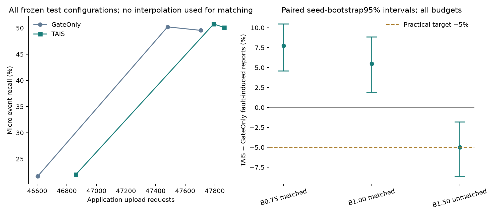

# BM-1 results: confirmation did not clear the budget-matched value gate

**Decision: NO-GO for further complexity/tuning of the current confirmation mechanism.** Two final budget points genuinely matched within the predeclared1% sample/upload tolerances; both produced more fault-induced false reports. The1.5 point reduced fault-induced reports by exactly5%, but its sample gap was **1.0298%**, above1%, so it is **unmatched and ineligible**. That positive but unmatched result is retained; it is not rounded into a success.

## What actually ran, and when decisions froze

Base `97feccb36acb6790b40be31e3cee1661e8811a61`; original `tais.scheduler`/`replay`/`metrics`/generator and both C/upstream dependencies unchanged. Preregistration `9ab0b1212ac5e777491491183880039db6a74fcf`; runner/analyzer freeze `d22fb50097037ac1913d3bac163c6a31a907716f`; parameter lock **`7600f2c1d0093bfe840d9c35d3ae1d3bfe7433ce` before final generation**. The [preregistration](BUDGET_MATCHED_EXPERIMENT_PREREGISTRATION.md), [plan](../configs/budget-matched.json), [selection](../results/budget-matched/selection.json) and all243candidate grid pairs are preserved.

Seed audit found no prior150–199 use within accessible Git history, ignored experimental files or TAIS-external-data. Development150–159: **9,000 scored runs**; validation160–169: **9,000**; final170–199: **10,800**, all45scenarios and all frozen configurations. Total28,800 scored policy runs plus3,840 cached clean counterfactual runs, used only offline for attribution. No final policy configuration was rerun, thinned, interpolated or selected after results. Four workers changed execution order, not deterministic outputs.

Both calibration grids used9multipliers for each main policy plus two1.0 context baselines. Selection read only resource fields and preferred common multipliers; all3chosen pairs are exactly the same0.75/1/1.5 within GateOnly and TAIS. Consequently the intended core difference here is the existing confirmation switch and its downstream sampling/history effects, not different selected thresholds. All20calibration operating points remain in their own CSVs. Eight unique final operating points cover the3budgets plus AdaptiveSense/TrustLog context; duplicate native controls were executed once, not once per label.

These are fresh noise seeds from the **same controlled synthetic generator**, not natural-fault evidence or real-environment external validation. Seeds0–199 must now be regarded as used/reserved for future research.

## Actual budget matching, no near-miss waiver

| Budget | Gate / TAIS multiplier | Samples G / T | Sample gap | Uploads G / T | Upload gap | Final matched |
| --- | --- | --- | --- | --- | --- | --- |
| B0.75 | 0.75 / 0.75 | 78,869 / 78,990 | 0.1534% | 47,705 / 47,864 | 0.3333% | True |
| B1.00 | 1.0 / 1.0 | 76,097 / 76,595 | 0.6544% | 47,481 / 47,793 | 0.6571% | True |
| B1.50 | 1.5 / 1.5 | 71,374 / 72,109 | 1.0298% | 46,603 / 46,861 | 0.5536% | False |

Relative gaps are `abs(TAIS−Gate)/Gate`, unrounded for eligibility. B1.50 uses735extra samples out of71,374, i.e.1.029786757%; it fails even though both calibration phases met1%. No test-specific multiplier change, replacement pair, sample deletion or tolerance relaxation was performed. B1.50 remains descriptive in every table and figure.

Budget targets came only from development GateOnly resource means at the three fixed anchors. Absolute final budget vectors moved with fresh noise; they are recorded below rather than claimed exactly equal to the old vector. The preregistered final matching test concerns the two real configurations' sample/upload gaps, not post-hoc absolute target redefinition.

| Budget | Development target samples/run,uploads/run | Final Gate samples/run,uploads/run | Final TAIS samples/run,uploads/run |
| --- | --- | --- | --- |
| B0.75 | 58.7711, 35.4822 | 58.4215, 35.3370 | 58.5111, 35.4548 |
| B1.00 | 56.4956, 35.3067 | 56.3681, 35.1711 | 56.7370, 35.4022 |
| B1.50 | 53.1089, 34.5333 | 52.8696, 34.5207 | 53.4141, 34.7119 |

## Primary paired findings

TAIS-minus-Gate differences, micro totals over30seed clusters,10,000 paired percentile Bootstrap draws,95% intervals. Recall differences are **percentage points**, not relative percentages. Each point has900 scenario-level event labels generated independently of policy outputs. Shared latent/noise across fault scenarios is retained within30seed clusters; these are not900independent statistical observations.

| Budget | TP G / T (900truth) | Recall difference (pp),95%CI | Fault-induced G / T | Relative difference,95%CI | Decision |
| --- | --- | --- | --- | --- | --- |
| B0.75 | 446 / 451 | +0.5556 [0.0000, 1.2222] | 531 / 572 | +7.7213% [4.5692, 10.4651] | NO-GO |
| B1.00 | 452 / 457 | +0.5556 [0.0000, 1.2222] | 456 / 481 | +5.4825% [1.9190, 8.8435] | NO-GO |
| B1.50 | 195 / 198 | +0.3333 [0.0000, 0.6667] | 340 / 323 | -5.0000% [-8.6354, -1.8180] | NO-GO |

The matched B0.75 and B1.00 points add5detected events each; neither Recall95%CI lower bound is strictly above0. Both satisfy the−1pp noninferiority gate, but this does not establish superiority. Their fault-induced counts rise by41 (95%CI25–54) and25 (9–39), respectively. Relative increases are7.7213% and5.4825%, with intervals supporting an increase rather than the required decrease. Strict unmatched reports also increase by40 (24–53) and28 (13–42).

At unmatched B1.50, fault-induced340→323 (−17,95%CI−30to−6), exactly−5%; true events195→198. Direction survives the adjusted interval and all deletion checks, but **resource matching fails**. Its absolute Recall is only21.6667%/22.0000%, much lower than either policy's default point. It cannot be substituted for a matched default-budget success or used to change the frozen acceptance rule.

Three budgets were the fixed comparison family, including unmatched ones. Conservative98.3333% intervals and the predetermined robustness checks agree with the final gate outcome:

| Budget | Recall difference98.3333%CI (pp) | Fault relative difference98.3333%CI (%) | Deletion checks passed /83 |
| --- | --- | --- | --- |
| B0.75 | [0.0000, 1.4444] | [3.8530, 10.9773] | 1 /83 |
| B1.00 | [0.0000, 1.4444] | [1.0489, 9.4526] | 1 /83 |
| B1.50 | [0.0000, 0.8889] | [-9.4828, -1.4464] | 83 /83 |

Each point has30leave-one-seed,45leave-one-scenario and8leave-one-fault-class/clean checks. B0.75/B1.00 pass only the deletion of drift, where spike benefits remain; their original aggregate fault objective fails. B1.50 passes all83 but is still ineligible. The full249rows are retained; no favorable subgroup/95%interval substitutes for the conjunction of all gates.

## Full micro metrics and real application costs

All below are **new** final-test values, not copied from old20–49 results. Context AS/TrustLog are not sample/upload-matched against TAIS and cannot establish the primary mechanism comparison.

| Method | Multiplier | TP / misses | Precision | Recall | F1 | Strict unmatched | Fault-induced |
| --- | --- | --- | --- | --- | --- | --- | --- |
| AdaptiveSense | 1.0 | 450 / 450 | 30.7167% | 50.0000% | 38.0550% | 1,015 | 678 |
| AdaptiveSense+TrustLog | 1.0 | 450 / 450 | 30.7167% | 50.0000% | 38.0550% | 1,015 | 678 |
| GateOnly | 0.75 | 446 / 454 | 33.1106% | 49.5556% | 39.6974% | 901 | 531 |
| GateOnly | 1.0 | 452 / 448 | 35.5906% | 50.2222% | 41.6590% | 818 | 456 |
| GateOnly | 1.5 | 195 / 705 | 27.7383% | 21.6667% | 24.3294% | 508 | 340 |
| TAIS | 0.75 | 451 / 449 | 32.3994% | 50.1111% | 39.3543% | 941 | 572 |
| TAIS | 1.0 | 457 / 443 | 35.0729% | 50.7778% | 41.4889% | 846 | 481 |
| TAIS | 1.5 | 198 / 702 | 28.8210% | 22.0000% | 24.9527% | 489 | 323 |

| Method | Multiplier | Samples | Uploads | JSON bytes | Binaryv1 bytes | Conditional mean event delay(s) |
| --- | --- | --- | --- | --- | --- | --- |
| AdaptiveSense | 1.0 | 101,428 | 49,834 | 8,004,465 | 1,455,463 | 24.0178 |
| AdaptiveSense+TrustLog | 1.0 | 101,428 | 49,834 | 13,376,374 | 1,754,467 | 24.0178 |
| GateOnly | 0.75 | 78,869 | 47,705 | 12,807,398 | 1,678,263 | 25.0135 |
| GateOnly | 1.0 | 76,097 | 47,481 | 12,748,490 | 1,670,781 | 26.0619 |
| GateOnly | 1.5 | 71,374 | 46,603 | 12,516,698 | 1,640,747 | 24.7744 |
| TAIS | 0.75 | 78,990 | 47,864 | 12,850,355 | 1,683,987 | 23.8847 |
| TAIS | 1.0 | 76,595 | 47,793 | 12,832,830 | 1,682,013 | 24.3895 |
| TAIS | 1.5 | 72,109 | 46,861 | 12,586,254 | 1,650,035 | 19.3586 |

JSON bytes use the original exact envelope serialization. Existing stateless Binaryv1 is an equally applied secondary accounting format; v2, compression search and real radio/energy models are not used. Budget matching does not force byte equality: B1.00 TAIS costs84,340extra JSON bytes and11,232extra Binaryv1 bytes, along with498samples and312requests. This is measured application information cost, not joules or over-air packets.

## Delay, diagnostic effects and adverse scenarios

The observed differences **do not come at a longer mean detection delay**. Delay is conditional on detected truth, so matched-event intersections are also reported to avoid survivor bias:

| Budget | Conditional means G / T(s) | Common matched events | Common-event T−G delay(s),95%CI |
| --- | --- | --- | --- |
| B0.75 | 25.0135 / 23.8847 | 446 | -1.0090 [-1.7322, -0.3546] |
| B1.00 | 26.0619 / 24.3895 | 452 | -1.5487 [-2.2876, -0.8658] |
| B1.50 | 24.7744 / 19.3586 | 195 | -5.3333 [-6.8000, -3.9356] |

All Gate-detected events at these points belong to the common-matched set; TAIS adds5/5/3events. The default point's common-event mean delay improves1.5487s,95%CI[−2.2876,−0.8658]. Faster detection is a real secondary benefit here, but does not offset failure of the predeclared fault-false objective.

At B1.00, fault diagnosis rate is684/1,260=54.2857% for both policies; conditional first-flag delay is119.7558s for both. The0.75 and1.5 comparisons likewise have equal overall fault detection counts/delays within each point. Confirmation samples are203/380/282 for TAIS versus0 for GateOnly; diagnostic counts are11,904/11,258/9,635 versus11,772/11,033/9,530. Confirmation and diagnostic annotations can overlap; do not add them as disjoint acquisition counts. Full diagnostic/type detection and reconstruction metrics remain in all per-run and subgroup CSVs.

Default-point subgroup counts (groups overlap; no-event Recall is **N/A**, not0):

| B1.00 group | Truth | TP G / T | Strict unmatched G / T | Fault-induced G / T | Sample difference T−G | Upload difference T−G |
| --- | --- | --- | --- | --- | --- | --- |
| kind:clean | 60 | 37 / 37 | 37 / 37 | 0 / 0 | 0 | 0 |
| kind:range | 120 | 36 / 36 | 38 / 38 | 0 / 0 | 0 | 0 |
| kind:spike | 120 | 73 / 77 | 85 / 76 | 10 / 0 | -73 | 18 |
| kind:stuck | 120 | 36 / 36 | 38 / 38 | 0 / 0 | 0 | 0 |
| kind:drift | 120 | 81 / 82 | 305 / 342 | 256 / 291 | 571 | 294 |
| kind:missing | 120 | 36 / 36 | 38 / 38 | 0 / 0 | 0 | 0 |
| kind:invalid | 120 | 36 / 36 | 38 / 38 | 0 / 0 | 0 | 0 |
| kind:stable_offset | 120 | 117 / 117 | 239 / 239 | 190 / 190 | 0 | 0 |
| same_channel | 420 | 135 / 138 | 205 / 209 | 145 / 152 | 231 | 116 |
| cross_channel | 420 | 280 / 282 | 420 / 425 | 155 / 159 | 266 | 117 |
| profile:short | 450 | 123 / 128 | 171 / 168 | 97 / 92 | -3 | 23 |
| profile:long | 450 | 329 / 329 | 647 / 678 | 359 / 389 | 501 | 289 |
| no_event | 0 | 0 / 0 | 156 / 175 | 156 / 170 | 1 | 79 |

Across all3budgets, the fault-induced differences by fault category are:

| Fault category | B0.75 induced difference | B1.00 induced difference | B1.50 induced difference (unmatched) |
| --- | --- | --- | --- |
| kind:clean | 0 | 0 | 0 |
| kind:range | 0 | 0 | 0 |
| kind:spike | -10 | -10 | -8 |
| kind:stuck | 0 | 0 | 0 |
| kind:drift | 51 | 35 | -9 |
| kind:missing | 0 | 0 | 0 |
| kind:invalid | 0 | 0 | 0 |
| kind:stable_offset | 0 | 0 | 0 |

At matched B1.00, spike scenarios improve: fault-induced10→0,TP73→77, samples−73. Drift scenarios worsen: fault-induced256→291,TP81→82, samples+571 anduploads+294. The largest adverse case is `drift_none_long` (+18fault-induced reports), then `drift_same_long` and `drift_cross_long` (+8each). This is a confirmation/spike-recovery versus persistent-drift tradeoff; it is not evidence that spatial information or a new rule was tested.

Same-channel, cross-channel and short-event TP gains remain visible, while long-event detection count is unchanged at matched points and long-profile false reports rise. Range,stuck,missing/invalid and stable-offset rows are identical between the policies at a common multiplier. Stable-offset blindness and same-channel information erasure remain limitations. Profiles jointly vary fault duration,intensity and event duration; these data do not isolate each as an independent physical factor.

## Validation, provenance and boundaries

Local experiment tests: **14passed**. Full suite before calibration:434passed,2existing strict xfailed; final full suite: **434passed,2existing strict xfailed,0failed (19.62s)**. The two unchanged rearm high-threshold pulse assertions remain expected failures; no test or assertion was removed. Old-seed20 smoke/end-to-end tests exercised the complete selection/statistics/reporting path before final generation. No test used new final noise for debugging.

Upstream tests ran in disposable copies so their checkout bytes remained protected: AdaptiveSense **235 tests passed** and **69 configuration checks passed**; SensorTrust **27 Python tests passed**, its C11 compile passed with warnings as errors, and **21 C tests /404 checks passed**. See [upstream logs](../results/budget-matched/checks/upstream_checks.json).

Every9,000development,9,000validation and10,800test row was independently recomputed with the original evaluator from saved signals, sampled records and counterfactual reports, including reconstruction and both byte formats. This **did not invoke the scheduler again**. All34,890new compressed artifacts were checksum-verified. A history guard confirms **521baseline files,150,108existing ignored experimental files, both submodules and external raw-file stat signatures unchanged**. Code/config/source hashes and the pre-test selection SHA are pinned in the split manifests; every paired method shares exact observed/truth/fault fingerprints.

[Final verification](../results/budget-matched/checks/final_verification.json), [source/environment](../results/budget-matched/checks/environment.json), [full intervals](../results/budget-matched/test/analysis/paired_intervals.csv), [absolute intervals](../results/budget-matched/test/analysis/absolute_intervals.csv), [event-level intersections](../results/budget-matched/test/analysis/common_matched_event_pairs.csv). All45scenario outcomes, all grids and ineligible results are public. Full raw new trajectories are local/ignored with manifest hashes and generation commands; no old archive was overwritten.

The frozen analyzer has one disclosed **manifest self-hash defect**: it creates its manifest before enumerating output hashes, recording the empty-file hash for its own entry. All other output hashes match. The original manifest is retained; [supplementary delivery integrity](../results/budget-matched/checks/delivery_integrity.json) pins the completed manifest, all analysis outputs and phase CSV/manifests, and verifies the unchanged pre-test lock and source files. No policy, numerical result, interval, decision or selection was changed or rerun to correct this reporting metadata issue.

## Research decision

**Stop increasing complexity or repeatedly retuning the current confirmation mechanism. Retain GateOnly as the simpler competitor.** This study did not establish sufficient independent confirmation value at its predefined matched budgets. It does not prove confirmation can never help: spike benefits, faster detections and the unmatched1.5result are explicitly positive secondary findings. Those findings do not pass the present rule and are not repackaged as a GO.

The result is limited to this generator, its45scenarios, one simultaneous fault channel, the fixed9point calibration grid,1%resource matching tolerance and this30seed final cohort. Strict paired budgets are not hard real-time caps. Finite seed clusters and rare event differences limit precision; subgroup CIs are descriptive with overlapping groups, not independent validation. No natural fault labels, physical deployment, wireless delivery, energy measurement or external data validation is claimed. A different mechanism requires a separate task/protocol and fresh audited data, not an extension on these final seeds.

Reproduction commands and file roles: [results README](../results/budget-matched/README.md). The preregistration and selected lock are preserved, not revised after seeing the near-miss point.
