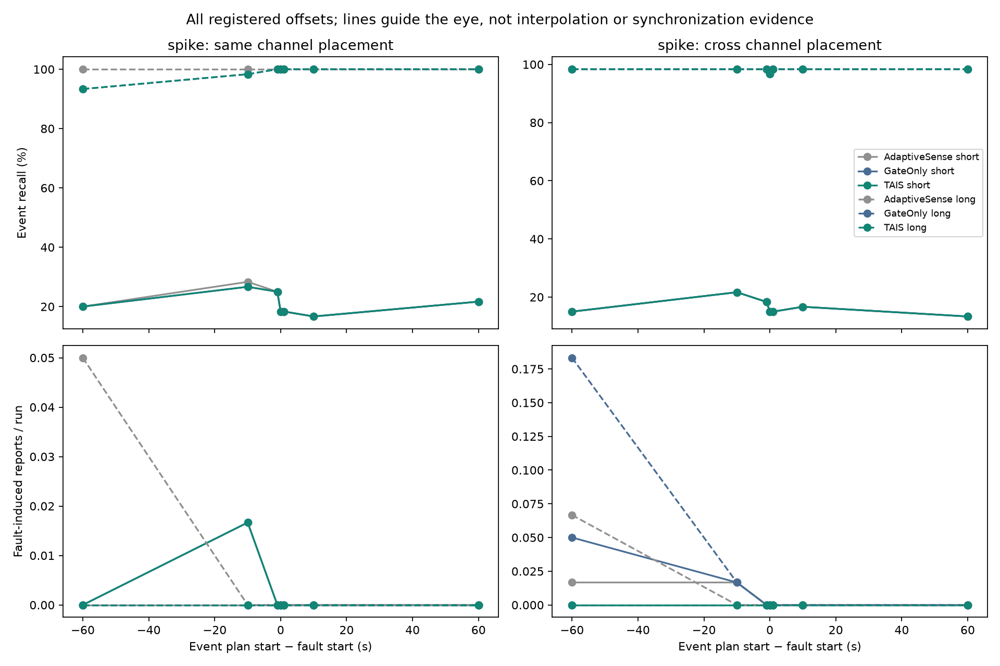
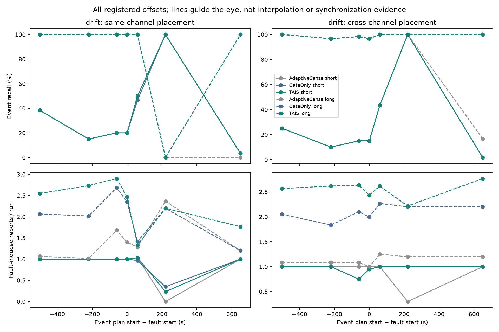
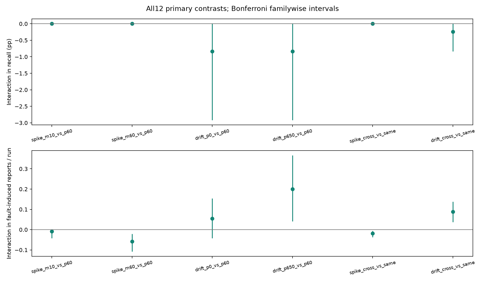
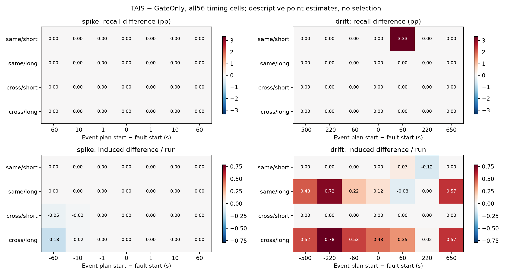

# FO-1: timing dependence and limits of observed evidence

**Completed synthetic benchmark; unchanged policies, no tuning. BM-1 confirmation NO-GO is preserved.**

The final matrix shows **timing-dependent false-report effects, not a general confirmation advantage**: overlapping spikes have14→1 operational fault-induced reports at equal262/360TP, while drift has2,688→3,022reports and only2additional TP. All480 replacement/stuck event/no-event pairs have identical full observed inputs despite different truth. Four of12predeclared interactions survive multiplicity and deletion checks; none is a Recall interaction.

## Scope, freezing and actual execution

Base `5b06d2feae44db2b3503697d246f51c43e5d8f2e`. Protocol commit `02c67a7293be1480cb99cd7f6dd19a6c82898235`; implementation `4b85e94ca9d266c8031ca55c1b5165e878635337`; completed software log `b7551fb87934f31048861264d7a8e71e3f45ee55`; **pre-final lock `1030868705e0ca004392ad1a5d3c597f66478a23`**. The protocol and code were frozen before new-noise generation; development/validation did not select parameters. [Protocol](FAULT_EVENT_OBSERVABILITY_PREREGISTRATION.md) and [final lock](../results/fault-event-observability/final-lock.json) remain unchanged.

| Phase | Seeds | Scored runs | Offline clean counterfactuals | Gzip artifacts |
| --- | --- | --- | --- | --- |
| development | 200–219 | 5580 | 2700 | 10140 |
| validation | 220–239 | 5580 | 2700 | 10140 |
| test | 240–299 | 16740 | 8100 | 30420 |

All93 scenarios ×three methods at multiplier1.0. Original45 delegated byte-identically to historical generation;48 added timing cases exclude already-counted default+60. Final240–299 ran once per method/case; metric verification reads saved artifacts without invoking policy. Seeds0–299 are now used/reserved. These are new random seeds under the same controlled model, **not external real-environment validation**.

Sampling/uploads differ naturally; this is **not a budget-matched causal policy comparison**. Short/long jointly change fault duration/intensity and event duration. Temperature/humidity have different amplitudes, noise floors and trust settings. Cross/same results do not isolate topology alone or establish a new fusion algorithm.

## Full final outcomes

| Method | TP / truth | Recall | Precision | F1 | Misses | Strict unmatched | Fault-induced |
| --- | --- | --- | --- | --- | --- | --- | --- |
| AdaptiveSense | 2,503 / 4,680 | 53.483% | 32.578% | 40.492% | 2,177 | 5,180 | 2,866 |
| GateOnly | 2,600 / 4,680 | 55.556% | 32.488% | 41.000% | 2,080 | 5,403 | 3,065 |
| TAIS | 2,602 / 4,680 | 55.598% | 31.021% | 39.822% | 2,078 | 5,786 | 3,383 |

| Method | Samples | Uploads | Exact JSON bytes | Event delay(s) | Fault flags / episodes | Flag delay(s) |
| --- | --- | --- | --- | --- | --- | --- |
| AdaptiveSense | 493,167 | 231,717 | 37,373,379 | 30.409 | N/A (not implemented) | N/A |
| GateOnly | 389,263 | 213,402 | 57,463,946 | 31.818 | 2,121 / 5,400 | 165.534 |
| TAIS | 393,723 | 215,798 | 58,111,297 | 31.262 | 2,121 / 5,400 | 165.534 |

Overall TAIS−GateOnly paired differences (whole-seed95%CIs): Recall 0.043 [0.000, 0.107]pp; fault-induced 318.000 [281.000, 358.000]; strict unmatched 383.000 [339.000, 429.000]; samples 4,460.000 [4,012.975, 4,910.000]; uploads 2,396.000 [2,236.000, 2,558.000]; JSON bytes 647,351.000 [604,160.250, 690,989.425]. The overall mixture is a benchmark weighting, not natural occurrence prevalence.

Delay is conditional on matched truth; [common-matched delay](../results/fault-event-observability/test/analysis/common_matched_delay.json) supplies the paired intersection and misses remain explicit. Diagnostic/confirmation counts overlap and do not automatically represent extra samples. Counterfactual incremental samples/uploads/JSON are preserved separately; intervention-induced schedule changes prevent a unique diagnostic-only causal interpretation.

## All spike and drift timing points

Offsets refer to **waveform plan start**. Physical truth starts2–3seconds later because of the unchanged threshold/ramp label. Spike offsets−1,0,+1 are sequential with respect to labeled truth, even when part of the physical ramp may already exist. Spike−10 overlaps truth in both profiles;−60 overlaps only long events. All temporal groups use actual interval/shared-point labels, not offset sign. [All56 geometry rows](../results/fault-event-observability/timing_geometry.csv) report inclusive-label versus half-open injection boundaries, geometric duration and sampled-grid overlap separately.

### spike

| Offset(s) | Truth | TP Gate / TAIS | Recall difference(pp),95%CI | Induced Gate / TAIS | Induced difference,95%CI |
| --- | --- | --- | --- | --- | --- |
| -60 | 240 | 136 / 136 | 0.000 [0.000, 0.000] | 14 / 0 | -14.000 [-22.000, -7.000] |
| -10 | 240 | 147 / 147 | 0.000 [0.000, 0.000] | 3 / 1 | -2.000 [-6.000, 0.000] |
| -1 | 240 | 145 / 145 | 0.000 [0.000, 0.000] | 0 / 0 | 0.000 [0.000, 0.000] |
| 0 | 240 | 138 / 138 | 0.000 [0.000, 0.000] | 0 / 0 | 0.000 [0.000, 0.000] |
| 1 | 240 | 139 / 139 | 0.000 [0.000, 0.000] | 0 / 0 | 0.000 [0.000, 0.000] |
| 10 | 240 | 139 / 139 | 0.000 [0.000, 0.000] | 0 / 0 | 0.000 [0.000, 0.000] |
| 60 | 240 | 140 / 140 | 0.000 [0.000, 0.000] | 0 / 0 | 0.000 [0.000, 0.000] |

### drift

| Offset(s) | Truth | TP Gate / TAIS | Recall difference(pp),95%CI | Induced Gate / TAIS | Induced difference,95%CI |
| --- | --- | --- | --- | --- | --- |
| -500 | 240 | 158 / 158 | 0.000 [0.000, 0.000] | 367 / 427 | 60.000 [47.000, 74.000] |
| -220 | 240 | 133 / 133 | 0.000 [0.000, 0.000] | 351 / 441 | 90.000 [76.000, 104.000] |
| -60 | 240 | 140 / 140 | 0.000 [0.000, 0.000] | 392 / 437 | 45.000 [34.000, 57.000] |
| 0 | 240 | 139 / 139 | 0.000 [0.000, 0.000] | 378 / 411 | 33.000 [23.000, 44.000] |
| 60 | 240 | 174 / 176 | 0.833 [0.000, 2.083] | 339 / 359 | 20.000 [5.000, 34.000] |
| 220 | 240 | 180 / 180 | 0.000 [0.000, 0.000] | 345 / 339 | -6.000 [-11.000, -1.000] |
| 650 | 240 | 123 / 123 | 0.000 [0.000, 0.000] | 324 / 392 | 68.000 [50.000, 88.000] |

Full profiles/topologies are retained in [all56 timing cells](../results/fault-event-observability/interpretation/all56_timing_cells.csv) and the original per-run CSVs. No interpolation, budget point selection or scenario trimming was performed.

## Primary timing interactions and multiplicity

Let Δ be TAIS−GateOnly. The table reports Δ(left)−Δ(right). False-report interactions are **per run**, not cohort totals; Recall is percentage points.10,000 Bootstrap draws resample60whole seeds. Twelve fixed tests use Bonferroni99.583333% intervals;95% descriptive intervals and every deletion check remain in CSV. A robust interaction requires adjusted exclusion of0 and direction retained after each seed/scenario deletion.

| Contrast | Outcome | Estimate | Adjusted interval | Excludes0 | Deletion direction |
| --- | --- | --- | --- | --- | --- |
| spike_m10_vs_p60 | recall | 0.000 | [0.000, 0.000] | False | 0 / 68 |
| spike_m10_vs_p60 | fault_induced_false_per_run | -0.008 | [-0.042, 0.000] | False | 67 / 68 |
| spike_m60_vs_p60 | recall | 0.000 | [0.000, 0.000] | False | 0 / 68 |
| spike_m60_vs_p60 | fault_induced_false_per_run | -0.058 | [-0.108, -0.021] | True | 68 / 68 |
| drift_p0_vs_p60 | recall | -0.833 | [-2.917, 0.000] | False | 67 / 68 |
| drift_p0_vs_p60 | fault_induced_false_per_run | 0.054 | [-0.042, 0.154] | False | 66 / 68 |
| drift_p650_vs_p60 | recall | -0.833 | [-2.917, 0.000] | False | 67 / 68 |
| drift_p650_vs_p60 | fault_induced_false_per_run | 0.200 | [0.041, 0.367] | True | 68 / 68 |
| spike_cross_vs_same | recall | 0.000 | [0.000, 0.000] | False | 0 / 88 |
| spike_cross_vs_same | fault_induced_false_per_run | -0.019 | [-0.037, -0.006] | True | 88 / 88 |
| drift_cross_vs_same | recall | -0.238 | [-0.833, 0.000] | False | 87 / 88 |
| drift_cross_vs_same | fault_induced_false_per_run | 0.088 | [0.037, 0.138] | True | 88 / 88 |

## Actual overlap and channel placement

| Group | Truth | TP Gate / TAIS | Induced Gate / TAIS | Recall Δ(pp),95%CI |
| --- | --- | --- | --- | --- |
| spike:temporal:overlap | 360 | 262 / 262 | 14 / 1 | 0.000 [0.000, 0.000] |
| spike:temporal:event_before_fault | 120 | 21 / 21 | 3 / 0 | 0.000 [0.000, 0.000] |
| spike:temporal:fault_before_event | 1,200 | 701 / 701 | 0 / 0 | 0.000 [0.000, 0.000] |
| drift:temporal:overlap | 840 | 612 / 614 | 1,349 / 1,441 | 0.238 [0.000, 0.595] |
| drift:temporal:event_before_fault | 600 | 312 / 312 | 823 / 973 | 0.000 [0.000, 0.000] |
| drift:temporal:fault_before_event | 240 | 123 / 123 | 324 / 392 | 0.000 [0.000, 0.000] |
| spike:same | 840 | 503 / 503 | 1 / 1 | 0.000 [0.000, 0.000] |
| spike:cross | 840 | 481 / 481 | 16 / 0 | 0.000 [0.000, 0.000] |
| drift:same | 840 | 506 / 508 | 1,215 / 1,333 | 0.238 [0.000, 0.595] |
| drift:cross | 840 | 541 / 541 | 1,281 / 1,473 | 0.000 [0.000, 0.000] |

These group intervals are descriptive and overlap. Cross means an event on healthy **humidity** while temperature is faulty, not an independent reference measuring the same physical temperature. An event on the unaffected channel supplies independent event evidence when sampled, but this does not identify the cause of temperature change. Healthy-channel isolation and failure to acquire a short event are separate properties.

## Observations versus physical identification

| Method/group | Fault runs | Entire fault unsampled | Event runs | Entire event unsampled | Flagged but event missed | Event found, no fault flag |
| --- | --- | --- | --- | --- | --- | --- |
| GateOnly/kind:spike | 1800 | 1767 | 1680 | 557 | 7 | 958 |
| GateOnly/kind:drift | 1800 | 0 | 1680 | 456 | 79 | 256 |
| GateOnly/same | 2280 | 823 | 2400 | 706 | 429 | 748 |
| GateOnly/cross | 2280 | 824 | 2280 | 683 | 187 | 694 |
| TAIS/kind:spike | 1800 | 1767 | 1680 | 557 | 7 | 958 |
| TAIS/kind:drift | 1800 | 0 | 1680 | 456 | 77 | 256 |
| TAIS/same | 2280 | 823 | 2400 | 706 | 427 | 748 |
| TAIS/cross | 2280 | 824 | 2280 | 683 | 187 | 694 |

A1-second spike can fall entirely between samples despite a5-second minimum requested interval; its absence from sampled observations is not successful spike diagnosis. A missed event with no in-truth sample lacks evidence, while misses despite samples can involve debounce, trust suppression or baseline recovery; sample presence alone does not prove sufficient duration evidence. Per-report preceding intervals and event/flag timestamps are in the committed CSVs; full health/score/state traces are archived with hashes.

Fault Recall here means **any nonzero C flag during the injected interval**, with type-specific counts separate. Pre-existing event-induced flags can count; it is not calibrated causal diagnosis. Plain AdaptiveSense has no diagnostic output, so no causal comparison of its structural zeros is made. Event-found/no-flag and wrong-type counters are joint detection descriptors, not source-attribution accuracy. No physical source classifier was implemented; that accuracy is **N/A**.

The original replacement/stuck cases provide an exact within-model boundary: range,missing,invalid and stuck each have short/long same-channel-event versus no-event pairs with different latent truth. The scheduled event is contained inside the replacement interval, and shared noise/background resumes identically outside it. [Equivalence results](../results/fault-event-observability/test/analysis/observational_equivalence.csv) compare the **entire two-channel1-Hz post-injection stream**, not only missing windows, and all three complete policy outputs. If observations match, any deterministic causal policy with the same initial state receives identical sampled histories by induction, even if it changes its sampling schedule. Different truth cannot then be guaranteed uniquely distinguished without new information or assumptions. Numerical matching to a coincident report is not physical recognition.

For additive drift and spikes, these registered timing cases do not themselves establish full-stream equivalence. Bias plus unknown real change can admit multiple physical decompositions without constraints, but poor success rates alone do not prove an information-theoretic impossibility. The dataset does not provide calibrated same-quantity spatial redundancy, extra references or a unique physical dynamics model. Type flags can add sampled evidence but do not resolve every decomposition.

## Validation, failures and reproducibility

**65new tests passed;499full software tests passed,2unchanged strict expected failures,0failed**, before new development generation. Original45 cases have bytewise old-seed20 generation regression; all offsets/boundaries, physical-label independence, policy input equality, future/hidden-data noninterference and full93-case old-seed20 execution/analysis/recomputation are tested. Existing high-threshold rearm pulse xfails and every old test remain unchanged.

A partial old-seed20 CLI smoke analysis initially raised a missing-partner KeyError in equivalence reporting. The failed partial output and notes were retained. Requiring both members fixed that helper before any200–299 trajectory; corrected smoke and the complete-matrix test passed. A first ad-hoc import lacked PYTHONPATH and was corrected before data generation. No generator/label/protocol change was made after new seeds opened. See [execution notes](../results/fault-event-observability/checks/execution_notes.json).

All scored metrics and event matches were independently recomputed from saved records, with no policy rerun. Raw/checksum/paired source inputs and analysis outputs were checked; analysis manifests exclude themselves from their output hashes. Final history protection checks576baseline files,185,135old ignored files, both pinned submodules and external raw-file stat signatures. [Final verification](../results/fault-event-observability/test/verification.json). Raw archive data remain outside Git with reproducible commands and manifests. [Results README](../results/fault-event-observability/README.md).

The original research, BM-1 NO-GO, Wire v1/v2, OSP-1 and raw workbooks were not changed. No new thresholds, confirmation states, attribution classifier or scheduler were introduced. No physical energy, over-air delivery, natural-fault validity, universal identifiability or budget-matched superiority claim is supported. A future mechanism requires a new protocol and unused audited seeds.

## Answers and next research decision

**Timing dependence exists, but it does not rescue the current confirmation mechanism.** Across the full final matrix, GateOnly/TAIS detect2,600/2,602 of4,680 events; Recall difference is+0.042735pp (95%CI[0,+0.106838]pp). TAIS adds318 fault-induced reports (95%CI281–358),383strict unmatched reports (339–429),4,460samples and2,396requests. Original45-case control results also retain the adverse direction: fault-induced891→935. BM-1's budget-matched NO-GO is neither rerun nor overturned.

1. **Spike improvement is conditional, and not confined to the old sequential arrangement.** At default+60 on these fresh seeds, all240events yield identical140TP and0fault-induced reports for GateOnly/TAIS: the old small benefit does not recur here. Over all spike cases the methods have identical984/1,680TP; fault-induced17→1. Same-channel placement has1→1, cross placement16→0. Offset−60 has14→0, while−10 has3→1; all other registered offsets have0→0. This is a distribution of effects, not uniform spike immunity.

2. **There is an actual-overlap false-report benefit, without a Recall benefit.** The labeled-overlap spike group has262/360TP for both, and fault-induced14→1 (descriptive paired difference−13,95%CI[−22,−6]); requests increase27. The more specific primary−10versus+60 interaction has fault difference−0.008333/run, adjusted interval[−0.041667,0], and does not establish a robust adjusted interaction. The−60versus+60 interaction is−0.058333/run, adjusted[−0.108333,−0.020833], with68/68deletion directions preserved. Because−60 is overlapping only for long events, that primary result must not be relabeled proof about every concurrent event/profile.

3. **Drift harm depends on timing and is not explained by overlap alone.** Fault-induced differences TAIS−GateOnly across offsets−500,−220,−60,0,+60,+220,+650 are respectively **+60,+90,+45,+33,+20,−6,+68**. The−6 at+220 is retained, not omitted. Across drift cases, counts rise2,688→3,022 (+334,95%CI[299.975,372]) while TP rises1,047→1,049; both policies flag930/1,800episodes. Event-before-fault groups add150false reports, overlapping groups92, and post-fault-event groups68. A true event need not overlap drift for the extra reports to occur. The+650versus+60 primary interaction is+0.2false reports/run (adjusted[0.040964,0.366667],68/68deletions);0versus+60 is not adjusted-supported. There is no basis for a monotonic overlap-duration law: profile changes intensity/duration jointly, and moving events also changes sampling histories.

   The adverse drift difference is concentrated in the **long joint profile**: fault-induced1,847→2,184 (+337), equal775/840TP, samples+4,320 andrequests+2,307. Short-profile drift has841→838 (−3),272→274TP, samples+229 andrequests+66. Any/type-specific in-interval flags are30/27 of900short episodes versus900/900of900long episodes, equally for GateOnly/TAIS; conditional first-flag delays are202.5s and240.7278s. These are descriptive joint-profile counts, not an isolated duration effect or evidence of uniquely correct physical cause. Short/long also change intensity1→2 and event duration26→180s.

   Delay also has an adverse subgroup: in drift-after-fault event cases, equal123/240TP accompany a **+7.6423s** TAIS conditional delay difference (descriptive95%CI[2.0635,13.5953]). Overall common-event delay is0.5423s shorter (95%CI[−0.8472,−0.2207]); the overall mean cannot hide the post-fault penalty. Drift-overlap detection is faster while false reports increase. These are distinct tradeoffs.

4. **There is no generic cross-channel win.** Over spike timing cells, same/cross TAIS TP is503/840versus481/840; over drift it is508/840versus541/840. Confirmation adds no cross-channel TP in either kind. Its cross-minus-same false-effect interaction is−0.019048/run for spikes (adjusted[−0.036905,−0.005952],88/88deletions), but **+0.088095/run** for drift ([0.036905,0.138095],88/88). Four of12primary interactions pass both adjusted exclusion and every direction deletion, all on false reports; none is a Recall interaction. Different event channels and physical/noise settings confound a universal topology explanation. An unaffected humidity event is independent event evidence, not a validated reference for a drifting temperature reading.

5. **Available evidence sometimes supports event reporting, but does not guarantee identifying its physical cause.** A healthy event-bearing channel can carry an observable event when actually sampled; an additive fault may leave much of a waveform present. Timely C flags are additional heuristics. These are opportunities, not sufficient conditions for unique attribution. Sparse sampling remains severe: **1,767/1,800spikes are never sampled** by either GateOnly or TAIS; in1,680event-bearing spike cases557 have no sample inside truth. For drift, all1,800fault intervals are sampled, but456/1,680event intervals are entirely unsampled. Merely taking one in-truth sample still does not guarantee10-second persistence evidence.

6. **An exact observational ambiguity is demonstrated within this model.** All480registered range/missing/invalid/stuck same-channel versus no-event pairs have different latent/event labels but identical complete two-channel post-injection streams, and identical full outputs for each of the three policies. This holds for all60seeds and both profiles, not a selected trace. They cannot be uniquely distinguished by any deterministic causal policy receiving only those observations. GateOnly/TAIS match0/480 of those erased events; AdaptiveSense numerically matches36/480 **despite the same observed data in the no-event worlds**. Those36matches cannot demonstrate physical recognition. [Matching boundary counts](../results/fault-event-observability/interpretation/equivalence_matching_boundary.csv) make this distinction explicit. This finite constructed counterexample does not assert every drift/spike case is indistinguishable; a separate model/information-bound analysis would be needed for that stronger statement.

7. **Recommended next scientific question:** under a fixed acquisition budget, does an independent reference measuring the **same physical quantity** add enough information to distinguish persistent sensor bias from real local change, while preserving local events? The evidence motivates testing information sufficiency, rather than lengthening confirmation or adding states. A separate protocol must declare physical coupling/local-gradient assumptions, reference availability/age, common faults and local-event negative controls. Compare against equal-information single-channel history and uninformative references, with separately known interventions and fresh audited seeds. Current humidity-only cross events do not prove that proposed reference will help; identical-input cases define where extra information is essential. Real-background or deployment validity would require their own evidence.

**Decision:** retain the timing benchmark and explicit ambiguity boundary; stop increasing/tuning the current confirmation mechanism. Do not claim a new algorithm, uniquely correct physical attribution, general cross-channel advantage, natural-fault validity or reversal of the prior NO-GO.
