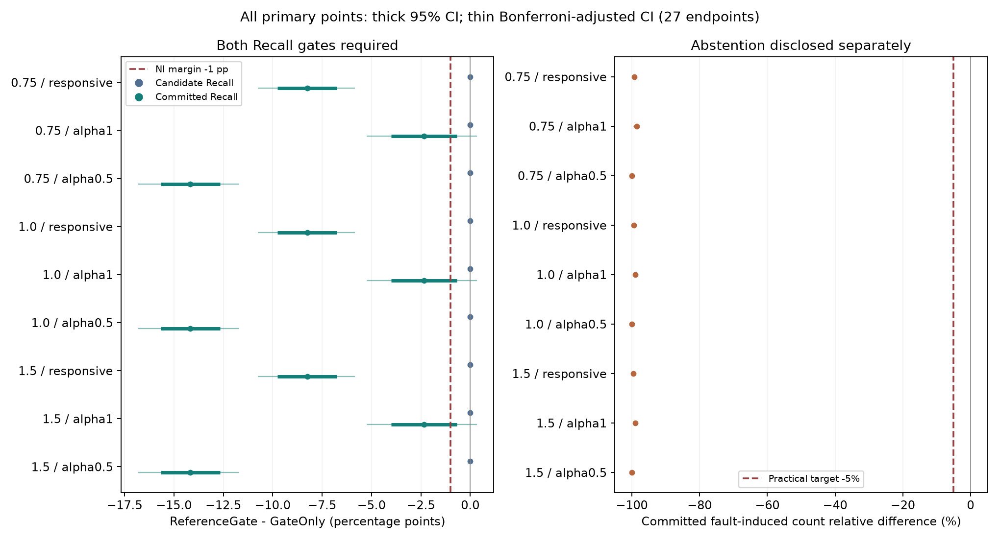
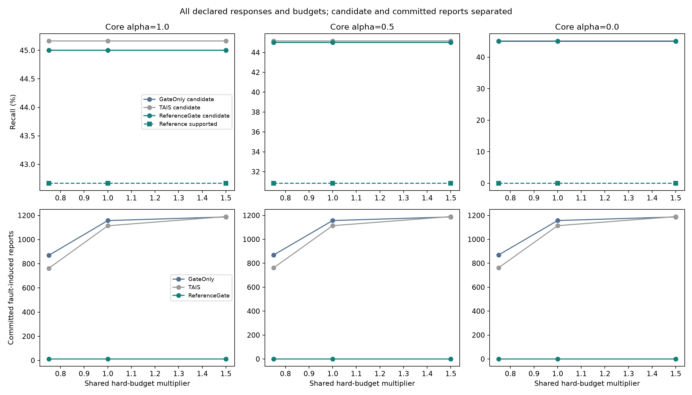
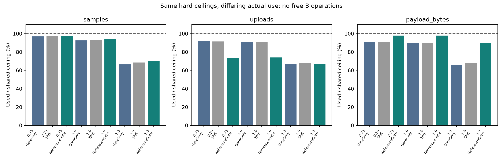

# 研究结论摘要（冻结方案的实际结果）

**当前 ReferenceGate：NO-GO。九个预定主要比较点均未通过全部门槛；不继续在本轮测试数据上调规则或增加状态。GateOnly保留为主要竞争基线，之前TAIS确认机制的NO-GO不变。** 这并不证明所有同物理量参照都无价值。

全部87场景、三策略、三预算均已执行。开发/验证各20种子、最终60种子，总计78,300个预算受限评分运行；另有1,260个开发成本校准运行和58,500个离线反事实运行。最终340–399仅执行一次。以下主要推断均为真实环境以外的合成模型证据。

## 1. 同一硬预算下，收益和损失分别是什么？

主响应组（核心α=.5/1，共2,400个真事件）在1.0档：GateOnly与ReferenceGate候选均检出1,080个，Recall均为45.00%；差值+0.000 [+0.000, +0.000]个百分点（95%CI）。ReferenceGate支持检出882个，Recall=36.75%，相对GateOnly差值为-8.250 [-9.750, -6.750]个百分点；Bonferroni校正区间为-8.250 [-10.750, -5.844]。缺少参照支持的198个原本正确候选没有被删除，但不能冒充已经得到环境支持。

| 预算 | GateOnly漂移归属的明确环境误报 | ReferenceGate支持的漂移归属误报 | 相对差值与95%CI（%） | 候选Recall差值与95%CI（百分点） | 明确环境Recall差值与95%CI（百分点） |
| --- | ---: | ---: | --- | --- | --- |
| 0.75 | 1,738 | 12 | -99.310 [-99.651, -98.958] | +0.000 [+0.000, +0.000] | -8.250 [-9.750, -6.750] |
| 1.0 | 2,314 | 12 | -99.481 [-99.738, -99.221] | +0.000 [+0.000, +0.000] | -8.250 [-9.750, -6.750] |
| 1.5 | 2,374 | 12 | -99.495 [-99.745, -99.240] | +0.000 [+0.000, +0.000] | -8.250 [-9.750, -6.750] |

误报下降具有区间支持，但不能单独判定成功。1.0档主响应组仍有2,688/3,594=74.79%已接收候选未获支持。原始未匹配候选由3,540降至2,514；原始漂移归属候选由2,314降至1,740，并未全部消失。相同预算下，读取时点、预算耗尽与上传准入共同改变了后续通知，不能把全部差异归给纯参照信息。

每档预算的响应合并组、α=1组、α=.5组均通过候选非劣检验和误报收益方向检查，但均未通过明确环境事件Recall的−1个百分点非劣门槛。逐种子/逐场景删除检查和全部校正区间均保留，未以有利子组替换总体判断。

## 2. 空间响应、形态与不可辨识边界

| 核心事件组，1.0档 | 真事件数 | GateOnly候选TP | ReferenceGate候选TP | ReferenceGate支持TP |
| --- | ---: | ---: | ---: | ---: |
| α=1.0 | 1,200 | 540 | 540 | 512 |
| α=0.5 | 1,200 | 540 | 540 | 370 |
| α=0.0 | 1,200 | 540 | 540 | 0 |

α=0严格对照的120对不同物理世界，在3档预算下有360个ReferenceGate配置级核对：完整A/B流、实际付费输入与完整输出均相同；三策略的全部1,080项配置核对也均相同。该反例不能靠确定性软件逐例保证区分。α>0的720个配置级对照中，完整B流不同，但360个实际付费输入仍完全相同。这是当前触发式采集没有取得区别证据，并非所有预算采集策略均不可能取得证据。

1.0档核心场景共付费读取B 17,925次，其中3,108次有限读数位于A的真实事件窗内。B只在初始化和主候选触发时读取，并非持续可用的免费参照。局地事件不影响B、B缺测、采样错过变化、相对于初始基线的变化不满足两次一致条件时，原因保持未决。渐变事件的主候选门控也可能在参照有潜在信息时未发起有效采集；本轮不修改该规则。

没有自然故障诊断准确率：ReferenceGate从不把B无响应直接称为漂移，故其参照专属故障归因Precision为N/A、Recall为0；C11已有标志的场景级P/R另表报告，不是独立物理因果证明。即使A、B共同变化，也只能支持环境变化存在，不能排除A同时漂移。

## 3. 新增成本是否值得？

以下为1.0档全部63个核心场景×60种子（每策略3,780运行），与上方主响应组分母不同。各运行上限均为94次A+B读取、45次上传和7,775字节；实际消耗如下。

| 策略 | A读取 | B读取 | 总读取 | 实际上传 | 实际JSON字节 |
| --- | ---: | ---: | ---: | ---: | ---: |
| GateOnly | 328,706 | 0 | 328,706 | 154,696 | 26,378,710 |
| TAIS | 330,017 | 0 | 330,017 | 154,689 | 26,374,818 |
| ReferenceGate | 316,259 | 17,925 | 334,184 | 125,859 | 28,786,154 |

相对GateOnly，ReferenceGate总读取增加1.67%，上传请求减少18.64%，但JSON字节增加9.13%；B读取占其总读取5.36%。不能把请求减少等同字节或实测能耗下降。两个策略主候选的条件平均检出延迟均为31.946s；支持检出的条件平均延迟为44.476s（n=882，与候选n=1080并非同一子集，不能把均值差当作配对额外延迟）。支持证据另有等待、漏检和条件选择，不能用相同的候选延迟掩盖支持损失。

预算分层按首次预算拒绝定义，不等于三项预算同时完全耗尽。0.75档主响应组中，ReferenceGate有290个事件起点位于首次拒绝之后，候选检出0/290；GateOnly对同一批事件也未检出，不能将这些漏检单独归因于参照预算。1.0和1.5档没有这类事件起点，故该分层Recall为N/A。已有事件的后续采样和通知仍会被拒绝或截断，完整账本保留这些记录；分层受策略自身影响，不能代替因果实验。三档预算的响应组支持TP都为882，提高到1.5档没有挽救该损失。

目前新增信息和成本未达到冻结的综合门槛，不值得继续优化这个具体规则。所有代价较高的1.5档、缺测、偏差及渐变不利结果保留在逐场景CSV。预算耗尽后事件分层是描述性结果，不是“若预算足够就必定检出”的反事实。

## 4. 下一步研究决策

停止当前ReferenceGate规则的参数和状态复杂化。若未来单独立项，优先研究“在不依赖A先触发候选的条件下，有限付费参照采集能否取得原本缺失的区别证据，以及参照空间覆盖不足时必须保留多少未决”；这需要新审计的种子、独立预注册、同样严格的预算和局地事件约束，不能在本轮结果上临时试新方法。α=0的完整观测等价边界仍须保留；本轮不支持真实传感器部署、自然故障识别、实际无线电能耗或普遍软件可辨识性结论。

---
# IRB-1: independent-reference value under shared hard budgets

**Decision: NO-GO for this predefined reference rule.** Prior confirmation NO-GO is preserved. Synthetic same-unit model only; no real environment, natural-fault, radio delivery or energy validation.

## Execution, model and fixed comparisons

[Preregistration with pre-data P1 clarification](INDEPENDENT_REFERENCE_BUDGET_PREREGISTRATION.md) · [Full matrix](../configs/independent-reference-budget.json) · [Final source/cap lock](../results/independent-reference-budget/final-lock.json). Three strategies only: original one-main-channel GateOnly, original TAIS and conservative ReferenceGate; multiplier 1.0. No threshold search or final point replacement.

| Phase | Seeds | Scored runs | Offline counterfactuals | Gzip artifacts |
| --- | --- | --- | --- | --- |
| calibrate | 300–319 | 1260 | 0 | 2520 |
| development | 300–319 | 15660 | 11700 | 29100 |
| validation | 320–339 | 15660 | 11700 | 29100 |
| test | 340–399 | 46980 | 35100 | 87300 |

[Development / validation / final core and responsive totals](../results/independent-reference-budget/interpretation/split_comparison.csv) retain every budget and method; only the held-out final split enters the stated inference. No threshold or policy selection was performed. Development sets budget ceilings only.

A and B measure Celsius,σ=0.08 C independent noise, common 24±0.03 C background, original 240/600 s drift at 0.015/0.03 C/s. Reference responseα1/.5/0 and static bias 0.3 C are modeled assumptions.24 missing/3C-bias pressure cases are synthetic stress, not occurrence estimates. Plateau uses 4 C / 26 or 180 s; matched ramps inherit original drift waveforms, including reset, not inflated amplitudes. Profile jointly changes duration,intensity and event duration. [All 87 parameters](../results/independent-reference-budget/interpretation/scenario_parameters.csv). [Actual independently labeled timing and overlap for every final seed/case](../results/independent-reference-budget/interpretation/actual_scenario_timing.csv) records planned changes separately from physical event windows; scenario names are not used as truth.

GateOnly/TAIS main scheduler and real C11 core are unchanged. ReferenceGate preserves main candidates; two paid B observations can add environmental support, otherwise cause remains unresolved. Same sign and>1.2 C displacement twice at ≥10 s directly reuse existing thresholds. Baselines are the first actual readings, no healthy-history orα oracle. One bounded pending job, no extra A polls, no B future interpolation. Unsupported does not mean faulty.

## Common hard caps and actual costs

| Budget | Shared A+B reads | Issued requests | Actual JSON bytes |
| --- | --- | --- | --- |
| 0.75 | 70 | 34 | 5831 |
| 1.0 | 94 | 45 | 7775 |
| 1.5 | 141 | 68 | 11663 |

Caps are floor(multiplier×development mean uncapped GateOnly cost), globally common for all cases/methods. They are ceilings, **not equal actual consumption**. Denied proposals are not issued requests; exact complete JSON includes reference values,timestamps, evidence and full A health fields. Every missing B read costs one. Ledger/JSON recomputation checks every admitted operation. A can still be read locally within remaining read quota after upload denial; logical scheduler request history is not rolled back. Pending B data are not silently dropped to fit.

| Budget | Method | A reads | B reads | Requests | JSON bytes | Candidates TP / truth | Committed TP | Candidate unmatched | Committed fault-induced |
| --- | --- | --- | --- | --- | --- | --- | --- | --- | --- |
| 0.75 | GateOnly | 256,860 | 0 | 117,854 | 20,068,274 | 1,620 / 3,600 | 1,620 | 3,918 | 2,745 |
| 0.75 | TAIS | 257,049 | 0 | 117,561 | 20,017,877 | 1,626 / 3,600 | 1,626 | 3,785 | 2,423 |
| 0.75 | ReferenceGate | 240,936 | 16,374 | 93,992 | 21,600,923 | 1,620 / 3,600 | 882 | 2,685 | 12 |
| 1.0 | GateOnly | 328,706 | 0 | 154,696 | 26,378,710 | 1,620 / 3,600 | 1,620 | 5,493 | 3,654 |
| 1.0 | TAIS | 330,017 | 0 | 154,689 | 26,374,818 | 1,626 / 3,600 | 1,626 | 5,684 | 3,549 |
| 1.0 | ReferenceGate | 316,259 | 17,925 | 125,859 | 28,786,154 | 1,620 / 3,600 | 882 | 3,904 | 12 |
| 1.5 | GateOnly | 354,581 | 0 | 171,481 | 29,258,481 | 1,620 / 3,600 | 1,620 | 5,682 | 3,744 |
| 1.5 | TAIS | 365,692 | 0 | 175,201 | 29,893,633 | 1,626 / 3,600 | 1,626 | 6,026 | 3,777 |
| 1.5 | ReferenceGate | 354,536 | 18,384 | 172,320 | 39,370,354 | 1,620 / 3,600 | 882 | 5,663 | 12 |

[Every strategy/case resource row](../results/independent-reference-budget/interpretation/budget_consumption.csv). Raw candidate induced/unmatched counts remain available even when status is unresolved; they are not relabeled committed physical errors. No application byte is called a measured wireless byte or joule.

## Predeclared primary paired findings

ReferenceGate−GateOnly, 60 whole-seed clusters, 10,000 Bootstrap draws. Primary groups contain core event-bearing responsive α=.5/1, pure α=1, pure α=.5. Three groups × three budgets × three endpoints = 27 fixed comparisons.95% intervals below; [all 27 Bonferroni-adjusted intervals](../results/independent-reference-budget/test/analysis/primary_corrected_intervals.csv) and every deletion check are retained. No α0/stress post-hoc path to GO.

| Budget/group | Candidate Recall Δ(pp),95%CI | Committed Recall Δ(pp),95%CI | Committed induced relative Δ(%),95%CI | NI candidate | NI environment | False benefit | Decision |
| --- | --- | --- | --- | --- | --- | --- | --- |
| 0.75/alpha0.5 | 0.000 [0.000, 0.000] | -14.167 [-15.667, -12.667] | -100.000 [-100.000, -100.000] | True | False | True | False |
| 0.75/alpha1 | 0.000 [0.000, 0.000] | -2.333 [-4.000, -0.667] | -98.619 [-99.302, -97.917] | True | False | True | False |
| 0.75/responsive | 0.000 [0.000, 0.000] | -8.250 [-9.750, -6.750] | -99.310 [-99.651, -98.958] | True | False | True | False |
| 1.0/alpha0.5 | 0.000 [0.000, 0.000] | -14.167 [-15.667, -12.667] | -100.000 [-100.000, -100.000] | True | False | True | False |
| 1.0/alpha1 | 0.000 [0.000, 0.000] | -2.333 [-4.000, -0.667] | -98.963 [-99.476, -98.443] | True | False | True | False |
| 1.0/responsive | 0.000 [0.000, 0.000] | -8.250 [-9.750, -6.750] | -99.481 [-99.738, -99.221] | True | False | True | False |
| 1.5/alpha0.5 | 0.000 [0.000, 0.000] | -14.167 [-15.667, -12.667] | -100.000 [-100.000, -100.000] | True | False | True | False |
| 1.5/alpha1 | 0.000 [0.000, 0.000] | -2.333 [-4.000, -0.667] | -98.989 [-99.490, -98.480] | True | False | True | False |
| 1.5/responsive | 0.000 [0.000, 0.000] | -8.250 [-9.750, -6.750] | -99.495 [-99.745, -99.240] | True | False | True | False |

Both candidate and committed-event NI require lower bounds>−1pp in 95% and adjusted intervals; false reduction requires≥5% and directional intervals, plus deletion robustness and hard caps. Thus removing most true events into unresolved status cannot pass. A zero Gate false denominator is insufficient evidence. Common caps do not isolate information value from changed A allocation or earlier budget exhaustion.

## Coverage, abstention and causal attribution

| Budget/alpha | Candidate Recall | Supported Recall | Unresolved received | Decisive candidate coverage | Wrong support rate |
| --- | --- | --- | --- | --- | --- |
| 0.75/1.0 | 45.000% | 42.667% | 61.765% | 38.235% | 3.940% |
| 0.75/0.5 | 45.000% | 30.833% | 73.242% | 26.758% | 0.804% |
| 0.75/0.0 | 45.000% | 0.000% | 100.000% | 0.000% | N/A |
| 1.0/1.0 | 45.000% | 42.667% | 70.339% | 29.661% | 3.940% |
| 1.0/0.5 | 45.000% | 30.833% | 79.243% | 20.757% | 0.804% |
| 1.0/0.0 | 45.000% | 0.000% | 100.000% | 0.000% | N/A |
| 1.5/1.0 | 45.000% | 42.667% | 77.482% | 22.518% | 3.940% |
| 1.5/0.5 | 45.000% | 30.833% | 84.242% | 15.758% | 0.804% |
| 1.5/0.0 | 45.000% | 0.000% | 100.000% | 0.000% | N/A |

**Receiver semantics are experimental:** the legacy JSON `environment_active` field still carries the raw GateOnly candidate state. `reference.evidence.status` is a separate annotation; only an evidence-aware consumer can apply the supported/committed interpretation used here. A legacy consumer would still see the candidate alarms. This is not a deployable backwards-compatible alarm-suppression protocol and does not prove that raw candidate notifications disappeared.

Unresolved is neither credited correct nor counted as a committed environmental error. Candidate notifications remain and are fully scored separately. Supported environment evidence does **not** assert A is fault-free: event+drift can coexist. Unique physical-source attribution accuracy is N/A. Reference-only fault-attribution Precision is N/A and Recall 0: no fault cause is asserted from B nonresponse.

| Budget | Method | C11 local fault-claim P/R | Received fault-claim P/R | Support scenario coverage | Post-denial candidate Recall |
| --- | --- | --- | --- | --- | --- |
| 0.75 | GateOnly | 89.437 / 50.800% | 87.152 / 40.700% | N/A | N/A |
| 0.75 | TAIS | 89.437 / 50.800% | 87.152 / 40.700% | N/A | N/A |
| 0.75 | ReferenceGate | 89.324 / 50.200% | 100.000 / 9.600% | 23.624% | 0.000% |
| 1.0 | GateOnly | 91.513 / 64.700% | 91.501 / 64.600% | N/A | N/A |
| 1.0 | TAIS | 91.513 / 64.700% | 91.501 / 64.600% | N/A | N/A |
| 1.0 | ReferenceGate | 91.379 / 63.600% | 87.552 / 42.200% | 23.624% | N/A |
| 1.5 | GateOnly | 91.513 / 64.700% | 91.513 / 64.700% | N/A | N/A |
| 1.5 | TAIS | 91.513 / 64.700% | 91.513 / 64.700% | N/A | N/A |
| 1.5 | ReferenceGate | 91.513 / 64.700% | 91.513 / 64.700% | 23.624% | N/A |

C11 claims here are scenario-level any sampled flag versus known drift presence, not calibrated physical causation. Existing in-injection flag/type Recall/delay is separately retained. A late flag can be a scenario-positive claim without timely episode localization. Reference does not add a C11 fault detector; P/R changes can follow changed sampling. Post-denial strata are descriptive, not counterfactual proof about a missed event.

## What information actually existed

[Reference availability](../results/independent-reference-budget/interpretation/reference_availability.csv) separates charged attempts,finite/missing values and finite reads inside A/B independent physical-label windows. A nonzero modeledα does not mean the rule acquired a usable event sample. Baseline-only B reads or main-candidate gating can prevent information acquisition; missing B is never filled or treated as unchanged healthy evidence.

[Full-versus-paid observation pairs](../results/independent-reference-budget/interpretation/observability_and_acquisition_pairs.csv) compare matched-ramp event worlds to drift-only worlds for allα/durations/budgets. Atα0, exact complete A/B streams are equal despite different physical truth; full policy outputs must be equal at the same caps. No deterministic observer on that information can guarantee correct per-case separation. Existing event-only/drift-only cases are reused, not counted as extra independent samples.

Atα>0, complete B streams can differ while A remains exactly equal. If paid transcripts remain equal for a particular strategy/quota, that is **acquisition-limited evidence**, not an impossibility proof for every possible budgeted acquisition rule. When B supplies cochange, it supports environmental presence, not absence of simultaneous A drift. Current g,noise,bias/reliability and response assumptions limit deployment conclusions.

## Validation and boundaries

Before new data: 609 full-suite tests passed, 2 unchanged strict xfails, 0 failed; 110 new tests passed. The initial 108-pass/2-fail parity run is retained: a missing internal debug field `t` was restored without changing algorithms or assertions. P1 label semantics were clarified before any 300–399 trajectory. Full 87-case old-seed-20 pipeline, independent ledger/JSON checks,exact twin streams/outputs,physical labels,future/hidden-data noninterference and unpaid-reference access are tested.

All scored metrics are independently recomputed offline from saved records; verification never calls the policy again. Old 657 tracked files, 236,199 ignored files, both pinned upstreams and external raw-file stat signatures are protected. Analysis manifests exclude themselves from their own hash list. Final source/caps and calibration hashes remain unchanged. [Final verification](../results/independent-reference-budget/test/verification.json) · [Execution notes](../results/independent-reference-budget/checks/execution_notes.json) · [Reproduction commands](../results/independent-reference-budget/README.md).

This study does not alter prior confirmation NO-GO,old generators, Wire v1/v2, OSP-1, main or upstream sources. Fresh noise under one synthetic model is not real external validation. A new mechanism needs a new task/protocol and fresh audited data; no retuning on these final seeds.

