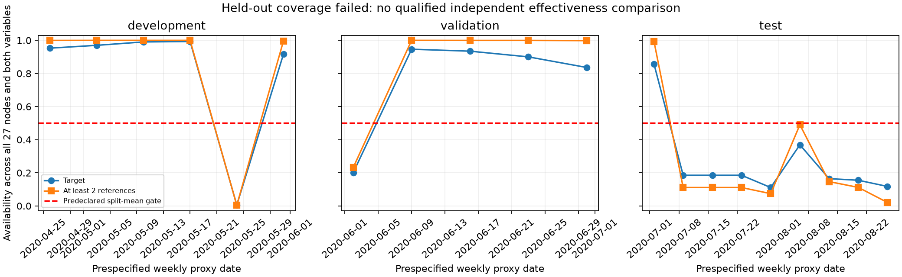

# OSP-1 实际运行报告：有条件离线探索，保留块覆盖失败

**这是基于真实温室背景和受控干预的离线探索性实验，不是实际在线 LoRaWAN 系统或自然故障诊断的确认性验证。**

本次交付了可运行的数据治理、四方法固定计划对照、独立干预日志、因果性与重现测试，以及实际 CSV/图表。**保留时间块没有通过预先规定的覆盖门槛，因此本轮没有合格的独立效果验证。** 开发/验证中存在局部收益、损害和与无信息参考相似的结果，不能据此宣布空间参照优于历史方法，更不能宣布 TAIS 已解决漂移。

## 执行与冻结记录

从干净的 `research/blocked-rearm-fix`、`66f4270d1649bc14ffe53911cbf4d219f55f4080` 创建 `research/offline-spatial-pilot`，未合并 main。

| 记录 | 内容与顺序 |
| --- | --- |
| `6feafb2` | 在效果运行前提交[协议](OFFLINE_SPATIAL_PILOT_PROTOCOL.md)与[配置](../configs/offline_spatial_pilot.json) |
| `ba46b81` | 独立模块、23项测试、README；首轮开发效果前补充范围饱和规则，避免把超过100%RH的数值当真实环境事件 |
| `f2fcbbb` | 提交实际开发/验证输出、[冻结记录](../results/offline-spatial-pilot/freeze.json)与[开封前检查](../results/offline-spatial-pilot/checks/pretest-review.json)，之后才打开保留块 |
| 本报告所在提交 | 归档保留块失败、完整输出和只读审计；没有再次调参或换测试块 |

此实验的检测器不是 AdaptiveSense、SensorTrust 或 TAIS 调度器的原样复现，不修改它们。原400个普通跟踪文件中仅 README 增补入口，其他399个逐个对照基准 Git blob 验证未变，两个子模块干净且 SHA 未变。旧 C0/C1/C1.1 的正式在线 NO-GO 结论保留；本次无需联系作者，也没有发送询问信息。

## 输入、治理与可复现性

使用已保存的 Greenhouse-1.xlsx，32,052,236字节，SHA-256：

```text
9b5f48b5f37ebc90052658649de7471b298da7dd4581bf47d0d8ec404cadff19
```

原件位于仓库外 `TAIS-external-data/C1_1-20261018-evidence/A-raw/`，只读且未覆盖。[Zenodo固定版本1.0](https://zenodo.org/records/5793685)，数据 DOI [10.5281/zenodo.5793685](https://doi.org/10.5281/zenodo.5793685)，CC BY4.0；署名 Singh、Rahmani、Weyn、Berkvens，论文 [Joint Communication and Sensing: a Proof of Concept and Datasets for Greenhouse Monitoring using LoRaWAN](https://doi.org/10.3390/s22041326)。相对布局来源是论文 Figure7/Table2，AF16–AF42 的3×9格点，没有米制坐标。原数据不在Git内；派生结果明确标识变换，不暗示原作者背书。[既有证据核查](C1_1_DATASET_SELECTION.md)未被修改。

标准库 OOXML 解析器保留原工作表、行号、节点、单元格原字符串/类型和原数值到外部 `source-ledger.jsonl.gz`；完整代理时间缓存也留在仓库外。提交的 [source-quality.json](../results/offline-spatial-pilot/source-quality.json)记录真实质量检查：668,368条非空原记录，668,355条可解析代理时间，13条时间缺失/无效，91,678次源文件相邻记录时间倒退，14条温度分析不可用，湿度分析不可用0条。时间倒退是文件次序现象，不是已确认的设备时钟故障；纯格式空行另计，不充当观测。

逐节点质量摘要包括长缺口、最大间隔、重复时间隔离和中位间隔。没有填补长离线段、跨节点按行同步或把缺时间填成午夜。分析范围 T=[−40,85]℃、RH=[0,100]% 是显式输入假设，不是已经确认的仪器规格/故障标签。原始异常值保留，受控副本在相同范围饱和，日志记名义幅度及饱和次数；总体分母保留缺测与零实际干预机会。

工作簿 Date+Time 仅作为**无时区接收代理轴**；未知采集时刻、真实到达延迟、硬件更换时刻均未补齐。每10分钟固定处理，只用假设可用时间不晚于当前时刻的最后一条值。偏移−10/0/+10分钟、最大参考年龄5/15/30分钟全部保留；负偏移允许原标签稍晚的记录，仅在该假设轴上因果，不能称为真实部署无泄漏。没有计算相关性排名或寻找最优滞后。

## 方法、干预与统计口径

四方法在同一记录副本与固定轮询上运行。HistoryShort 用过去60分钟目标中位数的绝对变化与半阈值释放；HistoryExtended 增加90分钟目标趋势证据；Spatial 将同一趋势规则用于目标减四个几何近邻中心化中位数的残差；NullSpatial 使用相同请求、可用掩码与成本，但数值来自已隔离校准前缀的无当前共同变化日片段。趋势门控允许新鲜突变通过，参考不足时不抑制。它们是可解释的离线信息对照，没有学习复杂模型。

13个场景覆盖未干预、漂移、稳定偏移、局地快/慢变化、共同变化、漂移与两类快事件重合、参考缺失/自身漂移及相应无事件配对控制。漂移08:00–12:00线性增加6℃/24%RH并保持；快事件10:30–11:30增加3℃/12%RH。每个目标/物理量单独构造一个世界，不把同日27个目标的干预误当同时发生的27故障。**局地慢事件与漂移故意产生完全相同的在线输入、不同的离线因果标签**；不能把拒绝前者包装成故障识别成功。

漂移新增报告按±10分钟一对一匹配有/无漂移报告起点；同时保留消失起点和净变化。事件主要看相对于无该事件的配对控制新增起点在开始后90分钟内的增量召回；普通窗口召回另存，可能偶然匹配背景报告。背景可能含未知自然异常，因此严格自然误报率、自然故障准确率、自然事件召回均不可计算。单次新报告不等于其物理因果已确定。

区间是10,000次**日期cluster**配对bootstrap，保留同日全部节点依赖，完整CSV包含各日差值。开发仅6日、验证仅5日、一个温室；不作多重比较校正后的确认性推断，不把617,760行组合当独立样本。没有基于效果选择参数；倍率0.5/1/2在主对齐均展示，其他8对齐仅预定倍率1。全部代码/配置/分析在保留块前固定，不从其结果反推非劣界限。

## 数据划分与覆盖门槛

校准前缀2020-04-18至04-25，不假设健康；开发04-26至06-01、验证06-02至07-01、保留07-02至09-01，左闭右开。分区间有隔离日，每7日取预定一集，04:00–20:00轮询97次/目标变量，前2小时仅初始化，每集状态独立。27节点和两物理量均保留。全数据曾用于C1.1质量审计，因此保留块仅称未用于本方法选择的效果数据，不称从未接触过的盲测。

| 分区 | 日期数 | 指标组合行 | 目标覆盖 | 至少两参考覆盖 | 预定50%均值门槛 |
| --- | ---: | ---: | ---: | ---: | --- |
| 开发 | 6 | 185,328 | 80.47% | 83.34% | 通过，可作探索比较 |
| 验证 | 5 | 154,440 | 76.38% | 84.59% | 通过，可作探索比较 |
| 保留 | 9 | 277,992 | **25.89%** | **24.12%** | **失败，NO-GO** |

这些覆盖是主对齐、未干预、所有节点/变量的固定计划计分槽均值，不是原始数据文件完整率。开发05-24覆盖极低、验证06-02明显缺测也没有删除。保留07-02目标覆盖85.71%，但07-09以后多数日期只有11%–37%；没有只截取第一天或挑在线节点挽救测试。[逐日期CSV](../results/offline-spatial-pilot/audit/coverage-by-date.csv)及下图保留全部日期。



**停止的范围**：保留块完整回放及汇总已输出，门槛在汇总步骤才计算，因此其指标与图仍归档为失败审计，不作为合格独立效果比较。没有删除不利结果，也没有进一步模型调整、换时间块或补跑另一最终集。主点局地快事件的243个请求节点日中仅69个有实际采样干预机会，这也是覆盖失败的证据，不是空间机制有效的证据。未来流程应把可用性门槛先于效果汇总执行；本轮不回写冻结实现以改变执行事实。

## 开发与验证的实际结果

以下仅为覆盖通过的探索性描述。主点：代理偏移0、参考最大年龄15分钟、倍率1；漂移数为每请求节点日平均新增起点，事件数为增量命中/全部请求。不是自然误报率。

| 分区/变量/指标 | HistoryShort | HistoryExtended | Spatial | NullSpatial |
| --- | ---: | ---: | ---: | ---: |
| 开发/温度/漂移新增报告 | 0.3580 | 0.2284 | 0.2099 | 0.3272 |
| 开发/湿度/漂移新增报告 | 1.6173 | 1.6296 | 1.4259 | 1.4938 |
| 验证/温度/漂移新增报告 | 0.4148 | 0.3852 | 0.1704 | 0.3852 |
| 验证/湿度/漂移新增报告 | 1.2667 | 1.2667 | 1.1407 | **1.1185** |
| 开发/温度/局地快事件 | 79/162 | 80/162 | 79/162 | 80/162 |
| 开发/湿度/局地快事件 | 64/162 | 65/162 | 64/162 | 65/162 |
| 验证/温度/局地快事件 | 35/135 | 35/135 | 35/135 | **37/135** |
| 验证/湿度/局地快事件 | 52/135 | 52/135 | 52/135 | 52/135 |
| 开发/温度/漂移+局地快 | 21/162 | 32/162 | 42/162 | 24/162 |
| 开发/湿度/漂移+局地快 | 72/162 | 72/162 | 74/162 | 72/162 |
| 验证/温度/漂移+局地快 | 1/135 | 1/135 | 38/135 | 7/135 |
| 验证/湿度/漂移+局地快 | 45/135 | 45/135 | **44/135** | 46/135 |
| 开发/温度/局地慢事件 | 13/162 | 12/162 | 13/162 | 11/162 |
| 开发/湿度/局地慢事件 | 45/162 | 45/162 | **39/162** | 35/162 |
| 验证/温度/局地慢事件 | 4/135 | 1/135 | 4/135 | 4/135 |
| 验证/湿度/局地慢事件 | 51/135 | 51/135 | **46/135** | 41/135 |

Spatial减HistoryExtended的关键配对差值及95%日期区间：

| 指标 | 开发温度 | 开发湿度 | 验证温度 | 验证湿度 |
| --- | --- | --- | --- | --- |
| 漂移新增报告/节点日 | −0.0185 [−0.1420, +0.0741] | −0.2037 [−0.2840, −0.1049] | −0.2148 [−0.5333, −0.0074] | −0.1259 [−0.1630, −0.0815] |
| 局地快增量召回 | −0.0062 [−0.0185, 0] | −0.0062 [−0.0185, 0] | 0 [0, 0] | 0 [0, 0] |
| 漂移+局地快增量召回 | +0.0617 [0, +0.1481] | +0.0123 [0, +0.0370] | +0.2741 [0, +0.5556] | −0.0074 [−0.0222, 0] |
| 局地慢增量召回 | +0.0062 [0, +0.0185] | **−0.0370 [−0.0741, −0.0062]** | +0.0222 [0, +0.0667] | **−0.0370 [−0.0741, −0.0074]** |

真实参考并不稳定优于负对照。验证湿度漂移新增报告，Spatial减Null为+0.0222 [−0.0370,+0.0815]；验证温度局地快召回为−0.0148 [−0.0444,0]。因此不能把全部抑制效果归因于当刻空间信息。验证温度漂移+局地快相对Null为+0.2296 [0,+0.5111]，但日期区间宽，不构成普遍优效。

局地快的低总体召回同时受缺测、背景变化、原episode锁定和90分钟匹配约束影响。开发可观测机会139/162，验证101/135；不因此删掉其他分母。主点Spatial局地快已检出样本平均延迟：开发温度37.85分钟、湿度31.88分钟，验证温度20.57分钟、湿度39.62分钟。**这是条件于检出的延迟**，未检出另计；绝对变化也可能到11:30恢复边缘才报告，不能声称及时捕获起点。完整普通窗口召回与增量召回同时保留，二者不可互换。

### 其余预定场景与不利结果

全部13场景、三主倍率和九种对齐逐项存于[汇总CSV](../results/offline-spatial-pilot/audit/all-primary-operating-points.csv)及分区CSV，没有只保留上表。

- **未干预背景**：报告数仅是输出活动，缺独立自然标签，既不能全部当真事件，也不能全部当误报。
- **稳定偏移**：瞬时大跳变保留通道不会可靠排除故障。作为次要描述，Spatial相对未干预净报告变化为开发温度+0.0062、湿度−0.4753，验证温度+0.0074、湿度−0.8074。负净数可能是压制/挪动背景报告，绝非证明偏移被正确诊断；[全部方法逐节点差值](../results/offline-spatial-pilot/audit/secondary-report-count-changes.csv)保留。
- **局地慢变化**：与漂移输入完全一致，报告起点也必须一致；跨全部617,760行组合的相关子集和示例时序检查都验证这一点。空间参考不足以单凭该观测判定物理因果，湿度召回损失是实际代价。
- **共同快变化**：主点无漂移时四方法增量召回与各自局地快相同，不能解释成能够区分局地/共同原因。有漂移时验证湿度Spatial共同快46/135，而局地快44/135；共同变化只用于给定注入响应，不是自然标签。
- **参考缺失**：主点Spatial漂移新增报告从开发温度0.2099升至0.3272、湿度1.4259升至1.5494；验证温度0.1704升至0.4148、湿度1.1407升至1.2074。缺参考时不抑制避免强制拒绝局地事件，也失去抑制漂移能力，不能只在参考齐全时宣传效果。
- **参考自身漂移**：主点Spatial带故障参考的局地快召回与其正常参考相同，但仅一个参考坏、四槽中至少两可用的受控设定，不证明多数/共同故障鲁棒。参考单独坏时净报告变化开发温度/湿度均+0.0062，验证温度0、湿度−0.0074；负对照同样可能改变报告。
- **漂移+真实事件**：温度有局部召回收益，湿度验证反而下降；没有用温度结果掩盖湿度损害。受控漂移本身会替换/删除背景起点，开发所有方法漂移净变化都为负，例如Spatial温度−0.5617、湿度−1.0432，同时仍有上述正的新增报告。净数与新增数必须共同解释。

### 时间语义与操作点敏感性

全部9种对齐的差值和区间在[all-timing-assumptions.csv](../results/offline-spatial-pilot/audit/all-timing-assumptions.csv)，各分区 `time-sensitivity.png`显示九格，不择优。倍率1，Spatial减HistoryExtended的九设置差值范围：

| 指标 | 开发温度 | 开发湿度 | 验证温度 | 验证湿度 |
| --- | --- | --- | --- | --- |
| 漂移新增报告/节点日 | **[−0.0247,+0.1420]** | [−0.2037,−0.0679] | [−0.2148,−0.0444] | [−0.1407,−0.0148] |
| 漂移+局地快召回 | **[−0.0617,+0.0617]** | [+0.0062,+0.0185] | [0,+0.2889] | [−0.0074,+0.0074] |

开发温度的收益方向会翻转。局地快差值开发两变量均−0.0062、验证均0；这只是本规则/干预下的结果，不表示真实时钟偏差没有风险。三阈值成本—召回曲线完整保留于各分区 `cost-recall.png`；未从中选择新最优点，其他八对齐未做倍率交互扩展。

## 使用量与成本

每目标变量日固定97次目标轮询，Spatial/Null各4槽×97=388次参考请求，假设每次10字节请求+26字节响应，共13,968字节，缺失仍计状态响应；每个环境报告再计1次请求/18字节。历史缓存增加存储/计算但没有虚构网络测量费用。原行实际使用数、有效读取、缓存复用另列。温湿度分开计费是本实验二进制帧假设，实际部署若合并传输会不同。

例如开发主点局地快：温度Spatial平均391.20次应用请求、14,025.67字节，HistoryExtended 2.88次、51.78字节；湿度Spatial395.02次、14,094.33字节，HistoryExtended6.89次、124字节。Spatial与Null参考预算严格相同；两者比无网络参考的历史方法昂贵。不存在“免费取得离线可见参考”的解释。没有测电流、没有无线电功耗模型，不报告实际节能。

## 测试、产物与复核命令

本机Python3.14.7，NumPy2.5.4、pandas3.0.6、Matplotlib3.11.2、pytest9.1.1；安装版本由既有 `requirements-lock.txt`固定。[运行环境与只读汇总输入哈希](../results/offline-spatial-pilot/audit/manifest.json)可追溯。

| 实际命令 | 真实结果 |
| --- | --- |
| `.venv/bin/python -m pytest -q`，新增实现前 | 192通过、2原有严格xfail、0意外失败 |
| `.venv/bin/python -m pytest tests/test_offline_spatial.py -q` | 23通过 |
| `.venv/bin/python -m pytest -q`，冻结实现后 | **215通过、2原有严格xfail、0意外失败** |
| `scripts/verify_offline_spatial.py --workbook <原件>` | PASS：源SHA、399原文件、2子模块、冻结代码配置、全部输出哈希、成本等价、标签不可辨识边界、15,132条示例可用性检查 |

测试日志和完整性结果在 [checks/](../results/offline-spatial-pilot/checks/final-integrity.json)。23项覆盖原始单元格/行号、不可覆盖与哈希拒绝、全九因果年龄/偏移点、校准和负对照不读取评估未来、固定拓扑、缓存新鲜性、漂移与慢事件输入相同、缺参考路径、前缀因果性、成本配对、一对一匹配、分区隔离及同配置重复输出字节一致。旧2项高阈值rearm预期失败保持原断言，未删除/弱化。

从安装到 prepare、run、analyze、freeze、test 的[完整命令](../results/offline-spatial-pilot/README.md)支持在新目录复现；全部输出拒绝无声覆盖。`scripts/report_offline_spatial.py`只读取已经归档的CSV画覆盖图，不重新运行检测器；其指标表继承原输出，不重新定义主比较。`verify_offline_spatial.py`负责只读完整性检查。完整原行账本/NPZ在仓库外，Git只提交小型汇总、压缩指标、独立干预日志、预定示例和图。

本轮真实执行了开发、验证和冻结后一次保留回放，共617,760个方法/节点日/场景/操作点汇总，14,040条独立干预计划；这不是617,760个独立试验。每分区manifest含源哈希、完整配置、代码指纹及9个输出校验值，不能拿旧TAIS结果替代。保留块原始产物未改写为通过，其[失败声明](../results/offline-spatial-pilot/TEST_NO_GO.md)是使用结果的前置说明。

## 可以和不能得出的结论

已证明的是：在**声明的代理时钟与固定预算假设**下，真实背景可以构造可审计的空间/历史/负对照比较；简单残差门控确实改变输出，部分漂移新增起点减少，同时有局地事件损害和额外成本。它不是仅有计划的文档任务。

尚未证明空间参照有稳定净增量价值：保留覆盖失败、负对照部分相似/更好、对时间假设敏感、局地慢事件不可辨识，均阻止该结论。也未证明自然故障诊断、真实在线因果可用、自然事件召回、农业普遍适用、原TAIS 5–10秒判据或实际无线电节能。单一温室、少日期、单向固定形状注入、静态前缀校准、参考多数/共同故障未充分覆盖、范围饱和和恢复边缘报告等均是限制。

**保留本原型作为负结果与信息边界研究工具，不将规则并入TAIS在线主算法。** 后续若推进，应在独立协议中预先定义可用性治理、数据/时间块和额外信息假设；本轮所有时间块已用于分析，不能改名为新独立验证。不得按现有结果挑仍在线节点、改参考年龄或增加机制反复求正结果。当前最具体的发现是：在可用参考长期不足且局地缓变与漂移观测等价时，空间参照的增量收益尚不成立；需要新的预定数据与可用性条件才能检验，而非补一个有利阈值。
