# Phase4.2: bounded robust and risk-aware sampling

Candidate design follows the source audit in PHASE4_AUDIT.md. No candidate is
run or selected on MA-1 seeds900–919. All parameters are explicit in
`configs/phase4.json`; engineering940/941 checks implementation, not independent
effectiveness. No hyperparameter sweep. These are two scheduling hypotheses,
not new calibrated health classifiers or new event detectors.

## Shared causal contract and fast budget

`update(t,values,health)` receives only a current acquired sample and unchanged
C11 health (or the explicit neutral input when T off). Each channel keeps a
fixed-size finite healthy history. Invalid/FAULT/DEGRADED input requests a
separate20s diagnostic interval and clears sampling feature history; it does
not relabel C11 or cancel the healthy channel's independent request. Shared
sampling takes the minimum channel demand; no channel veto. A7/old policies
retain their old60s diagnostic rule. This change is explicit in the new sampler.

Let actual sampled timestamps be t_i, minimum interval m=5s. A fast acquisition
is an i>0 with t_i−t_(i−1)<=m. Store only their timestamps in a deque. Admit a
proposed fast next acquisition at u=t+m only if

`count{t_i : u−120 < t_i <= t} < 6`.

Prune/update using actual acquisitions, not merely requested deadlines. Thus
there are at most6 fast acquisitions in every open-left120s rolling window
on a due-time stream. A delayed source tick does not falsely consume a fast
slot. Budget is shared by channels; diagnostics do not bypass it. Maximum
continuous burst30s, cooldown30s with20s interval. This bounds fast sampling,
not total CPU, sensor energy or a hard radio budget. Every actual cycle, including
ordinary/diagnostic cycles, remains in total sample and byte counts.

## Robust Adaptive Sampling (Robust)

History length7. Before appending the current sample x, compute for each eligible
channel median c of previous values and

`scale=max(public_noise_floor,1.4826*median(|x_j−c|))`

`z=|x−c|/scale`.

Median/MAD responds to the sampled noise distribution without raising the
detector's fixed threshold. Empty history produces z=0 and seeds the history.
The leading channel and signed displacement must persist for2 observed samples.
An initial z>=3 requests a bounded5s probe; sustained same-direction z>=1.5
retains TRACK, with a maximum30s burst. Falling below retention, reversing
direction or exhausting the fast budget enters COOLDOWN. QUIET interval40s;
cooldown20s. Detector debounce remains score>8 for10s; it is never replaced by z.

```mermaid
stateDiagram-v2
    QUIET --> PROBE: z >= 3; fast slot available
    PROBE --> TRACK: two same-channel/sign samples; z >= 1.5
    PROBE --> COOLDOWN: evidence fails or budget blocked
    TRACK --> COOLDOWN: z < 1.5, burst expires, or budget blocked
    COOLDOWN --> QUIET: 30 seconds elapsed
```

## Risk-Aware Adaptive Sampling (Risk)

History length9. From previous samples only, fit median pairwise slope

`s=median((x_j−x_i)/(t_j−t_i))`, `b=median(x_i−s*t_i)`.

The current forecast is `p(t)=b+s*t`; current residual does not enter the fit.
Directional consistency is the fraction of nonzero adjacent historical changes
with the slope sign. Set forecast contribution0 until at least3 past samples
and consistency>=0.75. Define

`risk=max(z/3, |x-p(t)|/(3*scale), |s|*30/(3*scale))`.

The forecast term can enter WATCH/HIGH before the current displacement is large;
it is a lightweight risk heuristic, not a probability or prediction of arbitrary
independent onsets. LOW interval30s bounds the maximum quiet blind gap more
tightly than original60s. WATCH uses15s for risk>=0.5; HIGH starts at risk>=1,
retains down to0.5, with observed persistence and the same burst/cooldown/budget.
The risk forecast cannot foresee an unannounced independent step, and the
unchanged EMA detector may still miss slow pulses even with more coverage.

```mermaid
stateDiagram-v2
    LOW --> WATCH: 0.5 <= risk < 1
    LOW --> HIGH_PROBE: risk >= 1; bounded probe
    WATCH --> HIGH_PROBE: risk >= 1
    HIGH_PROBE --> HIGH: two consistent acquired samples
    HIGH_PROBE --> COOLDOWN: failed persistence or budget blocked
    WATCH --> LOW: risk < 0.5
    HIGH --> COOLDOWN: evidence fails, 30 seconds, or budget blocked
    COOLDOWN --> LOW: cooldown ends
```

## Integration and resource limits

`tais.adaptive` is a new subpackage: samplers, optional policy/CoreSender wrapper,
and offline sampling metrics. The wrapper calls the unchanged Scheduler for
health and local detection, overrides ONLY next interval and final emission,
and retains its own diagnostic telemetry off the wire. T off uses exactly the
MA-1 neutral health semantics; nonfinite sanitation still applies. U on uses
unchanged Upload; U off every sample. No U decision feeds sampler features,
time, budget or event analysis. Original defaults and Core CLI are unchanged.

The sampler is generic over configured channel names; existing Binaryv1 layout
registry still governs wire-compatible Core channels (the evaluated two are
temperature/humidity). Histories are bounded7/9 samples per channel, slope work
at most36 pair differences per channel/update. C11 memory/float behavior and
hardware conversion/energy have not been benchmarked on ESP32-S3. A Python host
prototype that passes tests is not evidence of embedded real-time performance.
