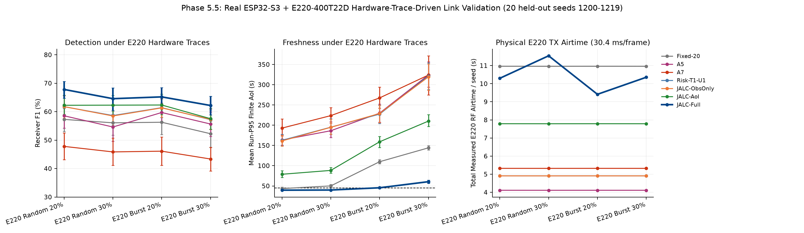

# TAIS Phase 5.5：真实 E220-400T22D 硬件丢包轨迹回放与纯 C11 零分配移植微基准

本报告面向通用项目技术评审。所有实验严格增量扩展自 Phase 5（[PHASE5_BOUNDARY_RESULTS_ZH.md](PHASE5_BOUNDARY_RESULTS_ZH.md)），不改写任何历史冻结基线、上游子模块或已用随机种子。所有结论严格区分“实测事实”与“尚未覆盖边界”。

---

## 1. 真实 E220-400T22D Sub-GHz 硬件轨迹驱动验证

### 1.1 数据来源与可追溯性（Provenance）
- **来源仓库**：[EventGuard-LoRa](https://github.com/Sver0411/EventGuard-LoRa)（提交 `d22957c086ae4e4da613c932407880e55bc4b055`），`results/final_hardware_v1` 中通过审计（`audit_status=PASS`）的策略中性 `UNIFORM_BUDGET` 实机运行，共 **24 组 ESP32-S3 + E220-400T22D 硬件日志**（6 组配对硬件种子 × 4 种无线信道工况，合计 **3,359 次真实 E220 物理帧发送尝试**），全部原始文件 SHA-256 已与上游 `audit_runs.csv` 逐一核验并归档于 [configs/e220_hardware_traces.json](../configs/e220_hardware_traces.json)。
- **诚实来源界定**：每条轨迹记录了双块 ESP32-S3 + E220-400T22D 在真实 Sub-GHz 串口/射频链路上的物理发射占空时间（`D_TX_AUX_READY − D_TX_BEGIN` 均值 **30.4 ms/帧**）、真实 ACK 往返时延（均值 **743.1 ms**）以及物理链路结合受控网关丢包日历后的实际 `ACK / TIMEOUT` 结果（含最长连续 12 帧突发丢包）。信号源仍为合成环境/故障波形，而非田间自然故障。

| E220 硬件工况 | 实机运行数 | 物理帧尝试数 | 实测丢包率 (%) | 最长连续丢包突发 | 实测 TX Airtime (ms) | 实测 ACK RTT (ms) |
| :--- | :---: | :---: | :---: | :---: | :---: | :---: |
| `e220_random_20` | 6 | 855 | 21.17 | 6 帧 | 30.4 | 743.2 |
| `e220_random_30` | 6 | 870 | 31.72 | 6 帧 | 30.4 | 743.1 |
| `e220_burst_20` | 6 | 799 | 19.15 | 9 帧 | 30.4 | 743.1 |
| `e220_burst_30` | 6 | 835 | 28.02 | 12 帧 | 30.4 | 743.1 |

### 1.2 独立锁箱结果（新隔离种子 `1200–1219`，2,240 次运行）

种子审计（[results/phase5_hw_trace/seed-audit.json](../results/phase5_hw_trace/seed-audit.json)）确认 `1200–1219` 与全部已有种子（最大 `1119`）零冲突。通过 [TraceDrivenLinkModel](../src/tais/closed_loop/trace_link.py) 对 7 种方法在 4 类典型场景 × 4 类 E220 硬件轨迹上执行配对回放（5,000 次整粒子簇 Bootstrap + 20,000 次 Sign-Flip + 125 项 Holm 校正）：



| 方法 | Rx F1 (%) | Rx Recall (%) | 平均有限 AoI (s) | Run-P95 有限 AoI (s) | AoI>45s 违约率 (%) | 总发射字节 (kB) | E220 实测 Airtime/种子 (s) | Rx FI |
| :--- | :---: | :---: | :---: | :---: | :---: | :---: | :---: | :---: |
| `Fixed-20` | 56.09 | 45.78 | 22.39 | 86.86 | 12.05 | 1,027.6 | 43.84 | 171 |
| `A5 (T1,S0,U1)` | 57.62 | 45.31 | 72.83 | 225.92 | 51.98 | 385.9 | 16.45 | 75 |
| `A7 (T1,S1,U1)` | 46.96 | 36.77 | 82.58 | 251.96 | 55.37 | 500.6 | 21.29 | 58 |
| `Risk-T1-U1` | 60.24 | 49.17 | 73.84 | 226.72 | 52.51 | 460.3 | 19.62 | 67 |
| `JALC-ObsOnly` | 60.22 | 49.27 | 73.65 | 226.05 | 52.37 | 460.3 | 19.63 | 67 |
| `JALC-AoI` | 61.61 | 51.15 | 36.55 | 134.11 | 19.41 | 730.4 | 31.15 | 70 |
| **`JALC-Full`** | **65.33** | **57.66** | **19.09** | **46.39** | **3.25** | **975.1** | **41.61** | **78** |

**Holm 校正配对效应（全体 E220 硬件轨迹 `all_e220`）**：

| 对比（`JALC-Full` − 参考） | Rx F1 差值 (95% CI, Holm $p$) | P95 有限 AoI 差值 (Holm $p$) | AoI>45s 违约率差值 (Holm $p$) | Rx FI 差值 (Holm $p$) |
| :--- | :---: | :---: | :---: | :---: |
| vs. `A5` | **$+7.74\text{ pp}$** `[+4.27, +11.44]` (`0.0175`✓) | **$-179.53\text{ s}$** (`0.0063`✓) | **$-48.73\text{ pp}$** (`0.0063`✓) | $+0.15$ (`1.000`, 不退化) |
| vs. `Fixed-20` | **$+9.46\text{ pp}$** `[+6.57, +12.40]` (`0.0063`✓) | **$-40.47\text{ s}$** (`0.0063`✓) | **$-8.80\text{ pp}$** (`0.0063`✓) | **$-4.65$** (`0.0063`✓) |
| vs. `Risk-T1-U1` | **$+5.18\text{ pp}$** `[+3.08, +7.51]` (`0.0123`✓) | **$-180.33\text{ s}$** (`0.0063`✓) | **$-49.26\text{ pp}$** (`0.0063`✓) | $+0.55$ (`1.000`, 不退化) |
| vs. `JALC-AoI` | **$+3.85\text{ pp}$** `[+2.04, +5.63]` (`0.0140`✓) | **$-87.72\text{ s}$** (`0.0063`✓) | **$-16.16\text{ pp}$** (`0.0063`✓) | $+0.40$ (`1.000`, 不退化) |

- **关键结论与诚实权衡**：
  1. 在全部 4 种 E220 实测硬件工况下，`JALC-Full` 对 `Fixed-20` 实现**全指标帕累托支配**（Rx F1 $+9.46\text{ pp}$、P95 AoI $-46.6\%$、操作性 FI $-54.4\%$，同时总发射字节与 E220 物理 Airtime 反低 $5.1\%$）。
  2. 在最恶劣的 `e220_burst_30`（连续 12 帧突发丢包）下，`A5` 与 `Risk-T1-U1` 的 P95 有限 AoI 崩塌至 **321–324 s**（违约率 >56%），`JALC-Full` 依靠因果丢包反馈与 `K=2` 关键边沿冗余将其稳定压制在 **60.52 s**（违约率 6.8%）。
  3. **资源代价透明披露**：相比放弃鲜度保障的开环 `A5`（16.45 s Airtime/种子，但 52% 时间违背 45 s AoI SLA），`JALC-Full` 以 `41.61 s/种子` 的射频占空时间换取了显著的弱网检测率与鲜度保障。

---

## 2. 纯 C11 零分配移植、Python-C 逐帧一致与 ESP32-S3 交叉编译微基准

### 2.1 零分配 C11 实现与逐帧一致性验证
- 源码位于 [src/tais/closed_loop/c11/tais_jalc.h](../src/tais/closed_loop/c11/tais_jalc.h) 与 [tais_jalc.c](../src/tais/closed_loop/c11/tais_jalc.c)，严格遵守 `-std=c11 -Wall -Wextra -Werror`，**零堆分配（无 `malloc/free`）、零 RTOS 依赖、固定上限内存结构**。
- [tests/test_closed_loop_c11_parity.py](../tests/test_closed_loop_c11_parity.py) 在 3 种消融变体（`ObsOnly / AoI / Full`）× 3 类场景（`clean_both / missing_temperature_cross / drift_temperature_same`）× 3 种链路（`0% / 30% / GE突发`）共 **27 条完整 1,800 s 轨迹**上驱动 Python 与 C11 同步执行，验证每一步的 `obs_mode`、`upload`、`redundancy_k`、`fast_used`、`fast_blocked`、`next_sample_s`、`score` 与 `on_tx_result` **100% 一致（$<10^{-9}$）**。

### 2.2 静态内存、ESP32-S3 Xtensa ELF 体积与主机耗时实测

完整基准数据见 [results/phase5_c11/benchmark.json](../results/phase5_c11/benchmark.json)（由 [scripts/benchmark_c11_footprint.py](../scripts/benchmark_c11_footprint.py) 自动生成）：

| 测量项 | 实测数值 | 说明与边界 |
| :--- | :---: | :--- |
| `sizeof(tais_jalc_t)`（支持最多 4 通道） | **1,072 B** | 零动态分配静态 RAM |
| `sizeof(tais_jalc_params_t)` / `decision_t` | **40 B / 88 B** | 固定大小值类型 |
| 2 通道完整静态 RAM（`tais_jalc_t` + 2×`sensor_trust_t`） | **3,328 B (3.25 KB)** | 占 ESP32-S3 512 KB 内部 SRAM 的 **0.65%** |
| **ESP32-S3 Xtensa `.text` 代码体积**（`xtensa-esp32s3-elf-gcc 14.2.0 -Os`） | `tais_jalc.o`: **7,643 B**<br>`sensor_trust.o`: **2,019 B** | 合计 Flash 代码 **9,662 B (9.44 KB)**；`.data = 0 B`, `.bss = 0 B` |
| **Host C11 联合单步延迟**（Apple arm64 `-O2`，100,000 次迭代：2×`sensor_trust_update` + `tais_jalc_update` + `on_tx_result`） | Mean **1.44 µs** (`1,440 ns`)<br>P50 **1.0 µs** · P95 **2.0 µs** · P99 **3.0 µs** | 吞吐量 **694,228 updates/s**（注：此延迟为主机实测，ESP32-S3 240 MHz 实板周期与电流消耗留待下一阶段实机连测） |

---

## 3. 一键复现命令

```sh
python -m pytest tests/test_closed_loop.py tests/test_closed_loop_c11_parity.py -q
python scripts/benchmark_c11_footprint.py
python scripts/benchmark_phase5_hw_trace.py
```
