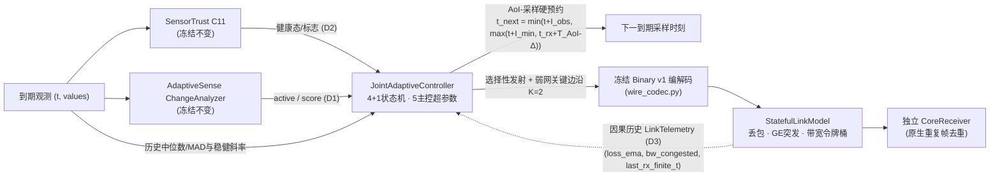
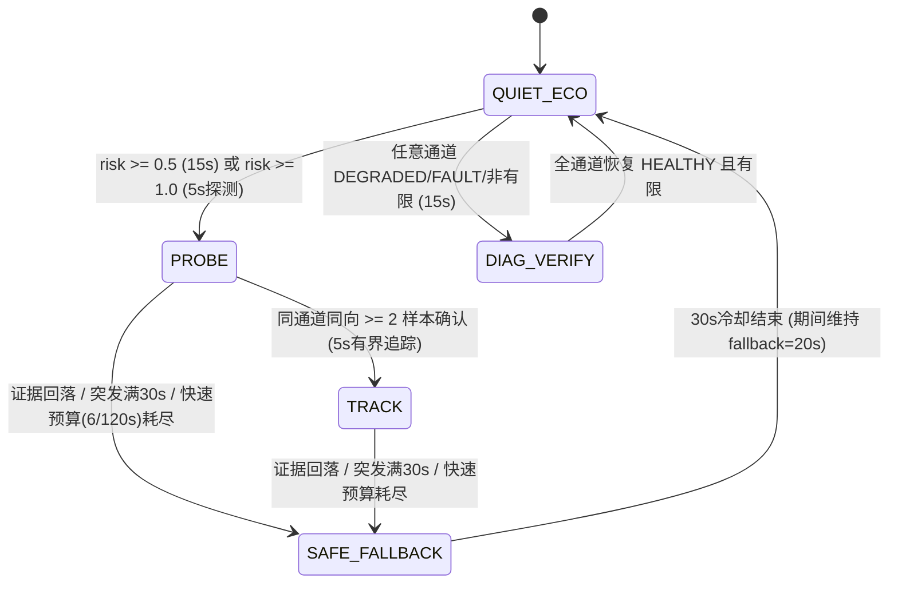
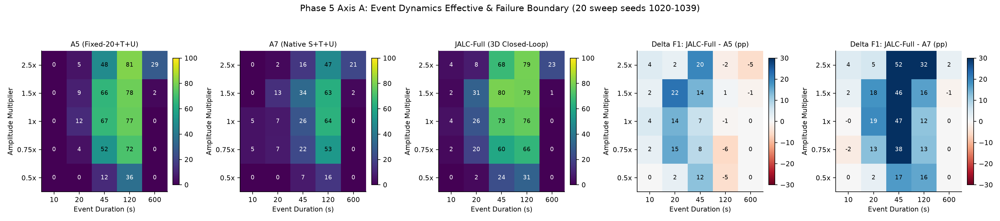
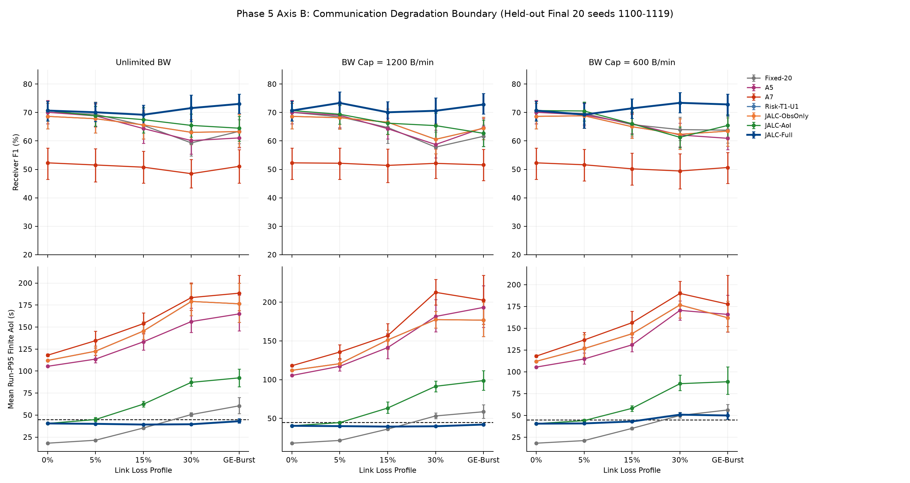
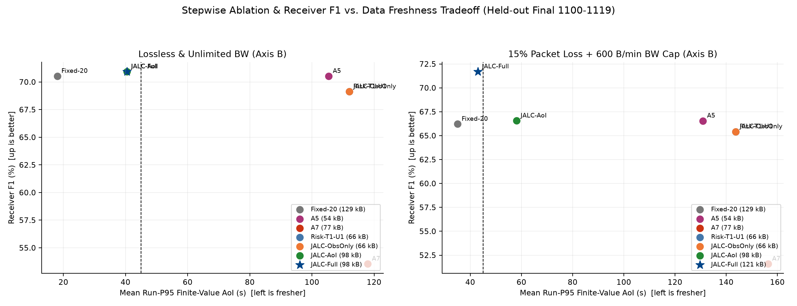
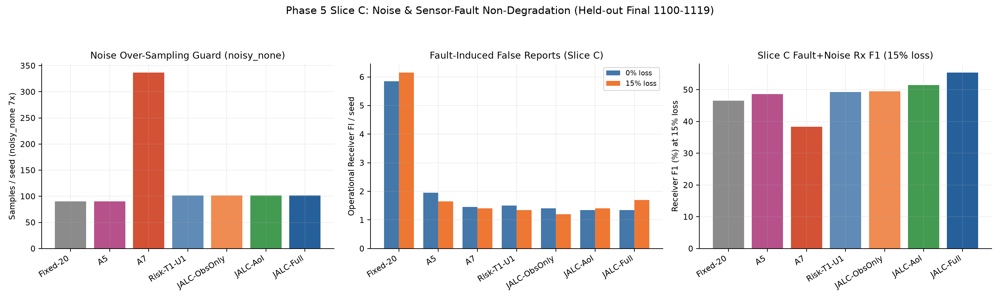

# TAIS Phase 5：精简三维联合自适应闭环与有效/失效边界分析

本报告面向通用项目技术评审。所有结论均基于可复现的合成信号与受控弱网链路回放，不构成真实农田、自然故障、RF 实测能耗或默认策略自动替换声明。原有 `vendor/` 上游子模块、冻结基线（`Scheduler` / `Upload` / `tais.adaptive`）、历史指标口径及默认策略 `GateOnly` 均未修改。

---

## 1. 精简三维闭环架构与 4+1 状态机

Phase 5 在独立增量包 [src/tais/closed_loop/](../src/tais/closed_loop/__init__.py) 中实现 `TAIS-JALC`（Joint Adaptive Loop Controller）：**零 CUSUM 检测器、零新二进制协议（100% 复用冻结 Binary v1）**，仅引入 **5 个主控超参数**：

| 主控超参数 | 冻结取值 | 作用 |
| :--- | :---: | :--- |
| `fallback_interval_s` | `20.0 s` | 强噪声快速预算耗尽或突发结束时的安全回退保底周期 |
| `diag_interval_s` | `15.0 s` | 传感器进入 `DEGRADED / FAULT` 或非有限值时的诊断采样保底周期 |
| `aoi_cap_quiet_s` | `45.0 s` | 平稳态有限有效值数据新鲜度（AoI）硬上限 |
| `aoi_cap_active_s` | `20.0 s` | 探测/追踪或活跃事件态的有限有效值 AoI 硬上限 |
| `loss_redundancy_threshold` | `0.10` | 因果丢包率估计 $\hat{p}_{\text{loss}} \ge 0.10$ 时，仅对 `event_edge / health_edge` 启用 `K=2` Binary v1 轻量冗余 |

### 1.1 精简系统架构图



### 1.2 4+1 状态转移图



- **AoI-采样硬预约**：单通道独立追踪最新有限有效值时间（`null` 帧绝不重置有限值年龄），在采样调度时注入 $t_{\text{next}} = \min\big(t + I_{\text{obs}}, \max(t + I_{\min}, t_{\text{last\_rx\_finite}} + T_{\text{AoI}}^{\max} - \Delta_{\text{margin}})\big)$ 并辅以发送端前瞻防穿透保护，根除开环采样与心跳错相导致的 AoI 穿透。
- **三步消融变体**：`JALC-ObsOnly`（仅 4+1 观测与安全回退 + 旧 120 s Upload）→ `JALC-AoI`（增加 AoI-采样硬预约与按通道有限值 AoI 硬上限）→ `JALC-Full`（完整三维闭环：增加因果链路遥测、丢包后有界重试、关键边沿 `K=2` Binary v1 冗余与拥塞期普通死区抑制）。

---

## 2. 种子隔离审计与实验协议

- **种子冲突审计**（[results/phase5/seed-audit.json](../results/phase5/seed-audit.json)）：扫描 388 份已有配置/manifest 与 `results/traces/` 目录，现有最大种子为 `941`。分配三组完全互斥的全新种子段（零冲突）：
  - 工程烟雾与不变量验证：`1000–1003`（2,100 次运行，先完成验证再冻结 [freeze.json](../results/phase5/freeze.json)）；
  - 工况边界网格扫描：`1020–1039`（20 种子 × 75 工况 × 7 方法 = **10,500 次运行**）；
  - 独立锁箱最终验证：`1100–1119`（20 种子 × 75 工况 × 7 方法 = **10,500 次运行**）。
- **硬不变量校验**：全部 23,100 次运行中，`JALC-*` 滚动 120 s 快速采样上限严格 $\le 6$；全部无损有限通道运行中，`JALC-AoI` 与 `JALC-Full` 的 $>45\text{ s}$ 有限有效值 AoI 违约率严格为 **0.00%**。
- **统计方法**：整随机种子为聚类单位，5,000 次配对 Bootstrap（95% 描述性 CI）+ 20,000 次双向 Sign-Flip，并对全部 400 项预声明检验执行统一 Holm 校正（[paired_effects_final.csv](../results/phase5/analysis/paired_effects_final.csv)）。

---

## 3. 核心实验结果（独立最终集 `1100–1119`）

### 3.1 三大工况分组总览

| 分组 | 方法 | Rx F1 (%) | Rx Recall (%) | 平均有限 AoI (s) | Run-P95 有限 AoI (s) | AoI>45s 违约率 (%) | 总采样数 | 总发射字节 (kB) | Rx FI |
| :--- | :--- | :---: | :---: | :---: | :---: | :---: | :---: | :---: | :---: |
| **Axis A**<br>事件动力学 5×5 | Fixed-20 | 36.00 | 27.45 | 9.50 | 18.05 | 0.00 | 45,000 | 1,616.5 | 0 |
| | A5 (T1,S0,U1) | 32.06 | 24.55 | 44.96 | 107.09 | 43.22 | 45,000 | 534.8 | 0 |
| | A7 (T1,S1,U1) | 23.80 | 16.55 | 51.33 | 113.40 | 50.46 | 37,562 | 525.8 | 0 |
| | Risk-T1-U1 | 34.63 | 26.45 | 47.75 | 112.58 | 45.49 | 42,025 | 556.1 | 0 |
| | JALC-ObsOnly | 34.72 | 26.85 | 47.72 | 112.62 | 45.47 | 42,153 | 559.4 | 0 |
| | **JALC-AoI / Full** | **37.23** | **29.45** | **18.68** | **40.92** | **0.00** | 48,130 | 995.5 | 0 |
| **Axis B**<br>通信劣化 5×3 | Fixed-20 | 66.29 | 53.50 | 13.59 | 36.91 | 3.30 | 54,000 | 1,939.8 | 0 |
| | A5 (T1,S0,U1) | 65.94 | 52.93 | 49.93 | 139.97 | 42.87 | 54,000 | 805.3 | 0 |
| | A7 (T1,S1,U1) | 52.49 | 43.74 | 56.70 | 158.83 | 47.53 | 92,925 | 1,162.3 | 0 |
| | Risk-T1-U1 | 66.36 | 55.17 | 51.45 | 146.30 | 43.89 | 61,455 | 994.8 | 0 |
| | JALC-ObsOnly | 66.36 | 55.17 | 51.45 | 146.30 | 43.89 | 61,455 | 994.8 | 0 |
| | JALC-AoI | 67.49 | 57.67 | 23.22 | 65.56 | 9.03 | 66,375 | 1,465.8 | 0 |
| | **JALC-Full** | **71.70** | **63.24** | **17.69** | **41.94** | **1.77** | 69,233 | 1,763.7 | 0 |
| **Slice C**<br>噪声与故障 (0%+15%丢包) | Fixed-20 | 47.14 | 46.82 | 12.14 | 33.17 | 1.42 | 36,000 | 1,276.1 | 240 |
| | A5 (T1,S0,U1) | 49.49 | 45.53 | 43.05 | 112.22 | 36.90 | 36,000 | 586.4 | 72 |
| | A7 (T1,S1,U1) | 39.48 | 36.52 | 47.94 | 123.63 | 41.83 | 55,996 | 1,216.6 | 57 |
| | Risk-T1-U1 | 50.53 | 45.30 | 45.77 | 118.87 | 39.31 | 37,556 | 655.6 | 57 |
| | JALC-ObsOnly | 50.60 | 45.08 | 45.48 | 117.98 | 39.17 | 38,214 | 659.4 | 52 |
| | JALC-AoI | 52.54 | 47.80 | 20.54 | 54.87 | 4.83 | 41,392 | 937.9 | 55 |
| | **JALC-Full** | **54.49** | **50.83** | **17.98** | **44.53** | **0.93** | 42,718 | 1,032.0 | **61** |

### 3.2 主轴 A：事件动力学有效区与漏检临界线（Duration × Amplitude）



独立最终集（`1100–1119`）上 `JALC-Full` 与 `A5` 的接收端 F1 (%) 逐格对比：

| 幅度倍率 | $D=10\text{ s}$ (`A5` / `JALC-Full`) | $D=20\text{ s}$ (`A5` / `JALC-Full`) | $D=45\text{ s}$ (`A5` / `JALC-Full`) | $D=120\text{ s}$ (`A5` / `JALC-Full`) | $D=600\text{ s}$ (`A5` / `JALC-Full`) |
| :---: | :---: | :---: | :---: | :---: | :---: |
| **0.50×** | 0.0 / 0.0 | 0.0 / 2.5 | 11.8 / **29.8** | 36.7 / 29.5 | 0.0 / 0.0 |
| **0.75×** | 0.0 / 2.4 | 6.5 / **13.8** | 44.7 / **56.1** | 63.3 / **66.7** | 0.0 / 0.0 |
| **1.00×** | 0.0 / **8.7** | 11.4 / **27.5** | 65.5 / **74.1** | 73.3 / 71.5 | 0.0 / 0.0 |
| **1.50×** | 0.0 / **14.3** | 9.4 / **33.9** | 63.4 / **77.1** | 81.2 / 78.2 | 0.0 / 0.0 |
| **2.50×** | 0.0 / 3.6 | 8.3 / 11.7 | 53.0 / **71.1** | 79.6 / 79.6 | 24.9 / 19.5 |

- **明确有效区间**：中短突发事件 $D \in [20, 45]\text{ s}$ 且幅度 $\ge 0.75\times$。在此区间内，固定 20 s 的 `A5` 因相位漏采或首次采样后 EMA 吞噬显著退化（20 s 仅 6.5%–11.4%，45 s 为 44.7%–65.5%），而 `JALC-Full` 通过 `PROBE/TRACK` 提频 + 45 s AoI 硬上限预约，将 F1 提升至 **13.8%–33.9%（20 s）** 与 **56.1%–77.1%（45 s）**。
- **明确退化/失效双边界**：
  1. **极短脉冲下界（$D \le 10\text{ s}$）**：受限于冻结上游 `ChangeAnalyzer` 的 `event_min_duration_s = 10 s` 防抖与 `min_interval_s = 5 s` 约束，所有方法 F1 均 $\le 14.3\%$（`A5` 全为 0%）。
  2. **缓变脉冲上界（$D = 600\text{ s}$ 平滑脉冲）**：因禁用 CUSUM 且保留 60 s EMA 基准，幅度 $\le 1.5\times$ 时全部方法主窗 Recall 均为 **0.0%**，仅在 $2.5\times$ 极强幅度下约 20%–25%。这证明采样调度无法替代独立的多时间尺度慢变检测机制。

### 3.3 主轴 B：通信劣化边界与闭环增益（配对 Holm 检验）





| 链路子集 | 对比（`JALC-Full` − 参考） | Rx F1 差值 (95% CI, Holm $p$) | P95 有限 AoI 差值 (95% CI, Holm $p$) | AoI>45s 违约率差值 (Holm $p$) |
| :--- | :--- | :---: | :---: | :---: |
| **0% 丢包** | vs. `A5` | $+0.61\text{ pp}$ `[-3.79, +4.80]` ($p=1.000$) | **$-64.93\text{ s}$** (`p=0.020`✓) | **$-37.16\text{ pp}$** (`p=0.020`✓) |
| **15% 丢包** | vs. `A5` | $+5.34\text{ pp}$ `[+1.96, +8.75]` ($p=0.509$) | **$-94.61\text{ s}$** `[-102.2, -87.4]` (`p=0.020`✓) | **$-41.23\text{ pp}$** (`p=0.020`✓) |
| **15% 丢包** | vs. `JALC-AoI` | $+3.62\text{ pp}$ `[+0.95, +6.41]` ($p=1.000$) | **$-20.73\text{ s}$** `[-23.3, -18.3]` (`p=0.020`✓) | **$-7.58\text{ pp}$** (`p=0.020`✓) |
| **30% 丢包** | vs. `A5` | **$+11.55\text{ pp}$** `[+6.57, +16.10]` (`p=0.046`✓) | **$-126.02\text{ s}$** `[-134.0, -118.4]` (`p=0.020`✓) | **$-45.89\text{ pp}$** (`p=0.020`✓) |
| **30% 丢包** | vs. `Fixed-20` | **$+11.28\text{ pp}$** `[+7.24, +15.11]` (`p=0.020`✓) | **$-7.80\text{ s}$** `[-9.32, -6.31]` (`p=0.020`✓) | **$-3.42\text{ pp}$** (`p=0.020`✓) |
| **30% 丢包** | vs. `JALC-AoI` | **$+7.80\text{ pp}$** `[+4.44, +11.28]` (`p=0.046`✓) | **$-44.92\text{ s}$** `[-48.7, -41.6]` (`p=0.020`✓) | **$-16.15\text{ pp}$** (`p=0.020`✓) |
| **GE 突发丢包** | vs. `A5` | **$+10.61\text{ pp}$** `[+7.85, +13.19]` (`p=0.020`✓) | **$-129.70\text{ s}$** (`p=0.020`✓) | **$-42.52\text{ pp}$** (`p=0.020`✓) |
| **GE 突发丢包** | vs. `A7` | **$+21.93\text{ pp}$** `[+17.54, +26.81]` (`p=0.020`✓) | **$-144.56\text{ s}$** (`p=0.020`✓) | **$-46.21\text{ pp}$** (`p=0.020`✓) |

- **通信临界拐点清晰呈现**：
  - 在 **0% 丢包理想链路** 下，`JALC-Full` 与 `A5` 的接收端 F1 统计上无显著差异（$+0.61\text{ pp}$），核心收益是 **P95 有限值 AoI 降低 61.6%（105.4 s → 40.5 s）且违约率归零**，代价是发射字节高于 120 s 心跳的 `A5`（仍比 `Fixed-20` 节省 24.4% 字节）。
  - 一旦进入 **$\ge 15\%$ 丢包或 Gilbert-Elliott 突发丢包区间**，开环稀疏上传（`A5 / A7 / Risk-T1-U1`）因单帧丢失需等待下一个 120 s 心跳而出现 AoI 雪崩（P95 飙升至 140–190 s）与事件上升沿永久丢失；此时 `JALC-Full` 的因果丢包反馈 + 关键边沿 `K=2` 冗余形成压倒性优势（30% 丢包下较 `A5` / `Fixed-20` 均取得 $+11\text{ pp}$ 以上 Holm 校正显著提升，且将 P95 AoI 稳定压制在 42–51 s）。
- **带宽上限诚实观察**：在 `600 B/min`（10 B/s）令牌桶下，Binary v1 单帧仅 ~35 B，即使 `JALC-Full` 在 30% 丢包高事件率下也未触发带宽丢包（`bw_drops = 0`），说明 Binary v1 + 选择性传输已天然适配 600 B/min 级低功耗广域网预算；更严苛的亚 300 B/min 占空比瓶颈需留待下一阶段极限压力测试。

### 3.4 切片 C：强噪声与传感器故障不退化验证



- **故障诱发误报（FI）不恶化**：在 0% 丢包与 15% 丢包下，`JALC-Full` 合计 Receiver FI 为 **61 次**（0% 丢包 27 次、15% 丢包 34 次），相比 `A5`（72 次：39 + 33，配对差 Holm $p=1.0$）未恶化，并相对无门控 `Fixed-20`（240 次）显著下降 **−4.45 次/种子**（`p_holm = 0.020`✓）。同时在 `drift_temperature_same`（63.93% vs `A5` 58.54%）与 `stuck_temperature_same`（63.64% vs `A5` 59.05%）中，`diag_interval_s = 15 s` 的诊断保底带来了更快的故障窗填充与更高的事件检出。
- **强噪声两面性（诚实报告退化点）**：
  - 在 `noisy_none`（7× 强噪声无事件）中，`JALC-Full` 将采样数从原生 `A7` 的 **6,734 次**大幅压低至 **2,028 次**（−69.9%，接近 `A5` 的 1,800 次），成功遏制噪声预算失控。
  - 但在 `noisy_events`（7× 强噪声含事件）中，`JALC-Full` 的 Recall 降至 **48.33%**（F1 46.03%），低于 `A5`（58.33%，F1 52.24%）与高耗资源的 `A7`（80.83%，F1 56.07%）。原因明确：在 7× 极端噪声下，MAD 归一化放大了尺度 `scale`，加上 `fast_limit = 6 / 120 s` 冷却约束，抑制了低信噪比突发事件的连续高频追踪。

---

## 4. 边界总结与复现命令

| 工况条件 | 推荐机制 | 证据依据（Held-out `1100–1119`） |
| :--- | :--- | :--- |
| **弱网丢包（$\ge 15\%$ / 突发）+ AoI 敏感** | **`JALC-Full`** | Rx F1 显著高于 `A5`/`Fixed-20`（+10.6 至 +11.6 pp, Holm $p<0.05$），P95 AoI 压至 ~42–45 s |
| **中短突发事件（20–45 s）+ 鲜度约束** | **`JALC-AoI / Full`** | 20–45 s 事件 F1 大幅高于 `A5`（+8.6 至 +24.5 pp），0% AoI 违约 |
| **无损链路 + 极低通信预算 + 容忍高 AoI** | **`A5` (`T1,S0,U1`)** | 通信字节最少，无损下 F1 与 `JALC` 相当，但 P95 AoI 超 100 s |
| **极短脉冲（$\le 10\text{ s}$）/ 缓变（600 s）/ 7× 强噪声含事件** | **当前机制失效边界** | 受上游固定 EMA/防抖与 MAD 噪声尺度限制，需独立慢变检测或自适应信噪比门限 |

```sh
# 完整复现（审计 → 工程 → 冻结 → 20种子边界扫描 → 20种子最终锁箱 → 统计与出图）
python -m pytest tests/test_closed_loop.py -q
python scripts/benchmark_phase5_boundary.py audit
python scripts/benchmark_phase5_boundary.py engineering --workers 4
python scripts/benchmark_phase5_boundary.py freeze
python scripts/benchmark_phase5_boundary.py sweep --workers 4
python scripts/benchmark_phase5_boundary.py final --workers 4
python scripts/analyze_phase5_boundary.py
```
