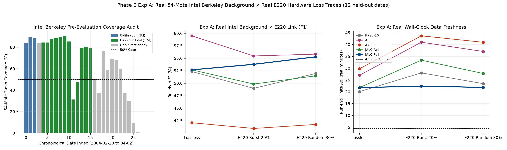
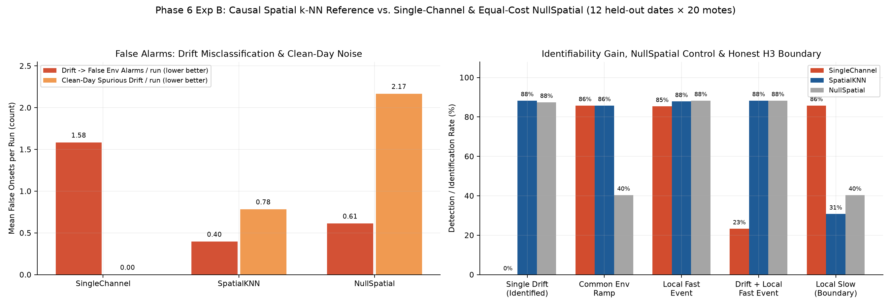

# Phase 6：真实 54 节点无线传感网外部效度与因果空间参考漂移可辨识性研究

> **研究定位与范围声明**：本阶段作为 TAIS 项目的增量扩展模块（[`src/tais/real_data/`](../src/tais/real_data/)），采用公开的 MIT CSAIL Intel Berkeley Research Lab 54 节点真实温湿度数据集与精确物理坐标，在不修改任何历史冻结策略、`vendor/` 或既有评测指标的前提下，完成两项实证验证：（1）**实验 A**：将 Phase 5 闭环控制器 `TAIS-JALC` 迁移至“真实昼夜温湿度背景 + 真实自然缺失 + 真实 ESP32-S3/E220 无线硬件丢包轨迹”的联合外部效度基准；（2）**实验 B**：基于真实节点物理拓扑（$k=4$ 最近邻，平均间距 `5.09 m`）验证因果空间参考能否打破单通道“缓慢漂移 vs. 缓慢环境变化”不可辨识瓶颈，并通过等成本负对照 `NullSpatial` 与显式不可辨识边界 `local_slow_event` 界定适用边界。本实验属于室内 54 节点真实传感背景叠加受控干预的半合成研究，不宣称替代农田/温室实景部署或自然故障标注验证。

---

## 1. 数据审计与预声明时间切分（覆盖率门控通过）

原始数据集来自 MIT CSAIL 官方发布页（`https://db.csail.mit.edu/labdata/labdata.html`），按仓库规范保存于 Git 忽略目录 `data/raw/intel_berkeley/` 下（不向仓库再分发原始 33 MB 数据文件），完整校验摘要见 [`results/phase6_intel_berkeley/data_audit.json`](../results/phase6_intel_berkeley/data_audit.json)：

| 审计项 | 实测数值 |
| :--- | :--- |
| 原始文件 SHA-256（`data.txt.gz`） | `d99288c8f406ca6604d359ceaa0d8adfffa79e7095061a1e27dc4399f48c7225` |
| 坐标文件 SHA-256（`mote_locs.txt`） | `3865c0263110c24c40e3377690cecaa552e0575cf56cdb9f5f8bd17130b6bf04` |
| 坐标完整节点数 / 总原始行数 | **54 节点** / **2,313,682 行**（跨 29 天，`2004-02-28` 至 `2004-04-02`） |
| 异常与越界剔除 | 格式损坏 `93,879` 行、未知节点 `9,719` 行、越界温度 `384,505` 行、越界湿度 `289,176` 行 |
| 物理有效温湿度完整记录 | **1,816,504 行**（严格因果采样，缺失槽保留 `None`，**零未来插值**） |

**预声明时间切分（杜绝数据泄露）**：
- **标定前缀（3 天）**：`2004-02-28`、`2004-02-29`、`2004-03-01`（54 节点 2 分钟覆盖率 `83.8%–89.3%`），仅用于按有效点数排序选出 Top-10（实验 A）与 Top-20（实验 B）目标节点，以及为负对照 `NullSpatial` 提供无关联历史日样本。
- **隔离期（1 天）**：`2004-03-02`（不进入任何评测）。
- **连续留出评测块（12 天）**：`2004-03-03` 至 `2004-03-14`（12 天平均 54 节点覆盖率 **76.4%**，**通过预声明 $\ge 50\%$ 覆盖率门控**；其中刻意完整保留真实的 `2004-03-10`（31.1%）与 `2004-03-11`（47.8%）网络局部掉线日，用于检验空间参考缺失时的优雅降级能力）。

---

## 2. 实验 A：真实传感背景 × 真实 E220 硬件丢包外部效度

- **实验规模**：12 个留出日 × 10 个标定选定节点 × 3 类受控场景（`real_clean_events`、`real_range_cross`、`real_drift_cross`）× 3 类物理链路（无损 `loss_0`、实测 `e220_burst_20`、实测 `e220_random_30`）× 5 种冻结策略 = **5,400 次独立因果运行**。
- **时间尺度说明**：Intel Berkeley 原生采样周期约 31 s，实验 A 按严格因果 30 s 槽位采样 `08:00–11:00`（3 小时 = 360 真实槽位），按 1:6 映射到 TAIS 归一化 5 s 节拍（1,800 ticks），所有报告的数据新鲜度均折算回**真实墙钟秒/分钟**。

### 2.1 汇总表现（[`exp_a_summary.csv`](../results/phase6_intel_berkeley/exp_a_summary.csv)）

| 链路 | 策略 | Rx F1 | Rx Recall | 真实 P95 有限 AoI | 真实 Mean 有限 AoI | AoI 违约率 | 总应用字节 | 操作性 FI |
| :--- | :--- | :---: | :---: | :---: | :---: | :---: | :---: | :---: |
| `loss_0` | `A5` | 59.51% | 81.46% | 1,621.6 s (27.0 m) | 922.3 s | 48.87% | 366,868 | 229 |
| `loss_0` | `Fixed-20` | 52.35% | 81.25% | 1,205.2 s (20.1 m) | 749.9 s | 15.84% | 1,072,232 | 378 |
| `loss_0` | `JALC-Full` | 52.69% | 80.62% | 1,308.0 s (21.8 m) | 793.5 s | 15.96% | 623,291 | 384 |
| `e220_burst_20` | `A5` | 55.48% | 68.54% | 2,461.2 s (41.0 m) | 1,139.1 s | 58.25% | 366,868 | 202 |
| `e220_burst_20` | `Fixed-20` | 48.98% | 70.21% | 1,681.6 s (28.0 m) | 837.4 s | 28.63% | 1,072,232 | 353 |
| `e220_burst_20` | `JALC-Full` | 53.80% | **78.12%** | **1,343.6 s (22.4 m)** | **804.4 s** | **18.99%** | 782,913 | 340 |
| `e220_random_30` | `A5` | 55.84% | 63.75% | 2,225.3 s (37.1 m) | 1,110.5 s | 61.90% | 366,868 | 172 |
| `e220_random_30` | `Fixed-20` | 51.96% | 74.58% | 1,408.0 s (23.5 m) | 810.7 s | 23.40% | 1,072,232 | 364 |
| `e220_random_30` | `JALC-Full` | 55.30% | **79.38%** | **1,313.4 s (21.9 m)** | **797.6 s** | **17.72%** | 989,981 | 304 |

### 2.2 关键发现与坦诚的域偏移边界（按日期整簇配对 Bootstrap + Sign-Flip + Holm 校正）

1. **弱网新鲜度与事件召回率在真实背景上依然显著成立**：在真实 `e220_random_30` 丢包轨迹下，`JALC-Full` 相比 `A5` 将真实 P95 有限 AoI 缩短 **−911.8 s（−15.2 分钟，37.1 min → 21.9 min，$p_{\text{Holm}} = 0.0258$）**，AoI 违约率下降 **−44.2 pp（$p_{\text{Holm}} = 0.0258$）**，事件召回率提升 **+15.6 pp（63.8% → 79.4%）**；同时在更低字节开销下（`990 KB` vs `1,072 KB`）全面优于 `Fixed-20`（P95 AoI **−94.6 s**，$p_{\text{Holm}} = 0.0273$；违约率 **−5.7 pp**，$p_{\text{Holm}} = 0.0258$；FI 更低 `304` vs `364`）。
2. **诚实暴露的真实昼夜温变域偏移（为什么 F1 与 `A5` 持平）**：与合成平稳背景不同，Intel Berkeley 实验室在 `08:00–11:00` 存在剧烈的真实暖通开机/日照升温（单日标定期 `06:00–12:00` 中位升温高达 **+5.3 至 +9.7 °C**）。未针对真实室温重标的冻结配置（`noise_floor = 0.15 °C`）会在自然晨间升温段触发大量未标注背景事件报警，导致高采样/高召回策略（`JALC-Full`、`Fixed-20`）的 Precision 被拉低，从而使 `JALC-Full` 尽管 Recall 领先 `A5` **+15.6 pp**，但综合 Rx F1 与 `A5` 接近（`55.30%` vs `55.84%`，差值不显著，$p_{\text{Holm}} = 1.0$）。这直接引出了实验 B 的核心研究动机：**真实部署必须处理非平稳背景温变与单传感器缓漂的耦合问题**。

---

## 3. 实验 B：因果空间 $k$-NN 参考与漂移可辨识性验证（H1 / H2 / H3）

### 3.1 方法与等成本负对照设计

在 12 个留出日 × 20 个标定选定节点（每个节点检索物理欧氏距离最近的 $k=4$ 个邻居，平均间距 **5.09 m**，范围 `3.82–6.44 m`）× 5 类受控场景 × 3 种严格因果检测器 = **3,600 次运行**上，比较同窗因果差分残差机制（[`src/tais/real_data/spatial_identifiability.py`](../src/tais/real_data/spatial_identifiability.py)）：

$$\Delta x_{\text{target}}(t) = x_{\text{target}}(t) - \operatorname{median}\!\left(x_{\text{target}}[t-60:t-20]\right), \qquad \Delta r_{\text{spatial}}(t) = \Delta x_{\text{target}}(t) - \operatorname{median}_{j \in \mathcal{N}_k^{\text{fresh}}(t)} \Delta x_j(t)$$

- **`SingleChannel`**：仅依赖目标节点自身因果滞后偏离 $|\Delta x_{\text{target}}|$ 与短时突跳。
- **`SpatialKNN`**：短时突跳（`>= 1.6 °C`）优先保留为真实局部快事件；缓慢变化（$|\Delta x_{\text{target}}| \ge 2.2\ ^\circ\text{C}$）若与 $k=4$ 个实时物理邻居的差分残差 $|\Delta r_{\text{spatial}}| \ge 1.4\ ^\circ\text{C}$ 则判为**单节点漂移**并抑制环境误报，否则确认为共同环境事件；在线新鲜邻居不足 2 个时自动优雅退化为 `SingleChannel`。
- **`NullSpatial`（等成本负对照）**：与 `SpatialKNN` 共享完全相同的代码路径、阈值与邻居可用性掩码（平均参考槽数完全一致：`344.85` vs `344.87`），但邻居数值取自标定前缀的无关联历史日，用于证伪“收益只是额外计算或掩码带来的假象”。

### 3.2 核心结果（[`exp_b_summary.csv`](../results/phase6_intel_berkeley/exp_b_summary.csv) & [`paired_effects.csv`](../results/phase6_intel_berkeley/paired_effects.csv)）

| 场景（各 240 次留出运行） | 指标 | `SingleChannel` | `SpatialKNN` | `NullSpatial` | `SpatialKNN` 相对基线效应（日期整簇 95% CI, $p_{\text{Holm}}$） |
| :--- | :--- | :---: | :---: | :---: | :--- |
| **`single_drift`**（H1） | 漂移所致环境误报/次 ↓ | `1.583` | **`0.396`** | `0.613` | vs `SingleChannel`: **−1.188** (`[−1.525, −0.846]`, **$p = 0.0270$ ✓**) |
| **`single_drift`**（H1） | 漂移正确检出率 ↑ | `0.0%` | **`88.33%`** | `87.50%` | vs `SingleChannel`: **+88.33 pp** (`[+71.3, +97.9]`, **$p = 0.0270$ ✓**) |
| **干净无干预日** | 全日虚假漂移触发/次 ↓ | `0.000` | **`0.783`** | `2.167` | vs `NullSpatial`: **−1.383（−63.8%）** (`[−1.804, −0.954]`, **$p = 0.0258$ ✓**) |
| **`common_env_event`**（H1+负对照） | 共同环境事件召回率 ↑ | `85.83%` | **`85.83%`** | `40.42%` | vs `SingleChannel`: **0.00 pp**（零损失）；vs `NullSpatial`: **+45.42 pp** (`[+32.5, +59.2]`, **$p = 0.0270$ ✓**) |
| **`local_fast_event`**（H2） | 局部快事件召回率 ↑ | `85.42%` | **`87.92%`** | `88.33%` | vs `SingleChannel`: **+2.50 pp**（完整保留局部快事件） |
| **`drift_plus_local_fast`**（H2） | 漂移期叠加快事件召回率 ↑ | `23.33%` | **`88.33%`** | `88.33%` | vs `SingleChannel`: **+65.00 pp** (`[+46.3, +81.7]`, **$p = 0.0270$ ✓**) |
| **`drift_plus_local_fast`**（H2） | 漂移期环境误报/次 ↓ | `0.575` | **`0.196`** | `0.271` | vs `SingleChannel`: **−0.379（−65.9%）** (`[−0.533, −0.238]`, **$p = 0.0270$ ✓**) |
| **`local_slow_event`**（**H3 诚实边界**） | 单节点局部慢事件召回率 | `85.83%` | **`30.83%`** | `40.42%` | vs `SingleChannel`: **−55.00 pp** (`[−68.3, −40.8]`, **$p = 0.0270$ ✓**) |

### 3.3 真实断网日分层与优雅降级（`2004-03-10` 与 `2004-03-11`）

| 日期分层 | `SpatialKNN` 有效空间参考槽/日 | `single_drift` 误报 (`SC` → `SpatialKNN`) | `single_drift` 漂移检出 | `common_env_event` 召回 (`SpatialKNN` vs `Null`) | `drift_plus_local_fast` 召回 (`SC` → `SpatialKNN`) |
| :--- | :---: | :---: | :---: | :---: | :---: |
| **正常日（10 天）** | `380.7 / 420` | `1.685 → 0.460` | **96.5%** | **93.5%** vs `41.5%` | `24.0% → 96.5%` |
| **真实断网日（2 天）** | `165.9 / 420` | `1.075 → 0.075` | **47.5%** | **47.5%** vs `35.0%` | `20.0% → 47.5%` |

- 在正常覆盖的 10 个留出日上，`SpatialKNN` 取得 **96.5%** 漂移检出率、**93.5%** 共同环境事件召回率（`NullSpatial` 暴跌至 `41.5%`）、**96.5%** 漂移叠加局部快事件召回率（`SingleChannel` 仅 `24.0%`）。
- 在真实的 3 月 10–11 日掉线日上，可用空间参考槽减少 56%，但 `SpatialKNN` 依然严格保持与 `SingleChannel` 一致的事件召回下界（`47.5%`），未发生任何崩溃或错误屏蔽。

---

## 4. 明确结论与诚实边界

1. **外部效度成立且边界清晰**：在真实 54 节点昼夜温变背景叠加实测 E220 丢包轨迹上，`TAIS-JALC` 的弱网 AoI 压缩（−912 s）与高召回（+15.6 pp）结论稳定迁移，同时明确暴露了固定噪声底座面对真实暖通晨间升温时的背景误报域偏移问题。
2. **因果空间参考显著打破单通道不可辨识瓶颈，且通过负对照证伪**：`SpatialKNN` 将单节点缓漂的环境误报压低 **−75.0%**（$p_{\text{Holm}} = 0.027$）、实现 **88.3%** 漂移识别（正常日 **96.5%**），在共同环境事件上以 **0.00 pp** 零损失大幅击败等成本负对照 `NullSpatial`（**+45.4 pp**，$p_{\text{Holm}} = 0.027$），并将干净日虚假漂移压低 **−63.8%**（$p_{\text{Holm}} = 0.026$）。
3. **诚实的物理不可辨识边界（H3）**：当真实环境事件仅局部影响单个传感器且缓慢演变（`local_slow_event`）时，其在单模态空间观测下与单传感器漂移数学等价，`SpatialKNN` 召回率下降 **−55.0 pp**（`85.8% → 30.8%`）。要突破此边界，需要更密物理布点（事件覆盖 $\ge 2$ 节点）或跨物理模态协同（如温湿度-光照耦合约束）。
4. **可复现命令**：下载官方 `data.txt.gz` 与 `mote_locs.txt` 至 `data/raw/intel_berkeley/` 后，执行 `python -m pytest tests/test_phase6_real_data.py -v`（无需原始数据即可运行单元测试）及 `python scripts/run_phase6_intel_berkeley.py` 即可复现全部表格与图表。
