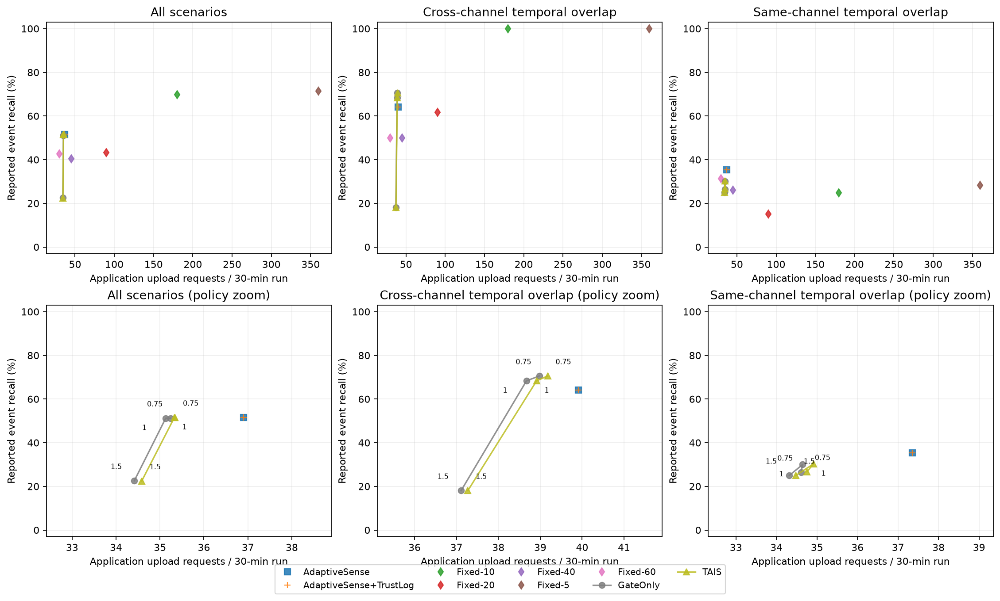

# TAIS v0.1 research report

Report date: 2026-10-17. This is a research prototype report, not a field deployment result.

## Scope and independent evidence

The research question is how channel health can constrain event-aware sampling when another healthy channel may experience an event, and where same-channel event/fault overlap becomes ambiguous. The real C11 SensorTrust detector and pinned AdaptiveSense primitives are reused without upstream edits. The package preserves per-channel state and independent latent/noisy/faulted streams and truth labels.

## Exact original baseline reproduction

AdaptiveSense `f7ec30fd4721aa1a7c308f879050a83936e60067`: 235 Python tests and 69 configuration checks passed. SensorTrust `2ce98dd043bb01ea99052eda218c68a172499a4c`: 27 Python tests and 21 standalone C tests (404 checks) passed. These were run in isolated temporary copies. The original seven-scenario AdaptiveSense benchmark regenerated 24 channel event labels and the following actual result:

| Strategy | Local detected events | Samples | Application uploads | Strict unmatched detections |
| --- | --- | --- | --- | --- |
| Fixed 5 s | 22/24 | 5280 | 5280 | 17 |
| Fixed 10 s | 22/24 | 2640 | 2640 | 20 |
| Fixed 20 s | 19/24 | 1320 | 1320 | 20 |
| Fixed 40 s | 17/24 | 660 | 660 | 14 |
| Fixed 60 s | 11/24 | 440 | 440 | 5 |
| AdaptiveSense | 18/24 | 1178 | 768 | 17 |

Both CSVs matched their pinned originals byte-for-byte: metrics_all SHA-256 `46d49bfd7ac606930cccfb11f982ee9bfa578f84f40703fc2b0bfe80f16a7876`; metrics_summary `2f41f5478e4acabe57a9811246cc144862b7afd5e0315963b3cc5afab0e60bbf`. [Logs and environment](../results/baseline/manifest.json). These are original baseline results, not TAIS results and not the two-channel fault benchmark below.

## Frozen new benchmark

All 50 seeds retained: development 0–9, validation 10–19, independent test 20–49. No threshold tuning or selection on any split; three predeclared threshold multipliers are all reported. 45 scenarios x13 operating points x50 seeds =29,250 scored runs, plus cached clean counterfactual replays. Algorithm/config frozen at 273758d, source-script import fix at 97aa5d5; per-split manifests record the actual source commit and configuration hash. Later report/analysis tooling changes do not change the experimental policy.

Each 30-minute run has two channels, independently labeled physical events and one injected faulty temperature channel in fault scenarios. Profiles jointly vary duration and intensity; event-free, healthy-other-channel and same-channel overlap are separately tabulated. Main recall matches upload-requested report onsets; local TP is a separate column. Statistical and attribution definitions are in the [protocol](EXPERIMENT_PROTOCOL.md).

Full-run numerical tables and interpretation are populated only after the corresponding commands complete and hashes are checked.

<!-- RESULTS_START -->

Completed scored runs: **29,250**. Raw archived replay hashes and exact metric checks are recorded per split.

### Development: 5,850 scored runs

| Method | Threshold multiplier | Recall | TP | Missed | Strict false reports | Counterfactual-new fault false | Samples | Upload requests | Application bytes |
| --- | --- | --- | --- | --- | --- | --- | --- | --- | --- |
| AdaptiveSense | 1 | 47.00% | 141 | 159 | 329 | 219 | 33559 | 16585 | 2664358 |
| AdaptiveSense+TrustLog | 1 | 47.00% | 141 | 159 | 329 | 219 | 33559 | 16585 | 4452184 |
| Fixed-10 | 1 | 70.00% | 210 | 90 | 372 | 273 | 81000 | 81000 | 13027097 |
| Fixed-20 | 1 | 41.33% | 124 | 176 | 399 | 223 | 40500 | 40500 | 6513100 |
| Fixed-40 | 1 | 40.67% | 122 | 178 | 300 | 192 | 20250 | 20250 | 3256625 |
| Fixed-5 | 1 | 71.33% | 214 | 86 | 384 | 278 | 162000 | 162000 | 26052832 |
| Fixed-60 | 1 | 42.67% | 128 | 172 | 286 | 185 | 13500 | 13500 | 2170894 |
| GateOnly | 0.750 | 45.33% | 136 | 164 | 292 | 181 | 26080 | 15853 | 4256263 |
| GateOnly | 1 | 47.67% | 143 | 157 | 265 | 147 | 25105 | 15791 | 4240023 |
| GateOnly | 1.500 | 22.67% | 68 | 232 | 160 | 105 | 23589 | 15498 | 4162638 |
| TAIS | 0.750 | 45.33% | 136 | 164 | 307 | 196 | 26118 | 15893 | 4267090 |
| TAIS | 1 | 47.67% | 143 | 157 | 272 | 154 | 25256 | 15868 | 4260857 |
| TAIS | 1.500 | 22.67% | 68 | 232 | 155 | 100 | 23798 | 15579 | 4184508 |

[Per-scenario results](../results/development/by_scenario.csv), [manifest](../results/development/manifest.json), [paired CIs](../results/development/paired_bootstrap.csv).

### Validation: 5,850 scored runs

| Method | Threshold multiplier | Recall | TP | Missed | Strict false reports | Counterfactual-new fault false | Samples | Upload requests | Application bytes |
| --- | --- | --- | --- | --- | --- | --- | --- | --- | --- |
| AdaptiveSense | 1 | 45.33% | 136 | 164 | 343 | 222 | 33921 | 16590 | 2664460 |
| AdaptiveSense+TrustLog | 1 | 45.33% | 136 | 164 | 343 | 222 | 33921 | 16590 | 4452780 |
| Fixed-10 | 1 | 70.00% | 210 | 90 | 352 | 252 | 81000 | 81000 | 13025168 |
| Fixed-20 | 1 | 38.00% | 114 | 186 | 394 | 214 | 40500 | 40500 | 6512000 |
| Fixed-40 | 1 | 40.00% | 120 | 180 | 305 | 195 | 20250 | 20250 | 3254391 |
| Fixed-5 | 1 | 71.67% | 215 | 85 | 377 | 271 | 162000 | 162000 | 26048592 |
| Fixed-60 | 1 | 43.33% | 130 | 170 | 304 | 185 | 13500 | 13500 | 2170122 |
| GateOnly | 0.750 | 45.33% | 136 | 164 | 314 | 178 | 26559 | 15917 | 4272459 |
| GateOnly | 1 | 45.33% | 136 | 164 | 282 | 149 | 25589 | 15873 | 4261261 |
| GateOnly | 1.500 | 19.67% | 59 | 241 | 183 | 117 | 23980 | 15571 | 4181266 |
| TAIS | 0.750 | 45.33% | 136 | 164 | 329 | 194 | 26607 | 15960 | 4284086 |
| TAIS | 1 | 45.33% | 136 | 164 | 292 | 157 | 25733 | 15949 | 4281846 |
| TAIS | 1.500 | 19.67% | 59 | 241 | 181 | 115 | 24214 | 15648 | 4202073 |

[Per-scenario results](../results/validation/by_scenario.csv), [manifest](../results/validation/manifest.json), [paired CIs](../results/validation/paired_bootstrap.csv).

### Test: 17,550 scored runs

| Method | Threshold multiplier | Recall | TP | Missed | Strict false reports | Counterfactual-new fault false | Samples | Upload requests | Application bytes |
| --- | --- | --- | --- | --- | --- | --- | --- | --- | --- |
| AdaptiveSense | 1 | 51.56% | 464 | 436 | 990 | 652 | 101108 | 49816 | 8000401 |
| AdaptiveSense+TrustLog | 1 | 51.56% | 464 | 436 | 990 | 652 | 101108 | 49816 | 13370474 |
| Fixed-10 | 1 | 69.78% | 628 | 272 | 1094 | 795 | 243000 | 243000 | 39074445 |
| Fixed-20 | 1 | 43.33% | 390 | 510 | 1198 | 670 | 121500 | 121500 | 19534623 |
| Fixed-40 | 1 | 40.33% | 363 | 537 | 968 | 589 | 60750 | 60750 | 9766062 |
| Fixed-5 | 1 | 71.33% | 642 | 258 | 1129 | 811 | 486000 | 486000 | 78150012 |
| Fixed-60 | 1 | 42.67% | 384 | 516 | 860 | 558 | 40500 | 40500 | 6509524 |
| GateOnly | 0.750 | 51.22% | 461 | 439 | 858 | 494 | 78810 | 47579 | 12771468 |
| GateOnly | 1 | 51.22% | 461 | 439 | 807 | 440 | 75964 | 47427 | 12731828 |
| GateOnly | 1.500 | 22.56% | 203 | 697 | 546 | 329 | 71247 | 46461 | 12476501 |
| TAIS | 0.750 | 51.56% | 464 | 436 | 904 | 541 | 78919 | 47714 | 12807940 |
| TAIS | 1 | 51.56% | 464 | 436 | 828 | 458 | 76430 | 47694 | 12804006 |
| TAIS | 1.500 | 22.44% | 202 | 698 | 534 | 318 | 71938 | 46689 | 12538148 |

[Per-scenario results](../results/test/by_scenario.csv), [manifest](../results/test/manifest.json), [paired CIs](../results/test/paired_bootstrap.csv).

### Independent test: actual temporal relationships

Clean controls and sequential spike cases are explicitly separate. `cross` / `same` refer only to true fault/event overlap. The 1-second spike precedes the later event in v0.1; no concurrent-spike claim.

| Group | Method | Events | Recall | Fault false | Strict false | Requests | Samples | Fault diagnosis recall | Event delay s |
| --- | --- | --- | --- | --- | --- | --- | --- | --- | --- |
| clean | AdaptiveSense | 60 | 60.00% | 0 | 38 | 3014 | 4677 | N/A | 38 |
| clean | GateOnly | 60 | 60.00% | 0 | 38 | 3014 | 4677 | N/A | 38 |
| clean | TAIS | 60 | 60.00% | 0 | 38 | 3014 | 4677 | N/A | 38 |
| cross | AdaptiveSense | 360 | 64.17% | 220 | 411 | 14369 | 32739 | 0.00% | 26.719 |
| cross | GateOnly | 360 | 68.33% | 153 | 381 | 13922 | 25719 | 69.17% | 27.553 |
| cross | TAIS | 360 | 68.33% | 160 | 388 | 14009 | 25922 | 69.17% | 27.553 |
| cross_sequential | AdaptiveSense | 60 | 58.33% | 2 | 40 | 2096 | 3541 | 0.00% | 36.429 |
| cross_sequential | GateOnly | 60 | 58.33% | 2 | 40 | 2093 | 3491 | 3.33% | 37.714 |
| cross_sequential | TAIS | 60 | 60.00% | 0 | 38 | 2097 | 3498 | 3.33% | 35.472 |
| none | AdaptiveSense | 0 | N/A | 219 | 219 | 14770 | 28524 | 0.00% | N/A |
| none | GateOnly | 0 | N/A | 152 | 152 | 13810 | 19386 | 50.48% | N/A |
| none | TAIS | 0 | N/A | 162 | 168 | 13884 | 19465 | 50.48% | N/A |
| same | AdaptiveSense | 360 | 35.28% | 209 | 242 | 13446 | 27871 | 0.00% | 10.732 |
| same | GateOnly | 360 | 30.00% | 132 | 157 | 12473 | 18960 | 58.61% | 16.102 |
| same | TAIS | 360 | 30.28% | 136 | 158 | 12569 | 19122 | 58.61% | 12.009 |
| same_sequential | AdaptiveSense | 60 | 58.33% | 2 | 40 | 2121 | 3756 | 0.00% | 37.143 |
| same_sequential | GateOnly | 60 | 60.00% | 1 | 39 | 2115 | 3731 | 3.33% | 37.722 |
| same_sequential | TAIS | 60 | 61.67% | 0 | 38 | 2121 | 3746 | 3.33% | 35.838 |

### Paired independent-test differences at original thresholds

TAIS rows compare to AdaptiveSense; TAIS-minus-GateOnly rows isolate confirmation. Recall differences are fractions (x100 gives percentage points). Count differences are mean **per seed batch of all scenarios in the stated group**, not per individual 30-minute trace. Intervals are descriptive 95% whole-seed bootstrap CIs, not adjusted hypothesis tests.

| Group | Difference | Metric | Mean difference | CI lower | CI upper |
| --- | --- | --- | --- | --- | --- |
| all | TAIS | recall | 0.000 | -0.011 | 0.012 |
| all | TAIS | uploads | -70.733 | -74.767 | -66.800 |
| all | TAIS | samples | -822.600 | -836.203 | -811.732 |
| all | TAIS | fault_induced_false | -6.467 | -7.367 | -5.633 |
| all | TAIS | false_reports | -5.400 | -6.367 | -4.533 |
| all | TAIS-minus-GateOnly | recall | 0.003 | 0 | 0.009 |
| all | TAIS-minus-GateOnly | uploads | 8.900 | 7.067 | 10.533 |
| all | TAIS-minus-GateOnly | samples | 15.533 | 9.598 | 20.733 |
| all | TAIS-minus-GateOnly | fault_induced_false | 0.600 | 0.067 | 1.033 |
| all | TAIS-minus-GateOnly | false_reports | 0.700 | 0.167 | 1.167 |
| cross | TAIS | recall | 0.042 | 0.019 | 0.067 |
| cross | TAIS | uploads | -12 | -13.967 | -10.066 |
| cross | TAIS | samples | -227.233 | -229.768 | -224.466 |
| cross | TAIS | fault_induced_false | -2 | -2.233 | -1.733 |
| cross | TAIS | false_reports | -0.767 | -1 | -0.533 |
| cross | TAIS-minus-GateOnly | recall | 0 | 0 | 0 |
| cross | TAIS-minus-GateOnly | uploads | 2.900 | 2.333 | 3.467 |
| cross | TAIS-minus-GateOnly | samples | 6.767 | 5.166 | 8.300 |
| cross | TAIS-minus-GateOnly | fault_induced_false | 0.233 | 0.067 | 0.433 |
| cross | TAIS-minus-GateOnly | false_reports | 0.233 | 0.067 | 0.433 |
| same | TAIS | recall | -0.050 | -0.078 | -0.022 |
| same | TAIS | uploads | -29.233 | -30.867 | -27.167 |
| same | TAIS | samples | -291.633 | -296.167 | -286.433 |
| same | TAIS | fault_induced_false | -2.433 | -2.833 | -2 |
| same | TAIS | false_reports | -2.800 | -3.234 | -2.300 |
| same | TAIS-minus-GateOnly | recall | 0.003 | 0 | 0.008 |
| same | TAIS-minus-GateOnly | uploads | 3.200 | 1.733 | 4.434 |
| same | TAIS-minus-GateOnly | samples | 5.400 | 0.300 | 10.033 |
| same | TAIS-minus-GateOnly | fault_induced_false | 0.133 | -0.067 | 0.333 |
| same | TAIS-minus-GateOnly | false_reports | 0.033 | -0.200 | 0.267 |

### Disclosed failure probes

These fixed probes expose hard replacement/missingness, short healthy-channel events, offset/stuck blind spots and sequential spike history. The complete 45-scenario table remains available, including every unfavorable point.

| Scenario | Method | Events | TP | Fault false | Fault diagnosis recall | Samples | Requests |
| --- | --- | --- | --- | --- | --- | --- | --- |
| missing_same_long | AdaptiveSense | 30 | 0 | 0 | 0.00% | 960 | 900 |
| missing_same_long | GateOnly | 30 | 0 | 0 | 100.00% | 1020 | 901 |
| missing_same_long | TAIS | 30 | 0 | 0 | 100.00% | 1020 | 901 |
| range_cross_short | AdaptiveSense | 30 | 29 | 37 | 0.00% | 4024 | 1144 |
| range_cross_short | GateOnly | 30 | 5 | 0 | 100.00% | 1238 | 984 |
| range_cross_short | TAIS | 30 | 5 | 0 | 100.00% | 1238 | 984 |
| range_same_long | AdaptiveSense | 30 | 9 | 51 | 0.00% | 5021 | 1158 |
| range_same_long | GateOnly | 30 | 0 | 0 | 100.00% | 1020 | 931 |
| range_same_long | TAIS | 30 | 0 | 0 | 100.00% | 1020 | 931 |
| spike_same_short | AdaptiveSense | 30 | 6 | 1 | 0.00% | 1274 | 966 |
| spike_same_short | GateOnly | 30 | 6 | 1 | 3.33% | 1252 | 963 |
| spike_same_short | TAIS | 30 | 7 | 0 | 3.33% | 1263 | 966 |
| stable_offset_none_long | AdaptiveSense | 0 | 0 | 57 | 0.00% | 2144 | 1112 |
| stable_offset_none_long | GateOnly | 0 | 0 | 57 | 0.00% | 2144 | 1112 |
| stable_offset_none_long | TAIS | 0 | 0 | 57 | 0.00% | 2144 | 1112 |
| stuck_none_long | AdaptiveSense | 0 | 0 | 0 | 0.00% | 960 | 900 |
| stuck_none_long | GateOnly | 0 | 0 | 0 | 0.00% | 960 | 900 |
| stuck_none_long | TAIS | 0 | 0 | 0 | 0.00% | 960 | 900 |

### Cost comparison at original thresholds

Full TAIS vs plain AdaptiveSense: uploads -4.26%, samples -24.41%, serialized application bytes +60.04%. Compared with diagnostic-only logging (same health metadata), TAIS bytes change -4.24%. Metadata therefore matters; upload reductions do not establish lower total payload versus plain AdaptiveSense, much less lower radio energy.

At this fixed point, TAIS recall is 51.56% vs GateOnly 51.22%; it uses +466 samples and +267 requests, with +18 operational fault false reports. The ablation does not justify assuming confirmation helps. All other multipliers remain reported above.

### Secondary metrics at original thresholds

Delays are conditional on matched events or detected fault episodes; misses are separately counted. Reconstruction uses the same naive causal hold from all finite observations, including annotated faulty values. MAE/RMSE retain C and %RH units, so they must not be pooled into one physical error.

| Method | Event delay s | False reports/h | Sample MAE C | Sample RMSE C | Sample MAE %RH | Sample RMSE %RH |
| --- | --- | --- | --- | --- | --- | --- |
| AdaptiveSense | 24.737 | 1.467 | 4.855 | 9.251 | 0.369 | 0.742 |
| AdaptiveSense+TrustLog | 24.737 | 1.467 | 4.855 | 9.251 | 0.369 | 0.742 |
| Fixed-5 | 11.150 | 1.673 | 4.961 | 9.381 | 0.329 | 0.482 |
| Fixed-60 | 74.427 | 1.274 | 4.980 | 9.433 | 0.442 | 1.028 |
| GateOnly | 27.252 | 1.196 | 4.974 | 9.417 | 0.381 | 0.803 |
| TAIS | 25.987 | 1.227 | 4.964 | 9.396 | 0.380 | 0.802 |

| Method | Upload MAE C | Upload RMSE C | Upload MAE %RH | Upload RMSE %RH |
| --- | --- | --- | --- | --- |
| AdaptiveSense | 4.854 | 9.247 | 0.368 | 0.739 |
| AdaptiveSense+TrustLog | 4.854 | 9.247 | 0.368 | 0.739 |
| Fixed-5 | 4.961 | 9.381 | 0.329 | 0.482 |
| Fixed-60 | 4.980 | 9.433 | 0.442 | 1.028 |
| GateOnly | 4.972 | 9.413 | 0.378 | 0.800 |
| TAIS | 4.963 | 9.392 | 0.378 | 0.799 |

Diagnostic demand is not automatically extra sampling. The paired total sample difference above measures actual incremental cost. Plain/fixed methods have no health detector (zero detected episodes by construction). Stable-offset has no dedicated C flag; type-specific counts expose this distinction.

| Method | Fault episodes | Any-flag detected | Matching-type detected | Diagnosis recall | Fault delay s | Diagnostic demand | Confirmation demand | Diagnostic-only cycles |
| --- | --- | --- | --- | --- | --- | --- | --- | --- |
| AdaptiveSense | 1260 | 0 | 0 | 0.00% | N/A | 0 | 0 | 0 |
| AdaptiveSense+TrustLog | 1260 | 676 | 675 | 53.65% | 126.138 | 0 | 0 | 0 |
| Fixed-5 | 1260 | 0 | 0 | 0.00% | N/A | 0 | 0 | 0 |
| Fixed-60 | 1260 | 0 | 0 | 0.00% | N/A | 0 | 0 | 0 |
| GateOnly | 1260 | 676 | 675 | 53.65% | 126.138 | 10922 | 0 | 9613 |
| TAIS | 1260 | 676 | 675 | 53.65% | 126.138 | 11142 | 358 | 9526 |

### Trade-off curves

The full axes include every fixed baseline. The zoom retains all policy operating points. [Nearest actual budget comparisons](../results/test/budget_comparison.csv) include the budget gap; no interpolated or hand-picked matched-cost claim is made.

<!-- RESULTS_END -->

## Interpretation boundaries and next work

At the original threshold point on 30 independent seeds, TAIS and AdaptiveSense each report 464/900 events (51.56%). TAIS has 458 vs 652 operational counterfactual-new fault false reports (-29.75%), 76430 vs 101108 samples (-24.41%), and 47694 vs 49816 upload requests (-4.26%). The paired recall-difference 95% CI is [-1.11,+1.22] percentage points: equal aggregate recall is not a formal non-inferiority guarantee. Application bytes increase 60.04% versus plain AdaptiveSense because health metadata is included.

Actual cross-channel overlap recall is 68.33% vs 64.17% (difference +4.17 pp; descriptive CI [1.94,6.67]). Actual same-channel overlap recall is 30.28% vs 35.28% (difference -5.00 pp; CI [-7.78,-2.22]). Thus the pooled equality hides a material same-channel loss; health gating does not solve the identifiability problem. Clean-control recall is unchanged at 60%. A node-wide trust-veto comparator was not implemented, so the older H2 comparative hypothesis is not established; channel isolation itself is tested directly.

Confirmation adds only 3 reported events relative to GateOnly at the original threshold point (0.33 pp; CI [0,0.89]), alongside 466 samples, 267 requests and 18 additional operational fault false reports. At multiplier 1.5 it loses one event relative to GateOnly. These mixed results do not establish a consistent confirmation advantage. Gating and confirmation require separate interpretation, and all unfavorable points remain in the tables.

The health gate and confirmation sampler are separate hypotheses. Any measured benefit of gating cannot be assigned to confirmation without the GateOnly ablation. Healthy-channel state isolation is a tested implementation property; it is not a guarantee of observing a brief event between samples. Hard replacement/missingness on the same channel removes information that this single sensor cannot recover. Stable offsets and sparse-sampling diagnosis expose SensorTrust limitations.

No rule or threshold was changed based on independent test outcomes. This first suite has jointly varied profiles, two channels, one faulty channel and sequential rather than concurrent one-second spike/event cases. A subsequent preregistered suite should vary timing, intensity and duration independently, include concurrent spikes and multiple faults, and evaluate spatial/cross-sensor corroboration. Any tuning requires new held-out seeds.

The real Hull greenhouse CSV could not be acquired through the tested API (403). Nominal metadata/license/5-minute resolution were checked, but actual header/missingness and TAIS replay were not. The fixture-tested audit helper is not empirical dataset evidence. No control-threshold cue, hardware current measurement or embedded deployment result exists. Literature verification is focused; comparison implementations for AAS/CLARA/sentinels are not provided, so no novelty or superiority claim over those works.
