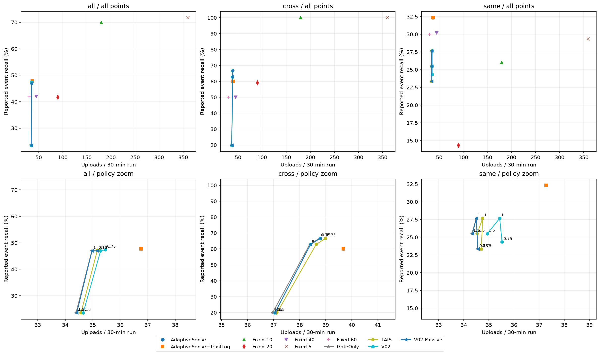
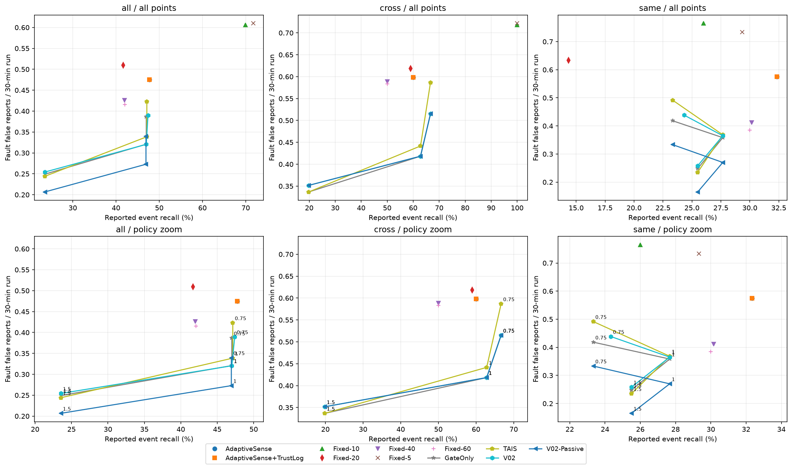

# TAIS v0.2 research report

**Finding:** only multiplier.75 improves same-channel recall (23.33%→24.33%, +1.00 pp,95% CI[+.33,+1.83]); all six gains are late long-drift detections. Multipliers1/1.5 have no same-channel gain; default overall recall drops by2/1500. Extra costs, the passive ablation and a known blocked-rearm failure are reported in the [complete interpretation](V02_INTERPRETATION.md). Final verification:42,750 runs,50,700 archive hashes and five fresh policy replays passed. Final local tests:125 passed,1 strict known expected failure,0 unexpected failures.

This report is generated from actual completed outputs. The design was committed at8222873 before implementation1dbc102; v0.1 source/config/results remain intact. Seeds20–49 are diagnostic only; the new final split is50–99. Frozen selection rule: no parameter selection, all three inherited threshold multipliers retained.

## Root causes and mechanism

[Failure forensics](FAILURE_ANALYSIS_V0.1.md) proves400 observation-identical event/no-event pairs across old seeds. All18 extra old same-channel AS matches occur identically without the event in range scenarios. The old pooled recall gap therefore does not establish loss of18 observable events. Sampling/debounce, C offset/stuck blind spots and degraded confirmation churn are distinct causes.

The selected mechanism is one bounded persistent episode: pre-update EMA reference, signed displacement, >=3 sampled confirmations, >=10 s duration, <=120 s pending window, existing upstream debounce and unchanged hard FAULT exclusion. Candidate evidence survives a drop below scheduler ALERT entry. Full V02 adds5 s demand; V02-Passive retains evidence with ordinary scheduling. [Exact rules and frozen protocol](V02_DESIGN.md). This is observational persistence, not causal identification.

## development: 8,550 scored runs

Seeds[0, 1, 2, 3, 4, 5, 6, 7, 8, 9]; actual source commit`1dbc102a70e44011941fd2358af4f485f8f457ac`. [Raw metrics](../results/v0.2/development/metrics.csv), [event records](../results/v0.2/development/events.csv), [manifest and source/archive hashes](../results/v0.2/development/manifest.json).

| method | multiplier | n_events | tp | missed | recall | fault_induced_false | false_reports | samples | uploads | payload_bytes |
| --- | --- | --- | --- | --- | --- | --- | --- | --- | --- | --- |
| AdaptiveSense | 1 | 300 | 141 | 159 | 0.47 | 219 | 329 | 33559 | 16585 | 2.66436e+06 |
| AdaptiveSense+TrustLog | 1 | 300 | 141 | 159 | 0.47 | 219 | 329 | 33559 | 16585 | 4.45218e+06 |
| Fixed-10 | 1 | 300 | 210 | 90 | 0.7 | 273 | 372 | 81000 | 81000 | 1.30271e+07 |
| Fixed-20 | 1 | 300 | 124 | 176 | 0.413333 | 223 | 399 | 40500 | 40500 | 6.5131e+06 |
| Fixed-40 | 1 | 300 | 122 | 178 | 0.406667 | 192 | 300 | 20250 | 20250 | 3.25662e+06 |
| Fixed-5 | 1 | 300 | 214 | 86 | 0.713333 | 278 | 384 | 162000 | 162000 | 2.60528e+07 |
| Fixed-60 | 1 | 300 | 128 | 172 | 0.426667 | 185 | 286 | 13500 | 13500 | 2.17089e+06 |
| GateOnly | 0.75 | 300 | 136 | 164 | 0.453333 | 181 | 292 | 26080 | 15853 | 4.25626e+06 |
| GateOnly | 1 | 300 | 143 | 157 | 0.476667 | 147 | 265 | 25105 | 15791 | 4.24002e+06 |
| GateOnly | 1.5 | 300 | 68 | 232 | 0.226667 | 105 | 160 | 23589 | 15498 | 4.16264e+06 |
| TAIS | 0.75 | 300 | 136 | 164 | 0.453333 | 196 | 307 | 26118 | 15893 | 4.26709e+06 |
| TAIS | 1 | 300 | 143 | 157 | 0.476667 | 154 | 272 | 25256 | 15868 | 4.26086e+06 |
| TAIS | 1.5 | 300 | 68 | 232 | 0.226667 | 100 | 155 | 23798 | 15579 | 4.18451e+06 |
| V02 | 0.75 | 300 | 137 | 163 | 0.456667 | 182 | 293 | 27681 | 15996 | 4.29467e+06 |
| V02 | 1 | 300 | 143 | 157 | 0.476667 | 145 | 262 | 26718 | 15933 | 4.2782e+06 |
| V02 | 1.5 | 300 | 68 | 232 | 0.226667 | 103 | 158 | 23970 | 15589 | 4.18715e+06 |
| V02-Passive | 0.75 | 300 | 136 | 164 | 0.453333 | 160 | 270 | 26551 | 15857 | 4.25734e+06 |
| V02-Passive | 1 | 300 | 143 | 157 | 0.476667 | 126 | 243 | 25599 | 15794 | 4.24082e+06 |
| V02-Passive | 1.5 | 300 | 68 | 232 | 0.226667 | 87 | 142 | 23619 | 15516 | 4.1675e+06 |

## validation: 8,550 scored runs

Seeds[10, 11, 12, 13, 14, 15, 16, 17, 18, 19]; actual source commit`1dbc102a70e44011941fd2358af4f485f8f457ac`. [Raw metrics](../results/v0.2/validation/metrics.csv), [event records](../results/v0.2/validation/events.csv), [manifest and source/archive hashes](../results/v0.2/validation/manifest.json).

| method | multiplier | n_events | tp | missed | recall | fault_induced_false | false_reports | samples | uploads | payload_bytes |
| --- | --- | --- | --- | --- | --- | --- | --- | --- | --- | --- |
| AdaptiveSense | 1 | 300 | 136 | 164 | 0.453333 | 222 | 343 | 33921 | 16590 | 2.66446e+06 |
| AdaptiveSense+TrustLog | 1 | 300 | 136 | 164 | 0.453333 | 222 | 343 | 33921 | 16590 | 4.45278e+06 |
| Fixed-10 | 1 | 300 | 210 | 90 | 0.7 | 252 | 352 | 81000 | 81000 | 1.30252e+07 |
| Fixed-20 | 1 | 300 | 114 | 186 | 0.38 | 214 | 394 | 40500 | 40500 | 6.512e+06 |
| Fixed-40 | 1 | 300 | 120 | 180 | 0.4 | 195 | 305 | 20250 | 20250 | 3.25439e+06 |
| Fixed-5 | 1 | 300 | 215 | 85 | 0.716667 | 271 | 377 | 162000 | 162000 | 2.60486e+07 |
| Fixed-60 | 1 | 300 | 130 | 170 | 0.433333 | 185 | 304 | 13500 | 13500 | 2.17012e+06 |
| GateOnly | 0.75 | 300 | 136 | 164 | 0.453333 | 178 | 314 | 26559 | 15917 | 4.27246e+06 |
| GateOnly | 1 | 300 | 136 | 164 | 0.453333 | 149 | 282 | 25589 | 15873 | 4.26126e+06 |
| GateOnly | 1.5 | 300 | 59 | 241 | 0.196667 | 117 | 183 | 23980 | 15571 | 4.18127e+06 |
| TAIS | 0.75 | 300 | 136 | 164 | 0.453333 | 194 | 329 | 26607 | 15960 | 4.28409e+06 |
| TAIS | 1 | 300 | 136 | 164 | 0.453333 | 157 | 292 | 25733 | 15949 | 4.28185e+06 |
| TAIS | 1.5 | 300 | 59 | 241 | 0.196667 | 115 | 181 | 24214 | 15648 | 4.20207e+06 |
| V02 | 0.75 | 300 | 137 | 163 | 0.456667 | 181 | 316 | 28205 | 16063 | 4.3117e+06 |
| V02 | 1 | 300 | 136 | 164 | 0.453333 | 150 | 282 | 27231 | 16020 | 4.30078e+06 |
| V02 | 1.5 | 300 | 59 | 241 | 0.196667 | 118 | 184 | 24666 | 15682 | 4.21114e+06 |
| V02-Passive | 0.75 | 300 | 136 | 164 | 0.453333 | 158 | 293 | 27027 | 15928 | 4.27541e+06 |
| V02-Passive | 1 | 300 | 136 | 164 | 0.453333 | 129 | 261 | 26078 | 15883 | 4.26394e+06 |
| V02-Passive | 1.5 | 300 | 59 | 241 | 0.196667 | 98 | 164 | 24031 | 15586 | 4.1853e+06 |

## test: 42,750 scored runs

Seeds[50, 51, 52, 53, 54, 55, 56, 57, 58, 59, 60, 61, 62, 63, 64, 65, 66, 67, 68, 69, 70, 71, 72, 73, 74, 75, 76, 77, 78, 79, 80, 81, 82, 83, 84, 85, 86, 87, 88, 89, 90, 91, 92, 93, 94, 95, 96, 97, 98, 99]; actual source commit`14af61952229a6da6cda40c8ee7257f9582b4b40`. [Raw metrics](../results/v0.2/test/metrics.csv), [event records](../results/v0.2/test/events.csv), [manifest and source/archive hashes](../results/v0.2/test/manifest.json).

| method | multiplier | n_events | tp | missed | recall | fault_induced_false | false_reports | samples | uploads | payload_bytes |
| --- | --- | --- | --- | --- | --- | --- | --- | --- | --- | --- |
| AdaptiveSense | 1 | 1500 | 716 | 784 | 0.477333 | 1069 | 1595 | 167072 | 82694 | 1.32819e+07 |
| AdaptiveSense+TrustLog | 1 | 1500 | 716 | 784 | 0.477333 | 1069 | 1595 | 167072 | 82694 | 2.21962e+07 |
| Fixed-10 | 1 | 1500 | 1049 | 451 | 0.699333 | 1363 | 1863 | 405000 | 405000 | 6.51255e+07 |
| Fixed-20 | 1 | 1500 | 625 | 875 | 0.416667 | 1146 | 2037 | 202500 | 202500 | 3.25636e+07 |
| Fixed-40 | 1 | 1500 | 630 | 870 | 0.42 | 959 | 1593 | 101250 | 101250 | 1.62777e+07 |
| Fixed-5 | 1 | 1500 | 1076 | 424 | 0.717333 | 1372 | 1900 | 810000 | 810000 | 1.30259e+08 |
| Fixed-60 | 1 | 1500 | 631 | 869 | 0.420667 | 935 | 1425 | 67500 | 67500 | 1.08495e+07 |
| GateOnly | 0.75 | 1500 | 705 | 795 | 0.47 | 870 | 1437 | 130012 | 79098 | 2.12347e+07 |
| GateOnly | 1 | 1500 | 705 | 795 | 0.47 | 722 | 1289 | 124791 | 78678 | 2.1124e+07 |
| GateOnly | 1.5 | 1500 | 354 | 1146 | 0.236 | 561 | 858 | 117609 | 77387 | 2.07831e+07 |
| TAIS | 0.75 | 1500 | 707 | 793 | 0.471333 | 952 | 1516 | 130231 | 79324 | 2.12959e+07 |
| TAIS | 1 | 1500 | 707 | 793 | 0.471333 | 762 | 1336 | 125618 | 79126 | 2.12453e+07 |
| TAIS | 1.5 | 1500 | 353 | 1147 | 0.235333 | 549 | 845 | 118799 | 77788 | 2.08915e+07 |
| V02 | 0.75 | 1500 | 711 | 789 | 0.474 | 877 | 1441 | 138026 | 79804 | 2.14244e+07 |
| V02 | 1 | 1500 | 705 | 795 | 0.47 | 721 | 1286 | 132824 | 79396 | 2.13171e+07 |
| V02 | 1.5 | 1500 | 353 | 1147 | 0.235333 | 572 | 868 | 120960 | 77969 | 2.09397e+07 |
| V02-Passive | 0.75 | 1500 | 704 | 796 | 0.469333 | 764 | 1328 | 132209 | 79099 | 2.12349e+07 |
| V02-Passive | 1 | 1500 | 704 | 796 | 0.469333 | 614 | 1179 | 127151 | 78691 | 2.11275e+07 |
| V02-Passive | 1.5 | 1500 | 353 | 1147 | 0.235333 | 465 | 762 | 118172 | 77444 | 2.07985e+07 |

## New independent test: temporal relationships, original thresholds

| relationship | method | multiplier | n_events | tp | missed | recall | fault_induced_false | false_reports | samples | uploads | payload_bytes |
| --- | --- | --- | --- | --- | --- | --- | --- | --- | --- | --- | --- |
| clean | AdaptiveSense | 1 | 100 | 55 | 45 | 0.55 | 0 | 58 | 7527 | 4998 | 810140 |
| clean | GateOnly | 1 | 100 | 55 | 45 | 0.55 | 0 | 58 | 7523 | 4998 | 1.34992e+06 |
| clean | TAIS | 1 | 100 | 55 | 45 | 0.55 | 0 | 58 | 7523 | 4998 | 1.34992e+06 |
| clean | V02 | 1 | 100 | 55 | 45 | 0.55 | 0 | 58 | 7523 | 4998 | 1.34992e+06 |
| clean | V02-Passive | 1 | 100 | 55 | 45 | 0.55 | 0 | 58 | 7523 | 4998 | 1.34992e+06 |
| cross | AdaptiveSense | 1 | 600 | 360 | 240 | 0.6 | 359 | 658 | 53821 | 23804 | 3.80714e+06 |
| cross | GateOnly | 1 | 600 | 377 | 223 | 0.628333 | 251 | 605 | 41999 | 23032 | 6.16241e+06 |
| cross | TAIS | 1 | 600 | 377 | 223 | 0.628333 | 265 | 619 | 42337 | 23180 | 6.20245e+06 |
| cross | V02 | 1 | 600 | 377 | 223 | 0.628333 | 251 | 605 | 44450 | 23052 | 6.16752e+06 |
| cross | V02-Passive | 1 | 600 | 377 | 223 | 0.628333 | 251 | 605 | 44450 | 23052 | 6.16752e+06 |
| cross_sequential | AdaptiveSense | 1 | 100 | 53 | 47 | 0.53 | 2 | 59 | 5649 | 3461 | 560939 |
| cross_sequential | GateOnly | 1 | 100 | 52 | 48 | 0.52 | 2 | 59 | 5613 | 3455 | 933096 |
| cross_sequential | TAIS | 1 | 100 | 53 | 47 | 0.53 | 0 | 57 | 5608 | 3460 | 934457 |
| cross_sequential | V02 | 1 | 100 | 53 | 47 | 0.53 | 0 | 57 | 5608 | 3460 | 934457 |
| cross_sequential | V02-Passive | 1 | 100 | 52 | 48 | 0.52 | 0 | 57 | 5586 | 3453 | 932563 |
| none | AdaptiveSense | 1 | 0 | 0 | 0 | N/A | 361 | 361 | 47544 | 24562 | 3.94626e+06 |
| none | GateOnly | 1 | 0 | 0 | 0 | N/A | 253 | 253 | 32248 | 22997 | 6.17789e+06 |
| none | TAIS | 1 | 0 | 0 | 0 | N/A | 276 | 285 | 32420 | 23134 | 6.2149e+06 |
| none | V02 | 1 | 0 | 0 | 0 | N/A | 251 | 251 | 35743 | 23127 | 6.21272e+06 |
| none | V02-Passive | 1 | 0 | 0 | 0 | N/A | 201 | 201 | 32201 | 22992 | 6.17665e+06 |
| same | AdaptiveSense | 1 | 600 | 194 | 406 | 0.323333 | 345 | 399 | 46556 | 22366 | 3.58971e+06 |
| same | GateOnly | 1 | 600 | 166 | 434 | 0.276667 | 215 | 255 | 31468 | 20699 | 5.55628e+06 |
| same | TAIS | 1 | 600 | 166 | 434 | 0.276667 | 221 | 259 | 31773 | 20850 | 5.59718e+06 |
| same | V02 | 1 | 600 | 166 | 434 | 0.276667 | 219 | 257 | 33543 | 21257 | 5.70672e+06 |
| same | V02-Passive | 1 | 600 | 166 | 434 | 0.276667 | 162 | 200 | 31468 | 20700 | 5.55667e+06 |
| same_sequential | AdaptiveSense | 1 | 100 | 54 | 46 | 0.54 | 2 | 60 | 5975 | 3503 | 567738 |
| same_sequential | GateOnly | 1 | 100 | 55 | 45 | 0.55 | 1 | 59 | 5940 | 3497 | 944447 |
| same_sequential | TAIS | 1 | 100 | 56 | 44 | 0.56 | 0 | 58 | 5957 | 3504 | 946342 |
| same_sequential | V02 | 1 | 100 | 54 | 46 | 0.54 | 0 | 58 | 5957 | 3502 | 945806 |
| same_sequential | V02-Passive | 1 | 100 | 54 | 46 | 0.54 | 0 | 58 | 5923 | 3496 | 944187 |

## Same-channel information classes (all declared points)

Matched TP remains the unchanged temporal metric, including coincidental matches in observation-erased cases. It cannot demonstrate causal event sensitivity in those cases.

| information_class | method | multiplier | n_events | tp | missed | recall | fault_induced_false | false_reports | samples | uploads | payload_bytes |
| --- | --- | --- | --- | --- | --- | --- | --- | --- | --- | --- | --- |
| same_additive | AdaptiveSense | 1 | 200 | 166 | 34 | 0.83 | 215 | 269 | 21851 | 9681 | 1.56655e+06 |
| same_additive | GateOnly | 0.75 | 200 | 140 | 60 | 0.7 | 251 | 302 | 19105 | 8617 | 2.32568e+06 |
| same_additive | GateOnly | 1 | 200 | 166 | 34 | 0.83 | 215 | 255 | 18068 | 8580 | 2.31578e+06 |
| same_additive | GateOnly | 1.5 | 200 | 153 | 47 | 0.765 | 149 | 180 | 16943 | 8474 | 2.2876e+06 |
| same_additive | TAIS | 0.75 | 200 | 140 | 60 | 0.7 | 295 | 343 | 19144 | 8699 | 2.34788e+06 |
| same_additive | TAIS | 1 | 200 | 166 | 34 | 0.83 | 221 | 259 | 18373 | 8731 | 2.35669e+06 |
| same_additive | TAIS | 1.5 | 200 | 153 | 47 | 0.765 | 141 | 172 | 17363 | 8600 | 2.32161e+06 |
| same_additive | V02 | 0.75 | 200 | 146 | 54 | 0.73 | 263 | 311 | 21281 | 9195 | 2.48138e+06 |
| same_additive | V02 | 1 | 200 | 166 | 34 | 0.83 | 219 | 257 | 20143 | 9138 | 2.46622e+06 |
| same_additive | V02 | 1.5 | 200 | 153 | 47 | 0.765 | 155 | 186 | 18393 | 8843 | 2.38715e+06 |
| same_additive | V02-Passive | 0.75 | 200 | 140 | 60 | 0.7 | 200 | 248 | 19105 | 8616 | 2.32553e+06 |
| same_additive | V02-Passive | 1 | 200 | 166 | 34 | 0.83 | 162 | 200 | 18068 | 8581 | 2.31617e+06 |
| same_additive | V02-Passive | 1.5 | 200 | 153 | 47 | 0.765 | 99 | 130 | 16918 | 8487 | 2.29116e+06 |
| same_erased | AdaptiveSense | 1 | 400 | 28 | 372 | 0.07 | 130 | 130 | 24705 | 12685 | 2.02316e+06 |
| same_erased | GateOnly | 0.75 | 400 | 0 | 400 | 0 | 0 | 0 | 13400 | 12119 | 3.2405e+06 |
| same_erased | GateOnly | 1 | 400 | 0 | 400 | 0 | 0 | 0 | 13400 | 12119 | 3.2405e+06 |
| same_erased | GateOnly | 1.5 | 400 | 0 | 400 | 0 | 0 | 0 | 13400 | 12119 | 3.2405e+06 |
| same_erased | TAIS | 0.75 | 400 | 0 | 400 | 0 | 0 | 0 | 13400 | 12119 | 3.2405e+06 |
| same_erased | TAIS | 1 | 400 | 0 | 400 | 0 | 0 | 0 | 13400 | 12119 | 3.2405e+06 |
| same_erased | TAIS | 1.5 | 400 | 0 | 400 | 0 | 0 | 0 | 13400 | 12119 | 3.2405e+06 |
| same_erased | V02 | 0.75 | 400 | 0 | 400 | 0 | 0 | 0 | 13400 | 12119 | 3.2405e+06 |
| same_erased | V02 | 1 | 400 | 0 | 400 | 0 | 0 | 0 | 13400 | 12119 | 3.2405e+06 |
| same_erased | V02 | 1.5 | 400 | 0 | 400 | 0 | 0 | 0 | 13400 | 12119 | 3.2405e+06 |
| same_erased | V02-Passive | 0.75 | 400 | 0 | 400 | 0 | 0 | 0 | 13400 | 12119 | 3.2405e+06 |
| same_erased | V02-Passive | 1 | 400 | 0 | 400 | 0 | 0 | 0 | 13400 | 12119 | 3.2405e+06 |
| same_erased | V02-Passive | 1.5 | 400 | 0 | 400 | 0 | 0 | 0 | 13400 | 12119 | 3.2405e+06 |

## Paired differences: V02 minus reference, every threshold point

Counts are per-seed batches of all scenarios in the stated group; recall is a fraction (x100 gives percentage points). Whole-seed2000-replicate percentile95% CIs, RNG731; descriptive and not multiplicity-adjusted. Delay comparisons condition on detection and are not a missed-event penalty. [Complete paired CIs, including AS/GateOnly and secondary metrics](../results/v0.2/test/paired_bootstrap.csv), [absolute CIs](../results/v0.2/test/confidence_intervals.csv).

| group | multiplier | reference | metric | mean_difference | ci_low | ci_high | seeds |
| --- | --- | --- | --- | --- | --- | --- | --- |
| all | 0.75 | TAIS | recall | 0.00266667 | -0.00133333 | 0.00666667 | 50 |
| all | 0.75 | TAIS | samples | 155.9 | 150.14 | 161.361 | 50 |
| all | 0.75 | TAIS | uploads | 9.6 | 7.92 | 11.14 | 50 |
| all | 0.75 | TAIS | payload_bytes | 2570.78 | 2112.14 | 2991.48 | 50 |
| all | 0.75 | TAIS | fault_induced_false | -1.5 | -1.78 | -1.22 | 50 |
| all | 0.75 | V02-Passive | recall | 0.00466667 | 0.002 | 0.008 | 50 |
| all | 0.75 | V02-Passive | samples | 116.34 | 110.999 | 121.001 | 50 |
| all | 0.75 | V02-Passive | uploads | 14.1 | 12.3195 | 15.6805 | 50 |
| all | 0.75 | V02-Passive | payload_bytes | 3789.72 | 3315.39 | 4205.36 | 50 |
| all | 0.75 | V02-Passive | fault_induced_false | 2.26 | 1.98 | 2.52 | 50 |
| all | 1 | TAIS | recall | -0.00133333 | -0.004 | 0 | 50 |
| all | 1 | TAIS | samples | 144.12 | 137.877 | 149.92 | 50 |
| all | 1 | TAIS | uploads | 5.4 | 3.6195 | 7.2205 | 50 |
| all | 1 | TAIS | payload_bytes | 1437.8 | 969.359 | 1944.46 | 50 |
| all | 1 | TAIS | fault_induced_false | -0.82 | -1.18 | -0.44 | 50 |
| all | 1 | V02-Passive | recall | 0.000666667 | 0 | 0.002 | 50 |
| all | 1 | V02-Passive | samples | 113.46 | 107.999 | 118.08 | 50 |
| all | 1 | V02-Passive | uploads | 14.1 | 12.48 | 15.64 | 50 |
| all | 1 | V02-Passive | payload_bytes | 3792.78 | 3370.89 | 4202.94 | 50 |
| all | 1 | V02-Passive | fault_induced_false | 2.14 | 1.88 | 2.42 | 50 |
| all | 1.5 | TAIS | recall | 0 | 0 | 0 | 50 |
| all | 1.5 | TAIS | samples | 43.22 | 34.219 | 52.5615 | 50 |
| all | 1.5 | TAIS | uploads | 3.62 | 1.5595 | 5.681 | 50 |
| all | 1.5 | TAIS | payload_bytes | 965.24 | 409.053 | 1536.8 | 50 |
| all | 1.5 | TAIS | fault_induced_false | 0.46 | 0.2 | 0.74 | 50 |
| all | 1.5 | V02-Passive | recall | 0 | 0 | 0 | 50 |
| all | 1.5 | V02-Passive | samples | 55.76 | 49.078 | 62.84 | 50 |
| all | 1.5 | V02-Passive | uploads | 10.5 | 8.34 | 12.68 | 50 |
| all | 1.5 | V02-Passive | payload_bytes | 2824.8 | 2239.5 | 3394.21 | 50 |
| all | 1.5 | V02-Passive | fault_induced_false | 2.14 | 1.82 | 2.46 | 50 |
| relationship:clean | 0.75 | TAIS | recall | 0 | 0 | 0 | 50 |
| relationship:clean | 0.75 | TAIS | samples | 0 | 0 | 0 | 50 |
| relationship:clean | 0.75 | TAIS | uploads | 0 | 0 | 0 | 50 |
| relationship:clean | 0.75 | TAIS | payload_bytes | 0 | 0 | 0 | 50 |
| relationship:clean | 0.75 | TAIS | fault_induced_false | 0 | 0 | 0 | 50 |
| relationship:clean | 0.75 | V02-Passive | recall | 0 | 0 | 0 | 50 |
| relationship:clean | 0.75 | V02-Passive | samples | 0 | 0 | 0 | 50 |
| relationship:clean | 0.75 | V02-Passive | uploads | 0 | 0 | 0 | 50 |
| relationship:clean | 0.75 | V02-Passive | payload_bytes | 0 | 0 | 0 | 50 |
| relationship:clean | 0.75 | V02-Passive | fault_induced_false | 0 | 0 | 0 | 50 |
| relationship:clean | 1 | TAIS | recall | 0 | 0 | 0 | 50 |
| relationship:clean | 1 | TAIS | samples | 0 | 0 | 0 | 50 |
| relationship:clean | 1 | TAIS | uploads | 0 | 0 | 0 | 50 |
| relationship:clean | 1 | TAIS | payload_bytes | 0 | 0 | 0 | 50 |
| relationship:clean | 1 | TAIS | fault_induced_false | 0 | 0 | 0 | 50 |
| relationship:clean | 1 | V02-Passive | recall | 0 | 0 | 0 | 50 |
| relationship:clean | 1 | V02-Passive | samples | 0 | 0 | 0 | 50 |
| relationship:clean | 1 | V02-Passive | uploads | 0 | 0 | 0 | 50 |
| relationship:clean | 1 | V02-Passive | payload_bytes | 0 | 0 | 0 | 50 |
| relationship:clean | 1 | V02-Passive | fault_induced_false | 0 | 0 | 0 | 50 |
| relationship:clean | 1.5 | TAIS | recall | 0 | 0 | 0 | 50 |
| relationship:clean | 1.5 | TAIS | samples | 0 | 0 | 0 | 50 |
| relationship:clean | 1.5 | TAIS | uploads | 0 | 0 | 0 | 50 |
| relationship:clean | 1.5 | TAIS | payload_bytes | 0 | 0 | 0 | 50 |
| relationship:clean | 1.5 | TAIS | fault_induced_false | 0 | 0 | 0 | 50 |
| relationship:clean | 1.5 | V02-Passive | recall | 0 | 0 | 0 | 50 |
| relationship:clean | 1.5 | V02-Passive | samples | 0 | 0 | 0 | 50 |
| relationship:clean | 1.5 | V02-Passive | uploads | 0 | 0 | 0 | 50 |
| relationship:clean | 1.5 | V02-Passive | payload_bytes | 0 | 0 | 0 | 50 |
| relationship:clean | 1.5 | V02-Passive | fault_induced_false | 0 | 0 | 0 | 50 |
| relationship:cross | 0.75 | TAIS | recall | 0 | 0 | 0 | 50 |
| relationship:cross | 0.75 | TAIS | samples | 41.78 | 40.28 | 43.1 | 50 |
| relationship:cross | 0.75 | TAIS | uploads | -2.44 | -2.92 | -1.94 | 50 |
| relationship:cross | 0.75 | TAIS | payload_bytes | -666.28 | -801.051 | -535.674 | 50 |
| relationship:cross | 0.75 | TAIS | fault_induced_false | -0.86 | -0.94 | -0.76 | 50 |
| relationship:cross | 0.75 | V02-Passive | recall | 0 | 0 | 0 | 50 |
| relationship:cross | 0.75 | V02-Passive | samples | 0 | 0 | 0 | 50 |
| relationship:cross | 0.75 | V02-Passive | uploads | 0 | 0 | 0 | 50 |
| relationship:cross | 0.75 | V02-Passive | payload_bytes | 0 | 0 | 0 | 50 |
| relationship:cross | 0.75 | V02-Passive | fault_induced_false | 0 | 0 | 0 | 50 |
| relationship:cross | 1 | TAIS | recall | 0 | 0 | 0 | 50 |
| relationship:cross | 1 | TAIS | samples | 42.26 | 40.44 | 44.08 | 50 |
| relationship:cross | 1 | TAIS | uploads | -2.56 | -3.18 | -1.9 | 50 |
| relationship:cross | 1 | TAIS | payload_bytes | -698.66 | -860.241 | -525.528 | 50 |
| relationship:cross | 1 | TAIS | fault_induced_false | -0.28 | -0.42 | -0.14 | 50 |
| relationship:cross | 1 | V02-Passive | recall | 0 | 0 | 0 | 50 |
| relationship:cross | 1 | V02-Passive | samples | 0 | 0 | 0 | 50 |
| relationship:cross | 1 | V02-Passive | uploads | 0 | 0 | 0 | 50 |
| relationship:cross | 1 | V02-Passive | payload_bytes | 0 | 0 | 0 | 50 |
| relationship:cross | 1 | V02-Passive | fault_induced_false | 0 | 0 | 0 | 50 |
| relationship:cross | 1.5 | TAIS | recall | 0 | 0 | 0 | 50 |
| relationship:cross | 1.5 | TAIS | samples | 5.82 | 1.72 | 10.5605 | 50 |
| relationship:cross | 1.5 | TAIS | uploads | -0.96 | -1.48 | -0.42 | 50 |
| relationship:cross | 1.5 | TAIS | payload_bytes | -263.48 | -407.95 | -116.908 | 50 |
| relationship:cross | 1.5 | TAIS | fault_induced_false | 0.18 | 0.08 | 0.3 | 50 |
| relationship:cross | 1.5 | V02-Passive | recall | 0 | 0 | 0 | 50 |
| relationship:cross | 1.5 | V02-Passive | samples | -0.18 | -0.72 | 0.18 | 50 |
| relationship:cross | 1.5 | V02-Passive | uploads | -0.04 | -0.1 | 0 | 50 |
| relationship:cross | 1.5 | V02-Passive | payload_bytes | -10.92 | -27.4 | 0 | 50 |
| relationship:cross | 1.5 | V02-Passive | fault_induced_false | 0 | 0 | 0 | 50 |
| relationship:same | 0.75 | TAIS | recall | 0.01 | 0.00333333 | 0.0183333 | 50 |
| relationship:same | 0.75 | TAIS | samples | 42.74 | 37.9 | 47.46 | 50 |
| relationship:same | 0.75 | TAIS | uploads | 9.92 | 8.48 | 11.18 | 50 |
| relationship:same | 0.75 | TAIS | payload_bytes | 2669.9 | 2297.23 | 3013.68 | 50 |
| relationship:same | 0.75 | TAIS | fault_induced_false | -0.64 | -0.9 | -0.38 | 50 |
| relationship:same | 0.75 | V02-Passive | recall | 0.01 | 0.00333333 | 0.0183333 | 50 |
| relationship:same | 0.75 | V02-Passive | samples | 43.52 | 38.46 | 48.0805 | 50 |
| relationship:same | 0.75 | V02-Passive | uploads | 11.58 | 9.74 | 13.2 | 50 |
| relationship:same | 0.75 | V02-Passive | payload_bytes | 3116.86 | 2664.21 | 3553.7 | 50 |
| relationship:same | 0.75 | V02-Passive | fault_induced_false | 1.26 | 0.98 | 1.54 | 50 |
| relationship:same | 1 | TAIS | recall | 0 | 0 | 0 | 50 |
| relationship:same | 1 | TAIS | samples | 35.4 | 30.0395 | 40.72 | 50 |
| relationship:same | 1 | TAIS | uploads | 8.14 | 6.82 | 9.38 | 50 |
| relationship:same | 1 | TAIS | payload_bytes | 2190.72 | 1818.62 | 2525.14 | 50 |
| relationship:same | 1 | TAIS | fault_induced_false | -0.04 | -0.32 | 0.28 | 50 |
| relationship:same | 1 | V02-Passive | recall | 0 | 0 | 0 | 50 |
| relationship:same | 1 | V02-Passive | samples | 41.5 | 36.079 | 46.3005 | 50 |
| relationship:same | 1 | V02-Passive | uploads | 11.14 | 9.54 | 12.58 | 50 |
| relationship:same | 1 | V02-Passive | payload_bytes | 3001 | 2564.7 | 3415.69 | 50 |
| relationship:same | 1 | V02-Passive | fault_induced_false | 1.14 | 0.88 | 1.42 | 50 |
| relationship:same | 1.5 | TAIS | recall | 0 | 0 | 0 | 50 |
| relationship:same | 1.5 | TAIS | samples | 20.6 | 16.22 | 24.8 | 50 |
| relationship:same | 1.5 | TAIS | uploads | 4.86 | 3.04 | 6.7405 | 50 |
| relationship:same | 1.5 | TAIS | payload_bytes | 1310.96 | 840.639 | 1824.25 | 50 |
| relationship:same | 1.5 | TAIS | fault_induced_false | 0.28 | 0.02 | 0.58 | 50 |
| relationship:same | 1.5 | V02-Passive | recall | 0 | 0 | 0 | 50 |
| relationship:same | 1.5 | V02-Passive | samples | 29.5 | 24.639 | 33.921 | 50 |
| relationship:same | 1.5 | V02-Passive | uploads | 7.12 | 5 | 9.2405 | 50 |
| relationship:same | 1.5 | V02-Passive | payload_bytes | 1919.82 | 1318.9 | 2482.03 | 50 |
| relationship:same | 1.5 | V02-Passive | fault_induced_false | 1.12 | 0.8 | 1.48 | 50 |
| information_class:same_additive | 0.75 | TAIS | recall | 0.03 | 0.01 | 0.055 | 50 |
| information_class:same_additive | 0.75 | TAIS | samples | 42.74 | 37.7985 | 47.12 | 50 |
| information_class:same_additive | 0.75 | TAIS | uploads | 9.92 | 8.5395 | 11.22 | 50 |
| information_class:same_additive | 0.75 | TAIS | payload_bytes | 2669.9 | 2277.46 | 3008.95 | 50 |
| information_class:same_additive | 0.75 | TAIS | fault_induced_false | -0.64 | -0.88 | -0.4 | 50 |
| information_class:same_additive | 0.75 | V02-Passive | recall | 0.03 | 0.01 | 0.055 | 50 |
| information_class:same_additive | 0.75 | V02-Passive | samples | 43.52 | 38.68 | 48.1815 | 50 |
| information_class:same_additive | 0.75 | V02-Passive | uploads | 11.58 | 9.76 | 13.2005 | 50 |
| information_class:same_additive | 0.75 | V02-Passive | payload_bytes | 3116.86 | 2663.79 | 3553.36 | 50 |
| information_class:same_additive | 0.75 | V02-Passive | fault_induced_false | 1.26 | 0.9995 | 1.54 | 50 |
| information_class:same_additive | 1 | TAIS | recall | 0 | 0 | 0 | 50 |
| information_class:same_additive | 1 | TAIS | samples | 35.4 | 30 | 40.601 | 50 |
| information_class:same_additive | 1 | TAIS | uploads | 8.14 | 6.74 | 9.36 | 50 |
| information_class:same_additive | 1 | TAIS | payload_bytes | 2190.72 | 1851.71 | 2520.2 | 50 |
| information_class:same_additive | 1 | TAIS | fault_induced_false | -0.04 | -0.34 | 0.26 | 50 |
| information_class:same_additive | 1 | V02-Passive | recall | 0 | 0 | 0 | 50 |
| information_class:same_additive | 1 | V02-Passive | samples | 41.5 | 36.159 | 46.4405 | 50 |
| information_class:same_additive | 1 | V02-Passive | uploads | 11.14 | 9.58 | 12.6205 | 50 |
| information_class:same_additive | 1 | V02-Passive | payload_bytes | 3001 | 2564.41 | 3401.14 | 50 |
| information_class:same_additive | 1 | V02-Passive | fault_induced_false | 1.14 | 0.88 | 1.42 | 50 |
| information_class:same_additive | 1.5 | TAIS | recall | 0 | 0 | 0 | 50 |
| information_class:same_additive | 1.5 | TAIS | samples | 20.6 | 16.44 | 24.9205 | 50 |
| information_class:same_additive | 1.5 | TAIS | uploads | 4.86 | 3.06 | 6.7605 | 50 |
| information_class:same_additive | 1.5 | TAIS | payload_bytes | 1310.96 | 814.236 | 1840.95 | 50 |
| information_class:same_additive | 1.5 | TAIS | fault_induced_false | 0.28 | 0.02 | 0.56 | 50 |
| information_class:same_additive | 1.5 | V02-Passive | recall | 0 | 0 | 0 | 50 |
| information_class:same_additive | 1.5 | V02-Passive | samples | 29.5 | 25.0395 | 34.12 | 50 |
| information_class:same_additive | 1.5 | V02-Passive | uploads | 7.12 | 4.9 | 9.22 | 50 |
| information_class:same_additive | 1.5 | V02-Passive | payload_bytes | 1919.82 | 1325.51 | 2471.45 | 50 |
| information_class:same_additive | 1.5 | V02-Passive | fault_induced_false | 1.12 | 0.78 | 1.44 | 50 |

## Secondary independent-test metrics at original thresholds

MAE/RMSE are mean per-run causal-hold reconstruction errors, in separate channel units; finite faulty readings remain included. Delays exclude misses; counts above retain them.

| method | latency_mean_s | false_per_hour | fault_detection_rate | fault_latency_mean_s | confirmation_samples | diagnostic_only_samples | sample_mae_temperature | sample_rmse_temperature | sample_mae_humidity | sample_rmse_humidity | upload_mae_temperature | upload_rmse_temperature | upload_mae_humidity | upload_rmse_humidity |
| --- | --- | --- | --- | --- | --- | --- | --- | --- | --- | --- | --- | --- | --- | --- |
| AdaptiveSense | 25.3729 | 1.41778 | 0 | N/A | 0 | 0 | 4.86828 | 9.25988 | 0.378422 | 0.76104 | 4.86622 | 9.25545 | 0.380423 | 0.761398 |
| AdaptiveSense+TrustLog | 25.3729 | 1.41778 | 0.531429 | 129.391 | 0 | 0 | 4.86828 | 9.25988 | 0.378422 | 0.76104 | 4.86622 | 9.25545 | 0.380423 | 0.761398 |
| Fixed-10 | 14.3241 | 1.656 | 0 | N/A | 0 | 0 | 4.96385 | 9.39899 | 0.342452 | 0.598442 | 4.96385 | 9.39899 | 0.342452 | 0.598442 |
| Fixed-20 | 27.5408 | 1.81067 | 0 | N/A | 0 | 0 | 4.96732 | 9.41068 | 0.371767 | 0.763865 | 4.96732 | 9.41068 | 0.371767 | 0.763865 |
| Fixed-40 | 47 | 1.416 | 0 | N/A | 0 | 0 | 4.97236 | 9.41873 | 0.407873 | 0.936888 | 4.97236 | 9.41873 | 0.407873 | 0.936888 |
| Fixed-5 | 11.5149 | 1.68889 | 0 | N/A | 0 | 0 | 4.96206 | 9.39029 | 0.329502 | 0.479658 | 4.96206 | 9.39029 | 0.329502 | 0.479658 |
| Fixed-60 | 77.4406 | 1.26667 | 0 | N/A | 0 | 0 | 4.97922 | 9.4303 | 0.448562 | 1.03516 | 4.97922 | 9.4303 | 0.448562 | 1.03516 |
| GateOnly | 27.5319 | 1.14578 | 0.531429 | 129.391 | 0 | 15593 | 4.96007 | 9.4001 | 0.390755 | 0.826086 | 4.95756 | 9.39545 | 0.392853 | 0.826356 |
| TAIS | 26.7822 | 1.18756 | 0.531429 | 129.391 | 590 | 15455 | 4.9514 | 9.38371 | 0.390728 | 0.825196 | 4.94913 | 9.37955 | 0.392933 | 0.825523 |
| V02 | 26.8213 | 1.14311 | 0.531429 | 129.391 | 501 | 14060 | 4.94377 | 9.37795 | 0.390587 | 0.824999 | 4.93596 | 9.36087 | 0.392773 | 0.825286 |
| V02-Passive | 27.5455 | 1.048 | 0.531429 | 129.391 | 0 | 14572 | 4.95501 | 9.39453 | 0.390812 | 0.826216 | 4.95092 | 9.38583 | 0.393003 | 0.826531 |

## All-type and profile comparisons

[Every scenario](../results/v0.2/test/by_scenario.csv), [fault type](../results/v0.2/test/by_fault_type.csv), [joint duration/intensity profile](../results/v0.2/test/by_profile.csv). Short/long vary event duration, fault duration and intensity together; these do not identify independent effects. Sequential spikes are separately labeled and remain included overall.

## Interpretation, failures and provenance

See [complete interpretation](V02_INTERPRETATION.md), [execution record](V02_REPRODUCIBILITY.md), and [post-final gain/loss traces](../results/v0.2/cases/README.md). The strict xfail records the newly demonstrated blocked-rearm defect; the final matrix was not retuned or rerun to hide it.
