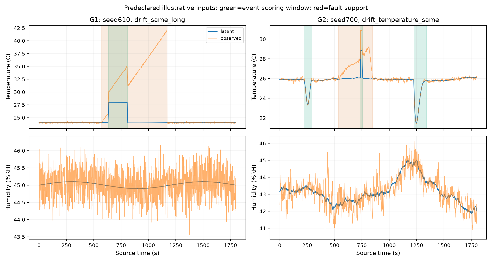
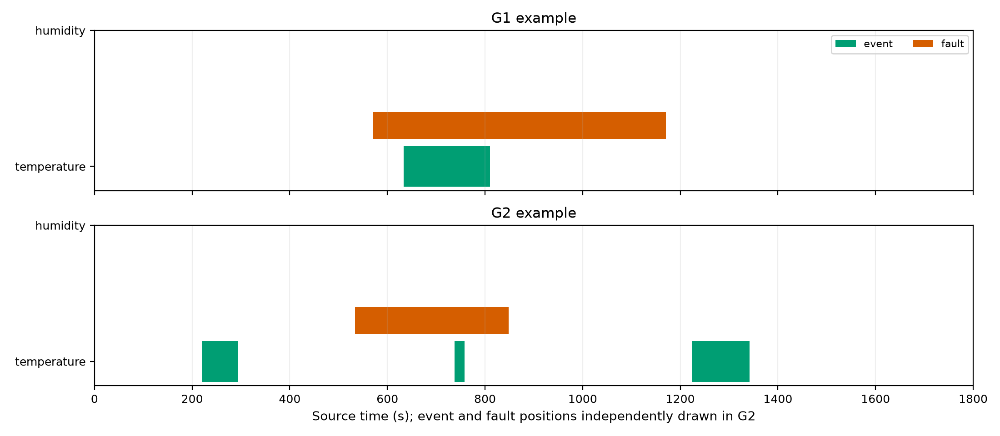
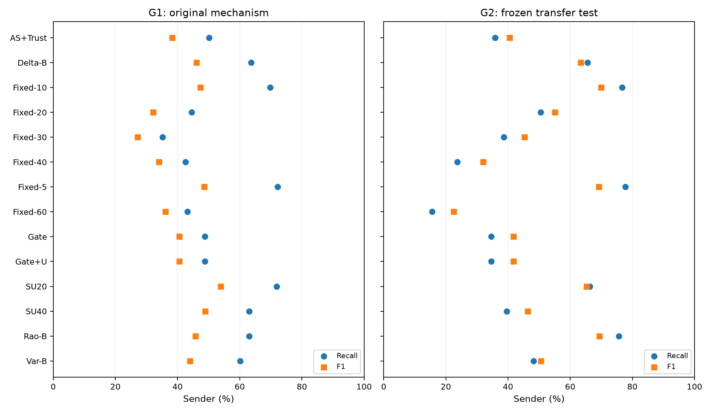
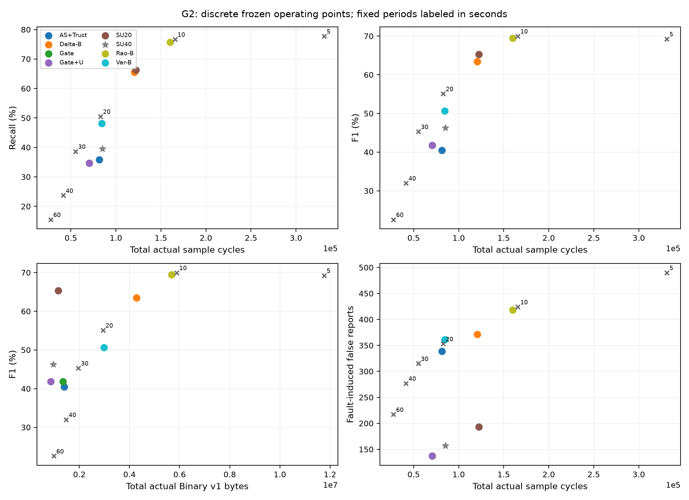
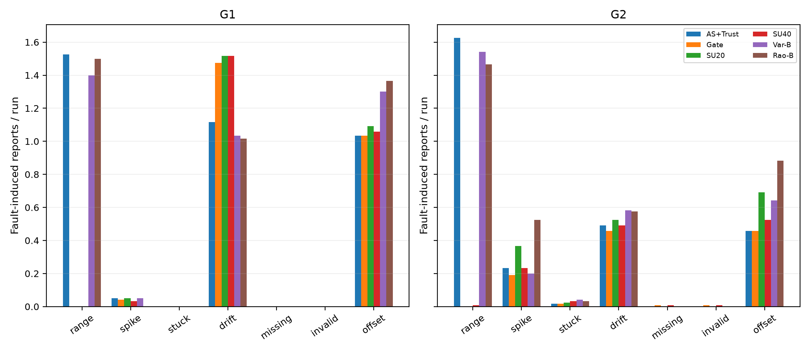
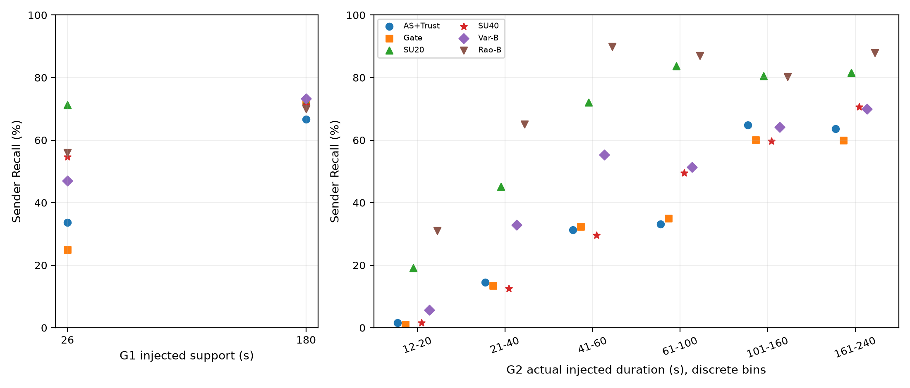

# TAIS 第二生成机制与冻结策略迁移报告

## 1. 目的、冻结与执行范围

检验已有策略在不同信号形成机制下的可迁移收益和分布依赖。两套机制都由本项目定义，因此这是跨生成机制压力测试，不能称为真实农业或外部自然故障验证。基准0170196；生成器/参数/评分/分析冻结提交3f3991aa26cf1ac7f8f8cd0fe188136b0311c9bd，正式种子700–719，工程种子690/691。全部14方法×46场景×20种子=12,880次正式系统运行，所有实例和失败均保留。无测试后调参或再校准。

## 2. 机制、真值与旧环境区别

| 环节 | G1（保留） | G2（本轮） |
| --- | --- | --- |
| 背景 | 固定小振幅正弦 | 随机分段目标的均值回归，两通道相关性分段变化 |
| 噪声 | 独立高斯 | AR(1)、分段强度、少量t3重尾扰动 |
| 环境事件 | 固定梯形/26或180秒，故障后固定延迟 | step/recovery、smooth、asymmetric三形状；12–240秒；与故障独立的随机时刻 |
| 故障 | 温度、固定剖面 | 温/湿度均有七类故障、随机时长/强度/正负/恢复；漂移分段斜率 |
| 真值 | 原有物理幅度内区间标签 | 完整外生物理支持区间；不读取检测器输出 |
| 场景 | 45场景，600事件/方法 | 46场景，包含多事件及双通道clean，完整事件数见下表 |
| 参数 | G1开发选择 | 全部直接转移，Rao仍为24°C/45%RH中心 |
| 统计 | 20个610–629种子，独立汇总 | 20个700–719种子，独立汇总；不合并显著性 |

完整生成方程、所有参数、场景矩阵与预声明示例见[冻结协议](TAIS_CROSS_GENERATOR_PROTOCOL.md)和[配置](../configs/tais-transfer.json)。G2没有调用G1生成过程；仅复用Trace/Fault和冻结评分接口。环境、噪声、事件族、故障通道使用SHA256派生独立随机流。按故障类型比较时保持同一无故障序列；counterfactual直接复制noisy而不重新生成，缓存键包含完整序列和真值哈希。在线接口只暴露observed，隐藏中心/日程/标签不可见。

物理区间[start,end)与评分[start,end−1]、采样覆盖和接收报告时间分别保存。与G1标签几何差异明确，不把两套绝对Recall当作相同任务。实际前后/重叠关系由独立日程分类，不按算法表现筛选。替换故障的完全遮蔽组保留；“fully_overwritten”描述动态支持被替换，卡死起点可能仍包含已有物理信息，不能把偶然容差命中写成恢复了被删除真值。

## 3. 全部主要方法与资源

| 方法 | P | R | F1 | Rx F1 | TP/FP/FN | FI | 采样 | 上传 | Binary v1字节 | B/Tx | Age均值/P95/max(s) |
| --- | --- | --- | --- | --- | --- | --- | --- | --- | --- | --- | --- |
| AdaptiveSense+TrustLog | 46.55% | 35.83% | 40.49% | 40.51% | 688/790/1232 | 339 | 81,474 | 39,191 | 1,392,252 | 35.52 | 27.19/58/79 |
| Delta-budget-SU40+C11 | 61.44% | 65.57% | 63.44% | 63.44% | 1259/790/661 | 371 | 120,579 | 120,579 | 4,286,926 | 35.55 | 10.68/39/49 |
| Fixed-10+C11 | 64.36% | 76.67% | 69.98% | 69.98% | 1472/815/448 | 424 | 165,600 | 165,600 | 5,882,392 | 35.52 | 4.50/9/9 |
| Fixed-20+C11 | 60.59% | 50.52% | 55.10% | 55.10% | 970/631/950 | 353 | 82,800 | 82,800 | 2,940,838 | 35.52 | 9.50/18/19 |
| Fixed-30+C11 | 54.72% | 38.65% | 45.30% | 45.30% | 742/614/1178 | 315 | 55,200 | 55,200 | 1,960,460 | 35.52 | 14.50/28/29 |
| Fixed-40+C11 | 49.24% | 23.70% | 32.00% | 32.00% | 455/469/1465 | 277 | 41,400 | 41,400 | 1,470,061 | 35.51 | 19.50/37/39 |
| Fixed-5+C11 | 62.42% | 77.76% | 69.25% | 69.25% | 1493/899/427 | 490 | 331,200 | 331,200 | 11,764,583 | 35.52 | 2.00/4/4 |
| Fixed-60+C11 | 41.39% | 15.52% | 22.58% | 22.58% | 298/422/1622 | 217 | 27,600 | 27,600 | 979,596 | 35.49 | 29.50/56/59 |
| GateOnly | 52.69% | 34.64% | 41.80% | 41.82% | 665/597/1255 | 137 | 70,542 | 37,885 | 1,347,319 | 35.56 | 27.53/58/79 |
| GateOnly+U | 52.69% | 34.64% | 41.80% | 41.80% | 665/597/1255 | 137 | 70,542 | 24,132 | 858,092 | 35.56 | 52.79/116/159 |
| JO-SU-20 | 64.33% | 66.30% | 65.30% | 65.30% | 1273/706/647 | 193 | 122,343 | 32,478 | 1,154,911 | 35.56 | 45.40/110/134 |
| JO-SU-40 | 55.80% | 39.58% | 46.31% | 46.31% | 760/602/1160 | 157 | 85,055 | 26,982 | 959,129 | 35.55 | 49.73/113/154 |
| Rao-inspired-budget-SU40+C11 | 64.21% | 75.68% | 69.47% | 69.47% | 1453/810/467 | 418 | 159,972 | 159,972 | 5,683,495 | 35.53 | 5.07/9/34 |
| Variance-budget-SU40+C11 | 53.34% | 48.18% | 50.63% | 50.63% | 925/809/995 | 361 | 84,429 | 84,429 | 2,989,505 | 35.41 | 18.05/53/59 |

P/R/F1为sender-on-upload；Rx为实际Binary v1解码后false→true边沿独立评分。所有独立方法均显式+C11，诊断只记录、不门控策略。每次实际编码的len之和是字节指标，没有用JSON估计，没有删健康/时间戳/null/事件字段。来源为[summary.csv](../results/tais-transfer/summary.csv)；所有本地、发送、接收计数见[完整分组](../results/tais-transfer/test/analysis/summary.csv)。

| 方法 | Receiver TP/FP/FN | 事件/健康边沿遗漏 | 事件/健康最大已送延迟(s) | 条件事件延迟 sender/rx(s) |
| --- | --- | --- | --- | --- |
| AdaptiveSense+TrustLog | 688/789/1232 | 13/53 | 55/55 | 39.55/39.55 |
| Delta-budget-SU40+C11 | 1259/790/661 | 0/0 | 0/0 | 25.27/25.27 |
| Fixed-10+C11 | 1472/815/448 | 0/0 | 0/0 | 22.01/22.01 |
| Fixed-20+C11 | 970/631/950 | 0/0 | 0/0 | 37.44/37.44 |
| Fixed-30+C11 | 742/614/1178 | 0/0 | 0/0 | 48.26/48.26 |
| Fixed-40+C11 | 455/469/1465 | 0/0 | 0/0 | 61.65/61.65 |
| Fixed-5+C11 | 1493/899/427 | 0/0 | 0/0 | 20.17/20.17 |
| Fixed-60+C11 | 298/422/1622 | 0/0 | 0/0 | 100.10/100.10 |
| GateOnly | 665/595/1255 | 2/0 | 55/0 | 40.02/40.02 |
| GateOnly+U | 665/597/1255 | 0/0 | 0/0 | 40.02/40.02 |
| JO-SU-20 | 1273/706/647 | 0/0 | 0/0 | 25.06/25.06 |
| JO-SU-40 | 760/602/1160 | 0/0 | 0/0 | 32.47/32.47 |
| Rao-inspired-budget-SU40+C11 | 1453/810/467 | 0/0 | 0/0 | 22.26/22.26 |
| Variance-budget-SU40+C11 | 925/809/995 | 0/0 | 0/0 | 35.67/35.67 |

延迟仅对命中事件条件化；所有miss均在FN/Recall保留。[共同命中延迟差](../results/tais-transfer/test/analysis/common_event_delays.csv)避免把不同命中子集直接解释为更快。

## 4. 采样预算和配对不确定性

| 独立预算点 | 实际采样 | SU40采样 | 实际差 | ±5%内 | F1 | SU40 F1 |
| --- | --- | --- | --- | --- | --- | --- |
| Delta-budget-SU40+C11 | 120,579 | 85,055 | +41.77% | False | 63.44% | 46.31% |
| Rao-inspired-budget-SU40+C11 | 159,972 | 85,055 | +88.08% | False | 69.47% | 46.31% |
| Variance-budget-SU40+C11 | 84,429 | 85,055 | -0.74% | True | 50.63% | 46.31% |

预算名称只标明G1开发选择目标，不保证G2预算匹配。超出±5%不得声称等预算。

| 固定+C11 | 相对SU40实际采样差 | ±5%内 | F1 | SU40−固定F1（描述性） |
| --- | --- | --- | --- | --- |
| Fixed-5+C11 | +289.40% | False | 69.25% | -22.94pp |
| Fixed-10+C11 | +94.70% | False | 69.98% | -23.67pp |
| Fixed-20+C11 | -2.65% | True | 55.10% | -8.78pp |
| Fixed-30+C11 | -35.10% | False | 45.30% | +1.01pp |
| Fixed-40+C11 | -51.33% | False | 32.00% | +14.32pp |
| Fixed-60+C11 | -67.55% | False | 22.58% | +23.74pp |

固定点比较保留全部周期，不只列对TAIS有利的点；固定点未预声明配对区间，此处不额外宣称推断性优效。

| A−B | 指标 | 差值 | 种子配对95%CI |
| --- | --- | --- | --- |
| JO-SU-40 − GateOnly | recall | +4.95pp | [-0.21, +10.31] |
| JO-SU-40 − GateOnly | f1 | +4.52pp | [+0.39, +8.75] |
| JO-SU-40 − GateOnly | samples | +14513.00 | [+12842.98, +16574.07] |
| JO-SU-40 − GateOnly | binary_v1_bytes | -388190.00 | [-409753.03, -366485.35] |
| JO-SU-40 − GateOnly | fault_induced_false | +20.00 | [+4.00, +32.00] |
| JO-SU-40 − AdaptiveSense+TrustLog | recall | +3.75pp | [-0.99, +9.01] |
| JO-SU-40 − AdaptiveSense+TrustLog | f1 | +5.82pp | [+1.82, +9.99] |
| JO-SU-40 − AdaptiveSense+TrustLog | samples | +3581.00 | [+1761.97, +5648.07] |
| JO-SU-40 − AdaptiveSense+TrustLog | binary_v1_bytes | -433123.00 | [-454383.25, -410531.78] |
| JO-SU-40 − AdaptiveSense+TrustLog | fault_induced_false | -182.00 | [-198.00, -165.00] |
| JO-SU-40 − Delta-budget-SU40+C11 | recall | -25.99pp | [-33.28, -18.44] |
| JO-SU-40 − Delta-budget-SU40+C11 | f1 | -17.13pp | [-22.99, -11.44] |
| JO-SU-40 − Delta-budget-SU40+C11 | samples | -35524.00 | [-42457.35, -28191.88] |
| JO-SU-40 − Delta-budget-SU40+C11 | binary_v1_bytes | -3327797.00 | [-3548973.70, -3100811.88] |
| JO-SU-40 − Delta-budget-SU40+C11 | fault_induced_false | -214.00 | [-253.00, -175.00] |
| JO-SU-40 − Variance-budget-SU40+C11 | recall | -8.59pp | [-14.58, -2.97] |
| JO-SU-40 − Variance-budget-SU40+C11 | f1 | -4.32pp | [-9.11, +0.18] |
| JO-SU-40 − Variance-budget-SU40+C11 | samples | +626.00 | [-1615.08, +2780.15] |
| JO-SU-40 − Variance-budget-SU40+C11 | binary_v1_bytes | -2030376.00 | [-2092435.95, -1973720.40] |
| JO-SU-40 − Variance-budget-SU40+C11 | fault_induced_false | -204.00 | [-236.00, -176.00] |
| JO-SU-40 − Rao-inspired-budget-SU40+C11 | recall | -36.09pp | [-43.54, -28.49] |
| JO-SU-40 − Rao-inspired-budget-SU40+C11 | f1 | -23.16pp | [-29.93, -16.94] |
| JO-SU-40 − Rao-inspired-budget-SU40+C11 | samples | -74917.00 | [-81326.40, -66186.85] |
| JO-SU-40 − Rao-inspired-budget-SU40+C11 | binary_v1_bytes | -4724366.00 | [-4927894.30, -4406349.65] |
| JO-SU-40 − Rao-inspired-budget-SU40+C11 | fault_induced_false | -261.00 | [-297.00, -226.00] |
| JO-SU-20 − JO-SU-40 | recall | +26.72pp | [+19.64, +33.91] |
| JO-SU-20 − JO-SU-40 | f1 | +18.99pp | [+13.39, +24.96] |
| JO-SU-20 − JO-SU-40 | samples | +37288.00 | [+35497.95, +39067.20] |
| JO-SU-20 − JO-SU-40 | binary_v1_bytes | +195782.00 | [+178338.62, +214655.08] |
| JO-SU-20 − JO-SU-40 | fault_induced_false | +36.00 | [+20.00, +54.00] |
| GateOnly+U − GateOnly | recall | +0.00pp | [+0.00, +0.00] |
| GateOnly+U − GateOnly | f1 | +0.00pp | [+0.00, +0.00] |
| GateOnly+U − GateOnly | samples | +0.00 | [+0.00, +0.00] |
| GateOnly+U − GateOnly | binary_v1_bytes | -489227.00 | [-504208.33, -473549.55] |
| GateOnly+U − GateOnly | fault_induced_false | +0.00 | [+0.00, +0.00] |

5,000次配对bootstrap以整个种子为簇，保留同种子全部场景；不是按秒独立抽样。区间为描述性，未对多重比较建立全局优效检验。

## 5. 跨生成器方向、边界与失败

| A−B | 指标 | G1差 | G2差 | 方向 |
| --- | --- | --- | --- | --- |
| JO-SU-40 − GateOnly | recall | +14.17pp | +4.95pp | consistent |
| JO-SU-40 − GateOnly | f1 | +8.32pp | +4.52pp | consistent |
| JO-SU-40 − GateOnly | samples | +14035.00 | +14513.00 | consistent |
| JO-SU-40 − GateOnly | binary_v1_bytes | -457874.00 | -388190.00 | consistent |
| JO-SU-40 − GateOnly | fault_induced_false | +7.00 | +20.00 | consistent |
| JO-SU-40 − AdaptiveSense+TrustLog | recall | +12.83pp | +3.75pp | consistent |
| JO-SU-40 − AdaptiveSense+TrustLog | f1 | +10.58pp | +5.82pp | consistent |
| JO-SU-40 − AdaptiveSense+TrustLog | samples | -2734.00 | +3581.00 | reversed |
| JO-SU-40 − AdaptiveSense+TrustLog | binary_v1_bytes | -513556.00 | -433123.00 | consistent |
| JO-SU-40 − AdaptiveSense+TrustLog | fault_induced_false | -134.00 | -182.00 | consistent |
| JO-SU-40 − Delta-budget-SU40+C11 | recall | -0.67pp | -25.99pp | consistent |
| JO-SU-40 − Delta-budget-SU40+C11 | f1 | +2.82pp | -17.13pp | reversed |
| JO-SU-40 − Delta-budget-SU40+C11 | samples | -6096.00 | -35524.00 | consistent |
| JO-SU-40 − Delta-budget-SU40+C11 | binary_v1_bytes | -1818678.00 | -3327797.00 | consistent |
| JO-SU-40 − Delta-budget-SU40+C11 | fault_induced_false | -154.00 | -214.00 | consistent |
| JO-SU-40 − Variance-budget-SU40+C11 | recall | +2.83pp | -8.59pp | reversed |
| JO-SU-40 − Variance-budget-SU40+C11 | f1 | +4.88pp | -4.32pp | reversed |
| JO-SU-40 − Variance-budget-SU40+C11 | samples | +1097.00 | +626.00 | consistent |
| JO-SU-40 − Variance-budget-SU40+C11 | binary_v1_bytes | -1550880.00 | -2030376.00 | consistent |
| JO-SU-40 − Variance-budget-SU40+C11 | fault_induced_false | -141.00 | -204.00 | consistent |
| JO-SU-40 − Rao-inspired-budget-SU40+C11 | recall | +0.00pp | -36.09pp | zero_in_one_generator |
| JO-SU-40 − Rao-inspired-budget-SU40+C11 | f1 | +3.17pp | -23.16pp | reversed |
| JO-SU-40 − Rao-inspired-budget-SU40+C11 | samples | -1022.00 | -74917.00 | consistent |
| JO-SU-40 − Rao-inspired-budget-SU40+C11 | binary_v1_bytes | -1627081.00 | -4724366.00 | consistent |
| JO-SU-40 − Rao-inspired-budget-SU40+C11 | fault_induced_false | -153.00 | -261.00 | consistent |
| JO-SU-20 − JO-SU-40 | recall | +8.83pp | +26.72pp | consistent |
| JO-SU-20 − JO-SU-40 | f1 | +4.94pp | +18.99pp | consistent |
| JO-SU-20 − JO-SU-40 | samples | +36322.00 | +37288.00 | consistent |
| JO-SU-20 − JO-SU-40 | binary_v1_bytes | +43398.00 | +195782.00 | consistent |
| JO-SU-20 − JO-SU-40 | fault_induced_false | +6.00 | +36.00 | consistent |
| GateOnly+U − GateOnly | recall | +0.00pp | +0.00pp | consistent |
| GateOnly+U − GateOnly | f1 | +0.00pp | +0.00pp | consistent |
| GateOnly+U − GateOnly | samples | +0.00 | +0.00 | consistent |
| GateOnly+U − GateOnly | binary_v1_bytes | -495534.00 | -489227.00 | consistent |
| GateOnly+U − GateOnly | fault_induced_false | +0.00 | +0.00 | consistent |

计数差是各自生成器内部总差；场景/事件组成不同，不能用两套总数之比宣称跨环境资源收益。

| 方法 | 事件组 | n | Recall | 覆盖率 | 有覆盖时成功率 | Rx Recall |
| --- | --- | --- | --- | --- | --- | --- |
| AdaptiveSense+TrustLog | duration:long | 640 | 64.22% | 100.00% | 64.22% | 64.22% |
| AdaptiveSense+TrustLog | duration:medium | 640 | 32.66% | 94.69% | 34.49% | 32.66% |
| AdaptiveSense+TrustLog | duration:short | 640 | 10.62% | 56.88% | 18.68% | 10.62% |
| AdaptiveSense+TrustLog | fully_overwritten | 52 | 3.85% | 82.69% | 4.65% | 3.85% |
| AdaptiveSense+TrustLog | no_sample_coverage | 310 | 0.00% | 0.00% | N/A | 0.00% |
| Delta-budget-SU40+C11 | duration:long | 640 | 74.22% | 100.00% | 74.22% | 74.22% |
| Delta-budget-SU40+C11 | duration:medium | 640 | 73.12% | 100.00% | 73.12% | 73.12% |
| Delta-budget-SU40+C11 | duration:short | 640 | 49.38% | 89.22% | 55.34% | 49.38% |
| Delta-budget-SU40+C11 | fully_overwritten | 52 | 0.00% | 98.08% | 0.00% | 0.00% |
| Delta-budget-SU40+C11 | no_sample_coverage | 69 | 0.00% | 0.00% | N/A | 0.00% |
| GateOnly | duration:long | 640 | 60.00% | 100.00% | 60.00% | 60.00% |
| GateOnly | duration:medium | 640 | 34.22% | 95.00% | 36.02% | 34.22% |
| GateOnly | duration:short | 640 | 9.69% | 52.50% | 18.45% | 9.69% |
| GateOnly | fully_overwritten | 52 | 0.00% | 76.92% | 0.00% | 0.00% |
| GateOnly | no_sample_coverage | 336 | 0.00% | 0.00% | N/A | 0.00% |
| JO-SU-20 | duration:long | 640 | 81.09% | 100.00% | 81.09% | 81.09% |
| JO-SU-20 | duration:medium | 640 | 80.47% | 100.00% | 80.47% | 80.47% |
| JO-SU-20 | duration:short | 640 | 37.34% | 92.34% | 40.44% | 37.34% |
| JO-SU-20 | fully_overwritten | 52 | 0.00% | 100.00% | 0.00% | 0.00% |
| JO-SU-20 | no_sample_coverage | 49 | 0.00% | 0.00% | N/A | 0.00% |
| JO-SU-40 | duration:long | 640 | 65.62% | 100.00% | 65.62% | 65.62% |
| JO-SU-40 | duration:medium | 640 | 43.91% | 100.00% | 43.91% | 43.91% |
| JO-SU-40 | duration:short | 640 | 9.22% | 62.66% | 14.71% | 9.22% |
| JO-SU-40 | fully_overwritten | 52 | 0.00% | 100.00% | 0.00% | 0.00% |
| JO-SU-40 | no_sample_coverage | 239 | 0.00% | 0.00% | N/A | 0.00% |
| Rao-inspired-budget-SU40+C11 | duration:long | 640 | 84.38% | 100.00% | 84.38% | 84.38% |
| Rao-inspired-budget-SU40+C11 | duration:medium | 640 | 87.81% | 100.00% | 87.81% | 87.81% |
| Rao-inspired-budget-SU40+C11 | duration:short | 640 | 54.84% | 97.50% | 56.25% | 54.84% |
| Rao-inspired-budget-SU40+C11 | fully_overwritten | 52 | 0.00% | 100.00% | 0.00% | 0.00% |
| Rao-inspired-budget-SU40+C11 | no_sample_coverage | 16 | 0.00% | 0.00% | N/A | 0.00% |
| Variance-budget-SU40+C11 | duration:long | 640 | 67.34% | 100.00% | 67.34% | 67.34% |
| Variance-budget-SU40+C11 | duration:medium | 640 | 52.50% | 99.53% | 52.75% | 52.50% |
| Variance-budget-SU40+C11 | duration:short | 640 | 24.69% | 64.84% | 38.07% | 24.69% |
| Variance-budget-SU40+C11 | fully_overwritten | 52 | 3.85% | 88.46% | 4.35% | 3.85% |
| Variance-budget-SU40+C11 | no_sample_coverage | 228 | 0.00% | 0.00% | N/A | 0.00% |

| 方法 | 故障通道组 | Recall | F1 | FI | 任意标志检出 |
| --- | --- | --- | --- | --- | --- |
| AdaptiveSense+TrustLog | fault:drift | 43.75% | 45.45% | 59 | 20.00% |
| AdaptiveSense+TrustLog | fault:stable_offset | 40.83% | 43.75% | 55 | 4.17% |
| AdaptiveSense+TrustLog | fault_channel:humidity | 35.36% | 40.46% | 142 | 39.55% |
| AdaptiveSense+TrustLog | fault_channel:temperature | 36.55% | 39.64% | 197 | 40.87% |
| AdaptiveSense+TrustLog | no_events | N/A | 0.00% | 109 | 33.90% |
| AdaptiveSense+TrustLog | relation:cross | 39.29% | 43.31% | 125 | 45.48% |
| AdaptiveSense+TrustLog | relation:same | 32.62% | 39.60% | 105 | 41.24% |
| Delta-budget-SU40+C11 | fault:drift | 69.17% | 63.00% | 69 | 10.83% |
| Delta-budget-SU40+C11 | fault:stable_offset | 70.83% | 61.37% | 93 | 3.33% |
| Delta-budget-SU40+C11 | fault_channel:humidity | 65.60% | 62.94% | 179 | 45.01% |
| Delta-budget-SU40+C11 | fault_channel:temperature | 64.76% | 61.99% | 192 | 41.81% |
| Delta-budget-SU40+C11 | no_events | N/A | 0.00% | 119 | 39.55% |
| Delta-budget-SU40+C11 | relation:cross | 69.64% | 66.25% | 134 | 46.89% |
| Delta-budget-SU40+C11 | relation:same | 60.71% | 62.92% | 118 | 43.79% |
| GateOnly | fault:drift | 43.33% | 45.22% | 55 | 20.00% |
| GateOnly | fault:stable_offset | 40.42% | 43.60% | 55 | 4.17% |
| GateOnly | fault_channel:humidity | 33.21% | 41.52% | 34 | 38.79% |
| GateOnly | fault_channel:temperature | 35.60% | 41.16% | 103 | 40.49% |
| GateOnly | no_events | N/A | 0.00% | 37 | 33.90% |
| GateOnly | relation:cross | 37.02% | 43.53% | 54 | 45.48% |
| GateOnly | relation:same | 31.79% | 40.12% | 46 | 39.55% |
| JO-SU-20 | fault:drift | 70.42% | 62.94% | 63 | 27.50% |
| JO-SU-20 | fault:stable_offset | 70.42% | 60.47% | 83 | 9.17% |
| JO-SU-20 | fault_channel:humidity | 65.83% | 66.31% | 55 | 46.89% |
| JO-SU-20 | fault_channel:temperature | 66.67% | 63.38% | 138 | 47.65% |
| JO-SU-20 | no_events | N/A | 0.00% | 54 | 40.68% |
| JO-SU-20 | relation:cross | 70.12% | 67.12% | 74 | 53.39% |
| JO-SU-20 | relation:same | 62.38% | 64.45% | 65 | 47.74% |
| JO-SU-40 | fault:drift | 45.00% | 46.65% | 59 | 23.33% |
| JO-SU-40 | fault:stable_offset | 43.33% | 45.12% | 63 | 5.83% |
| JO-SU-40 | fault_channel:humidity | 38.10% | 45.85% | 36 | 43.88% |
| JO-SU-40 | fault_channel:temperature | 40.24% | 45.61% | 121 | 42.18% |
| JO-SU-40 | no_events | N/A | 0.00% | 42 | 37.85% |
| JO-SU-40 | relation:cross | 41.31% | 47.34% | 58 | 48.02% |
| JO-SU-40 | relation:same | 37.02% | 45.40% | 57 | 43.22% |
| Rao-inspired-budget-SU40+C11 | fault:drift | 79.58% | 69.71% | 69 | 20.83% |
| Rao-inspired-budget-SU40+C11 | fault:stable_offset | 80.42% | 65.76% | 106 | 2.50% |
| Rao-inspired-budget-SU40+C11 | fault_channel:humidity | 75.95% | 69.27% | 196 | 52.35% |
| Rao-inspired-budget-SU40+C11 | fault_channel:temperature | 75.12% | 67.85% | 222 | 49.34% |
| Rao-inspired-budget-SU40+C11 | no_events | N/A | 0.00% | 143 | 50.00% |
| Rao-inspired-budget-SU40+C11 | relation:cross | 78.93% | 72.18% | 145 | 51.13% |
| Rao-inspired-budget-SU40+C11 | relation:same | 72.14% | 70.38% | 130 | 51.41% |
| Variance-budget-SU40+C11 | fault:drift | 52.50% | 50.91% | 70 | 4.17% |
| Variance-budget-SU40+C11 | fault:stable_offset | 54.58% | 52.09% | 77 | 1.67% |
| Variance-budget-SU40+C11 | fault_channel:humidity | 47.26% | 50.16% | 159 | 39.17% |
| Variance-budget-SU40+C11 | fault_channel:temperature | 49.40% | 49.97% | 202 | 39.74% |
| Variance-budget-SU40+C11 | no_events | N/A | 0.00% | 117 | 34.75% |
| Variance-budget-SU40+C11 | relation:cross | 51.19% | 53.22% | 130 | 43.22% |
| Variance-budget-SU40+C11 | relation:same | 45.48% | 50.56% | 114 | 40.40% |

无事件组Recall=N/A，保留环境误报。未故障通道的错误报告也保存在完整汇总no_fault_channel_false_*字段，不只展示故障通道。

| SU40故障 | 通道 | episodes | 任意标志率 | 对应类型率 | 任意/类型条件延迟(s) |
| --- | --- | --- | --- | --- | --- |
| drift | humidity | 60 | 28.33% | 28.33% | 229.12/229.12 |
| drift | temperature | 60 | 18.33% | 18.33% | 236.64/236.64 |
| invalid | humidity | 60 | 100.00% | 100.00% | 87.48/87.48 |
| invalid | temperature | 60 | 100.00% | 100.00% | 86.73/86.73 |
| missing | humidity | 60 | 100.00% | 100.00% | 87.48/87.48 |
| missing | temperature | 60 | 100.00% | 100.00% | 86.73/86.73 |
| range | humidity | 60 | 100.00% | 100.00% | 17.73/17.73 |
| range | temperature | 60 | 100.00% | 100.00% | 16.98/16.98 |
| spike | humidity | 171 | 11.70% | 11.70% | 0.65/0.65 |
| spike | temperature | 171 | 11.11% | 11.11% | 0.79/0.79 |
| stable_offset | humidity | 60 | 11.67% | N/A | 142.43/N/A |
| stable_offset | temperature | 60 | 0.00% | N/A | N/A/N/A |
| stuck | humidity | 60 | 15.00% | 15.00% | 135.33/135.33 |
| stuck | temperature | 60 | 23.33% | 23.33% | 170.14/170.14 |

stable_offset没有C11类型位，类型率N/A，任何其他标志不能算对应类型成功。missing/invalid同用既有invalid bit16，不声称二者可被C11区分。各方法的完整健康诊断见[fault_diagnostics.csv](../results/tais-transfer/test/analysis/fault_diagnostics.csv)，原始每故障检出/延迟见[faults.csv](../results/tais-transfer/test/faults.csv)。

## 6. 图表、原创性与资源解释













第二机制增加的是可审计压力覆盖和对结论分布依赖的检验，不是一个新检测算法。C11、ChangeAnalyzer、deadband、二进制协议和采样通信协调均已有先例；原有[相关工作](PAPER_NOVELTY_AND_RELATED_WORK.md)八项核实文献保持不变。可主张可运行系统集成、独立对照、透明反事实/接收端测量和结构性边界的复现证据。

采样、上传、Binary字节是实测软件计数。没有新硬件能耗系数；原有条件模型仅在给定权重及处理成本假设下成立。本地理想字节链路不测无线空中时间、重传、MCU RAM/时间、电流或电池寿命，不能把字节百分比等同电能百分比。

## 7. 最终研究判断与论文状态

判断和对投稿理由的影响见下列人工复审结论；它必须与以上真实CSV和配对区间一致。论文增量保留G1并单列G2方法/结果/预算/讨论/限制，旧12页稿在papers/tais/history和基准Git提交保存。

<!-- REVIEW_START -->
**最终判断：B——论文完整，但部分结果不稳健。** 第二生成器改变了值得发表的理由：G1中“SU40在近似预算下对Variance具有F1优势”不能推广到G2；应改为可复现的有条件系统权衡、竞争基线和失败边界研究。G2中SU40 F1为46.31%，Variance为50.63%，实际采样差-0.74%，SU40−Variance F1差-4.32pp，95%CI [-9.11, +0.18] pp，包含零；Recall差的区间[-14.58, -2.97] pp完全低于零。Fixed-20的F1为55.10%，采样差-2.65%，也不支持SU40等采样质量优越（固定点未预声明配对区间，此处是描述性比较）。

SU40相对GateOnly的F1差区间[+0.39, +8.75] pp仍支持这一生成机制内的条件改善，但增加14,513次采样和20次诱发误报，且Recall差区间[-0.21, +10.31] pp跨零。相对TrustLog的F1区间[+1.82, +9.99] pp为正，采样增加+4.40%，不能延用G1中采样同时降低的说法。SU40相对Variance的字节降低67.92%、诱发误报降低56.51%，同时P95年龄53→113s；这是资源/信息权衡，部分来自可共享的U模块。

SU20 F1/Recall为65.30%/66.30%，相对SU40采样增加43.84%，FI 157→193。SU20短事件Recall仅37.34%，虽然覆盖率达92.34%；SU40短事件Recall 9.22%还低于GateOnly 9.69%。全支持被替换的52个事件在Gate/SU20/SU40中均未检出。稳定偏移无专用类型位，温湿度也不应被假定同等诊断效果。

该研究仍有可考虑投稿的内容：端到端可复现、真正独立调度基线、完整字段通信与独立接收端审计，以及跨机制负面证据。不能以新检测理论、普遍优效、真实田间泛化或实际节能为卖点。保持Simulation-Based Evaluation标题和系统权衡贡献定位；进入作者/单位、篇幅、目标格式与投稿叙事定稿即可。本轮计划内补充实验结束，不建议继续围绕测试结果优化算法或追加生成器选择。具体venue尚未筛选，不承诺审稿结果。
<!-- REVIEW_END -->

主要局限仍包括：两套本项目定义的合成机制、外生标签几何差异、共享基础检测器、仅Inspired文献适配、无自然故障或农业现场效果、无真实无线和功率测量。事件落在采样间隔、完全替换、稳定偏移与慢变化歧义仍是结构性限制。此次是计划内最后补充实验，后续应限缩主张、整理作者/单位和投稿格式，不再追加算法优化或生成器选择循环。

## 8. 复现与证据

```sh
.venv/bin/python scripts/reproduce_transfer.py --workers 4
.venv/bin/python scripts/transfer_figures.py
.venv/bin/python scripts/build_paper.py
cd papers/tais
tectonic manuscript.tex --keep-logs
```

完整复现使用新scratch目录，核对每个CSV逐字节相等；不会覆盖正式结果或重新调参。只检查提交材料可加--check-only。新源码、配置、协议、运行清单、结果、数据审计、PDF检查及CI位于本分支。原G1结果目录保持逐文件只读；旧验证器仅调整对新增G2模块的文件清单处理，不变更旧算法、旧评分或锁定文件哈希。
