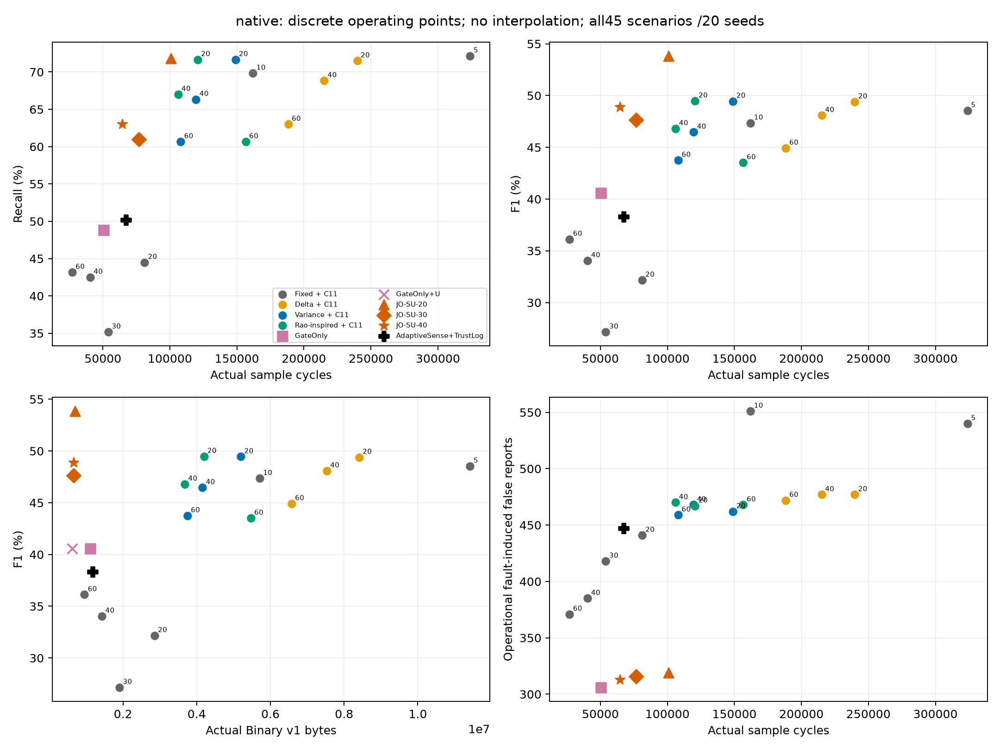
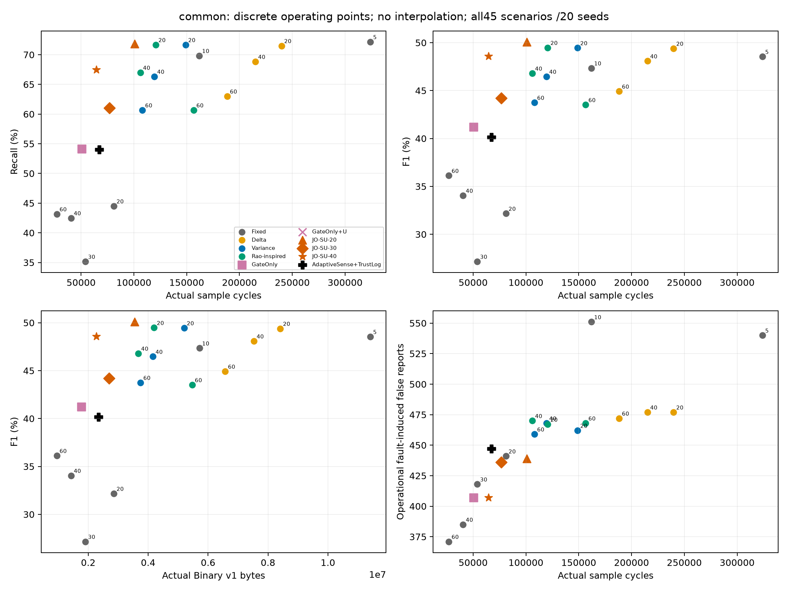
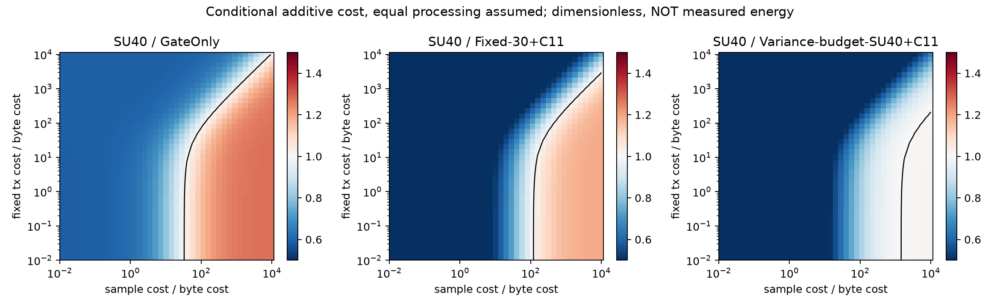

# TAIS 论文证据入口与完整实验报告

研究问题：故障健康信息、实际可见采样与通信规则怎样影响环境事件报告、采样/字节成本及接收端年龄？论文定位为**单节点双通道仿真系统研究**，不预设 TAIS 优于独立方法。

基准8b991530b77a3c7197bb998f0f4b49c1405ed96c；最终测试前冻结提交[269185d97ec24ec3761303a60eb742b63f7509ea](https://github.com/Sver0411/TAIS/commit/269185d97ec24ec3761303a60eb742b63f7509ea)；本轮分支 research/tais-paper-evaluation，不合并main。历史算法、历史结果及上游子模块只读；仅README增加入口。

## 真实执行范围

开发600–609：36,900评分运行。最终610–629：73,800评分运行，20个种子×全部45场景。每个种子/场景有53个native方法版本和29个common调度视图。方法版本包括功能明确不同的公共组件版本，**不是82种独立算法**。每个操作点600个真实合成事件；无事件场景Recall为N/A。

实现：固定5/10/20/30/40/60严格复用旧replay；Delta为相邻变化/速率触发，Variance为带时间戳EWMA方差，Rao-inspired为4点趋势预测阈值穿越。后者不含CS、APDT和双预测，**无文献忠实复现成功主张**。原生独立方法不含健康诊断；+C11只外挂原始诊断不门控；+C11+U是明确公共TAIS上传消融。common保留各自实际采样时刻，统一检测器+C11记录+每采样上传，只隔离调度贡献。

源观测→到期采样→实际检测→上传决定→完整Binaryv1→独立解码→接收边沿评分。见[架构与论文](../papers/tais/manuscript.tex)、[冻结协议](TAIS_PAPER_PROTOCOL.md)、[配置](../configs/tais-paper.json)、[操作点](../results/tais-paper/operating-points.json)。

## 独立基线和TAIS实际结果

新最终集 SU40 相对 TrustLog：Recall 50.17%→63.00%，F1 38.32%→48.90%，采样 -4.07%，字节 -43.92%。相对 GateOnly：Recall差 +14.17pp，F1差 +8.32pp（95%CI [+4.01, +12.40] pp），采样 +27.82%，诱发误报 306→313。这不是任务提示中的历史SU结果。

| 方法（native） | Precision | Recall | F1 | Rx F1 | 采样 | 上传 | v1字节 | 诱发误报 |
| --- | --- | --- | --- | --- | --- | --- | --- | --- |
| AdaptiveSense | 31.00% | 50.17% | 38.32% | 38.34% | 67,222 | 33,209 | 969,950 | 447 |
| AdaptiveSense+TrustLog | 31.00% | 50.17% | 38.32% | 38.34% | 67,222 | 33,209 | 1,169,204 | 447 |
| GateOnly | 34.72% | 48.83% | 40.58% | 40.61% | 50,453 | 31,645 | 1,113,522 | 306 |
| GateOnly+U | 34.72% | 48.83% | 40.58% | 40.58% | 50,453 | 17,575 | 617,988 | 306 |
| JO-S | 43.06% | 71.83% | 53.84% | 53.84% | 100,810 | 35,317 | 1,241,098 | 319 |
| JO-SU-20 | 43.06% | 71.83% | 53.84% | 53.84% | 100,810 | 19,921 | 699,046 | 319 |
| JO-SU-30 | 39.10% | 61.00% | 47.66% | 47.66% | 76,736 | 18,952 | 665,780 | 316 |
| JO-SU-40 | 39.96% | 63.00% | 48.90% | 48.90% | 64,488 | 18,687 | 655,648 | 313 |
| Fixed-5+C11 | 36.57% | 72.17% | 48.54% | 48.54% | 324,000 | 324,000 | 11,418,840 | 540 |
| Fixed-10+C11 | 35.81% | 69.83% | 47.34% | 47.34% | 162,000 | 162,000 | 5,709,420 | 551 |
| Fixed-20+C11 | 25.19% | 44.50% | 32.17% | 32.17% | 81,000 | 81,000 | 2,854,260 | 441 |
| Fixed-30+C11 | 22.12% | 35.17% | 27.16% | 27.16% | 54,000 | 54,000 | 1,902,540 | 418 |
| Fixed-40+C11 | 28.40% | 42.50% | 34.05% | 34.05% | 40,500 | 40,500 | 1,426,680 | 385 |
| Fixed-60+C11 | 31.06% | 43.17% | 36.12% | 36.12% | 27,000 | 27,000 | 950,820 | 371 |
| Delta-budget-Gate+C11 | 34.02% | 58.00% | 42.88% | 42.88% | 51,070 | 51,070 | 1,792,696 | 441 |
| Variance-budget-Gate+C11 | 31.34% | 53.33% | 39.48% | 39.48% | 52,795 | 52,795 | 1,845,736 | 450 |
| Rao-inspired-budget-Gate+C11 | 34.45% | 60.17% | 43.81% | 43.81% | 50,105 | 50,105 | 1,733,448 | 462 |
| Delta-budget-SU40+C11 | 36.11% | 63.67% | 46.08% | 46.08% | 70,584 | 70,584 | 2,474,326 | 467 |
| Variance-budget-SU40+C11 | 34.71% | 60.17% | 44.02% | 44.02% | 63,391 | 63,391 | 2,206,528 | 454 |
| Rao-inspired-budget-SU40+C11 | 35.90% | 63.00% | 45.74% | 45.74% | 65,510 | 65,510 | 2,282,729 | 466 |


这是代表性表；[全部82个方法/视图汇总](../results/tais-paper/summary.csv)和[全部场景/故障/关系/事件长度分组](../results/tais-paper/test/analysis/summary.csv)保留原生曲线、无健康小载荷版本、U消融及所有不利结果。主表中AS无健康，功能不等价；其他+C11版本使用相同健康字段和v1布局。

## 相近采样预算

仅用开发数据选择。首轮仅cap搜索全部失败，完整保留[失败校准](../results/tais-paper/budget-development/metrics.csv)和[旧操作点](../results/tais-paper/cap-only-operating-points.json)。测试前披露后续最小采样间隔搜索，并保留native最低5秒的原生曲线。预算点是有明确间隔约束的外部算法，不修改TAIS冻结点。表中差值始终为目标TAIS减独立对手；只有实际±5%以内可称近似匹配，不能称严格等预算。

### native

| TAIS目标 | 独立方法 | min/cap秒 | 实际采样差 | ±5%内 | TAIS−对手Recall | TAIS−对手F1 | F1配对95%CI |
| --- | --- | --- | --- | --- | --- | --- | --- |
| GateOnly | Delta-budget-Gate+C11 | 15/40 | +1.22% | True | -9.17 pp | -2.30 pp | [-6.24, +1.52] pp |
| JO-SU-40 | Delta-budget-SU40+C11 | 10/50 | +9.45% | False | -0.67 pp | +2.82 pp | [-0.11, +5.43] pp |
| GateOnly | Variance-budget-Gate+C11 | 15/50 | +4.64% | True | -4.50 pp | +1.10 pp | [-3.54, +5.76] pp |
| JO-SU-40 | Variance-budget-SU40+C11 | 10/60 | -1.70% | True | +2.83 pp | +4.88 pp | [+0.82, +8.84] pp |
| GateOnly | Rao-inspired-budget-Gate+C11 | 10/60 | -0.69% | True | -11.33 pp | -3.23 pp | [-4.92, -1.56] pp |
| JO-SU-40 | Rao-inspired-budget-SU40+C11 | 10/35 | +1.58% | True | +0.00 pp | +3.17 pp | [-0.49, +6.61] pp |

### common

| TAIS目标 | 独立方法 | min/cap秒 | 实际采样差 | ±5%内 | TAIS−对手Recall | TAIS−对手F1 | F1配对95%CI |
| --- | --- | --- | --- | --- | --- | --- | --- |
| GateOnly | Delta-budget-Gate | 15/40 | +1.22% | True | -3.83 pp | -1.67 pp | [-5.65, +2.24] pp |
| JO-SU-40 | Delta-budget-SU40 | 10/50 | +9.45% | False | +3.83 pp | +2.51 pp | [-1.16, +5.74] pp |
| GateOnly | Variance-budget-Gate | 15/50 | +4.64% | True | +0.83 pp | +1.74 pp | [-2.85, +6.44] pp |
| JO-SU-40 | Variance-budget-SU40 | 10/60 | -1.70% | True | +7.33 pp | +4.57 pp | [+0.03, +9.06] pp |
| GateOnly | Rao-inspired-budget-Gate | 10/60 | -0.69% | True | -6.00 pp | -2.59 pp | [-4.72, -0.57] pp |
| JO-SU-40 | Rao-inspired-budget-SU40 | 10/35 | +1.58% | True | +4.50 pp | +2.86 pp | [-1.75, +6.99] pp |


[逐项预算核验](../results/tais-paper/test/analysis/budget_comparisons.csv)；[全种子配对区间](../results/tais-paper/test/analysis/paired_intervals.csv)。检验单元为随机种子，5000次配对bootstrap；区间为同生成器内描述性分析，多重对照不代表全局优效证明。

## 图表





四类图均实际生成：Recall—Samples、F1—Samples、F1—Binary bytes、故障诱发误报—Samples。图示离散点，不平滑、不插值。数字来自真实运行，不将历史SU统计冒充本轮结果。

## 创新性、资源与局限

见[逐篇相关工作与贡献边界](PAPER_NOVELTY_AND_RELATED_WORK.md)。可主张可复现集成、分层公平评估、明确操作点和失败边界；自适应采样、C11健康规则、公共ChangeAnalyzer、deadband、Stateless编码、共同优化概念均有先例或是已有组件。不存在全新通用最优算法的证明。

[资源模型](TAIS_RESOURCE_COST_MODEL.md)只采用实测软件计数和无量纲参数敏感性，未赋予假定焦耳数，计算额外开销未知。字节下降不能等比例转换为无线能耗下降。

无采样覆盖的事件不可见；同通道完全遮蔽不能恢复；稳定偏移与缓慢环境变化存在歧义；额外采样可增加误报；减少上传会提高普通数据年龄。没有自然故障真值、真实农业事件效果、真实无线链路、电流或电池寿命实验。所有主结果来自同一个合成生成器，不能称真实数据泛化。历史H层和均衡替代NO-GO保持原结论。

## 论文及核验

- [英文LaTeX初稿](../papers/tais/manuscript.tex)、[PDF](../papers/tais/manuscript.pdf)、[BibTeX](../papers/tais/references.bib)、[编译与复现说明](../papers/tais/README.md)。
- [中文概要与成熟度](TAIS_PAPER_SUMMARY_ZH.md)、[审稿人质量审查](TAIS_PAPER_QUALITY_REVIEW.md)。
- [表格数据核验](../papers/tais/tables/data_audit.csv)、[数据来源说明](../results/tais-paper/DATA.md)、[结果指纹manifest](../results/tais-paper/test/manifest.json)、[核验报告](../results/tais-paper/checks/verification-test.json)。完整逐帧/信号归档保存在ignored results/traces/tais-paper，可确定性重建。

```sh
python -m pip install -r requirements-lock.txt
python -m pip install -e . --no-build-isolation
python -m pytest -q
python scripts/verify_paper.py
python scripts/reproduce_paper.py --output results/scratch/paper-reproduction-01 --workers 4
python scripts/build_paper.py
cd papers/tais && tectonic manuscript.tex --keep-logs
```

完整复现拒绝覆盖现有目录，不重新调参，要求最终逐运行metrics精确指纹一致。首次需C11编译器；TeX首次构建可下载依赖。CI执行全套原回归、独立基线单元测试、已提交证据核验和新的端到端smoke，不在CI内重复耗时的全20种子测试。正式测试运行、图表、原生/接收端指标均已保存。
