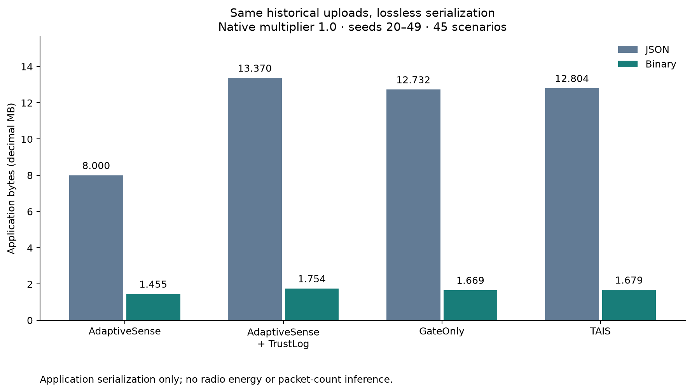

# Wire payload v1: lossless application serialization engineering audit

## Frozen scope before measurement

Code base: `f21bc2f0e1d01d0670ce1c1bd4ab5a2aab7e171d`. New branch: `research/wire-payload-v1`, created from that commit while the existing portfolio branch remains preserved. This is a format-layer review of historically used v0.1 test seeds20–49, not new independent algorithm validation. Target: **at least40% fewer TAIS application bytes than its original JSON**, without changing any business field or detection/sampling/upload behavior. A failed round trip invalidates a compression result, irrespective of size.

The actual `src/tais/replay.py` envelope is exactly `timestamp`, `values`, `environment_active`, `health`; each health entry has `score`, `state`, `flags`. Internal `Decision` scores, interval, reasons, confirmation and recovery diagnostics were **not** in that JSON. Existing finite-value sanitation converts missing/nonfinite measurements to `null`; finite faulty values remain present. Original JSON is `json.dumps(...,sort_keys=True,separators=(',',':'),allow_nan=False).encode()`.

## Complete-frame protocol, version1

This is a custom fixed-schema application format, not a claim of CBOR/SenML interoperability or a deployed LoRaWAN transport. Every frame is independently decodable with its preprovisioned layout; it has no preceding-frame or delta state. Integers use canonical unsigned base128 varints (least-significant group first); signed measurements use signed64 zigzag then varint. Fixed-width fields use network byte order.

| Order | Field | Representation |
| --- | --- | --- |
|1|Magic|2bytes, ASCII `TW`|
|2|Version|1byte, exactly1|
|3|Layout ID|1byte;1=(temperature,humidity),2=(temperature),3=(humidity), ordered immutable registry|
|4|Timestamp kind|1byte:0=uint64 varint,1=IEEE754 binary64|
|5|Timestamp|Original nonnegative number, same unit as input; no time scaling or rounding|
|6|Measurement types|1byte,2bits/channel:0=null,1=binary64,2=signed64 integer,3=invalid|
|7|Event active mask|1byte, one boolean per layout channel|
|8|Health present mask|1byte; absent health stays absent, including AdaptiveSense's empty `{}`|
|9|Measurements|Layout order;8bytes/float, canonical zigzag varint/int,0bytes/null|
|10|Health entries|For each present channel:state uint8(HEALTHY0/DEGRADED1/FAULT2),score uint8(0–100),flags canonical uint32 varint|
|11|Integrity check|4byte CRC32 of all preceding bytes, network order|

Valid types are Python `int`/`float`/`None` for measurements, `int`/`float` for time, exact boolean event flags, and exact integer health score/flags. Booleans are not numeric measurements. Finite binary64 values, subnormals and negative zero retain their exact IEEE bits; integers are never coerced through float. Unsupported ranges/types, unknown or extra business fields, invalid masks/states, noncanonical varints, nonfinite on-wire floats, truncation, trailing data, version/layout mismatch and checksum failure are rejected rather than clamped or ignored. The mapping must match configured channel **order and identity**, not merely a channel count. Partial health maps are representable.

Maximum legal frame56bytes (two channels, longest supported integer fields/flags); minimum13bytes (null values, empty health, short integer timestamp). Real two-float/small-flag frames with integer time128–1799 use30bytes without health,36bytes with two health entries. These are size predictions from the field layout, not the benchmark result. Version/layout IDs cost2bytes in every frame; magic adds2, timestamp kind1, three masks3, CRC4. Channel-name dictionaries are preprovisioned, not repeatedly transmitted. The benchmark separately reports the measured size of a canonical JSON layout descriptor and a hypothetical once-per-run provisioning cost; this is not implemented extra network traffic or included in the policy's upload count.

CRC detects accidental corruption; it is not authentication, replay protection, key management or a complete network protocol. A transport must supply frame boundaries. No radio, packet-delivery, airtime, current, energy or region/data-rate conclusion is inferred.

## Predeclared engineering comparison

Read immutable `results/test/manifest.json`, `metrics.csv`, `summary.csv` and the exact archived `results/traces/test/` files. Check source/config version equality with the original source commit, archive SHA-256, original per-record JSON byte count, per-run metrics, and original group totals **before** reporting savings. If an archive is absent or mismatched, stop; do not silently regenerate it into historical results.

Methods: AdaptiveSense, AdaptiveSense+TrustLog, GateOnly, TAIS. Reuse all45scenarios and30testseeds; native AS/TrustLog have only archived multiplier1, while GateOnly/TAIS retain all0.75/1/1.5 points. Do not invent AS runs at other multipliers. Primary comparison uses1.0. Each actual upload is separately encoded/decoded and checked against the original semantic envelope, including float bits, number types, health and active flags. Only bytes change. Empty-health AS stays empty; diagnostics are not stripped from other methods to improve their result.

Report JSON and Binary for every method/point; total bytes, mean/median/P95/min/max frame size, frame-size histograms, upload and sampling counts, event matches/strict false reports, precision/recall/F1, and field-preservation assertions. P95 uses nearest rank, median the usual midpoint of the two central sizes. Counts aggregate the same records, not resampled datasets. Codec savings, same-encoding policy differences and diagnostic metadata costs are separate. The40% criterion is applied to TAIS at its inherited default; other points and unfavorable comparisons are retained.

Event extraction is reconstructed over the frozen sender sample trace, substituting decoded business fields on uploaded records and retaining unchanged internal states at nonuploaded records. Match with the original upstream matcher and tolerance; compare source report/detection lists and counts. This proves sender behavior invariance; it does **not** pretend an uploaded-only receiver gains untransmitted internal samples. Exact equality of the entire received business-envelope stream also implies identical information for any unchanged receiver. Fault-counterfactual metrics remain the original archived values, justified by unchanged observations/health/report decisions; they are not re-estimated with a new counterfactual policy.

No scheduler, detector, matcher, frozen configuration, old CSV/manifest/trace, OSP module or upstream source is edited. New benchmark outputs use an exclusive new directory. Required tests cover valid round trips, float/integer boundaries and signed zero, all health states/flag combinations, null sanitation, multiple layouts, malformed/corrupt frames and configuration mismatch; then run the whole existing software suite.

## Actual results

The complete engineering review passed on **10,800 archived runs**, covering all45scenarios, seeds20–49 and all8 native method/operating-point groups. All **12,150 required gzip files** matched the frozen original manifest. All **383,196 uploaded envelopes** reproduced their archived JSON byte counts and round-tripped exactly, including integer/float type, IEEE754 bits, health entries and active flags. No detector or simulator was rerun for this comparison. All per-run checked counts/matches and group totals reconcile with the old metrics/summary. Full results: [summary](../results/wire-payload/test/summary.csv), [verification](../results/wire-payload/test/verification.json), [provenance](../results/wire-payload/test/manifest.json).

**Primary result:** TAIS multiplier1: **12,804,006 → 1,678,512 bytes**, saving **86.8907%** (11,125,494 bytes). The predeclared40% target was met, without removing diagnostics or quantizing values. These are actual serialized `bytes` lengths, not compressed archival gzip sizes.

### Fair encoding comparison

| Method | Multiplier | JSON bytes | Binary bytes | Saving | Uploads | Samples |
| --- | --- | --- | --- | --- | --- | --- |
| AdaptiveSense | 1.0 | 8,000,401 | 1,455,208 | 81.8108% | 49,816 | 101,108 |
| AdaptiveSense+TrustLog | 1.0 | 13,370,474 | 1,754,104 | 86.8808% | 49,816 | 101,108 |
| GateOnly | 0.75 | 12,771,468 | 1,673,844 | 86.8939% | 47,579 | 78,810 |
| GateOnly | 1.0 | 12,731,828 | 1,668,900 | 86.8919% | 47,427 | 75,964 |
| GateOnly | 1.5 | 12,476,501 | 1,635,698 | 86.8898% | 46,461 | 71,247 |
| TAIS | 0.75 | 12,807,940 | 1,678,704 | 86.8933% | 47,714 | 78,919 |
| TAIS | 1.0 | 12,804,006 | 1,678,512 | 86.8907% | 47,694 | 76,430 |
| TAIS | 1.5 | 12,538,148 | 1,643,906 | 86.8888% | 46,689 | 71,938 |

AS and TrustLog had only multiplier1 in the historical experiment. Their thresholds are not relabeled as0.75/1.5. GateOnly and TAIS retain both other pre-existing operating points, including the poor high-threshold recall; none was selected based on compression results.

TAIS Binary is6,321,889 bytes (**79.0197%**) below AdaptiveSense JSON. That mixes formats and is **encoding evidence**, not proof of a better scheduling policy. Under the **same Binary format**, TAIS is **223,304 bytes /15.3452% larger** than AdaptiveSense Binary (1,455,208 bytes). Under JSON, TAIS was60.0421% larger. The health information still costs bytes.

The diagnostic fairness comparison isolates this cost: AdaptiveSense+TrustLog has exactly the same49,816 uploads and measurements as AdaptiveSense; adding two health entries costs **298,896 Binary bytes**, exactly6bytes/upload here, versus5,370,073 extra JSON bytes. TAIS Binary is75,592 bytes (**4.3094%**) below TrustLog Binary, with the health fields retained; it remains larger than GateOnly Binary (1,668,900 bytes). These policy comparisons do not establish a general algorithm advantage.

The SVG output was subsequently normalized for trailing line whitespace only; original/final hashes and this formatting operation are recorded in the result manifest. No numerical output was changed.



### Frame size distribution and schema cost

All sizes below are **bytes per actual uploaded frame**, multiplier1; [exact histograms](../results/wire-payload/test/frame_size_histogram.csv) contain every size and all operating points.

| Method | Encoding | Mean | Median | P95 | Min | Max |
| --- | --- | --- | --- | --- | --- | --- |
| AdaptiveSense | JSON | 160.599 | 162.0 | 164 | 144 | 164 |
| AdaptiveSense | Binary | 29.212 | 30.0 | 30 | 22 | 30 |
| AdaptiveSense+TrustLog | JSON | 268.397 | 270.0 | 272 | 249 | 272 |
| AdaptiveSense+TrustLog | Binary | 35.212 | 36.0 | 36 | 28 | 36 |
| GateOnly | JSON | 268.451 | 270.0 | 272 | 249 | 273 |
| GateOnly | Binary | 35.189 | 36.0 | 36 | 28 | 36 |
| TAIS | JSON | 268.462 | 270.0 | 272 | 249 | 273 |
| TAIS | Binary | 35.193 | 36.0 | 36 | 28 | 36 |

TAIS's measured maximum is36bytes; the protocol's legal worst case is56bytes. The short timestamp/null/integer encodings explain smaller observed frames; no string key or float precision was dropped. Two ordinary health entries cost6bytes here (state1+score1+flags1 per channel); larger uint32 flags can take up to5bytes each. Other inherited points also have Binary P95/max36bytes.

Version+layout cost2bytes/frame, i.e.95,388 bytes across the primary47,694 TAIS uploads. The ordered registry contains `temperature,humidity`; its optional canonical JSON provisioning descriptor is **65bytes**. Preprovisioned receivers need no transmitted descriptor. A deliberately conservative hypothetical one-descriptor-per1350 replay sessions adds87,750 bytes: TAIS becomes **1,766,262 bytes** (still86.2054% below its old JSON). This is a sensitivity budget, not an implemented handshake or measured additional upload request. The summary carries this secondary total separately. No LoRaWAN region/data-rate or fragmentation claim is made from these sizes.

### Detection and health invariance

Both formats have exactly these same primary metrics:

| Method | TP / truth | Strict unmatched | Fault-induced | Precision | Recall | F1 | Mean delay (s) |
| --- | --- | --- | --- | --- | --- | --- | --- |
| AdaptiveSense | 464 / 900 | 990 | 652 | 31.9120% | 51.5556% | 39.4223% | 24.737069 |
| AdaptiveSense+TrustLog | 464 / 900 | 990 | 652 | 31.9120% | 51.5556% | 39.4223% | 24.737069 |
| GateOnly | 461 / 900 | 807 | 440 | 36.3565% | 51.2222% | 42.5277% | 27.251627 |
| TAIS | 464 / 900 | 828 | 458 | 35.9133% | 51.5556% | 42.3358% | 25.987069 |

Precision is TP/(TP+strict unmatched reports); recall is TP/truth; F1 is2TP/(2TP+FP+missed). No-event run recall remains N/A in the retained per-run source fields. These are historical algorithm outcomes, with matches independently rechecked from the same trace, not a new algorithm validation set.

TAIS retains **76,430 samples**, **47,694 upload requests**, **1,292 reports**,1,292 detection intervals,464 matched events,436 misses,828 strict unmatched reports and458 fault-induced reports. All **95,388 transmitted channel-health entries** are identical after decoding. Full internal health logs are also retained untouched and hashed, including nonuploaded records. Each run has identical pre/post canonical envelope stream hashes, binary-frame hash, internal-health hash, source trace/signal hashes and round-trip counts in [per_run.csv](../results/wire-payload/test/per_run.csv). Every sender report/detection list is compared exactly, then TP/FP/localTP/misses/redundancy/latencies are matched with the unchanged upstream matcher. Matching and transmitted fields are not inferred merely from aggregate equality.

All original metric columns are copied into the per-run audit, including reconstruction/fault diagnostics. The source archive SHA, unchanged nonuploaded trace and exact decoded uploaded stream establish no behavioral change. Clean-counterfactual fault attribution and reconstruction metrics are **retained frozen**, not newly recomputed with a different policy. `payload_bytes` denotes original JSON throughout; `binary_bytes` is the new alternative cost. In `summary.csv`, `bytes` is the row's encoding cost; both original/alternative totals remain available for audit. Scenario/seed breakdowns retain unfavorable cases.

### Software checks and protected history

Actual local commands:

```sh
.venv/bin/python -m pytest tests/test_wire_codec.py -q
# 130 passed
.venv/bin/python -m pytest -q -rx
# 345 passed, 2 xfailed, 0 failed (21.46s)
```

[Full software log](../results/wire-payload/checks/pytest.txt). The two strict expected failures are the pre-existing multiplier1.5 short/long pulse cases in `tests/test_rearm.py`; their assertions/markers are unchanged. They remain algorithm limitations, not codec failures. Tests include C11 adapter parity with the unmodified upstream CLI, original AdaptiveSense decision consistency, and fresh replay-to-wire integration for all4 compared policies. Codec fuzzing uses a deterministic **codec test generator**, not an independent algorithm-validation seed.

Additional upstream software checks ran only in temporary copies: **AdaptiveSense235 pytest tests passed**, all69 configuration-parity checks passed; **SensorTrust27 pytest tests passed**, and the unchanged C11 core passed all21 tests /404 checks with `-Wall -Wextra -Werror`. No baseline experiment writer was run in this checkout. Exact commands/exit codes: [upstream checks](../results/wire-payload/checks/upstream_checks.json). [Environment](../results/wire-payload/checks/environment.json) and [protected-file verification](../results/wire-payload/checks/scope_verification.json) are retained.

The24-run archive smoke check verified740 uploaded frames before the complete run. It was only a software check, stored in ignored scratch, and does not replace the full comparison. Original460 ordinary tracked files and both submodule gitlinks are checked byte-for-byte against research base `f21bc2f`; all are unchanged. No old CSV, manifest, frozen test, algorithm/configuration, OSP or upstream file is edited.

### Reproduce without touching historical results

```sh
python3 -m venv .venv
.venv/bin/python -m pip install -r requirements-lock.txt
.venv/bin/python -m pip install -e . --no-build-isolation
.venv/bin/python -m pytest -q -rx
.venv/bin/python scripts/benchmark_wire_codec.py \
  --archive /absolute/path/to/the/original/results/traces/test \
  --output results/scratch/wire-recheck-unique
```

Initialize pinned submodules with `git submodule update --init --recursive` first. Python, locked package versions, compiler and original experiment hashes are recorded in the manifests/checks. The output path must not already exist; archival hash mismatches or original-JSON mismatches abort instead of regenerating or replacing history. An optional `--smoke` performs24 archived runs only, explicitly labeled partial. The complete archived input is not committed to Git, in accordance with the existing trace policy; the original manifest fixes its hashes.

If starting from a clone without that archive, reproduce the **original** experiment only in a separate disposable checkout, never the working research repository: clone with submodules to an unused external directory, check out original source `97aa5d50afeb2cbf97bc9d91562a01c71dfd98cf`, create its own environment with the lockfile, then run `python scripts/run_experiments.py --split test` there. That historical script writes its own `results/test` and `results/traces/test`; point this benchmark's `--archive` at that disposable checkout. This is an optional historical input reconstruction, **not performed for the reported results** and not new independent evidence. The benchmark still requires all source-manifest archive hashes to agree; differences in environment/compression must be investigated, not waived. None of the original repository's old outputs should be overwritten.

Direct stateless API:

```python
from tais.wire_codec import validate_layout, envelope_from_record, encode, decode
validate_layout(("temperature", "humidity"), layout_id=1)
envelope = envelope_from_record(archived_upload_record)
frame = encode(envelope, layout_id=1)  # actual independently decodable bytes
restored = decode(frame, expected_layout_id=1)
assert restored == envelope
```

The benchmark additionally checks numeric types and float bits, because ordinary equality alone does not distinguish negative zero or int/float coercion. It processes only records whose `upload` is true. The original replay still emits its frozen JSON cost; this independent API/benchmark supplies the binary alternative without modifying scheduling or historical outputs. A real sender/receiver transport integration is separate work.

### Limits and remaining work

The40% engineering target is met on all inherited TAIS operating points in the historical test archive. This establishes lossless application serialization cost, not natural-fault validity, better detection, measured energy savings, fewer real packets, improved loss/retransmission/airtime, or an end-to-end deployed protocol. Authentication, schema negotiation, message routing/framing, receiver deployment, unknown channel layouts and production interoperability are outside this version. CRC is accidental-error detection only.

Binary TAIS still exceeds Binary AdaptiveSense because complete health records are preserved in every frame. Sending health changes only might reduce that residual cost, but would introduce synchronization, baseline/keyframe, loss/reordering, receiver-state and recovery requirements; it is not implemented or credited here. No further mechanism or tuning was needed to reach the current target.
