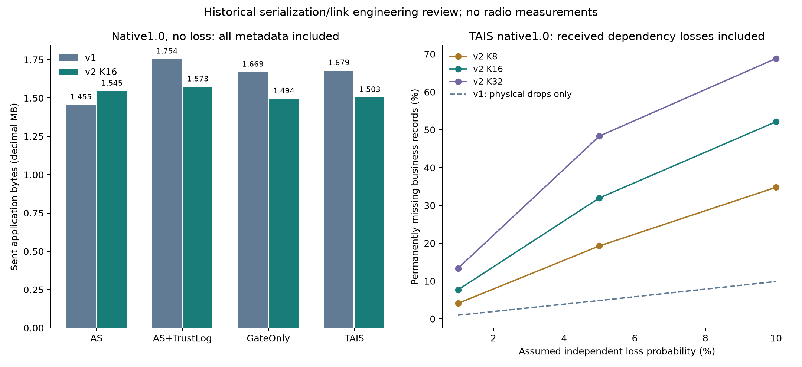

# Wire Payload v2: stateful health compression and explicit recovery

## Frozen engineering protocol before implementation/results

Base: `b184240226025d86c5e77a74f124c5c788564613`; branch `research/wire-payload-v2`. No detection/configuration/upstream/OSP/v1 output changes. This reuses all historical seeds20–49 and45 scenarios, with native AS/TrustLog1.0 and GateOnly/TAIS0.75/1/1.5; it is not independent algorithm validation. Main period16, sensitivities8/32 are fixed now, without selecting a winner afterwards.

The full uploaded-stream compressibility audit precedes implementation. TAIS1.0:47,694 uploads;46,344 within-run adjacent pairs,95.8528% identical full health; state/score/flag change rates1.7305%/2.0208%/2.0736% over92,688 comparable channel pairs. Raw health values cost286,164 bytes (6/upload). Changed values alone cost5,399 bytes; independent run initialization needs8,100 more. Optimistic savings272,665 bytes exclude all masks, identifiers, sequence, CRC and recovery. Charging one hypothetical bitmap/upload lowers that optimistic saving to224,971. It is a bound, not v2 results. Empty-health AS has nothing to compress. Audit includes all methods, every scenario, state occupancies and all9 transition counts in `results/wire-payload-v2/audit/`.

### Wire definition, no ACK or delivery assumption

Preprovisioned layouts remain exactly the v1 registry. Device IDs are explicit uint32 (nonzero); boot/session counters explicit uint64 (nonzero, strictly increasing per device); logical sequence is uint32, starts0, never wraps within a session. All use canonical unsigned base128 varints. Provisioning/identity authentication is not implemented. The caller must durably allocate nonreused boot IDs; a new Sender with a reused ID is an unsupported deployment error. Sequence exhaustion fails closed and requires a new session. Encoding advances the locally emitted logical stream, **not acknowledged delivery**; even a locally discarded frame counts as loss. No ACK, retry, reverse link or free LoRaWAN sequence is assumed.

Common frame: `TW` (2bytes), version2 (1), layout (1), control (1), device varint, session varint, sequence varint, payload, CRC32 (4, covering all preceding bytes). Each field is paid on every frame.

KEY: control exactly0x80, payload is a complete unmodified **v1 independent frame**, including its inner CRC. This deliberately preserves v1 as the full snapshot/recovery representation. Double framing/checksums are counted. Frames0,16,32,... are KEY for main period; changing periods never changes upload requests. Sender restart begins a new session with a KEY on the next existing upload.

DELTA: control bit7=0; bits0–3 hold2bits/channel measurement type as v1; bits4–5 contain event-active booleans; bit6 is timestamp type0=uint64-varint/1=binary64. Payload: original timestamp, one health bitmap, original measurements, changed health fields. The health byte uses bits6–7 for **current** presence of each channel; lower bits0–2 and3–5 are state/score/flags changed-field masks. New health entries send all3 fields; removed entries are explicitly absent; unchanged entries borrow only from a complete contiguous previous transmitted envelope. Unknown/reserved bits and inconsistent field masks are invalid. Scores remain exact0–100 integers, flags alluint32 bits, measurements/time exact original numeric types/IEEE754 bits, including negative zero and null. No unuploaded samples are encoder history.

A delta carrying every current health field (including explicitly empty health) is self-contained and may initialize/recover without borrowing cache. The rule applies identically to every method. Otherwise a delta requires a synced cache for the same device/session and immediately preceding sequence. The receiver never infers unchanged health after a gap. A KEY is always self-contained. Receiving a complete new snapshot restores **current** state; it cannot restore lost prior measurements/events.

### Receiver rules

Per configured device, keep newest session, highest valid received sequence, complete last applied health (or no usable cache), and last received frame for duplicate/conflict detection. Parse schema/length/CRC before mutation. A newer session invalidates old dependencies, even if its first received packet is a delta. Older sessions are rejected; duplicates/stale out-of-order packets produce no envelope. Same identity/sequence with different valid content is a conflict and invalidates cache. A forward gap clears the cache before applying any dependent fields. A dependent delta without its complete prior state yields `WAIT_KEYFRAME`, envelope=None. Future keys/self-contained deltas can restore current state. No reorder buffer, inferred backfill, retransmission or silent reuse is implemented. Equal/past sequence frames cannot roll state back.

Receiver restart clears volatile state; subsequent dependent frames wait for a snapshot. Authentic replay rejection across receiver restart would need persisted high-water marks plus authenticated identities; this prototype does not promise it. CRC detects accidental corruption only. Limits:32-bit device,64-bit boot,32-bit sequence, registered layouts, frame boundaries supplied externally; no deployed end-to-end protocol claim.

### Predeclared link experiments

Every archived run is a fresh receiver, sender device1/session1; these are declared one-byte identifiers, not metadata omitted from the budget. Unit tests cover at least3 interleaved devices and nontrivial/max-width identifiers. Each period sees the same original business envelopes and link masks. Profiles, fixed before results:

- `loss0`: no loss, all emitted records must decode exactly.
- `loss1`, `loss5`, `loss10`: nested Bernoulli masks from SHA256 of link seed2026101807, original seed, scenario and upload timestamp; no algorithm labels or future records. Common time opportunities share the mask across policies/periods/formats. These are controlled assumptions, not measured radio rates.
- `burst`: drop original upload indices5–8 and21–24 inclusive in every run where present.
- `sender_restart`: no loss; restart device1 into session2 immediately before existing upload index20, if present. No extra business upload is invented; changed framing costs are counted.
- `receiver_restart`: no loss; erase receiver cache immediately before index20, if present.

All7 profiles ×3 periods ×8 method/points, comparing v1 and v2 on exactly the same delivery schedule. V1 has no cache or application sequence metadata; the simulator knows missing records from its injection log, not from a claimed v1 continuity detector. Random/normal/burst profiles have identical sent bytes because there is no ACK-driven retransmission. Restart cases show their distinct costs. Reorder, duplicate, missing initialization, malformed frames/config, delayed old sessions and reset/interleaving are additional software tests, not fabricated radio observations.

One trace row records each logical sent frame, its bytes/hash/sequence/session/type, injected discard or reception, decoded/wait/recovery outcome for both codecs. Full large event logs are reproducibly generated under ignored `results/traces/wire-payload-v2/`, not mixed with old archives. Versioned summaries/manifests record their SHA256 and rows; a small public excerpt retains examples. Dropped vs received-but-unreconstructed records are separate. Every successfully reconstructed envelope must be bit/type-exact; any wrong complete envelope aborts the benchmark.

Recovery waits start at the first missing/unreconstructed logical record until the next fully reconstructed current record, measured in emitted-frame indices and original application seconds. Report completed episode mean/P95/max, and separately right-censored/end-of-run unresolved episodes; never assign zero delay to unresolved tails. Also report receiver-visible continuity gaps separately from simulator-known physical drops. No backwards reconstruction: all missing business records remain permanently unavailable in this no-retransmission experiment, even after current state recovers.

### Acceptance and cost analysis

Required: loss0 exact reconstruction of every envelope; unchanged sender samples/upload decisions/health/reports/matches; compare every method v1/v2; all initialization, identity/sequence/checksum/periodic refresh bytes paid. Report challenge TAISv2<1,455,208 honestly, main period16 irrespective of sensitivity results. If missed, stop instead of tuning old data. If recovery losses are severe, no overall superiority claim from loss0 savings.

Report full frame distributions and key/delta counts; synchronization metadata; initialization key bytes; actual key minus hypothetical same-record field-change delta size (refresh premium, not a valid alternative budget without snapshots). State-dependent health-only bounds are distinct from actual v2 totals. Uncertainty: paired seed-level differences and deterministic percentile bootstrap95% CIs, clustering all scenarios by original seed (30clusters). Used data remain historical. Protocol overhead sensitivity for longer identifiers is a declared arithmetic cost bound, not a new tuned protocol.

Sender P/R/F1 and original fault/reconstruction metrics remain frozen; link losses do **not** imply receiver P/R/F1 unchanged. No receiver algorithm is implemented/evaluated. Next physical tests would require actual transport framing, identity/session persistence, authentication, link traces and measured radio/current evidence. No energy/packet/airtime claim is made here.

## Actual implementation, results and reproduction

The complete run actually executed **10,800 original streams**, **383,196 original uploads**,3periods and7link profiles: **8,047,116 logged logical send/delivery events**. All12,150 required archives matched the original manifest, and every original v1 per-run byte total/envelope-stream hash reconciled. Main code was frozen at `9121945b53d447f68a4dd85af75de90bcca33bdd` after the audit/protocol commit `0da15d6`. No protocol/period was adjusted after results.

**Decision: retain v2 as an opt-in experimental transport prototype; keep v1 as the robust default.** Main-period TAIS v2 reduces sent bytes **1,678,512 → 1,503,239**, saving **175,273 bytes /10.4422%**. The challenge **v2<1,455,208 fails by48,031 bytes**. More seriously, dependency losses amplify physical losses; byte savings do not justify an unconditional replacement. All successfully reconstructed records are exact, but a lost/rejected record is not subsequently recovered by a later snapshot.

### Fair no-loss cost results

| Method | Multiplier | v1 bytes | v2 K8 | v2 K16 | v2 K32 | K16 saving vs v1 |
| --- | --- | --- | --- | --- | --- | --- |
| AdaptiveSense | 1.0 | 1,455,208 | 1,578,636 | 1,545,229 | 1,529,389 | -6.1861% |
| AdaptiveSense+TrustLog | 1.0 | 1,754,104 | 1,623,972 | 1,572,572 | 1,548,355 | 10.3490% |
| GateOnly | 0.75 | 1,673,844 | 1,548,400 | 1,498,580 | 1,475,185 | 10.4707% |
| GateOnly | 1.0 | 1,668,900 | 1,544,230 | 1,494,410 | 1,470,981 | 10.4554% |
| GateOnly | 1.5 | 1,635,698 | 1,514,864 | 1,465,942 | 1,442,521 | 10.3782% |
| TAIS | 0.75 | 1,678,704 | 1,552,896 | 1,502,886 | 1,479,373 | 10.4734% |
| TAIS | 1.0 | 1,678,512 | 1,553,302 | 1,503,239 | 1,479,292 | 10.4422% |
| TAIS | 1.5 | 1,643,906 | 1,522,540 | 1,473,504 | 1,449,612 | 10.3657% |

At K16 TAIS v2 is **41,990 bytes /2.7174% below AdaptiveSense v2**, **69,333 bytes /4.4089% below TrustLog v2**, but **8,829 bytes /0.5908% above GateOnly v2**. Empty-health AdaptiveSense v2 is **6.1861% larger than its own v1**; all synchronization overhead is exposed, not withheld from the baseline. A mixed v2/v1 scheduling superiority claim is not supported. The0.75/1.5 points above and all their period/link breakdowns are retained in CSV; high-threshold detector failures are not repaired by a codec.

| KEY period | TAIS bytes | Saving vs v1 | KEY / DELTA count | Initialization KEY bytes | All KEY refresh premium | Periodic premium excluding initialization |
| --- | --- | --- | --- | --- | --- | --- |
| 8 | 1,553,302 | 7.4596% | 6363 / 41331 | 63,450 | 99,761 | 84,911 |
| 16 | 1,503,239 | 10.4422% | 3414 / 44280 | 63,450 | 49,698 | 34,848 |
| 32 | 1,479,292 | 11.8688% | 1992 / 45702 | 63,450 | 25,751 | 10,901 |

The main total contains **3,414 KEYs** (1,350 initialization,2,064 periodic),44,280 DELTAs;160,322 KEY bytes +1,342,917 DELTA bytes =1,503,239. Initialization keys cost63,450 bytes, included once, not added again. Periodic keys cost96,872 bytes total. Three explicit identity/session/sequence varints cost **143,082 bytes**; common outer headers/CRC total572,328 bytes (including those varints). Every logical upload remains one emitted protocol frame; no separate free initialization/ACK/repair traffic exists.

Refresh premium compares each actual key against its hypothetical same-envelope delta given the real previous emission (first emission sends all health fields). This is an accounting counterfactual, not an evaluated reliable protocol. Initial wrapped-v1 key premium is11bytes/session,14,850 total; periodic refresh premium at K16 is34,848. Subtracting only periodic premiums gives the same **1,468,391-byte hypothetical no-periodic-refresh floor** for all3periods, still13,183 above1,455,208. Such an unbounded dependency chain is not recommended or run as a candidate. This identifies session/framing/initialization cost as a bottleneck and supports stopping, rather than searching ever-longer periods on old test data.

The main IDs are explicitly1/session1 (session2 on restart); all sequences in this corpus remain one byte. These are finite laboratory sessions, not a promise that a production ID always fits one byte. For example a3-byte session counter instead of1 adds95,388 bytes to primary TAIS, and a5-byte device ID adds190,776; these are arithmetic metadata sensitivities, not silently free IDs or new experiments. `MAX_FRAME_BYTES=85`, minimum14; maximum-width IDs/sequence/value/flags are tested.

| Period | Mean / median / P95 / max bytes |
| --- | --- |
| 8 | 32.568 / 31.0 / 48 / 48 |
| 16 | 31.518 / 31.0 / 47 / 48 |
| 32 | 31.016 / 31.0 / 34 / 48 |

The largest actual TAIS frame is48bytes, larger than v1's36, because a recovery KEY contains an intact v1 frame plus the v2 outer envelope. Full measured distributions for every method/point are in [frame sizes](../results/wire-payload-v2/test/frame_sizes.csv) and [histograms](../results/wire-payload-v2/test/frame_histograms.csv).

### All controlled link outcomes, TAIS multiplier1.0

| KEY period | Link profile | Sent bytes | Physical drops | Received but unrestored | Permanent missing total | Decoded |
| --- | --- | --- | --- | --- | --- | --- |
| 8 | burst | 1,553,302 | 10,800 | 17,632 | 28,432 | 19,262 |
| 8 | loss0 | 1,553,302 | 0 | 0 | 0 | 47,694 |
| 8 | loss1 | 1,553,302 | 470 | 1,486 | 1,956 | 45,738 |
| 8 | loss10 | 1,553,302 | 4,713 | 11,880 | 16,593 | 31,101 |
| 8 | loss5 | 1,553,302 | 2,311 | 6,886 | 9,197 | 38,497 |
| 8 | receiver_restart | 1,553,302 | 0 | 5,400 | 5,400 | 42,294 |
| 8 | sender_restart | 1,571,507 | 0 | 0 | 0 | 47,694 |
| 16 | burst | 1,503,239 | 10,800 | 17,632 | 28,432 | 19,262 |
| 16 | loss0 | 1,503,239 | 0 | 0 | 0 | 47,694 |
| 16 | loss1 | 1,503,239 | 470 | 3,196 | 3,666 | 44,028 |
| 16 | loss10 | 1,503,239 | 4,713 | 20,153 | 24,866 | 22,828 |
| 16 | loss5 | 1,503,239 | 2,311 | 12,939 | 15,250 | 32,444 |
| 16 | receiver_restart | 1,503,239 | 0 | 14,932 | 14,932 | 32,762 |
| 16 | sender_restart | 1,523,766 | 0 | 0 | 0 | 47,694 |
| 32 | burst | 1,479,292 | 10,800 | 24,382 | 35,182 | 12,512 |
| 32 | loss0 | 1,479,292 | 0 | 0 | 0 | 47,694 |
| 32 | loss1 | 1,479,292 | 470 | 5,914 | 6,384 | 41,310 |
| 32 | loss10 | 1,479,292 | 4,713 | 28,130 | 32,843 | 14,851 |
| 32 | loss5 | 1,479,292 | 2,311 | 20,738 | 23,049 | 24,645 |
| 32 | receiver_restart | 1,479,292 | 0 | 14,932 | 14,932 | 32,762 |
| 32 | sender_restart | 1,491,662 | 0 | 0 | 0 | 47,694 |

At assumed5% random loss, physical drops are2,311/47,694 (4.8455%). K16 additionally rejects **12,939 received dependent frames**;15,250 total business records (**31.9747%**) remain permanently unavailable. V1 loses only the2,311 physically discarded frames on exactly the same mask. K16's nominal sent-byte saving therefore does not preserve the same delivered information. Effective bytes per reconstructed record rise from approximately37.0 for v1 to46.3 for v2 in this case. No receiver detector P/R/F1 is claimed.

At assumed1% loss, K16 still misses3,666 records total; at10%,24,866. At zero physical loss, receiver restart alone leaves14,932 records unavailable. Of1,350 restart trials,708 reach the end before an adequate new snapshot arrives. A frame-count period is not an absolute-time delivery guarantee, and no extra upload is created to improve this result. Sender restart with a fresh session and immediate key does preserve all records, but increases K16 sent bytes to1,523,766 (+20,527 relative to its no-restart total).

K8 and K16 have identical burst outcomes here because the predeclared burst also discards K8's keys at8/24; both next recover at16/32. K32 is worse. This is a specific controlled alignment, not a universal loss distribution or a reason to choose a favorable burst phase. For any period, repeated snapshot loss can make recovery arbitrarily late; observed maxima are not hard delivery guarantees.

### Recovery waits: all adverse profiles retained

| Period | Profile | Completed / censored episodes | Mean / P95 / max wait (frames) | Mean / P95 / max wait (seconds) |
| --- | --- | --- | --- | --- |
| 8 | burst | 1992 / 708 | 11.000 / 11 / 11 | 532.533 / 660 / 680 |
| 8 | loss1 | 381 / 70 | 4.514 / 8 / 14 | 229.908 / 480 / 720 |
| 8 | loss10 | 2568 / 575 | 5.413 / 11 / 24 | 269.377 / 500 / 1440 |
| 8 | loss5 | 1578 / 318 | 5.008 / 8 / 24 | 251.020 / 480 / 1440 |
| 8 | receiver_restart | 1350 / 0 | 4.000 / 4 / 4 | 182.848 / 240 / 260 |
| 16 | burst | 1992 / 708 | 11.000 / 11 / 11 | 532.533 / 660 / 680 |
| 16 | loss1 | 292 / 146 | 8.822 / 16 / 16 | 421.164 / 840 / 960 |
| 16 | loss10 | 1500 / 880 | 11.039 / 16 / 32 | 527.373 / 960 / 1555 |
| 16 | loss5 | 1089 / 552 | 9.918 / 16 / 32 | 473.710 / 920 / 1455 |
| 16 | receiver_restart | 642 / 708 | 12.000 / 12 / 12 | 507.617 / 720 / 740 |
| 32 | burst | 642 / 708 | 27.000 / 27 / 27 | 1059.276 / 1370 / 1420 |
| 32 | loss1 | 171 / 246 | 17.094 / 32 / 32 | 665.673 / 1365 / 1675 |
| 32 | loss10 | 556 / 1042 | 23.955 / 32 / 32 | 948.633 / 1515 / 1710 |
| 32 | loss5 | 487 / 785 | 20.335 / 32 / 32 | 801.088 / 1425 / 1710 |
| 32 | receiver_restart | 642 / 708 | 12.000 / 12 / 12 | 507.617 / 720 / 740 |

Waits measure original upload opportunities and timestamp seconds from the first unavailable record through the first complete current reconstruction. Completed episodes' means/P95/max exclude unresolved tails, whose **counts are explicitly separate**; censored per-episode lower bounds and start times are preserved in `recovery_episodes.csv.gz`. Censoring makes a completed-only mean optimistic if interpreted as an unconditional mean. No loss and sender-restart profiles have no missing episodes, so their waits are N/A, not zero-duration recovery measurements. Original variable upload intervals explain the long second-scale waits.

All bytes count **emitted frames even when discarded**, not only received bytes. `observed_sequence_gaps` can also include an unknown prefix after receiver reset; it is not a physical-drop oracle. Device session change/reinitialization is distinguished from a missing-record episode. This trace has no retransmission or backfill.



### Correctness, statistics and software checks

No-loss exact reconstruction succeeded for all383,196 original uploads at each of3periods; every successfully decoded record in every profile was bit/type-exact. No incorrect complete envelope occurred. Source samples, upload trigger/counts, sender health, event reports/detections and matches remain identical by full v1 archival re-audit and unchanged source. Main TAIS retains76,430 samples,47,694 uploads,464TP/900truth,828strict unmatched,458fault-induced false,436misses: **precision35.9133%, recall51.5556%, F142.3358%**. These are **sender** metrics, not receiver performance under loss. All transmitted original health fields remain mandatory; unavailable health produces no complete record, not an old-value substitute.

An independent saved verifier reconciled all8,047,116 event rows with the aggregate counts and byte totals, then re-fed14,736 received frames from fixed seed20 cases through fresh receivers; all recorded statuses, continuity/recovery outcomes and envelope hashes matched. [Verification record](../results/wire-payload-v2/checks/result_verification.json). An initial ad hoc verification invocation stopped before checks because its stdin import path was unset; that invocation is retained in `checks/verification_invocations.json`, and the saved verifier sets the checkout path explicitly.

Local actual checks: `python -m pytest tests/test_wire_v2.py -q`: **75 passed**; `python -m pytest -q -rx`: **420 passed,2 existing strict xfailed,0 failed (27.33s)**. The2xfails are unchanged high-threshold rearm pulse limitations. In temporary upstream copies: AdaptiveSense235pytest tests and69configuration-parity checks passed; SensorTrust27pytest tests and21C11 core tests/404checks passed (`-Wall -Wextra -Werror`). Logs, environment and exact commands are in [checks](../results/wire-payload-v2/checks/). All484 ordinary baseline files and both upstream gitlinks are unchanged.

Paired seed-cluster bootstrap (30original seeds, all scenarios retained,10,000replicates) gives K16 TAIS no-loss byte difference−175,273,95%CI[−175,823.025,−174,742]; saving10.4422%,CI[10.4174%,10.4656%]. At5% loss the additional received-but-unrestored count is12,939,CI[12,415.975,13,447.025]. These intervals describe this historical/background corpus with **one fixed artificial link seed**, not uncertainty over real radio populations or independent algorithm validation. [Full uncertainty table](../results/wire-payload-v2/test/paired_uncertainty.csv).

State audit absolute counts for TAIS1.0:89,842 HEALTHY,1,573 DEGRADED,3,973 FAULT uploaded channel-health entries;1,604 state changes,1,873score changes,1,922flag changes over92,688 comparable channel pairs.44,422/46,344 adjacent full-health pairs repeat exactly. Actual changes, initial states and every health field are preserved, rather than rounding scores or assuming HEALTHY.

### Reproduce and inspect

See [results index and commands](../results/wire-payload-v2/README.md). Both scripts refuse existing output paths; the benchmark reads original archives and **never runs a scheduler**. The archived data hashes, code files, original experiment/config/version, locked environment, bootstrap/link seeds and output checksums are in [manifest](../results/wire-payload-v2/test/manifest.json). [Verification](../results/wire-payload-v2/test/verification.json) explicitly records the failed challenge. A24-run/740-upload smoke check preceded full measurement; it was debugging, not the target evaluation.

Full event log: `results/traces/wire-payload-v2/test/link_events.jsonl.gz`, **115,438,538 bytes**,8,047,116 event rows, SHA256 `8d06a274cd61d0377411b61f15af7d524bc51aba7179b02ff194eee1e63acc63`. This large generated log is local/ignored, not a claimed downloadable Git artifact; fresh reproduction regenerates it. The versioned public excerpt shows every profile for one fixed case. Log records include actual wire hex, identity/session/sequence, discard/reception, status, gap, recovery and expected business-envelope hash; all selected source archives retain their own original hashes. Nothing was overwritten.

Minimal API:

```python
from tais.wire_v2 import Sender, Receiver
sender = Sender(device_id=1, session_id=1, period=16, layout_id=1)
receiver = Receiver({1: 1})
wire = sender.encode(upload_envelope)  # commits a local emission, no ACK implied
result = receiver.receive(wire)
if result.envelope is None:
    # WAIT_KEYFRAME/STALE/DUPLICATE/CONFLICT are explicit outcomes, never old health.
    print(result.status)
else:
    restored_upload_envelope = result.envelope
# Before a sender reboot: durably allocate a greater boot ID, then sender.restart(new_id).
# receiver.reset() models a receiver reboot and discards volatile dependencies.
```

### Recommendation and remaining physical prerequisites

This is a runnable basis for **controlled physical protocol experiments**, with tested codecs, cache state and observable failure modes. It is **not ready for deployment or a default improvement over v1**. The observed dependency amplification is severe, the legacy-AS byte challenge failed, and long/censored recovery tails are substantial. Keep the fixed negative results and stop tuning periods/protocol on this old corpus.

A physical experiment must first provide durable boot identity allocation, authenticated device/session binding or an explicitly restricted threat model, message framing/routing/size validation, real reset/reorder/loss traces and an explicit receiver failure policy. Receiver anti-replay state across reboot and asynchronous repair are not solved. Any future ACK/key-request, retry, time-based refresh or larger identifiers must have an explicit implementation and byte/request budget; none is credited here. Real packet count, radio airtime/current/energy and actual delivery improvement remain unverified. No change to detector thresholds, sampling, event matching or OSP was made.
