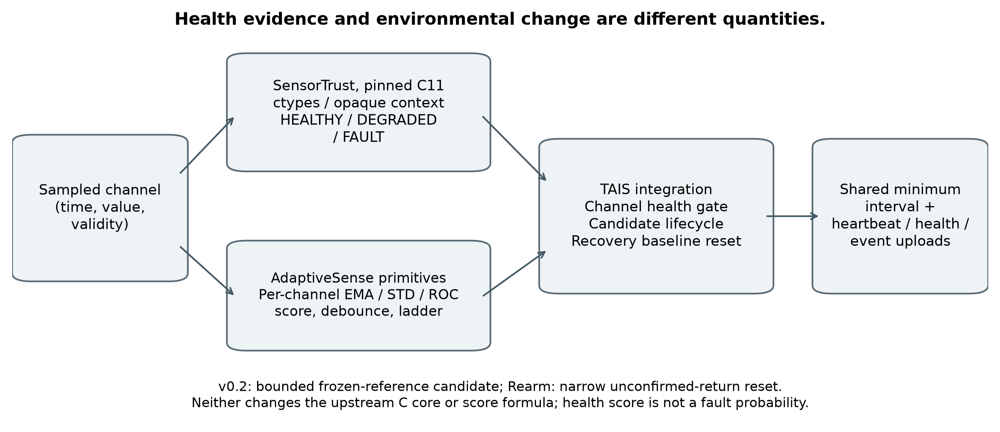
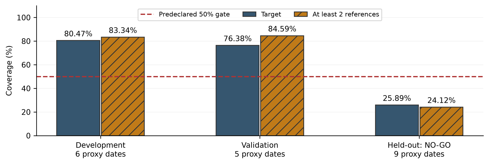

# 農業IoTにおけるセンサ信頼性を考慮した適応的センシングと環境イベント検出

TAIS: Trust-Aware Importance Scheduler | 研究概要 | 2026年10月18日

作成者：Sver0411（学部専攻：IoT工学／物联网工程）　研究プロトタイプ・技術報告

## 1. 研究背景と目的

農業IoTでは、電力・通信資源の制約下で環境を継続観測する必要がある。固定周期の計測は資源を消費し、低頻度では短い変化を見逃す。一方、変化量だけで観測頻度を上げると、センサ故障も重要な環境変化と誤認される。信頼性を強く優先すると、故障中の真の変化まで除外しかねない。

本研究は、**故障に伴う誤報の抑制、真の環境イベントの検出維持、計測・通信コストの三者のトレードオフ**を定量化する。最適な方式や実環境での優越性を前提とはしない。

## 2. 手法と実装範囲

TAISは、既存のSensorTrust C11実装による健全性判定と、AdaptiveSenseの変化スコア・状態遷移を利用する。健康度は確率ではなくヒューリスティックな指標であり、変化の物理的原因を直接識別しない。チャネルごとに判定を分離し、HEALTHYでは変化情報を利用、DEGRADEDでは疑わしい候補を確認、FAULTでは環境イベントから除外して診断を続ける。共有計測周期は必要な最短要求を採用し、5～60秒に制限する。定期生存通知・健全性変化と環境報告は区別する。

図A（全体版Figure 2）．既存C11／変化検出モジュールとTAISの関係を示す模式図。ラベル・未来値はオンライン判断に入力しない。

v0.1はチャネル別ゲートと有界確認を実装する。v0.2は更新前EMAを固定基準とし、3観測・10秒以上・120秒未満の持続を確認する。任意のRearm修正は、未確認候補が基準範囲へ戻って取り消された際のリセットと再待機を同期させる。健全性の変化だけでロックを解除する仕組みではない。

## 3. 実験方法

合成実験は30分・2チャネル・45シナリオとし、潜在環境、ノイズ、故障、イベント真値を別に生成した。固定5/10/20/40/60秒、元のAdaptiveSense、ゲートのみ、各TAIS版を同一入力で比較する。倍率0.75/1/1.5をすべて保存し、乱数シード単位の対応付きbootstrapで95%区間を算出した。最終評価用シードはv0.1が20–49、v0.2が50–99、Rearmが120–149であり、**異なる実験集の結果は合算しない**。

<!-- PAGEBREAK -->

## 4. 主な結果

以下は各段階の事前指定点（倍率1）。誤報は合成真値との時間照合と、故障なし反実仮想再生に基づく操作的な帰属である。[P1–P4]

| 段階・評価集 | 確認できた結果と代償 |
| --- | --- |
| v0.1：900イベント | AdaptiveSenseとTAISはともに464/900（51.56%）。故障帰属誤報652→458。ただしアプリケーションペイロードは60.04%増加。 |
| v0.1：実際の同時重合 | 同一チャネル35.28→30.28%、別チャネル64.17→68.33%。前者には観測消失時の偶然一致が含まれ、可観測イベントの喪失数とは同一でない。 |
| v0.2：1,500イベント | v0.1の707件に対し705件。倍率0.75でのみ同一チャネルに6件の遅い追加検出があり、全般的な改善は未確立。 |
| Rearm：主実験900イベント | 450→454件、差+0.44ポイント［95%区間0～+1.11］。同一チャネルの実際の故障重合は改善なし。 |
| Rearm：別の制御回復試験 | 尖峰後の独立イベント0/60→60/60。特定の失敗を修正したが、主実験とは混ぜない。高倍率ではドリフト誤報とコストが増える。 |

v0.1の確認機構はゲートのみと比べて3件を追加検出した一方、466回の計測・267回のアップロード・18件の故障帰属誤報を追加した。確認だけの安定した利益は示されていない。[P1]

## 5. 実温室背景によるオフライン探索と限界

OSP-1はGreenhouse-1の実温湿度背景に制御した故障・環境変化を加えた**半合成・オフライン情報実験**であり、既存TAISをそのまま再生したものではない。固定10分計画で、短期履歴・追加履歴・実空間参照・同じ参照取得コストの無情報参照を、13場面と9通りの時計偏移／参照年齢仮定で比較した。[P4, R6–R7]

図B（全体版Figure 7）．全27測点・2物理量を保持した事前指定時間ブロック。保留評価は目標25.89%、参照24.12%で、ともに50%基準を満たさずNO-GO。**適格な独立有効性検証は得られなかった。**

開発・検証では一部のドリフト追加報告が減ったが、無情報参照も似た利益を示し、局地的な緩やかな変化の再現率低下と参照取得コストが生じた。時計仮定にも依存する。合成実験でも、単一チャネルの環境緩やかな変化と加法的ドリフトが同じ観測を与える場合、健康履歴や持続性だけでは原因を保証付きで識別できない。局所的な状態修正はこの限界を解消しない。自然故障ラベル、信頼できる実到着時刻、実測電流に基づく検証はなく、実機省電力や自然故障診断の有効性は主張しない。

## 6. 今後の課題と研究上の位置付け

次の課題は、**時刻・位置・利用可能性が明確な参照が、同一チャネルの履歴を超える情報を与えるか**の検証である。局地変化を否定せず、無情報参照と同等の予算で比較し、事前に定めた局地再現率とコスト条件を同時に満たさなければ仮説を棄却する。空間相関や品質を考慮した標本化自体は既存研究にもある。[R3–R5] 本研究の現在の成果は、再現可能な実装、条件付きの実験結果、失敗原因と情報限界の明示であり、新規性や実温室での安定した優位性の証明ではない。

出典：P1–P4は[結果索引](RESULTS_PROVENANCE.md)、R3–R7は[英文報告の参考文献](TECHNICAL_REPORT_EN.md#references)。設定・CSV・区間・SHAは同索引に記載。GitHub：[Sver0411/TAIS](https://github.com/Sver0411/TAIS)。
