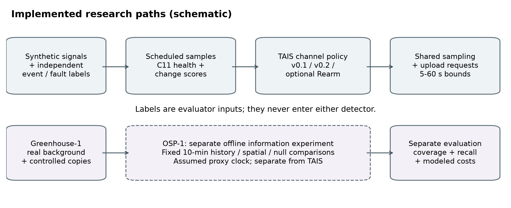
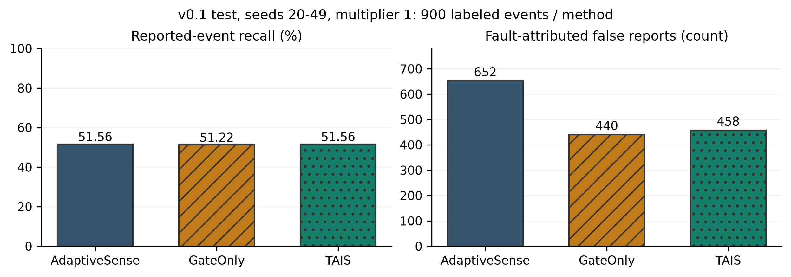
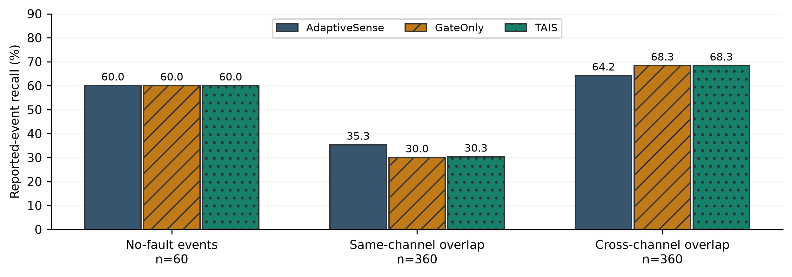
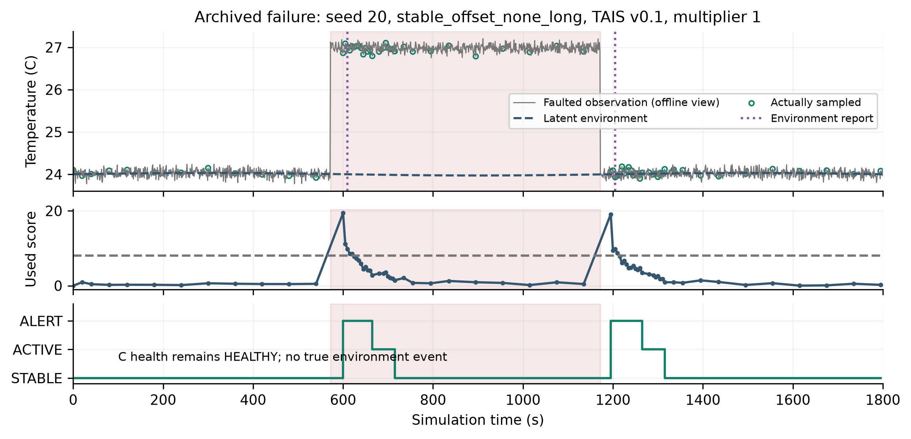
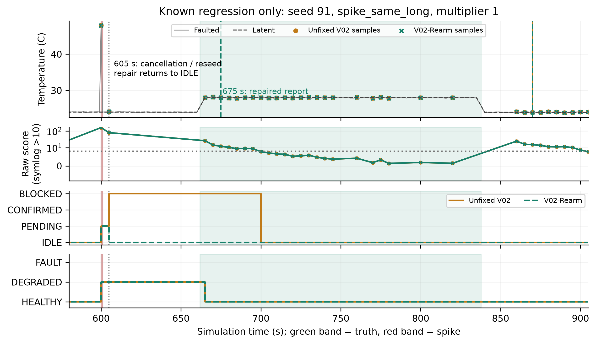
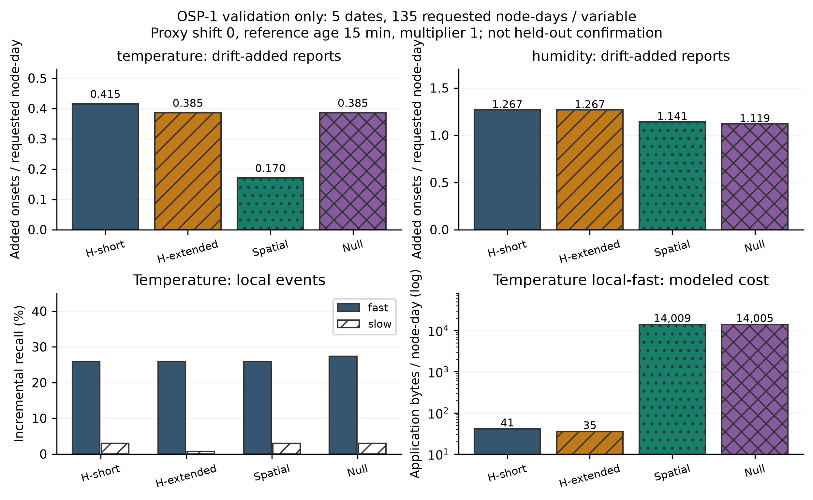

# Trust-Aware Importance Scheduling for Agricultural IoT

## Reproducible mechanisms, conditional benefits, and limits of fault-aware event sensing

Sver0411 | Undergraduate background: Internet of Things Engineering

Research portfolio technical report | 18 October 2026 | Evidence snapshot: f21bc2f

**Status:** An unpublished research prototype report. This document reorganizes existing evidence; it introduces no algorithm, parameter selection, or new effectiveness experiment. No field deployment, natural-fault diagnostic accuracy, or measured radio-energy saving is claimed.

## Abstract

Resource-constrained agricultural sensing must distinguish important environmental changes from unreliable measurements while controlling observation and communication costs. Trust-Aware Importance Scheduler (TAIS) combines the existing SensorTrust C11 health detector with unchanged AdaptiveSense change-scoring and scheduling primitives. The research examines channel-level gating, bounded confirmation, and a narrow recovery-state repair. On the v0.1 synthetic test split, TAIS and AdaptiveSense each match 464/900 labeled events; operationally fault-attributed false reports decrease from 652 to 458, but serialized application bytes increase 60.04%. Aggregate recall conceals different same-channel and cross-channel outcomes. A later persistent-candidate mechanism has a small, late same-channel benefit only at one declared threshold multiplier. A BLOCKED rearm repair restores a specific spike-followed-by-event capability; its independent main-suite recall change is only 450/900 to 454/900, with a paired interval including zero. Finally, OSP-1 examines history, spatial-reference, and null-reference controls on a real greenhouse background with controlled interventions. Its held-out block fails the predeclared coverage gate. The contribution is an auditable implementation and evidence chain that exposes reliability, observability, and cost tradeoffs; stable spatial-information benefits and deployment effectiveness remain unestablished. [P1–P4]

## 1. Introduction and research questions

Change-driven sampling can increase observation frequency when a signal varies, but a fault can create that same variation. Conversely, excluding suspect readings can remove evidence of a real event. Quality-aware adaptation, critical sensing, and spatial correlation already appear in prior work [R3–R5]; integrating these ideas is not a first-of-kind claim.

The investigation asks four separable questions:

| Question | Completed evidence | What it does not establish |
| --- | --- | --- |
| RQ1: Can health gating reduce fault-related reports while retaining events? | v0.1 synthetic controls and confirmation ablation | Universal recall preservation or lower total payload |
| RQ2: Can bounded persistence retain same-channel overlap events? | v0.2 full/passive comparison on new seeds | Reliable physical-cause identification |
| RQ3: Can rearm restore an independent event after a spike? | Known trace plus separately frozen main/recovery suites | General same-channel overlap improvement |
| RQ4: Does spatial reference add information beyond history? | OSP-1 real-background semi-synthetic exploration | Qualified independent benefit: coverage gate failed |

Claim IDs P1–P4 link to [Results Provenance](RESULTS_PROVENANCE.md), which records paths, hashes, selectors, and archived paired intervals.

<!-- PAGEBREAK -->

## 2. System architecture and attribution of work

Figure 1. Implemented research paths, schematic. The upper path uses synthetic signals with independent physical-event and injected-fault labels. Labels enter only evaluation. The lower path is OSP-1, a separate fixed-plan offline information experiment. It is not a real-time extension of the TAIS scheduler.

Figure 2. Actual reuse boundaries, schematic, based on `src/tais/trust.py`, `trust_bridge.c`, `scheduler.py`, and the separate evidence modules. Health and environmental change are different quantities. Optional v0.2/Rearm mechanisms do not alter either upstream repository.

Both dependencies are version-pinned and preserved without edits [R1–R2]; full source SHAs appear in the references and evidence index. The Python bridge allocates an opaque C context and calls the actual C11 core, rather than approximating it in Python. Health scores are heuristic outputs, not calibrated fault probabilities. Upstream licenses and attribution remain in the submodules.

TAIS adds channel-specific health arbitration, candidate handling, shared sampling demands, and an experimental reporting/replay framework. Each channel has its own analyzer and state. Calling the analyzer with that channel's value avoids substituting a node-wide maximum for every channel's score. An unreliable channel has no node-wide veto over another channel's event. This implementation property does not guarantee that a brief event will be sampled.

<!-- PAGEBREAK -->

## 3. Sensor reliability, event scheduling, and methodology

### 3.1 Online policy boundaries

AdaptiveSense supplies the previous-EMA deviation, population standard deviation over 30 seconds, mean absolute rate of change over 10 seconds, hysteresis, debounce, and interval ladders. Its implemented score is the maximum of these three components divided by the channel noise floor; this is the pinned algorithm's operational definition. The default event condition is score greater than 8 for at least 10 seconds, distinct from ALERT entry at 12. Threshold multipliers scale inherited thresholds, not physical truth labels.

In v0.1, HEALTHY readings can request environmental priority; DEGRADED evidence can enter bounded confirmation; FAULT or invalid values cannot authorize an environmental event. First usable recovery reseeds the channel analyzer to avoid comparing against a stale pre-fault baseline. SensorTrust history is retained. Shared sampling takes the minimum eligible, confirmation, or diagnostic demand, clamped to 5–60 seconds. Upload reasons include environmental onsets, health/flag changes, interval/state changes, trusted deltas, first observation, and heartbeat. Coincident reasons share one envelope.

v0.2 retains a pre-update EMA reference and signed displacement, requiring at least three supporting sampled readings, at least 10 seconds, upstream debounce, and a pending lifetime strictly below 120 seconds. Full V02 requests 5-second confirmation; V02-Passive retains the evidence rule without that extra sampling demand. A persistent excursion can be a fault, so confirmation is not proof of environmental cause. The optional rearm change is discussed separately in Section 6.

### 3.2 Experimental isolation and statistics

| Stage | Development / validation | Historically held-out test | Data and scope |
| --- | --- | --- | --- |
| v0.1 | Seeds 0–9 / 10–19 | 20–49 | 45 synthetic scenarios; 13 operating points |
| v0.2 | 0–9 / 10–19, reused diagnostic history | 50–99 | Same scenarios; 19 points including full/passive |
| Rearm | 100–109 / 110–119 | 120–149 | Main 45 scenarios; distinct aligned-recovery suite |
| OSP-1 | Apr 26–Jun 1 / Jun 2–Jul 1, 2020 proxy dates | Jul 2–Sep 1, 2020 proxy dates | Weekly episodes; one greenhouse; gate failed |

Synthetic runs last 1,800 seconds with two channels. Physical-event labels come from latent signals, fault labels from an independent schedule; the scheduler sees only requested observations. Fixed 5/10/20/40/60-second methods, actual AdaptiveSense, diagnostic-only trust logging, GateOnly, and TAIS policies share signals, noise seeds, and fault schedules. Three declared policy multipliers, 0.75/1/1.5, remain visible. Duration and intensity vary jointly in the two profiles; their effects are not independently identified. One-second spike probes precede later events and are not concurrent-overlap cases.

Reported-event recall uses channel-aware, one-to-one temporal matching with 5-second tolerance. Local detection is separately recorded. Unmatched report onsets are distinct from duration falsely active. The operational fault-attributed subset requires an unmatched onset in the fault/recovery window and no same-channel fault-free counterpart within tolerance; it is not proof of physical causation. No-event recall is N/A. Synthetic paired intervals resample whole seed batches 2,000 times (RNG 731); count differences are per-seed scenario batches unless totals are stated. They are descriptive percentile intervals, not multiplicity-adjusted superiority or non-inferiority tests.

<!-- PAGEBREAK -->

## 4. RQ1: v0.1 benefits and costs on its own test split

Figure 3. Synthetic v0.1 test, seeds 20–49, multiplier 1; 900 physical labels per method. Counts are archived point estimates, not invented confidence bounds. Sources: `results/test/summary.csv`; corresponding paired intervals are in `paired_bootstrap.csv`. [P1]

TAIS and AdaptiveSense both match 464/900 events (51.56%). The paired recall difference interval is [−1.11,+1.22] percentage points: equal pooled recall is not a non-inferiority guarantee. Fault-attributed false reports fall 652→458 (−29.75%); all unmatched reports fall 990→828. Samples fall 101,108→76,430 (−24.41%) and upload requests 49,816→47,694 (−4.26%). Yet actual serialized application payload rises 8,000,401→12,804,006 bytes (+60.04%), because health metadata matters. These are application-level measures, excluding radio headers, retries, acknowledgements, and current measurements.

Figure 4. Same v0.1 test point, distinct strata; n is the number of physical labels. Same/cross denote actual overlap. Sequential spike cases are omitted from these three bars and remain in the complete source CSV; the figure does not claim to partition all 900 labels.

Clean recall is 36/60 for all three methods. Same-channel overlap decreases 127/360→109/360 (35.28→30.28%, paired difference −5.00 pp, interval [−7.78,−2.22]); cross-channel overlap increases 231/360→246/360 (64.17→68.33%, +4.17 pp, [1.94,6.67]). Forensic observation-equivalence checks show the entire 18-match same-channel gap occurs in range-replacement cases where AdaptiveSense produces the same reports without the latent event. The historical temporal metric is retained, but it cannot be interpreted as 18 demonstrably observable events lost by gating.

Relative to GateOnly at multiplier 1, confirmation adds only three matches (461→464), alongside 466 samples, 267 requests, and 18 fault-attributed reports. The paired recall difference is +0.33 pp [0,+0.89]. This ablation does not establish a stable independent confirmation advantage. At multiplier 1.5, TAIS loses one event relative to GateOnly. All declared points remain in the archived tables; the original default is not selected because it looks favorable here.

<!-- PAGEBREAK -->

## 5. RQ2: persistent candidates and failure analysis

The v0.2 test uses new seeds 50–99, not the v0.1 final set. The comparison below is V02 versus v0.1 TAIS **on those same new seeds**, never against the earlier 464/900 total. [P2]

| Multiplier | Same-overlap matches v0.1→V02 /600 | Overall matches /1,500 | Extra samples | Extra requests | Fault-attributed report change |
| --- | --- | --- | --- | --- | --- |
| 0.75 | 140→146 | 707→711 | +7,795 | +480 | −75 |
| 1 | 166→166 | 707→705 | +7,206 | +270 | −41 |
| 1.5 | 153→153 | 353→353 | +2,161 | +181 | +23 |

At 0.75, the same-channel difference is +1.00 pp [0.33,1.83]. All six added matches are long-drift cases, reported 169–174 seconds after onset near the end of 176-second truth intervals. Overall difference is only +0.267 pp [−0.133,+0.667], because two sequential-case matches are lost. At the original multiplier 1, overall recall decreases 47.13→47.00%, with no same-channel gain and extra observations. Full versus passive at 0.75 adds six same-channel matches and one sequential cross-channel match, but costs 5,817 samples, 705 requests, and 113 additional fault-attributed reports. A narrow persistence benefit is therefore conditional and expensive, rather than a broadly better scheduler.

Figure 5. Pre-existing diagnostic failure, seed 20, `stable_offset_none_long`, v0.1 TAIS, multiplier 1. The full-resolution latent/faulted signals are an offline explanation; circles are actual samples, vertical lines environmental reports, shaded band the injected fault. There is **no true event interval**. The C health remains HEALTHY while in-range offset onset/recovery lead to reports at 610 and 1,205 seconds. Sources: archived forensic JSON; no trajectory regenerated or chosen using a new outcome search. [P2-F]

Three limitations require separate attribution. First, range/missing/invalid/stuck replacements can make event-present and event-absent input streams identical: no policy restricted to those inputs can guarantee different correct decisions. Second, persistent offset or drift may satisfy ordinary change and duration conditions while the C detector emits no flag; health is not ground truth. Third, a short event can fall between scheduled readings or fail the unchanged debounce. The two high-threshold rearm xfails concern score falling below the threshold before 10-second debounce completes; audits attribute them to an inherited scoring/persistence boundary, not a newly introduced rearm regression. Neither loosening FAULT exclusion nor repeatedly changing confirmation length is justified by those cases.

<!-- PAGEBREAK -->

## 6. RQ3: what the BLOCKED rearm repair restores

Figure 6. Known diagnostic seed 91, not independent evidence. PENDING at 600 s, cancellation/reseed at 605 s; V02 remains BLOCKED, while Rearm reports the later event at 675 s. Both show recovery-related reports near 870 s. Green/red denote event/fault truth; symmetric-log score above 10 preserves the spike. [P3-F]

The repair unlocks only after cancellation of a prior unconfirmed candidate for returned displacement, with a finite HEALTHY/DEGRADED reading inside the existing frozen-reference band. It synchronizes that transition with the already present scorer reseed and forbids the return sample itself from confirming an event. It does not unlock on every health change, relax FAULT exclusion, change thresholds, or repeatedly release a continuing CONFIRMED episode.

New final seeds 120–149 follow the frozen development/validation review. Aligned recovery deliberately guarantees a sampled spike before a separate event; it is not a natural fault distribution. [P3]

| Multiplier 1, V02→Rearm | Recall | Paired difference, pp (95% CI) | Extra samples / requests / bytes |
| --- | --- | --- | --- |
| Main, all 900 labels | 450→454 /900 | +0.444 [0,+1.111] | 0 / +4 / +1,068 |
| Main, actual same overlap | 102→102 /360 | 0 [0,0] | 0 / 0 / 0 |
| Main, actual cross overlap | 243→243 /360 | 0 [0,0] | 0 / 0 / 0 |
| Aligned, same sequential | 0→60 /60 | +100 [100,100] | 0 / +57 / +15,256 |

The recovery result restores v0.1 capability and must not be pooled with main. Main repaired versus v0.1 retains 454 matches but adds 4,282 samples/159 requests, removing 29 attributed/35 total unmatched reports: another tradeoff.

At 0.75/1.5, main adds 2/6 attributed reports; at 1.5, no extra match but +128 samples/+39 requests. Seed 102 shows numerical return while drift continues; new sampling changes EMA and C history, enabling further false episodes. Numerical return is not physical recovery. Keep this optional synchronization repair without claiming general improvement.

<!-- PAGEBREAK -->

## 7. RQ4: OSP-1, real-background offline spatial exploration

**This is an offline exploratory experiment on a real greenhouse background with controlled interventions, not a deployed LoRaWAN system or confirmatory natural-fault diagnosis.** Greenhouse-1 v1.0 [R6–R7] supplies 27 AF16–AF42 nodes and temperature/humidity. Its raw workbook is immutable, SHA-256 `9b5f48b5f37ebc90052658649de7471b298da7dd4581bf47d0d8ec404cadff19`. Real acquisition/arrival semantics remain unresolved; a naive reception-proxy axis is explicitly assumed. Missing/invalid times and long outages are retained, not filled into synchronous rows.

OSP-1 is a separate detector study: fixed 10-minute polling, HistoryShort, HistoryExtended, Spatial, and equal-reference-cost NullSpatial; 13 intervention cases, nearest-four geometric neighbors, at least two usable references. Drift, stable offset, local fast/slow events, common events, overlap, unavailable references, and a faulty reference are separately represented. All nine clock-shift (−10/0/+10 min) and maximum-age (5/15/30 min) settings remain visible; main alignment retains three declared threshold multipliers. No node-correlation ranking or test-based tuning was performed. [P4]

Figure 7. Archived split-mean target/reference-quorum coverage; all 27 nodes and both variables retained. **Held-out target 25.89% and reference 24.12% fail the predefined 50% gate. No qualified independent spatial-effectiveness conclusion follows.**

Held-out metrics were computed before the aggregate gate check and remain archived **as failure diagnostics only**, without selecting new nodes, dates, or settings. A future process should check coverage before computing effects; this report does not rewrite that execution history. All held-out blocks are now exposed, so selecting a surviving node/time subset cannot retrospectively restore independent validation.

<!-- PAGEBREAK -->

### 7.1 Exploratory information, event response, and cost

Figure 8. Validation-only exploratory point estimates, five dates, 135 requested node-days per variable, shift 0, age 15 min, multiplier 1. Top: controlled-drift added onsets. Bottom: temperature local-event incremental recall and local-fast assumed bytes (log scale). History/spatial/null names are abbreviated. This is not held-out confirmation or natural-fault accuracy.

Validation temperature drift-added reports average 0.170 for Spatial versus 0.385 for extended history. Their paired difference is −0.2148 [−0.5333,−0.0074] onsets per requested node-day. Humidity averages 1.141 for Spatial versus 1.119 for Null; difference +0.0222 [−0.0370,+0.0815]. Real reference is therefore not consistently better than uninformed reference. Humidity slow-local recall falls 51/135→46/135 versus extended history, difference −3.70 pp [−7.41,−0.74]. This harm accompanies drift-report suppression, rather than disappearing in a pooled metric. [P4]

Four reference slots ×97 polls cost 388 assumed requests and 13,968 reference bytes per target-variable-day, even when unavailable. Temperature local-fast mean application bytes are 14,008.67 for Spatial versus 35.07 for extended history and 14,005.33 for Null. The real/null reference budgets match; the history methods do not have equivalent total network cost. These are assumed binary application frames, not measured LoRaWAN transmissions or energy.

The intervention comparison counts new onsets relative to a paired background, not strict natural false alarms. Incremental recall requires an onset absent from the no-event counterpart within 90 minutes; ordinary window recall is separately retained because background reports can coincide with a label. Slow-local and drift copies deliberately have identical observed values with different physical explanations. A lower drift response can thus be a lost local event under the alternative explanation.

All nine timing assumptions remain in the archived sensitivity analysis. Development temperature drift-added differences versus extended history range from −0.0247 to +0.1420 onsets per node-day; the direction can reverse. This is neither a best-lag search nor evidence that an assumed timestamp shift represents actual network latency. The three primary multipliers and all unfavorable cases remain linked in P4; no point was retuned after final opening.

<!-- PAGEBREAK -->

## 8. Limitations and threats to validity

**Observation versus physical cause.** With y(t)=x(t)+b(t)+noise(t), environmental variation x and fault bias b have no unique decomposition without additional restrictions. Health flags and historical state derived from the same y do not supply independent truth. Identical observed inputs under local slow change and drift remain an explicit OSP-1 boundary. This does not imply that every statistical improvement is impossible; it limits per-case guarantees and requires declared distributional/physical assumptions.

**Sampling changes evidence.** The synthetic scheduler changes observation times, which changes EMA history and sample-count-based C diagnosis. Healthy-channel isolation does not preserve information never sampled. More confirmation can both reveal a real event and confirm a persistent fault. Conditional detection delay omits misses, while onset counts omit false-state occupancy; neither alone is adequate performance evidence.

**Limited populations and statistics.** Synthetic profiles jointly change duration and intensity, generally use one faulty channel, and contain sequential spike probes. Fixed scenarios, finite seed sets, descriptive bootstrap intervals, and multiple comparisons restrict generalization. OSP-1 is one greenhouse, with only six development and five validation dates; node-days and operating points are dependent, not independent sites. Its 617,760 metric rows must not be reported as 617,760 independent experiments. No qualified final-block effectiveness comparison survived coverage.

**Real-data semantics and labeling.** Hull was downloaded successfully in C0 after earlier unsuccessful access, but date mapping/window semantics remained insufficient; Intel identity/time semantics also blocked the formal C1 protocol. C1 is a draft, not frozen preregistration. C1.1 identified Greenhouse-1 as a conditional candidate; OSP-1 authorizes assumptions for offline exploration without overturning the formal online NO-GO. Raw-background anomalies have no exhaustive natural labels. Untouched background reports cannot all be called false, actuator changes are not complete event truth, and injected faults are not naturally documented failures.

**Information and resource fairness.** OSP-1 references are not free. The real and null reference budgets match, but history-only policies do not pay those network requests. Binary OSP-1 frames and synthetic JSON envelopes are different cost models; their bytes cannot be pooled. Neither measures radio energy, packet loss, actual sensor duty cycle, field calibration, or long-term hardware reliability. The minute-scale proxy experiment does not validate the inherited 5–10-second conditions.

## 9. Future research and falsifiable decisions

The next worthwhile question is whether **causally available, spatially identified measurements provide incremental discrimination beyond target history under an explicit reference budget, while allowing local environmental change**. This remains a hypothesis, not an implemented confirmed contribution.

A subsequent study should first freeze time/identity/availability governance on another eligible dataset or new untouched blocks. Use fixed external sampling to isolate information from sampling feedback, then separately test closed-loop resource budgets. Compare target-history, added-history, actual reference, and equal-cost uninformed-reference controls; keep local slow/fast change, common faults, missing references, and observationally identical pairs. Predefine application-grounded local-recall tolerance and meaningful false-report improvement, paired time/site-cluster intervals, coverage gates, and stopping rules **before** final opening. If reference gains vanish against null/history controls, local recall violates tolerance, or coverage fails, reject the joint benefit claim rather than stack mechanisms.

## 10. Conclusion: three kinds of achievement

**Implementation facts:** real C11 adaptation, auditable causal replay, independent labels, preserved baselines, bounded channel policies, a traced state repair, and read-only result reproduction. **Data-supported findings:** point-specific gating/persistence tradeoffs, a reproducible recovery repair, and spatial-pilot harms/costs with a failed held-out gate. **Unconfirmed hypotheses:** stable real-deployment spatial benefit, reliable natural-fault diagnosis, universal local-event preservation, and physical energy savings. This separation is the research outcome, not a claim that TAIS dominates existing sensing methods.

## References

[R1] Sver0411, *AdaptiveSense*, source version `f7ec30fd4721aa1a7c308f879050a83936e60067`. [Pinned repository](https://github.com/Sver0411/AdaptiveSense/tree/f7ec30fd4721aa1a7c308f879050a83936e60067). Software baseline, not a peer-reviewed TAIS validation.

[R2] Sver0411, *SensorTrust*, C11 source version `2ce98dd043bb01ea99052eda218c68a172499a4c`. [Pinned repository](https://github.com/Sver0411/SensorTrust/tree/2ce98dd043bb01ea99052eda218c68a172499a4c). Heuristic health implementation reused and tested through the C interface.

[R3] Y. Rao, G. Zhao, W. Wang, J. Zhang, Z. Jiang, and R. Wang, “Adaptive Data Acquisition with Energy Efficiency and Critical-Sensing Guarantee for Wireless Sensor Networks,” *Sensors*, vol. 19, no. 12, art. 2654, 2019. [DOI: 10.3390/s19122654](https://doi.org/10.3390/s19122654). Published article; critical-sensing and mode-switching context, not a fault-robustness benchmark reproduced here.

[R4] A. Masoum, N. Meratnia, and P. J. M. Havinga, “A Decentralized Quality Aware Adaptive Sampling Strategy in Wireless Sensor Networks,” *IEEE UIC/ATC*, pp. 298–305, 2012. [DOI: 10.1109/UIC-ATC.2012.156](https://doi.org/10.1109/UIC-ATC.2012.156). Published proceedings paper; project verification is limited to publisher metadata/abstract, not an independently reviewed full implementation.

[R5] H. Harb, C. Abou Nader, A. Jaber, M. Hakem, J.-C. Charr, C. Abou Jaoude, and C. Zaki, “CLARA: A cluster-based node correlation for sampling rate adaptation and fault tolerance in sensor networks,” *Internet of Things*, vol. 28, art. 101345, 2024. [DOI: 10.1016/j.iot.2024.101345](https://doi.org/10.1016/j.iot.2024.101345). Published article; metadata/abstract and accessible excerpts checked in the project, full paywalled method not independently reproduced. No quantitative TAIS-versus-CLARA claim.

[R6] R. K. Singh, M. H. Rahmani, M. Weyn, and R. Berkvens, “Joint Communication and Sensing: A Proof of Concept and Datasets for Greenhouse Monitoring Using LoRaWAN,” *Sensors*, vol. 22, no. 4, art. 1326, 2022. [DOI: 10.3390/s22041326](https://doi.org/10.3390/s22041326). Formal data/method source; layout is not proof of synchronized sampling or available natural-fault truth.

[R7] R. K. Singh, M. H. Rahmani, M. Weyn, and R. Berkvens, *Joint Communication and Sensing: a Proof of Concept and Datasets for Greenhouse Monitoring using LoRaWAN*, Zenodo, v1.0, 2021. [Fixed-version DOI: 10.5281/zenodo.5793685](https://doi.org/10.5281/zenodo.5793685). CC BY 4.0; derived pilot outputs identify transformations and do not imply author endorsement. Raw workbooks are not redistributed. Concept DOI `.5793684` denotes the collection; no unverified “DOI typo” is asserted.

[R8] K. Hull, M. Mabitsela, E. Phiri, and M. Booysen, “Dataset of temperature, humidity, and actuator states of an east-facing South African Greenhouse Tunnel,” *Data in Brief*, vol. 51, art. 109633, 2023. [Article DOI](https://doi.org/10.1016/j.dib.2023.109633); [data v1 DOI: 10.17632/54htxm94bv.1](https://doi.org/10.17632/54htxm94bv.1), CC BY 4.0 dataset. C0/C1 chronology and timestamp limitations supersede older access-only descriptions for present availability, without rewriting them.

[R9] G. Lu, Y. Sun, Y. Jiang, and B. Butler, “Adaptive Sampling for Spatiotemporal Anomaly Monitoring in Wireless Sensor Networks,” [arXiv:2607.15235v1](https://arxiv.org/abs/2607.15235v1), July 16, 2026. Author comments report acceptance at IEEE ISSC 2026; checked October 18, 2026. A separate proceedings DOI was not verified. This is an arXiv-hosted accepted manuscript with author-reported status, not presented as an independently verified proceedings publication. No baseline reproduction here.

### Evidence and reproducibility note

[P1–P4] are the project's own experimental evidence, not additional scholarly publications: see [RESULTS_PROVENANCE.md](RESULTS_PROVENANCE.md), the [Figure Index](FIGURE_INDEX.md), and `SOURCE_MANIFEST.json` for exact sources, fields, selectors, source commits, split boundaries, and SHA-256. `build_figures.py` only reads frozen artifacts. SVGs and 300-dpi PNGs are redraws; PDF typography does not imply external peer review. The professor-style review in `REVIEW_NOTES.md` is an internal simulated review, not an endorsement by an actual professor.
